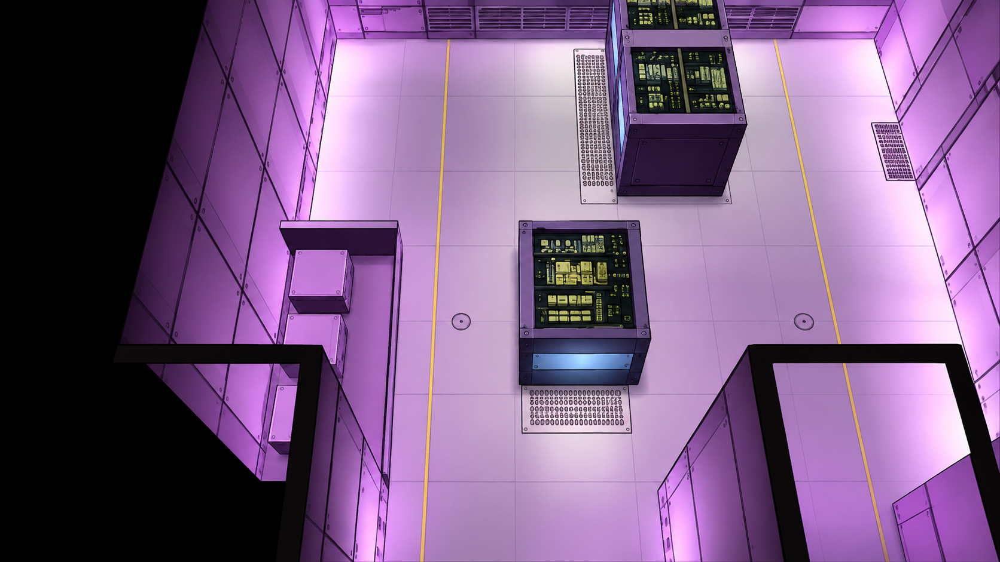
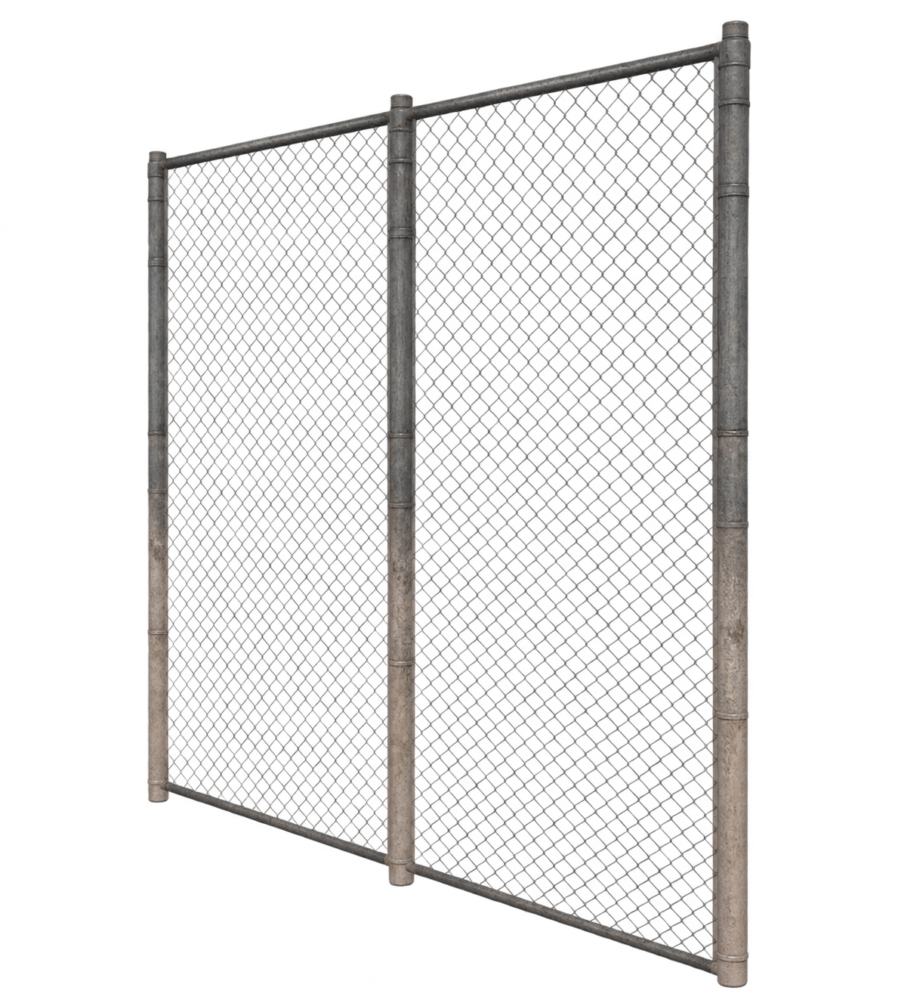
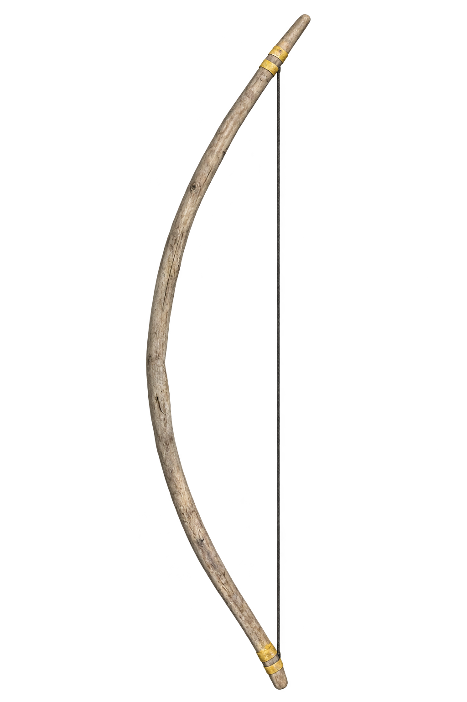
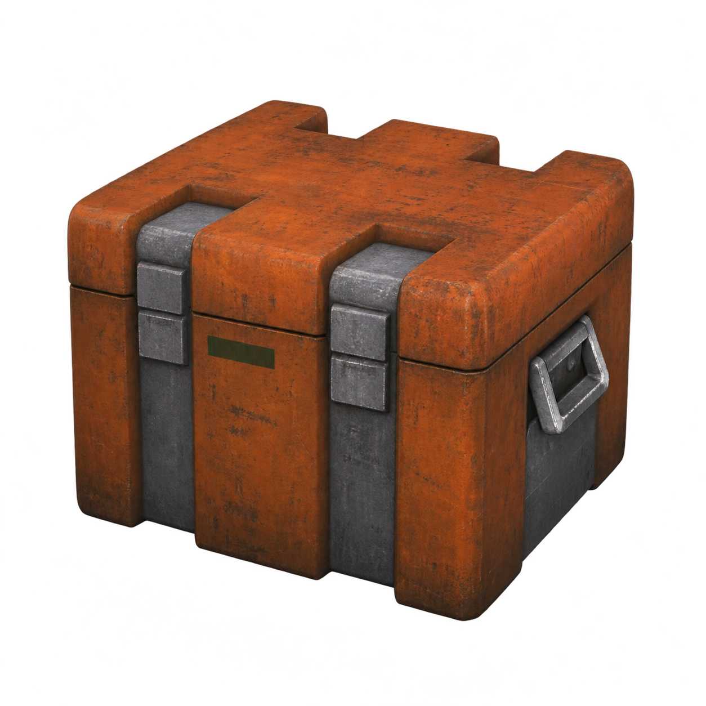
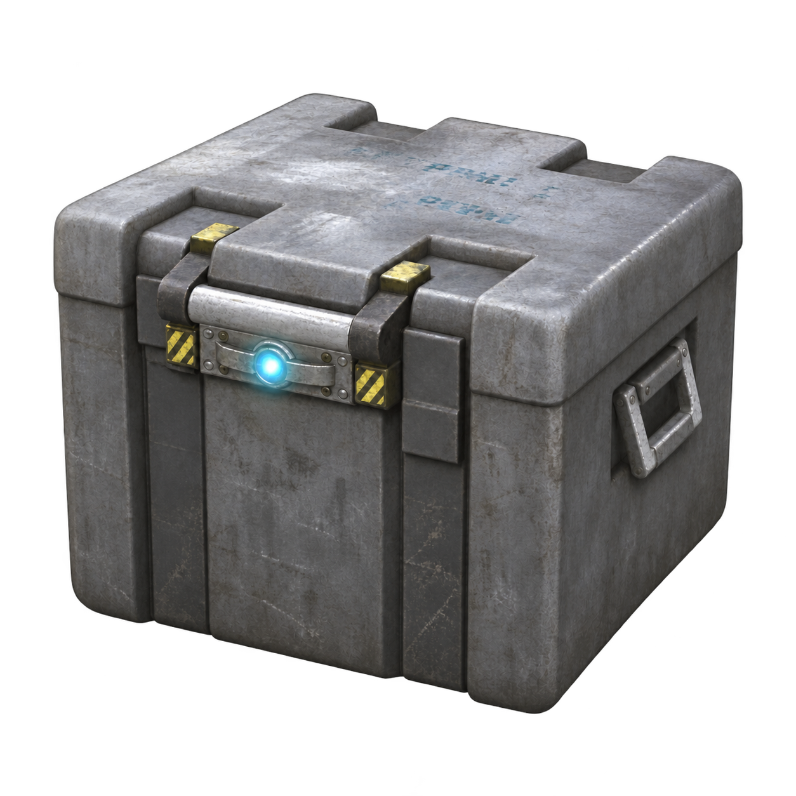
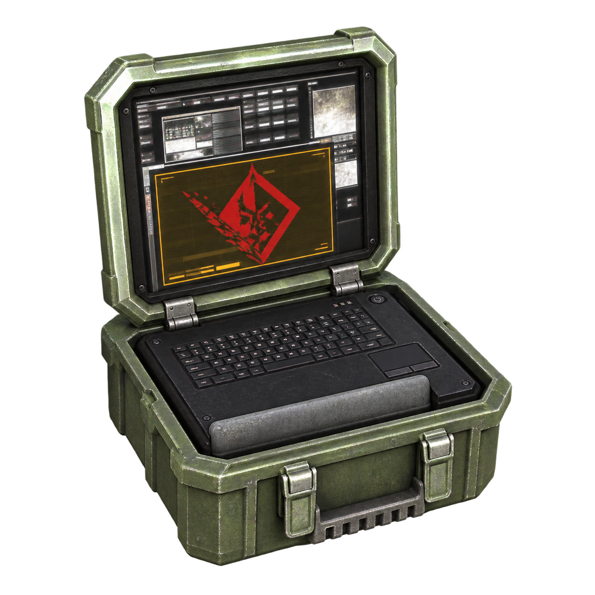

# Continuation P65 — baie AC!D 2 et objets Survive / Revengeance

**26 novembre 2026 — six sources individuelles supplémentaires.** P65 ajoute un fragment de baie technique d’AC!D 2, deux objets de Survive et trois objets de Revengeance. Le total sélectionné passe de **205 à 211**, le catalogue Atlas de **28 à 34 entrées** et le cumul des essais archivés de **14 à 15**. Chaque source retenue possède son propre PNG, son identité, ses références et ses réserves dans le [manifeste P65](../cqc-reprise/pass65/delivery-manifest.json) et les [associations à la bible](asset-associations-p65.json).

La production comprend **7 appels imagegen, 7 PNG produits, 6 retenus, 1 archive et 0 refus**. Un appel a servi à corriger le coffre verrouillé : la v2 est sélectionnée et la v1 reste archivée. Les refus des passes précédentes n’ont pas été relancés. Aucun agrandissement ou traitement mécanique des pixels n’est appliqué aux PNG retenus. Les paramètres et textes exacts sont conservés dans l’[index des prompts](../cqc-reprise/pass65/prompts.json).

| Ajout P65 | Jeu | Type | Sources retenues |
|---|---|---|---:|
| Research Block, fragment de baie technique | AC!D 2 | Décor opaque | 1 |
| Normal Fence, Survival Bow | Survive | Objets isolés avec alpha | 2 |
| Coffre normal, coffre verrouillé v2, terminal de données VR | Revengeance | Objets isolés avec alpha | 3 |
| **Total P65** | **Trois jeux** | **1 décor et 5 objets** | **6** |

## Portée de cette livraison

Les six sources sont ajoutées au [catalogue existant de l’Atlas](../../public/cqc/data/cqc-p63-source-atlas.json), consultable par `/cqc/?module=atlas63`. Le [module de consultation](../../public/cqc/modules/source-atlas-v063.html) conserve son nom et ses commandes. `atlasIntegrated:true` décrit ce raccord documentaire à l’Atlas ; **aucune source P65 n’est admise au combat**.

Les indicateurs communs restent `runtimeIntegrated:false`, `combatRuntimeIntegrated:false`, `combatReady:false`, `absolute1to1Certified:false`, `referenceGeometryValidated:false`, `nativeUhd:false` et `scopeClosed:false`. La fidélité demeure `pending_external_review`. Les revues visuelles retiennent des candidats documentés ; elles ne certifient ni une reproduction absolue 1:1, ni les faces cachées, ni une échelle physique exacte. **Aucun PNG P65 n’est UHD natif.** Aucun mouvement, projectile actif, collision, interaction, plan de caméra ou nouvelle illustration narrative n’est livré par cette passe.

**P64 reste intact.** Les 205 associations et identités de sources antérieures, dont les 11 sources P64, sont préservées, ainsi que les 28 anciennes fiches Atlas et leur ordre. Le contrôle des sources absentes du checkout partiel utilise leurs registres et identités de blobs Git ; les 28 PNG historiques présents localement sont rehachés. Les six `workId` P65 sont des périmètres descriptifs supplémentaires : ils ne modifient pas la photographie historique de **277 lignes**, dont **97 sans correspondance** dans cet audit historique. Aucun secteur, groupe d’objets ou jeu n’est déclaré clos. [Preuve de conservation et de contrôle local](../cqc-reprise/pass65/p65-local-verification.json).

## Galerie des six PNG individuels

Chaque image ci-dessous ouvre son fichier individuel. La galerie est une présentation documentaire ; aucun fichier composite n’est sélectionné.

| AC!D 2 — fragment Research Block | Survive — Normal Fence | Survive — Survival Bow |
|---|---|---|
|  |  |  |
| [Fiche et limites](#acid2-research-block-machinery-bay) · 1672 × 941, RGB | [Fiche et limites](#survive-normal-fence) · 1189 × 1323, RGBA | [Fiche et limites](#survive-survival-bow) · 1024 × 1536, RGBA |

| Revengeance — coffre normal | Revengeance — coffre verrouillé v2 | Revengeance — terminal VR |
|---|---|---|
|  |  |  |
| [Fiche et limites](#mgr-item-box-normal) · 1254 × 1254, RGBA | [Fiche et limites](#mgr-item-box-locked) · 1254 × 1254, RGBA | [Fiche et limites](#mgr-vr-data-terminal) · 1254 × 1254, RGBA |

## Associations aux rubriques du guide

Les rubriques sont reprises sans renumérotation des [associations P65](asset-associations-p65.json) et de la [carte du guide](guide-map.json). Elles expriment les exigences liées à chaque source et les dépendances restant à satisfaire ; leur présence n’annonce pas l’implémentation de ces fonctions.

| Source | `workId` descriptif | Rubriques du guide |
|---|---|---|
| Fragment Research Block | `stage:acid2_research_block_machinery_bay` | 02, 13, 14, 15, 17, 19, 25, 26, 27, 29 |
| Normal Fence | `prop:survive_normal_fence` | 02, 13, 14, 15, 17, 18, 25, 26, 27, 29 |
| Survival Bow | `prop:survive_survival_bow` | 02, 05, 15, 16, 17, 18, 25, 26, 27, 29 |
| Coffre normal | `prop:mgr_item_box_normal` | 02, 13, 15, 17, 19, 25, 26, 27, 29 |
| Coffre verrouillé | `prop:mgr_item_box_locked` | 02, 13, 15, 17, 19, 25, 26, 27, 29 |
| Terminal VR | `prop:mgr_vr_data_terminal` | 02, 13, 15, 17, 19, 25, 26, 27, 29 |

Les rubriques communes couvrent la fidélité et les sources (02), la production des assets (17), les inventaires (25), la validation (26), les fiches types (27) et les références (29). Les autres associations concernent les movesets et ressources (05), la composition des arènes (13), les arènes vivantes et statiques (14), les connexions et interactions (15), les ennemis et projectiles (16), l’animation, les VFX, le son et la caméra (18), ou l’interface et l’expérience (19). Par exemple, le lien du bow à la rubrique 16 conserve la question de ses projectiles : il ne fournit aucune flèche ni comportement de tir.

## Fiches des six sources

### AC!D 2 — Research Block, fragment de baie technique

[PNG individuel](../../public/cqc/assets/p65/acid2-research-block-machinery-bay.png) · [Fiche Atlas](../../public/cqc/modules/source-atlas-v063.html?asset=acid2-research-block-machinery-bay) · [Prompt exact](../cqc-reprise/pass65/research/acid2/prompt-research-block-machinery-bay.txt)

**Identité :** `asset:p65:acid2-research-block-machinery-bay`, v1, 1672 × 941, RGB opaque. **Périmètre :** `stage:acid2_research_block_machinery_bay`. **Rubriques :** `02`, `13`, `14`, `15`, `17`, `19`, `25`, `26`, `27`, `29`. **Documents associés :** cette continuation, [Fiches et validation](FICHES_ET_VALIDATION.md), [Arènes et boss](ARENES_ET_BOSS.md).

**Référence et contenu observé.** La source visuelle est une vignette native de **336 × 188 pixels**, attribuée au Stage 04 Research Block par le titre de la vidéo de chaffXgrenade, « Metal Gear Ac!d 2 Walkthrough - 07 - Stage 04: Research Block (2) ». La vue élevée et oblique montre deux îlots techniques sombres en enfilade, des parois mauves, un sol clair lilas quadrillé, deux lignes jaunes et des coupes noires au premier plan. Le grand îlot arrière dépasse le cadrage supérieur. La [vignette conservée](../cqc-reprise/pass65/research/acid2/references/research-block-2-native-thumbnail.png) est la preuve visuelle locale ; la [vidéo de référence](https://www.youtube.com/watch?v=7H7vIk6QXJE), l’[autre séquence repérée](https://www.youtube.com/watch?v=k8iS-ao5PcA) et le [walkthrough documentaire](https://gamefaqs.gamespot.com/psp/928434-metal-gear-acid-2/faqs/40367) conservent l’attribution et le contexte.

**Adaptation retenue.** Le PNG reprend ce fragment et ce point de vue. Les personnages, robots, portraits, compteurs, carte et compas ont été retirés. Les petites zones ainsi découvertes prolongent les motifs voisins du sol ou des parois. Les îlots et les couloirs restent dans leurs rapports visibles ; la coupe noire périphérique fait partie du décor opaque. Les circuits, vis, grilles et joints sont détaillés par reconstruction.

**Limites.** Aucun minutage exact de la vignette n’est établi et la lecture de la séquence complète n’a pas été validée. Cette image ne fournit ni le plan complet de la salle, ni les sorties, autres pièces, parcours ou rencontres du Research Block. Elle ne remplace pas une arène CQC latérale : conversion de caméra, collisions et circulation restent ouvertes. La revue indépendante conserve la source comme **fragment de baie technique uniquement**, avec des microdétails et portions masquées extrapolés. [Revue visuelle](../cqc-reprise/pass65/research/root-visual-qa.json).

### Survive — Normal Fence

[PNG individuel](../../public/cqc/assets/p65/survive-normal-fence.png) · [Fiche Atlas](../../public/cqc/modules/source-atlas-v063.html?asset=survive-normal-fence) · [Prompt exact](../cqc-reprise/pass65/research/survive/prompt-normal-fence.txt)

**Identité :** `asset:p65:survive-normal-fence`, v1, 1189 × 1323, RGBA. **Périmètre :** `prop:survive_normal_fence`. **Rubriques :** `02`, `13`, `14`, `15`, `17`, `18`, `25`, `26`, `27`, `29`. **Documents associés :** cette continuation, [Fiches et validation](FICHES_ET_VALIDATION.md), [Combat](COMBAT.md).

**Référence et contenu observé.** La [capture native atwiki](../cqc-reprise/pass65/research/survive/references/normal-fence-atwiki-220401_01.jpg), publiée dans le [guide de placement des barrières](https://w.atwiki.jp/mgsurvive/pages/111.html), montre le module complet à droite de l’image : **deux panneaux grillagés, trois montants, des rails supérieurs et inférieurs**, sans pieds rapportés. Une [seconde capture native](../cqc-reprise/pass65/research/survive/references/normal-fence-gameranx-20180222143434.jpg) associe visiblement ce modèle au libellé Normal Fence dans le [chapitre 4 de Gameranx](https://gameranx.com/features/id/139663/article/metal-gear-survive-walkthrough-chapter-4-the-wormhole-transporter/).

**Adaptation retenue.** Le module est isolé dans la même perspective oblique, avec sa structure simple et ses extrémités complètes. Le joueur, la barrière vue sur chant, la tourelle, le sol et l’interface de la référence sont retirés. Les fils, leur épaisseur, les raccords et la texture du métal sont reconstruits. Aucun bloc de béton, pied, fil barbelé, lumière ou panneau supplémentaire n’est ajouté. Les ouvertures du maillage utilisent réellement le canal alpha.

**Limites.** Le PNG ne détermine pas l’échelle de jeu, les collisions, la résistance, l’effondrement, le franchissement ou une logique défensive. Les faces et détails non lisibles dans la capture restent interprétés. L’alpha couvre la plage 0–255, avec **56,497 % de pixels entièrement transparents** ; quelques résidus très faibles subsistent en dehors du contour utile. Au seuil alpha 16, le sujet ne touche aucun bord du canevas. Les traces rouges apparentes dans certains aperçus correspondent à des zones de faible alpha documentées ; transparence réelle ne signifie pas détourage mathématiquement parfait. [Mesures et provenance](../cqc-reprise/pass65/research/survive/handoff.json) · [Revue indépendante](../cqc-reprise/pass65/research/root-visual-qa.json).

### Survive — Survival Bow

[PNG individuel](../../public/cqc/assets/p65/survive-survival-bow.png) · [Fiche Atlas](../../public/cqc/modules/source-atlas-v063.html?asset=survive-survival-bow) · [Prompt exact](../cqc-reprise/pass65/research/survive/prompt-survival-bow.txt)

**Identité :** `asset:p65:survive-survival-bow`, v1, 1024 × 1536, RGBA. **Périmètre :** `prop:survive_survival_bow`. **Rubriques :** `02`, `05`, `15`, `16`, `17`, `18`, `25`, `26`, `27`, `29`. **Documents associés :** cette continuation, [Fiches et validation](FICHES_ET_VALIDATION.md), [Combat](COMBAT.md).

**Référence et contenu observé.** Le [menu Craft conservé](../cqc-reprise/pass65/research/survive/references/survival-bow-craft-20180222142556.jpg) sélectionne explicitement **Survival Bow**. Son aperçu montre un long arc simple en bois pâle usé, de petites bandes jaunes aux deux extrémités et une corde. Cette capture appartient à la [galerie du chapitre 4 de Gameranx](https://gameranx.com/features/id/139663/article/metal-gear-survive-walkthrough-chapter-4-the-wormhole-transporter/). Le panneau central d’information masque une partie du bois.

**Adaptation retenue.** Le PNG présente un seul arc entier, dressé, avec le bois courbé à gauche et la corde à droite. La portion médiane masquée est reconstruite comme une continuité simple du bois, sans accessoire. Les mains, le personnage, les menus et le décor sont retirés ; aucune flèche, aucun carquois, viseur ou mécanisme d’arc à poulies n’est ajouté. L’espace entre le bois et la corde est transparent.

**Limites.** La continuité du bois reste une extrapolation, pas une vue native supplémentaire. Les usages, animations de tension, flèches, trajectoires, dégâts et raccords de main ne sont pas fournis. L’alpha natif va de 0 à 254 et **93,846 % des pixels sont entièrement transparents**. Un aperçu qui expose les couleurs RGB sans appliquer correctement l’alpha peut montrer un halo brun ; les mesures du PNG restent la preuve de la transparence. De très faibles résidus alpha sont conservés, sans sujet touchant le bord au seuil 16. [Mesures et provenance](../cqc-reprise/pass65/research/survive/handoff.json) · [Revue indépendante](../cqc-reprise/pass65/research/root-visual-qa.json).

### Revengeance — coffre d’objets normal

[PNG individuel](../../public/cqc/assets/p65/mgr-item-box-normal.png) · [Fiche Atlas](../../public/cqc/modules/source-atlas-v063.html?asset=mgr-item-box-normal) · [Prompts MGR](../cqc-reprise/pass65/research/mgr/prompts.json)

**Identité :** `asset:p65:mgr-item-box-normal`, v1, 1254 × 1254, RGBA. **Périmètre :** `prop:mgr_item_box_normal`. **Rubriques :** `02`, `13`, `15`, `17`, `19`, `25`, `26`, `27`, `29`. **Documents associés :** cette continuation, [Fiches et validation](FICHES_ET_VALIDATION.md), [Combat](COMBAT.md).

**Référence et contenu observé.** La capture du **manuel officiel PC, page 11**, montre le coffre orange avec deux renforts sur la face visible et une poignée latérale droite. Le [manuel distribué sur Steam](https://shared.fastly.steamstatic.com/store_item_assets/steam/apps/235460/manuals/MGR_PC_manual_English.pdf?t=1718869136) et la [référence locale](../cqc-reprise/pass65/research/mgr/mgr-item-box-normal-reference.png) établissent la provenance de cette apparence du jeu final.

**Adaptation retenue.** Un seul coffre entier est isolé sur alpha. Ses volumes, les renforts et la poignée sont conservés ; la lumière, l’usure, les rayures, les joints et les détails de serrure sont reconstruits. La revue indépendante relève un orange plus lumineux et une usure plus détaillée que dans la capture sombre. Le petit rectangle frontal reste sans texte lisible. Aucun personnage, sol, contenu du coffre ou autre objet n’est repris.

**Limites.** Les faces cachées, l’échelle, l’ouverture, le contenu, les états interactifs et les collisions restent non validés. Quelques fines franges rouge/jaune sont visibles sur certaines arêtes supérieures et gauches. L’alpha est réel, mais la source garde ces réserves de contour. Elle ne constitue pas un coffre fonctionnel ou un mécanisme de récompense dans CQC. [Revue visuelle indépendante MGR](../cqc-reprise/pass65/research/mgr/independent-visual-qa.json).

### Revengeance — coffre d’objets verrouillé, v2 retenue

[PNG individuel retenu](../../public/cqc/assets/p65/mgr-item-box-locked.png) · [Fiche Atlas](../../public/cqc/modules/source-atlas-v063.html?asset=mgr-item-box-locked) · [Essai v1 archivé](../cqc-reprise/pass65/rejected/mgr-item-box-locked-v1.png) · [Prompts MGR](../cqc-reprise/pass65/research/mgr/prompts.json)

**Identité :** `asset:p65:mgr-item-box-locked`, **v2**, 1254 × 1254, RGBA. **Périmètre :** `prop:mgr_item_box_locked`. **Rubriques :** `02`, `13`, `15`, `17`, `19`, `25`, `26`, `27`, `29`. **Documents associés :** cette continuation, [Fiches et validation](FICHES_ET_VALIDATION.md), [Combat](COMBAT.md).

**Référence et contenu observé.** La [capture locale du manuel](../cqc-reprise/pass65/research/mgr/mgr-item-box-locked-reference.png), issue du [manuel officiel PC, page 11](https://shared.fastly.steamstatic.com/store_item_assets/steam/apps/235460/manuals/MGR_PC_manual_English.pdf?t=1718869136), identifie le coffre métallique verrouillé par son verrou horizontal, son signal cyan et ses accents jaune/noir. La silhouette reste celle d’un coffre entier, avec poignée.

**Adaptation et sélection.** Le premier PNG comportait des excroissances blanches irrégulières sur le contour supérieur. Une correction ciblée par imagegen a produit la v2 retenue ; la v1 est conservée comme archive distincte et exclue de l’Atlas. La v2 supprime les gros fragments blancs, conserve les volumes, la poignée, le verrou et les éléments d’identification. L’arête supérieure est désormais fine et continue.

**Limites.** La correction a également réinterprété le grain métallique, devenu plus marbré ou ondulé : elle n’est pas présentée comme un changement strictement limité aux pixels de bord. La référence est trop petite pour certifier les rivets, marques bleues, textures et lueur cyan. Quelques liserés ou points colorés infimes subsistent à fort contraste. Aucune ouverture, découpe, destruction ou interaction de verrou n’est intégrée. [Comparaison indépendante de la référence, de la v1 et de la v2](../cqc-reprise/pass65/research/mgr/independent-visual-qa.json).

### Revengeance — terminal de données VR

[PNG individuel](../../public/cqc/assets/p65/mgr-vr-data-terminal.png) · [Fiche Atlas](../../public/cqc/modules/source-atlas-v063.html?asset=mgr-vr-data-terminal) · [Prompts MGR](../cqc-reprise/pass65/research/mgr/prompts.json)

**Identité :** `asset:p65:mgr-vr-data-terminal`, v1, 1254 × 1254, RGBA. **Périmètre :** `prop:mgr_vr_data_terminal`. **Rubriques :** `02`, `13`, `15`, `17`, `19`, `25`, `26`, `27`, `29`. **Documents associés :** cette continuation, [Fiches et validation](FICHES_ET_VALIDATION.md), [Combat](COMBAT.md).

**Référence et contenu observé.** Le terminal est documenté dans le [manuel officiel PC, page 14](https://shared.fastly.steamstatic.com/store_item_assets/steam/apps/235460/manuals/MGR_PC_manual_English.pdf?t=1718869136). La [référence locale de 315 × 178 pixels](../cqc-reprise/pass65/research/mgr/mgr-vr-data-terminal-reference.png) montre un ordinateur ouvert dans une valise olive, avec clavier, écran, fermoirs et poignée. Cette forme portable est conservée.

**Adaptation retenue.** Le PNG isole l’ordinateur et son boîtier en un seul objet entier. Clavier, pavé tactile, charnières, poignée, petite quincaillerie et interface d’écran sont reconstruits à partir de la petite capture. Le motif rouge et les panneaux ou traits visibles sur l’écran sont une interprétation graphique. Le décor entourant le terminal est retiré, sans ajout d’un pied, d’une caisse ou d’un autre objet.

**Limites.** Aucun caractère d’écran, pictogramme ou microdétail n’est certifié pixel pour pixel. De très fines franges vert/jaune subsistent sur le boîtier et sous la poignée. Les faces cachées, l’échelle, la manipulation et une fonction de déverrouillage de missions VR ne sont pas fournies. La présence de cette source dans l’Atlas ne modifie aucun mode de jeu. [Revue visuelle indépendante MGR](../cqc-reprise/pass65/research/mgr/independent-visual-qa.json).

## Archive et comptabilité

| Élément écarté | Motif | Statut |
|---|---|---|
| [Coffre verrouillé v1](../cqc-reprise/pass65/rejected/mgr-item-box-locked-v1.png), 1254 × 1254 RGBA | Excroissances blanches et franges colorées sur le contour supérieur ; v2 préférée après revue | `selected:false`, `atlasIntegrated:false`, hors runtime |

Cette archive est un fichier distinct de 1 666 588 octets, SHA-256 `3bf1b6f3d29f5c10889f872a41a4d50c77c0932867d647691798c68a1e01a785`. Elle compte comme la quinzième archive cumulée, sans accroître les 211 sources retenues ou les 34 fiches Atlas. Les six PNG retenus totalisent **10 018 687 octets**. Le [manifeste](../cqc-reprise/pass65/delivery-manifest.json) contient les dimensions, formats, SHA-256, SHA de blobs Git et statistiques alpha de chacun des sept fichiers produits.

## Vérifications et niveau de preuve

Les résultats ci-dessous décrivent les preuves locales enregistrées le **26 novembre 2026 à 09:32 (Paris)**. Les tests et contrôles structurels ne remplacent pas une vérification du parcours dans un navigateur ni une certification de fidélité.

| Contrôle | Résultat documenté | Preuve |
|---|---|---|
| Tests Node Atlas / P64 / P65 | **30 réussis, 0 échec** | [Sortie des tests](../cqc-reprise/pass65/p65-node-tests.txt) |
| Intégrité des PNG P65 | **7 fichiers contrôlés**, dont 6 retenus et 1 archive : structure, CRC, décompression, dimensions, empreintes et alpha | [Vérificateur P65, statut `passed`](../cqc-reprise/pass65/p65-local-verification.json) |
| Cohérence manifeste, bible et Atlas | Six identités associées ; archive exclue ; 211 sources sélectionnées et 34 entrées Atlas | [Vérificateur P65](../cqc-reprise/pass65/p65-local-verification.json) |
| Préservation des sources et fiches antérieures | 205 identités historiques et 28 anciennes entrées Atlas inchangées ; shell, contrôleur et style préservés | [Vérificateur P65](../cqc-reprise/pass65/p65-local-verification.json), [contrôle historique](../cqc-reprise/pass65/historical-sources-verification.json) |
| Graphe statique runtime | **3 047 fichiers et 4 983 références** ; 6 fichiers et 6 références ajoutés ; 3 040 anciennes lignes inchangées, seul le catalogue change parmi les anciens propriétaires | [Vérificateur P65](../cqc-reprise/pass65/p65-local-verification.json) |
| Routes et omissions du socle | 740 omissions et 499 routes externes préservées ; 4 977 références antérieures conservées | [Vérificateur P65](../cqc-reprise/pass65/p65-local-verification.json) |
| Revue visuelle AC!D 2 et Survive | Trois sources retenues avec limites de référence, reconstruction et alpha explicites | [Revue indépendante](../cqc-reprise/pass65/research/root-visual-qa.json) |
| Revue visuelle Revengeance | Trois objets retenus ; coffre verrouillé v2 préféré ; réserves de texture, interface et franges consignées | [Revue indépendante MGR](../cqc-reprise/pass65/research/mgr/independent-visual-qa.json) |
| Déploiement et parcours navigateur P65 | **Non encore vérifiés dans les preuves disponibles** ; aucun aperçu P65 annoncé | Le [blocage Vercel de P64](../cqc-reprise/pass64/p64-browser-verification.json) est historique et ne démontre aucun résultat P65. |

Le [contrat d’intégration](../cqc-reprise/pass65/INTEGRATION_QA.md) expose les invariants et les commandes de contrôle. Le résultat local `passed` établit une intégrité de fichiers et un graphe statique cohérent ; il ne vaut ni exécution du combat, ni rendu navigateur validé. La passe P64 avait rencontré la limite Vercel « Deployment rate limited — retry in 24 hours. » ; aucune disponibilité d’un déploiement P65 n’en est déduite.

## Périmètres encore ouverts

Le fragment Research Block laisse ouverts le reste du secteur et ses connexions. Les deux objets Survive complètent la documentation matérielle, sans fermer l’inventaire de ses équipements ou de ses machines. Les trois objets MGR ne ferment aucun ensemble de collectables, de salles ou d’interactions.

La [recherche Survive](../cqc-reprise/pass65/research/survive/handoff.json) conserve notamment Forsaken Ruins, le Wormhole Transporter, la Machine Gun Turret, l’Air Shock Cannon et le projectile ennemi Mortar comme sujets encore ouverts. La carte tactique de Forsaken Ruins est inspectée, mais aucune vue native de terrain suffisamment exploitable n’est retenue pour générer le décor. Les images d’un port dans MGSV TPP sont distinguées des captures natives de Survive. Le projectile Mortar n’a pas été remplacé par un cristal générique, un leurre Kuban ou un obus d’arme construite. Les identités documentaires de Harley Warren et Joel Marton ne reçoivent aucun corps inventé.

Les [fiches P64](CONTINUATION_P64.md), leurs réserves, leurs archives et les refus antérieurs sont conservés. La suite doit réunir de nouvelles références visuelles pertinentes pour les manques restants, puis maintenir des états séparés pour la source fixe, l’intégration à l’Atlas, l’usage jouable, la validation et la publication.
