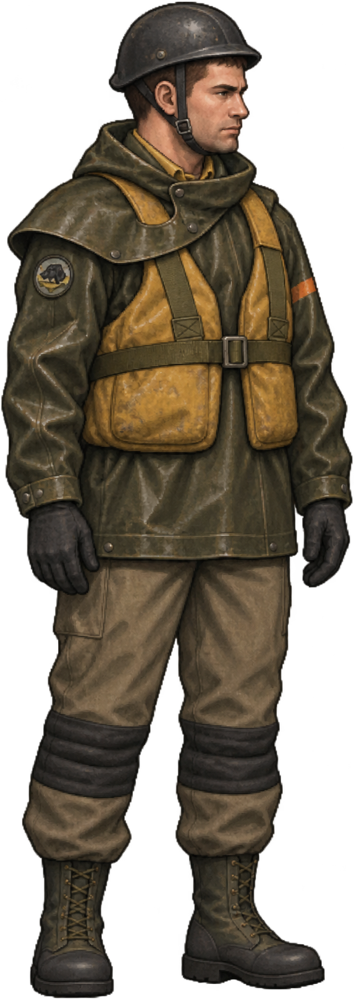

# Quart de pluie — passerelle

**Tenue originale CQC proposée pour le Diamond Dogs Scout.** Sur une passerelle exposée aux embruns, le personnage porte un ciré olive à col court asymétrique, un gilet de flottaison ocre à deux poches, une coque de protection sombre et des gants noirs. Une bande orange sur la manche se lit même à petite échelle. La pose debout, mains libres, exprime une relève sur le pont. Le visage, les sections sombres aux genoux et les bottes repartent de l’Original du même UID. Ce dessin est indépendant des tenues officielles du jeu.

| Élément | Valeur |
|---|---|
| Profil | `completion44__diamond_dogs_scout_44` |
| Nouvelle tenue de studio | `p53-original--quart-de-pluie-passerelle` |
| Production | 1 figure statique vers la droite, PNG RGBA. |
| Source | [Planche Original pass18, commit de base](https://github.com/darknigthmare/shadow-codec-ops/blob/3df6d0dd30b5a929495b01783a3594a29fa64a24/public/cqc/assets/combat-sprites-pass18/completion44__diamond_dogs_scout_44/right-v1.png), rectangle P52 `[92, 9, 180, 317]`. |
| Statut | Concept à revoir ; ni ajout à la garde-robe du jeu, ni certification d’apparition dans MGSV. |

[PNG brut intact](dd-scout-quart-de-pluie-right-raw-v1.png) · [Sprite découpé](dd-scout-quart-de-pluie-right.png) · [Rectangle, pivot et empreintes](costume.json) · [Consigne de dessin](prompt.json).

La configuration officielle recherchée « équipement tactique — gilet et casque » reste non résolue. Le [registre P52](../../../pass52/static-poses/inventaires/OFFICIAL416_REFERENCE_DISPOSITIONS_PRIVATE_V1.json) distingue déjà l’illustration préparatoire casque/gilet et les corps réellement vus dans *The Phantom Pain*. Le gilet de flottaison et le ciré du présent dessin sont des choix de conception pour le quai ; ni le gilet ni la coque ne servent de preuve pour cette ligne officielle.
