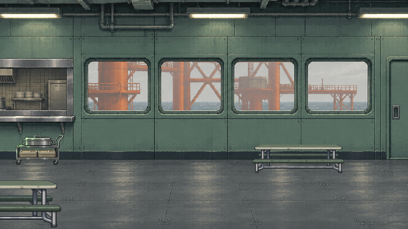

# Big Shell · Strut C · Salle à manger

L’arène reprend la ligne `mgs2_strut_c` de l’audit du 23 octobre. En Versus, sélectionner **BIG SHELL · STRUT C · SALLE À MANGER**. Le service de restauration et les baies qui donnent sur les structures orange de Big Shell situent la salle. Le chariot et les tables ont leurs propres appuis et vitesses de parallaxe. L’espace central reste libre pour le duel.

Les trois images sont des créations pour l’adaptation latérale du jeu. La géométrie est interprétée. Les essais du module couvrent les deux plans de rendu, les trois positions de caméra (−220, 0, +220), les trois zooms (0,76 / 1 / 1,15) et le mode de mouvement réduit. L’aperçu reproduit les coordonnées du moteur à 800 × 450, sans combattants.

[Décor et accessoires PNG](../../../../public/cqc/assets/p53-service-yard/) · [Module de rendu](../../../../public/cqc/src/cqc-p53-service-yard.js)
