# Galerie des sources CQC — P60 + P61

**172 PNG sélectionnés : 132 de P61 et 40 de P60.** Une miniature correspond à une source. Les sections regroupent les libellés synonymes d’un même jeu ; chaque fiche conserve son épisode ou son édition d’origine, tels qu’ils figurent dans le [manifeste de livraison](delivery-manifest.json).

**Sources statiques candidates : fidélité 1:1 non certifiée, couverture complète des variantes non certifiée, aucune animation ou intégration au jeu admise par cette galerie.** Les réserves propres à chaque source figurent dans la [galerie avec recherche et filtres](galerie.html) et dans son manifeste.

[Ouvrir la galerie avec filtres](galerie.html) · [Manifeste de livraison](delivery-manifest.json) · [PR #25](https://github.com/darknigthmare/shadow-codec-ops/pull/25)

| Catégorie | Sources sélectionnées |
|---|---:|
| Stages | 102 |
| Personnages | 17 |
| Costumes | 7 |
| Machines | 45 |
| Effets visuels | 1 |

**26 groupes de jeux et d’éditions** remplacent les 52 libellés d’épisode du manifeste dans la navigation. MGS2 Substance, MGS1 Integral / VR Missions, MGS3 PS2, Delta, FOX HUNT et le DLC Jetstream restent distingués. Les précisions PSP, année, mission et modèle restent visibles sur chaque fiche.

Les chemins relatifs fonctionnent dans un checkout complet et sur GitHub. Les sources P60 peuvent être absentes du checkout local partiel : les liens **PNG GitHub** et **Manifeste GitHub** ouvrent alors les fichiers de la branche de livraison. Les miniatures sont des images individuelles, sans collage.

## Stages — 102 sources

<strong>MGS1 — Metal Gear Solid</strong> — 6 sources

| Source | Source |
|---|---|
| <!-- asset-path:public/cqc/assets/p61/mgs1-blast-furnace.png --><a href="../../../public/cqc/assets/p61/mgs1-blast-furnace.png">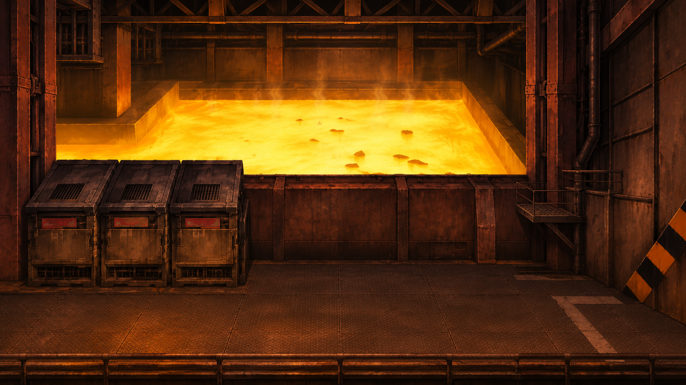</a> <strong>MGS1 — Blast Furnace</strong> P61 · Metal Gear Solid (1998) 1672 × 941 px <a href="../../../public/cqc/assets/p61/mgs1-blast-furnace.png">PNG</a> · <a href="https://github.com/darknigthmare/shadow-codec-ops/blob/codex/cqc-p61-missing-static-sources-20261125/public/cqc/assets/p61/mgs1-blast-furnace.png">PNG GitHub</a> · <a href="../../../docs/cqc-reprise/pass61/batches/mgs1-blast-furnace.json">Manifeste</a> · <a href="https://github.com/darknigthmare/shadow-codec-ops/blob/codex/cqc-p61-missing-static-sources-20261125/docs/cqc-reprise/pass61/batches/mgs1-blast-furnace.json">Manifeste GitHub</a> Références : <a href="https://samurai-gamers.com/wp-content/uploads/2023/08/Metal-Gear-Solid-MGS-Blast-Furnace-Underground-Warehouse-Walkthrough-1-MGS1.jpg">1</a> · <a href="https://samurai-gamers.com/metal-gear-solid/main-story-walkthrough-2/">2</a> <a href="galerie.html#source-018">Carte et réserves détaillées</a> | <!-- asset-path:public/cqc/assets/p61/mgs1-cargo-dock.png --><a href="../../../public/cqc/assets/p61/mgs1-cargo-dock.png">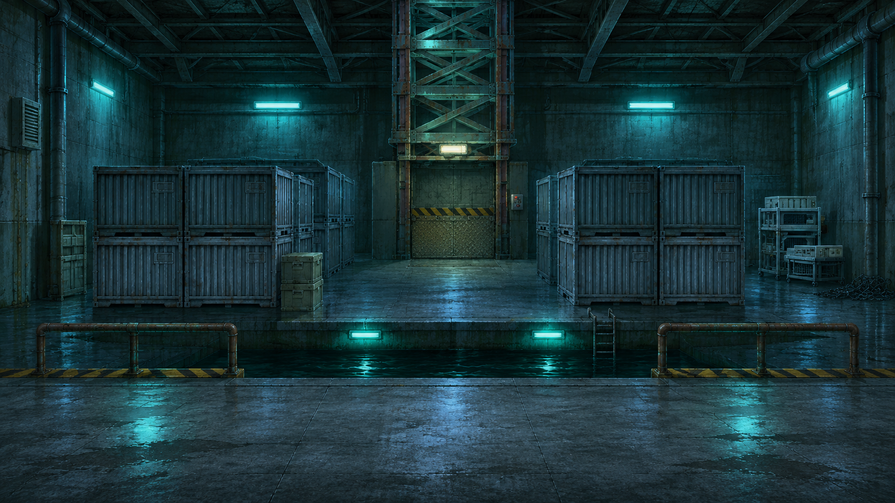</a> <strong>MGS1 — Cargo Dock</strong> P61 · Metal Gear Solid (1998) 1672 × 941 px <a href="../../../public/cqc/assets/p61/mgs1-cargo-dock.png">PNG</a> · <a href="https://github.com/darknigthmare/shadow-codec-ops/blob/codex/cqc-p61-missing-static-sources-20261125/public/cqc/assets/p61/mgs1-cargo-dock.png">PNG GitHub</a> · <a href="../../../docs/cqc-reprise/pass61/batches/mgs1-cargo-dock.json">Manifeste</a> · <a href="https://github.com/darknigthmare/shadow-codec-ops/blob/codex/cqc-p61-missing-static-sources-20261125/docs/cqc-reprise/pass61/batches/mgs1-cargo-dock.json">Manifeste GitHub</a> Références : <a href="https://metalgear.konami.net/manual/mc1/mgs1/pc/en/page19.html">1</a> · <a href="https://samurai-gamers.com/wp-content/uploads/2023/08/Metal-Gear-Solid-MGS-Loading-Docks-Tank-Hangar-Armory-Walkthrough-1.jpg">2</a> <a href="galerie.html#source-019">Carte et réserves détaillées</a> |
| <!-- asset-path:public/cqc/assets/p61/mgs1-cargo-elevator.png --><a href="../../../public/cqc/assets/p61/mgs1-cargo-elevator.png">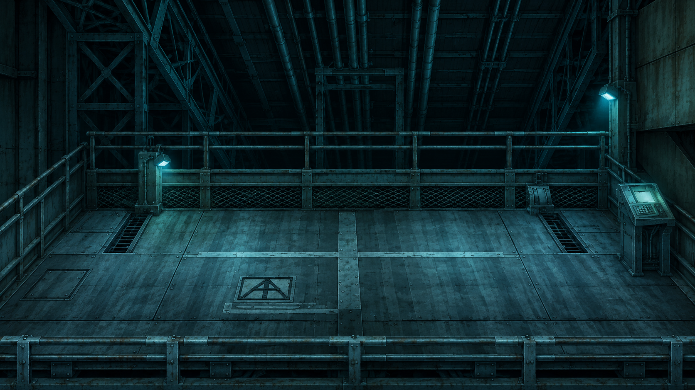</a> <strong>MGS1 — Cargo Elevator</strong> P61 · Metal Gear Solid (1998) 1672 × 941 px <a href="../../../public/cqc/assets/p61/mgs1-cargo-elevator.png">PNG</a> · <a href="https://github.com/darknigthmare/shadow-codec-ops/blob/codex/cqc-p61-missing-static-sources-20261125/public/cqc/assets/p61/mgs1-cargo-elevator.png">PNG GitHub</a> · <a href="../../../docs/cqc-reprise/pass61/batches/mgs1-cargo-elevator.json">Manifeste</a> · <a href="https://github.com/darknigthmare/shadow-codec-ops/blob/codex/cqc-p61-missing-static-sources-20261125/docs/cqc-reprise/pass61/batches/mgs1-cargo-elevator.json">Manifeste GitHub</a> Références : <a href="https://samurai-gamers.com/wp-content/uploads/2023/08/Metal-Gear-Solid-MGS-Blast-Furnace-Underground-Warehouse-Walkthrough-2-MGS1.jpg">1</a> · <a href="https://metalgear.konami.net/manual/mc1/mgs1/pc/en/page04.html">2</a> <a href="galerie.html#source-020">Carte et réserves détaillées</a> | <!-- asset-path:public/cqc/assets/p61/mgs1-wolf-cave.png --><a href="../../../public/cqc/assets/p61/mgs1-wolf-cave.png">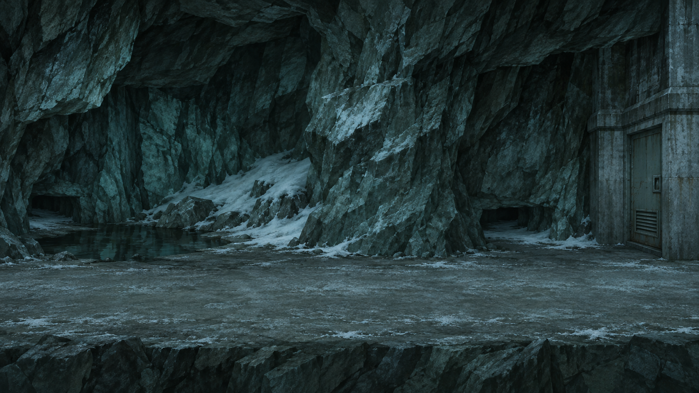</a> <strong>MGS1 — Cave / loups</strong> P61 · Metal Gear Solid (1998) 1672 × 941 px <a href="../../../public/cqc/assets/p61/mgs1-wolf-cave.png">PNG</a> · <a href="https://github.com/darknigthmare/shadow-codec-ops/blob/codex/cqc-p61-missing-static-sources-20261125/public/cqc/assets/p61/mgs1-wolf-cave.png">PNG GitHub</a> · <a href="../../../docs/cqc-reprise/pass61/batches/mgs1-wolf-cave.json">Manifeste</a> · <a href="https://github.com/darknigthmare/shadow-codec-ops/blob/codex/cqc-p61-missing-static-sources-20261125/docs/cqc-reprise/pass61/batches/mgs1-wolf-cave.json">Manifeste GitHub</a> Références : <a href="https://oapboap.org/lets-play/mgs/page-6/">1</a> · <a href="https://mgcvt.com/guide/mgs1/chart4.htm">2</a> <a href="galerie.html#source-021">Carte et réserves détaillées</a> |
| <!-- asset-path:public/cqc/assets/p61/mgs1-jeep-escape.png --><a href="../../../public/cqc/assets/p61/mgs1-jeep-escape.png">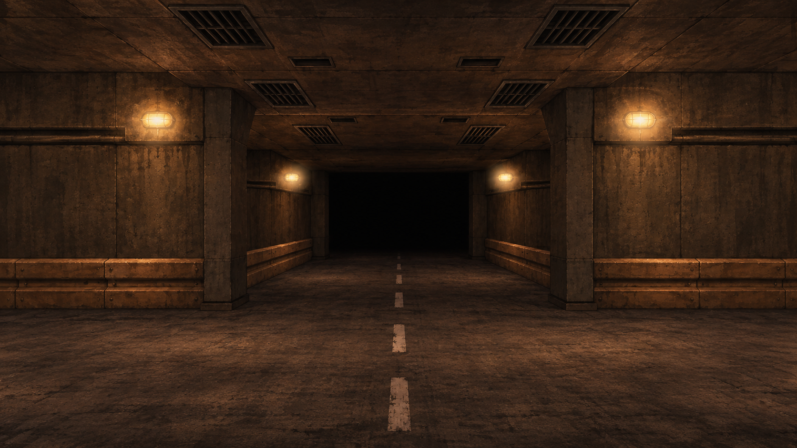</a> <strong>MGS1 — Supply Route / tunnel de fuite</strong> P61 · Metal Gear Solid (1998) 1672 × 941 px <a href="../../../public/cqc/assets/p61/mgs1-jeep-escape.png">PNG</a> · <a href="https://github.com/darknigthmare/shadow-codec-ops/blob/codex/cqc-p61-missing-static-sources-20261125/public/cqc/assets/p61/mgs1-jeep-escape.png">PNG GitHub</a> · <a href="../../../docs/cqc-reprise/pass61/batches/mgs1-jeep-escape.json">Manifeste</a> · <a href="https://github.com/darknigthmare/shadow-codec-ops/blob/codex/cqc-p61-missing-static-sources-20261125/docs/cqc-reprise/pass61/batches/mgs1-jeep-escape.json">Manifeste GitHub</a> Références : <a href="https://oapboap.org/lets-play/mgs/page-14/">1</a> <a href="galerie.html#source-022">Carte et réserves détaillées</a> | <!-- asset-path:public/cqc/assets/p61/mgs1-first-wolf.png --><a href="../../../public/cqc/assets/p61/mgs1-first-wolf.png">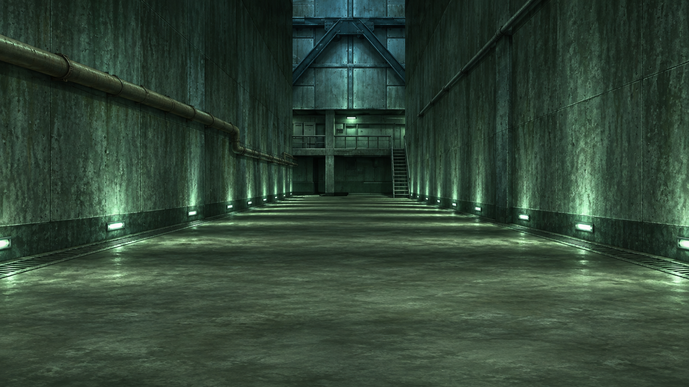</a> <strong>MGS1 — Underground Passage / premier duel Sniper Wolf</strong> P61 · Metal Gear Solid (1998) 1672 × 941 px <a href="../../../public/cqc/assets/p61/mgs1-first-wolf.png">PNG</a> · <a href="https://github.com/darknigthmare/shadow-codec-ops/blob/codex/cqc-p61-missing-static-sources-20261125/public/cqc/assets/p61/mgs1-first-wolf.png">PNG GitHub</a> · <a href="../../../docs/cqc-reprise/pass61/batches/mgs1-first-wolf.json">Manifeste</a> · <a href="https://github.com/darknigthmare/shadow-codec-ops/blob/codex/cqc-p61-missing-static-sources-20261125/docs/cqc-reprise/pass61/batches/mgs1-first-wolf.json">Manifeste GitHub</a> Références : <a href="https://oapboap.org/lets-play/mgs/page-6/">1</a> · <a href="https://mgcvt.com/guide/mgs1/chart4.htm">2</a> <a href="galerie.html#source-023">Carte et réserves détaillées</a> |

<strong>MGS2 — Sons of Liberty</strong> — 4 sources

| Source | Source |
|---|---|
| <!-- asset-path:public/cqc/assets/p61/mgs2-arsenal-stomach.png --><a href="../../../public/cqc/assets/p61/mgs2-arsenal-stomach.png">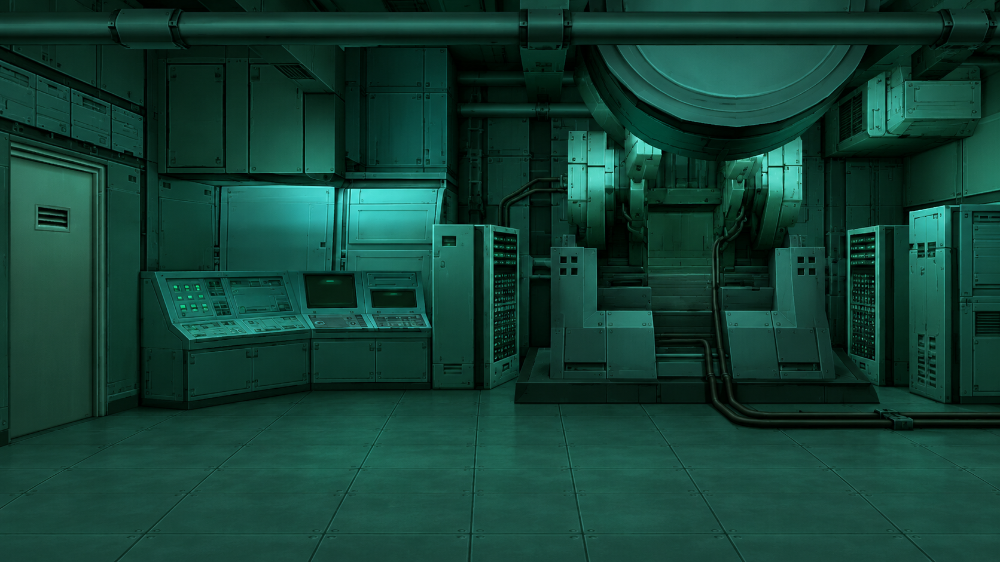</a> <strong>Arsenal Gear — Stomach, salle de contention</strong> P61 · Metal Gear Solid 2: Sons of Liberty 1672 × 941 px <a href="../../../public/cqc/assets/p61/mgs2-arsenal-stomach.png">PNG</a> · <a href="https://github.com/darknigthmare/shadow-codec-ops/blob/codex/cqc-p61-missing-static-sources-20261125/public/cqc/assets/p61/mgs2-arsenal-stomach.png">PNG GitHub</a> · <a href="../../../docs/cqc-reprise/pass61/batches/mgs2-arsenal-stomach.json">Manifeste</a> · <a href="https://github.com/darknigthmare/shadow-codec-ops/blob/codex/cqc-p61-missing-static-sources-20261125/docs/cqc-reprise/pass61/batches/mgs2-arsenal-stomach.json">Manifeste GitHub</a> Références : <a href="https://www.youtube.com/watch?v=QkVk_MtpjRE&amp;t=29795s">1</a> · <a href="https://strategywiki.org/wiki/Metal_Gear_Solid_2:_Sons_of_Liberty/Arsenal_Gear_and_New_York:_Eliminate_Solidus">2</a> <a href="galerie.html#source-025">Carte et réserves détaillées</a> | <!-- asset-path:public/cqc/assets/p61/mgs2-shell1-hostages.png --><a href="../../../public/cqc/assets/p61/mgs2-shell1-hostages.png">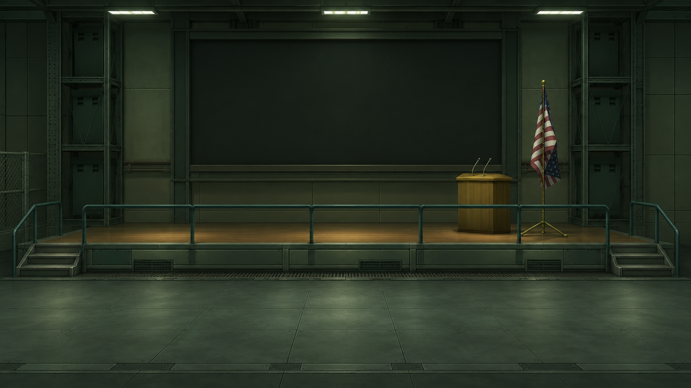</a> <strong>MGS2 — Shell 1 Core / salle des otages</strong> P61 · Metal Gear Solid 2 (2001) 1672 × 941 px <a href="../../../public/cqc/assets/p61/mgs2-shell1-hostages.png">PNG</a> · <a href="https://github.com/darknigthmare/shadow-codec-ops/blob/codex/cqc-p61-missing-static-sources-20261125/public/cqc/assets/p61/mgs2-shell1-hostages.png">PNG GitHub</a> · <a href="../../../docs/cqc-reprise/pass61/batches/mgs2-shell1-hostages.json">Manifeste</a> · <a href="https://github.com/darknigthmare/shadow-codec-ops/blob/codex/cqc-p61-missing-static-sources-20261125/docs/cqc-reprise/pass61/batches/mgs2-shell1-hostages.json">Manifeste GitHub</a> Références : <a href="https://thesnakesoup.org/myth-articles/myth-us-flag-orientation-shell-1-core-b1-hall-intentional/">1</a> <a href="galerie.html#source-024">Carte et réserves détaillées</a> |
| <!-- asset-path:public/cqc/assets/p60/mgs2-strut-b.png --><a href="../../../public/cqc/assets/p60/mgs2-strut-b.png">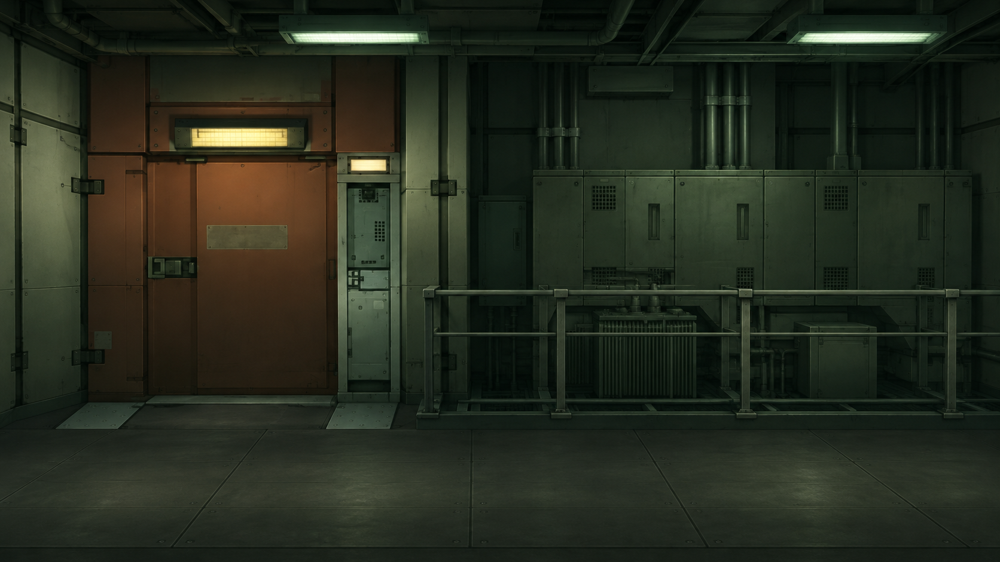</a> <strong>Strut B — salle transformateur</strong> P60 · MGS2 1672 × 941 px <a href="../../../public/cqc/assets/p60/mgs2-strut-b.png">PNG</a> · <a href="https://github.com/darknigthmare/shadow-codec-ops/blob/codex/cqc-p61-missing-static-sources-20261125/public/cqc/assets/p60/mgs2-strut-b.png">PNG GitHub</a> · <a href="../../../docs/cqc-reprise/pass60/batches/stages.json">Manifeste</a> · <a href="https://github.com/darknigthmare/shadow-codec-ops/blob/codex/cqc-p61-missing-static-sources-20261125/docs/cqc-reprise/pass60/batches/stages.json">Manifeste GitHub</a> Références : <a href="https://www.konami.com/mg/archive/mgs2/english/mr/secret_en.html">1</a> · <a href="https://portforward.com/games/walkthroughs/Metal-Gear-Solid-2-Sons-of-Liberty/2.-Plant-Chapter.htm">2</a> · <a href="https://www.gamepur.com/GUIDES/ALL-FATMAN-BOMB-LOCATIONS-IN-METAL-GEAR-SOLID-2-SONS-OF-LIBERTY">3</a> · <a href="https://portforward.com/games/walkthroughs/Metal-Gear-Solid-2-Sons-of-Liberty/metal-gear-solid-2-sons-of-liberty-51-small.webp">4</a> · <a href="https://portforward.com/games/walkthroughs/Metal-Gear-Solid-2-Sons-of-Liberty/metal-gear-solid-2-sons-of-liberty-56-small.webp">5</a> · <a href="https://portforward.com/games/walkthroughs/Metal-Gear-Solid-2-Sons-of-Liberty/metal-gear-solid-2-sons-of-liberty-57-small.webp">6</a> · <a href="https://www.gamepur.com/wp-content/uploads/2023/10/MGS2-Bomb-Locations-2.jpg?w=1024">7</a> <a href="galerie.html#source-074">Carte et réserves détaillées</a> | <!-- asset-path:public/cqc/assets/p60/mgs2-engine-room.png --><a href="../../../public/cqc/assets/p60/mgs2-engine-room.png">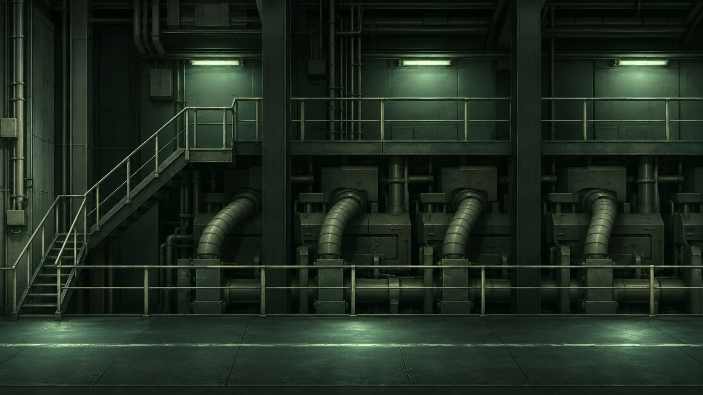</a> <strong>Tanker — salle des machines</strong> P60 · MGS2 1672 × 941 px <a href="../../../public/cqc/assets/p60/mgs2-engine-room.png">PNG</a> · <a href="https://github.com/darknigthmare/shadow-codec-ops/blob/codex/cqc-p61-missing-static-sources-20261125/public/cqc/assets/p60/mgs2-engine-room.png">PNG GitHub</a> · <a href="../../../docs/cqc-reprise/pass60/batches/stages.json">Manifeste</a> · <a href="https://github.com/darknigthmare/shadow-codec-ops/blob/codex/cqc-p61-missing-static-sources-20261125/docs/cqc-reprise/pass60/batches/stages.json">Manifeste GitHub</a> Références : <a href="https://www.konami.com/mg/archive/mgs2/english/mr/secret_en.html">1</a> · <a href="https://portforward.com/games/walkthroughs/Metal-Gear-Solid-2-Sons-of-Liberty/1.-Tanker-Chapter.htm">2</a> · <a href="https://portforward.com/games/walkthroughs/Metal-Gear-Solid-2-Sons-of-Liberty/metal-gear-solid-2-sons-of-liberty-25-small.webp">3</a> · <a href="https://portforward.com/games/walkthroughs/Metal-Gear-Solid-2-Sons-of-Liberty/metal-gear-solid-2-sons-of-liberty-27-small.webp">4</a> · <a href="https://portforward.com/games/walkthroughs/Metal-Gear-Solid-2-Sons-of-Liberty/metal-gear-solid-2-sons-of-liberty-28-small.webp">5</a> <a href="galerie.html#source-075">Carte et réserves détaillées</a> |

<strong>MGS3 — PS2</strong> — 10 sources

| Source | Source |
|---|---|
| <!-- asset-path:public/cqc/assets/p60/mgs3-chyornyj-prud.png --><a href="../../../public/cqc/assets/p60/mgs3-chyornyj-prud.png">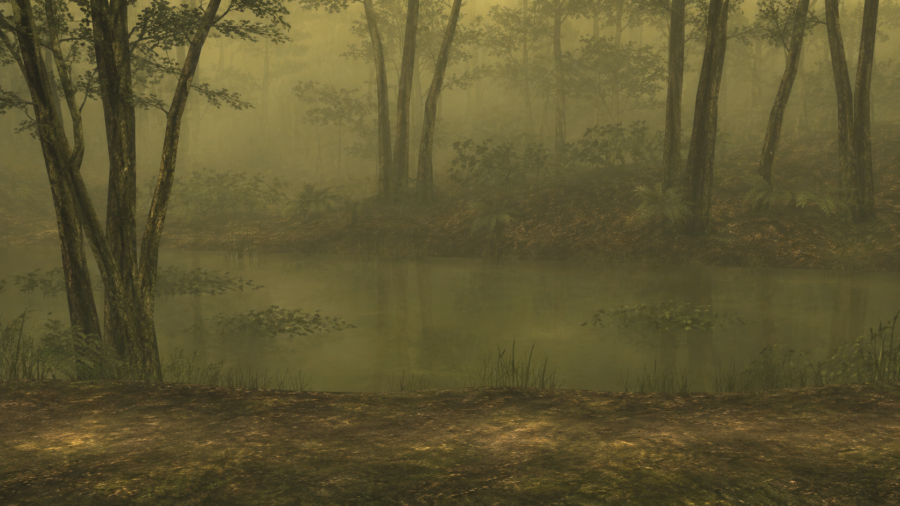</a> <strong>Chyornyj Prud</strong> P60 · MGS3 1672 × 941 px <a href="../../../public/cqc/assets/p60/mgs3-chyornyj-prud.png">PNG</a> · <a href="https://github.com/darknigthmare/shadow-codec-ops/blob/codex/cqc-p61-missing-static-sources-20261125/public/cqc/assets/p60/mgs3-chyornyj-prud.png">PNG GitHub</a> · <a href="../../../docs/cqc-reprise/pass60/batches/stages.json">Manifeste</a> · <a href="https://github.com/darknigthmare/shadow-codec-ops/blob/codex/cqc-p61-missing-static-sources-20261125/docs/cqc-reprise/pass60/batches/stages.json">Manifeste GitHub</a> Références : <a href="https://steamcommunity.com/sharedfiles/filedetails/?id=3063639317">1</a> · <a href="https://images.steamusercontent.com/ugc/2094796397704717872/8D35675CDD8E68F6EC27C032D5FEE4FD112AD4A9/">2</a> · <a href="https://images.steamusercontent.com/ugc/2094796397704719151/CF8752E74C1AAF5F653EB958212CB2BE2CF9C04E/">3</a> · <a href="https://images.steamusercontent.com/ugc/2094796397704722071/1606C3E35E1E6B5686066493C6C28D25C77904DE/">4</a> <a href="galerie.html#source-076">Carte et réserves détaillées</a> | <!-- asset-path:public/cqc/assets/p60/mgs3-dolinovodno.png --><a href="../../../public/cqc/assets/p60/mgs3-dolinovodno.png">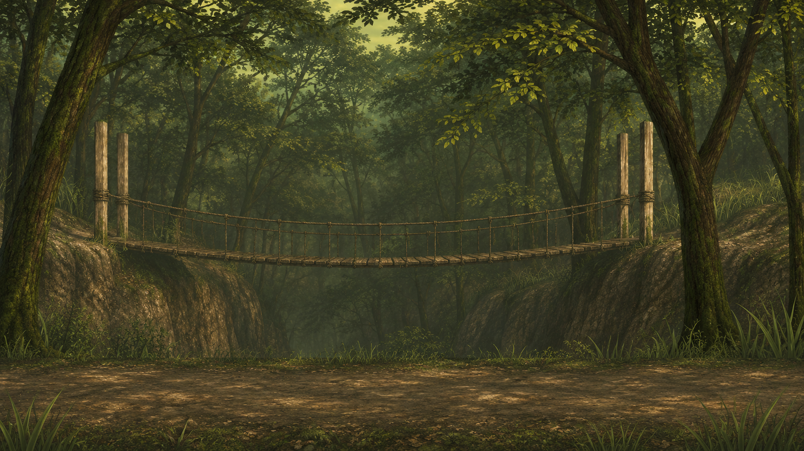</a> <strong>Dolinovodno — pont</strong> P60 · MGS3 1672 × 941 px <a href="../../../public/cqc/assets/p60/mgs3-dolinovodno.png">PNG</a> · <a href="https://github.com/darknigthmare/shadow-codec-ops/blob/codex/cqc-p61-missing-static-sources-20261125/public/cqc/assets/p60/mgs3-dolinovodno.png">PNG GitHub</a> · <a href="../../../docs/cqc-reprise/pass60/batches/stages.json">Manifeste</a> · <a href="https://github.com/darknigthmare/shadow-codec-ops/blob/codex/cqc-p61-missing-static-sources-20261125/docs/cqc-reprise/pass60/batches/stages.json">Manifeste GitHub</a> Références : <a href="https://www.konami.com/mg/archive/ssg/advice_3/advice_mgs3_01.html">1</a> · <a href="https://www.konami.com/mg/archive/ssg/advice_3/image/01_large_03.jpg">2</a> · <a href="https://steamcommunity.com/sharedfiles/filedetails/?id=3065969925">3</a> · <a href="https://images.steamusercontent.com/ugc/2093670381050755579/0C20D747D014E551C41E0EF2C473EDC3BE5B82E1/">4</a> <a href="galerie.html#source-077">Carte et réserves détaillées</a> |
| <!-- asset-path:public/cqc/assets/p60/mgs3-graniny-lab.png --><a href="../../../public/cqc/assets/p60/mgs3-graniny-lab.png">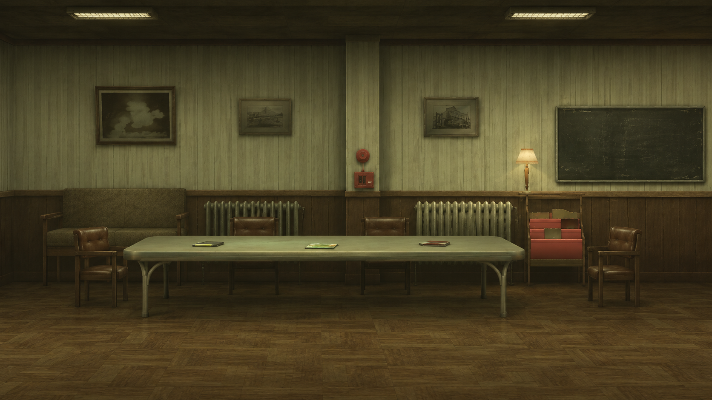</a> <strong>Graniny Gorki — laboratoire intérieur</strong> P60 · MGS3 1672 × 941 px <a href="../../../public/cqc/assets/p60/mgs3-graniny-lab.png">PNG</a> · <a href="https://github.com/darknigthmare/shadow-codec-ops/blob/codex/cqc-p61-missing-static-sources-20261125/public/cqc/assets/p60/mgs3-graniny-lab.png">PNG GitHub</a> · <a href="../../../docs/cqc-reprise/pass60/batches/stages.json">Manifeste</a> · <a href="https://github.com/darknigthmare/shadow-codec-ops/blob/codex/cqc-p61-missing-static-sources-20261125/docs/cqc-reprise/pass60/batches/stages.json">Manifeste GitHub</a> Références : <a href="https://www.konami.com/mg/archive/ssg/advice_3/advice_mgs3_06.html">1</a> · <a href="https://steamcommunity.com/sharedfiles/filedetails/?id=3065969925">2</a> · <a href="https://images.steamusercontent.com/ugc/2093670381050882945/722477FE1049923ABE892933A67DDFD16B17F165/">3</a> <a href="galerie.html#source-078">Carte et réserves détaillées</a> | <!-- asset-path:public/cqc/assets/p60/mgs3-runway.png --><a href="../../../public/cqc/assets/p60/mgs3-runway.png">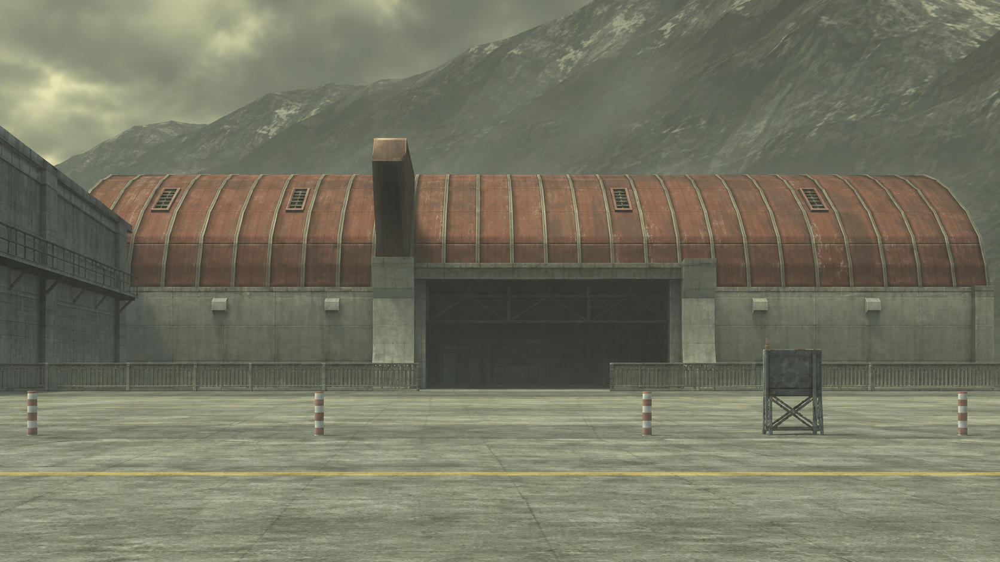</a> <strong>Groznyj Grad — piste Shagohod</strong> P60 · MGS3 1672 × 941 px <a href="../../../public/cqc/assets/p60/mgs3-runway.png">PNG</a> · <a href="https://github.com/darknigthmare/shadow-codec-ops/blob/codex/cqc-p61-missing-static-sources-20261125/public/cqc/assets/p60/mgs3-runway.png">PNG GitHub</a> · <a href="../../../docs/cqc-reprise/pass60/batches/stages.json">Manifeste</a> · <a href="https://github.com/darknigthmare/shadow-codec-ops/blob/codex/cqc-p61-missing-static-sources-20261125/docs/cqc-reprise/pass60/batches/stages.json">Manifeste GitHub</a> Références : <a href="https://eu-support.konami.com/hc/en-gb/articles/9731056113303-Backstory-What-is-the-story-of-Metal-Gear-Solid-3-Snake-Eater">1</a> · <a href="https://eu-support.konami.com/hc/article_attachments/25999674777239">2</a> · <a href="https://steamcommunity.com/sharedfiles/filedetails/?id=3065969925">3</a> · <a href="https://images.steamusercontent.com/ugc/2093670381051056899/E3F1E145418E0D5DE2767923834205EF5A8601FE/">4</a> · <a href="https://images.steamusercontent.com/ugc/2093670381051057313/4FB7CDA29CA3811E8594E4BDEBAEE7E069CBC6C9/">5</a> <a href="galerie.html#source-079">Carte et réserves détaillées</a> |
| <!-- asset-path:public/cqc/assets/p61/mgs3-bolshaya-base.png --><a href="../../../public/cqc/assets/p61/mgs3-bolshaya-base.png">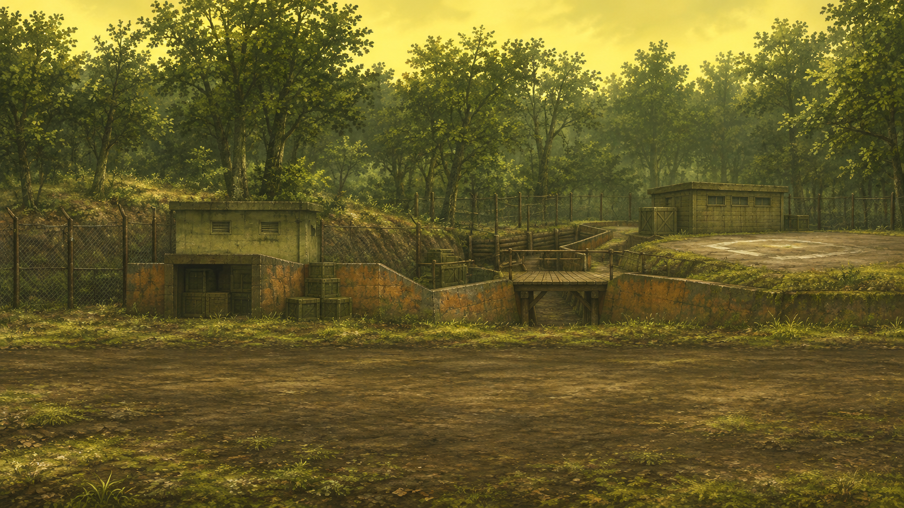</a> <strong>MGS3 — Bolshaya Past Base</strong> P61 · Metal Gear Solid 3 (2004) 1672 × 941 px <a href="../../../public/cqc/assets/p61/mgs3-bolshaya-base.png">PNG</a> · <a href="https://github.com/darknigthmare/shadow-codec-ops/blob/codex/cqc-p61-missing-static-sources-20261125/public/cqc/assets/p61/mgs3-bolshaya-base.png">PNG GitHub</a> · <a href="../../../docs/cqc-reprise/pass61/batches/mgs3-bolshaya-base.json">Manifeste</a> · <a href="https://github.com/darknigthmare/shadow-codec-ops/blob/codex/cqc-p61-missing-static-sources-20261125/docs/cqc-reprise/pass61/batches/mgs3-bolshaya-base.json">Manifeste GitHub</a> Références : <a href="https://www.gamespot.com/articles/metal-gear-solid-3-snake-eater-walkthrough/1100-6114610/">1</a> <a href="galerie.html#source-026">Carte et réserves détaillées</a> | <!-- asset-path:public/cqc/assets/p61/mgs3-lazorevo.png --><a href="../../../public/cqc/assets/p61/mgs3-lazorevo.png">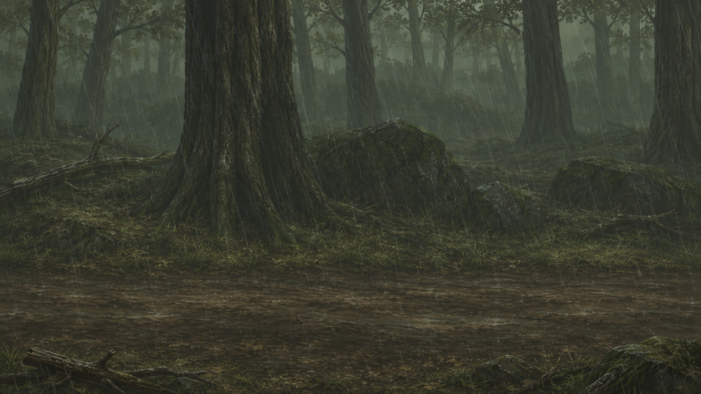</a> <strong>MGS3 — Lazorevo / fuite à moto</strong> P61 · Metal Gear Solid 3 (2004) 1672 × 941 px <a href="../../../public/cqc/assets/p61/mgs3-lazorevo.png">PNG</a> · <a href="https://github.com/darknigthmare/shadow-codec-ops/blob/codex/cqc-p61-missing-static-sources-20261125/public/cqc/assets/p61/mgs3-lazorevo.png">PNG GitHub</a> · <a href="../../../docs/cqc-reprise/pass61/batches/mgs3-lazorevo.json">Manifeste</a> · <a href="https://github.com/darknigthmare/shadow-codec-ops/blob/codex/cqc-p61-missing-static-sources-20261125/docs/cqc-reprise/pass61/batches/mgs3-lazorevo.json">Manifeste GitHub</a> Références : <a href="https://steamcommunity.com/sharedfiles/filedetails/?id=3065969925">1</a> <a href="galerie.html#source-027">Carte et réserves détaillées</a> |
| <!-- asset-path:public/cqc/assets/p61/mgs3-svyatogornyj-east.png --><a href="../../../public/cqc/assets/p61/mgs3-svyatogornyj-east.png">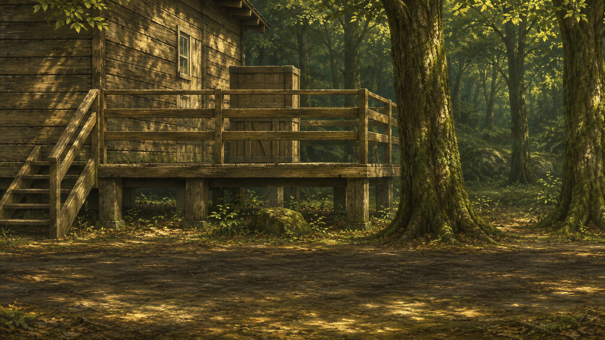</a> <strong>MGS3 — Svyatogornyj East</strong> P61 · Metal Gear Solid 3 (2004) 1672 × 941 px <a href="../../../public/cqc/assets/p61/mgs3-svyatogornyj-east.png">PNG</a> · <a href="https://github.com/darknigthmare/shadow-codec-ops/blob/codex/cqc-p61-missing-static-sources-20261125/public/cqc/assets/p61/mgs3-svyatogornyj-east.png">PNG GitHub</a> · <a href="../../../docs/cqc-reprise/pass61/batches/mgs3-svyatogornyj-east.json">Manifeste</a> · <a href="https://github.com/darknigthmare/shadow-codec-ops/blob/codex/cqc-p61-missing-static-sources-20261125/docs/cqc-reprise/pass61/batches/mgs3-svyatogornyj-east.json">Manifeste GitHub</a> Références : <a href="https://www.gamespot.com/articles/metal-gear-solid-3-snake-eater-walkthrough/1100-6114610/">1</a> <a href="galerie.html#source-028">Carte et réserves détaillées</a> | <!-- asset-path:public/cqc/assets/p61/mgs3-zaozyorje.png --><a href="../../../public/cqc/assets/p61/mgs3-zaozyorje.png">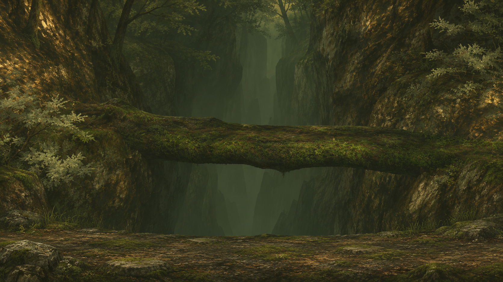</a> <strong>MGS3 — Zaozyorje West / ravin forestier</strong> P61 · Metal Gear Solid 3 (2004) 1672 × 941 px <a href="../../../public/cqc/assets/p61/mgs3-zaozyorje.png">PNG</a> · <a href="https://github.com/darknigthmare/shadow-codec-ops/blob/codex/cqc-p61-missing-static-sources-20261125/public/cqc/assets/p61/mgs3-zaozyorje.png">PNG GitHub</a> · <a href="../../../docs/cqc-reprise/pass61/batches/mgs3-zaozyorje.json">Manifeste</a> · <a href="https://github.com/darknigthmare/shadow-codec-ops/blob/codex/cqc-p61-missing-static-sources-20261125/docs/cqc-reprise/pass61/batches/mgs3-zaozyorje.json">Manifeste GitHub</a> Références : <a href="https://steamcommunity.com/sharedfiles/filedetails/?id=3065969925">1</a> <a href="galerie.html#source-029">Carte et réserves détaillées</a> |
| <!-- asset-path:public/cqc/assets/p60/mgs3-ponizovje-warehouse.png --><a href="../../../public/cqc/assets/p60/mgs3-ponizovje-warehouse.png">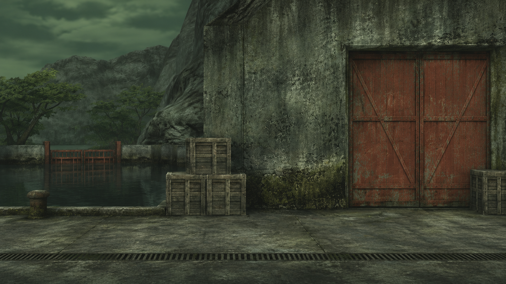</a> <strong>Ponizovje Warehouse</strong> P60 · MGS3 1672 × 941 px <a href="../../../public/cqc/assets/p60/mgs3-ponizovje-warehouse.png">PNG</a> · <a href="https://github.com/darknigthmare/shadow-codec-ops/blob/codex/cqc-p61-missing-static-sources-20261125/public/cqc/assets/p60/mgs3-ponizovje-warehouse.png">PNG GitHub</a> · <a href="../../../docs/cqc-reprise/pass60/batches/stages.json">Manifeste</a> · <a href="https://github.com/darknigthmare/shadow-codec-ops/blob/codex/cqc-p61-missing-static-sources-20261125/docs/cqc-reprise/pass60/batches/stages.json">Manifeste GitHub</a> Références : <a href="https://steamcommunity.com/sharedfiles/filedetails/?id=3065969925">1</a> · <a href="https://steamcommunity.com/sharedfiles/filedetails/?id=3063639317">2</a> · <a href="https://images.steamusercontent.com/ugc/2093670381050856365/E5E230565B2ADFA00A5F98162828B102133C841D/">3</a> · <a href="https://images.steamusercontent.com/ugc/2094796397704781405/6FDEDFBDA19E2A2AE9299691357839057B484070/">4</a> <a href="galerie.html#source-080">Carte et réserves détaillées</a> | <!-- asset-path:public/cqc/assets/p60/mgs3-rassvet.png --><a href="../../../public/cqc/assets/p60/mgs3-rassvet.png">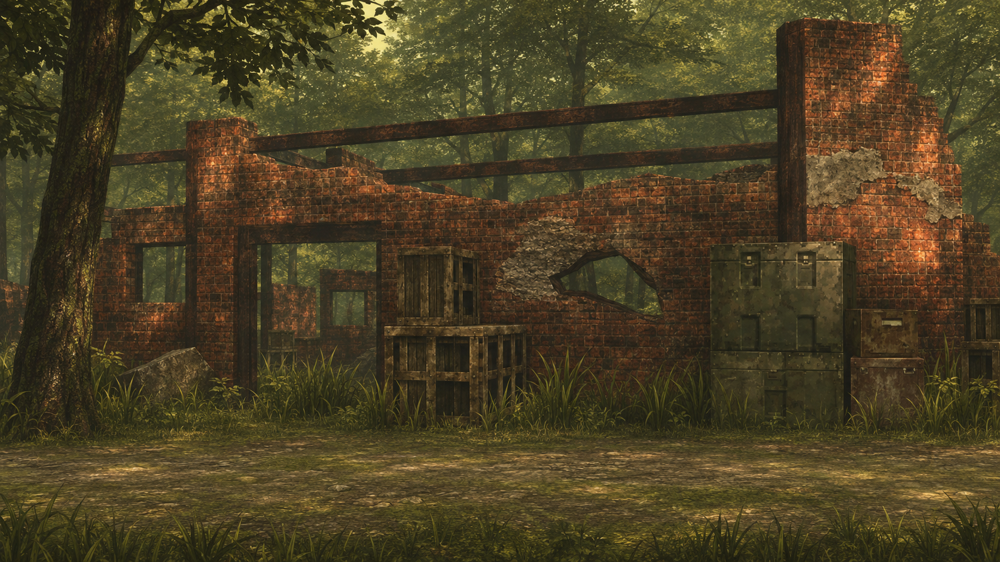</a> <strong>Rassvet</strong> P60 · MGS3 1672 × 941 px <a href="../../../public/cqc/assets/p60/mgs3-rassvet.png">PNG</a> · <a href="https://github.com/darknigthmare/shadow-codec-ops/blob/codex/cqc-p61-missing-static-sources-20261125/public/cqc/assets/p60/mgs3-rassvet.png">PNG GitHub</a> · <a href="../../../docs/cqc-reprise/pass60/batches/stages.json">Manifeste</a> · <a href="https://github.com/darknigthmare/shadow-codec-ops/blob/codex/cqc-p61-missing-static-sources-20261125/docs/cqc-reprise/pass60/batches/stages.json">Manifeste GitHub</a> Références : <a href="https://www.konami.com/mg/archive/ssg/advice_3/advice_mgs3_01.html">1</a> · <a href="https://www.konami.com/mg/archive/ssg/advice_3/image/01_large_04.jpg">2</a> · <a href="https://steamcommunity.com/sharedfiles/filedetails/?id=3065969925">3</a> · <a href="https://images.steamusercontent.com/ugc/2093670381050759091/F9845536AE62B6E46F7239019037542B0B1CAF5D/">4</a> <a href="galerie.html#source-081">Carte et réserves détaillées</a> |

<strong>FOX HUNT — Delta</strong> — 3 sources

| Source | Source |
|---|---|
| <!-- asset-path:public/cqc/assets/p61/foxhunt-cradle-forest.png --><a href="../../../public/cqc/assets/p61/foxhunt-cradle-forest.png">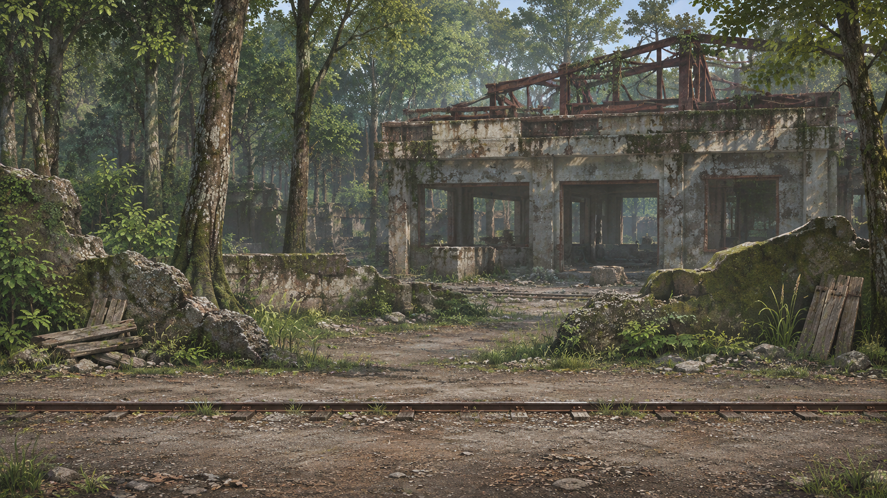</a> <strong>Cradle Forest</strong> P61 · Delta — FOX HUNT 1672 × 941 px <a href="../../../public/cqc/assets/p61/foxhunt-cradle-forest.png">PNG</a> · <a href="https://github.com/darknigthmare/shadow-codec-ops/blob/codex/cqc-p61-missing-static-sources-20261125/public/cqc/assets/p61/foxhunt-cradle-forest.png">PNG GitHub</a> · <a href="../../../docs/cqc-reprise/pass61/batches/stages-foxhunt.json">Manifeste</a> · <a href="https://github.com/darknigthmare/shadow-codec-ops/blob/codex/cqc-p61-missing-static-sources-20261125/docs/cqc-reprise/pass61/batches/stages-foxhunt.json">Manifeste GitHub</a> Références : <a href="https://www.youtube.com/watch?v=5HGvzVf36Cg">1</a> · <a href="https://www.youtube.com/watch?v=rPsO_-H1tNA">2</a> · <a href="https://www.neogaf.com/goto/post?id=270744046">3</a> · <a href="https://www.konami.com/games/eu/en/topics/18871/">4</a> <a href="galerie.html#source-001">Carte et réserves détaillées</a> | <!-- asset-path:public/cqc/assets/p61/foxhunt-ghost-garrison.png --><a href="../../../public/cqc/assets/p61/foxhunt-ghost-garrison.png">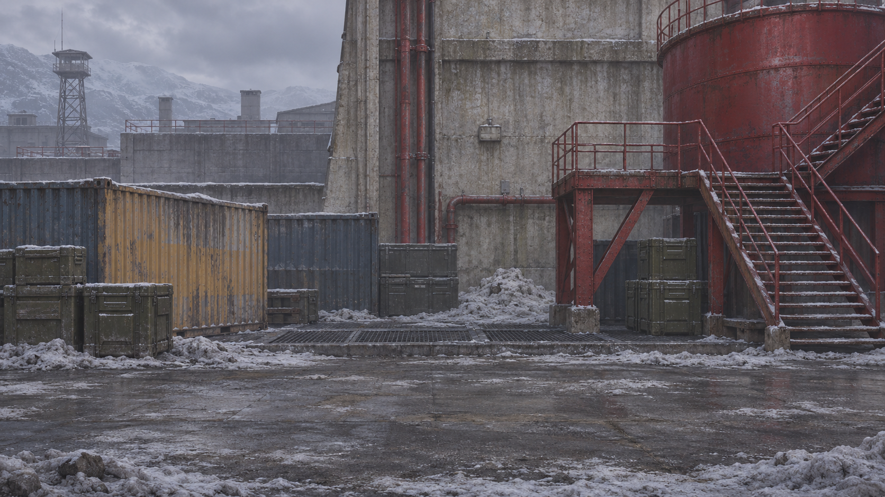</a> <strong>Ghost Garrison</strong> P61 · Delta — FOX HUNT 1672 × 941 px <a href="../../../public/cqc/assets/p61/foxhunt-ghost-garrison.png">PNG</a> · <a href="https://github.com/darknigthmare/shadow-codec-ops/blob/codex/cqc-p61-missing-static-sources-20261125/public/cqc/assets/p61/foxhunt-ghost-garrison.png">PNG GitHub</a> · <a href="../../../docs/cqc-reprise/pass61/batches/stages-foxhunt.json">Manifeste</a> · <a href="https://github.com/darknigthmare/shadow-codec-ops/blob/codex/cqc-p61-missing-static-sources-20261125/docs/cqc-reprise/pass61/batches/stages-foxhunt.json">Manifeste GitHub</a> Références : <a href="https://www.youtube.com/watch?v=Q0wRw-eNLU0">1</a> · <a href="https://i.ytimg.com/vi/Q0wRw-eNLU0/hq2.jpg">2</a> · <a href="https://www.neogaf.com/goto/post?id=270744046">3</a> · <a href="https://www.konami.com/games/eu/en/topics/18871/">4</a> <a href="galerie.html#source-002">Carte et réserves détaillées</a> |
| <!-- asset-path:public/cqc/assets/p61/foxhunt-sacred-garden.png --><a href="../../../public/cqc/assets/p61/foxhunt-sacred-garden.png">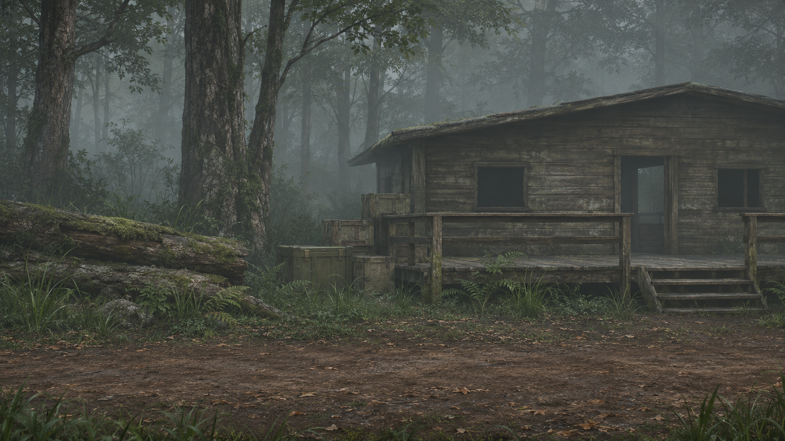</a> <strong>Sacred Garden</strong> P61 · Delta — FOX HUNT 1672 × 941 px <a href="../../../public/cqc/assets/p61/foxhunt-sacred-garden.png">PNG</a> · <a href="https://github.com/darknigthmare/shadow-codec-ops/blob/codex/cqc-p61-missing-static-sources-20261125/public/cqc/assets/p61/foxhunt-sacred-garden.png">PNG GitHub</a> · <a href="../../../docs/cqc-reprise/pass61/batches/stages-foxhunt.json">Manifeste</a> · <a href="https://github.com/darknigthmare/shadow-codec-ops/blob/codex/cqc-p61-missing-static-sources-20261125/docs/cqc-reprise/pass61/batches/stages-foxhunt.json">Manifeste GitHub</a> Références : <a href="https://www.youtube.com/watch?v=gjr7ycYRuvI">1</a> · <a href="https://www.youtube.com/watch?v=ZNIV3zMe8Ek">2</a> · <a href="https://www.konami.com/mg/mgs3r/news/asia/ja/update_122">3</a> · <a href="https://www.neogaf.com/goto/post?id=270744046">4</a> <a href="galerie.html#source-003">Carte et réserves détaillées</a> |   |

<strong>MGS4 — Guns of the Patriots</strong> — 9 sources

| Source | Source |
|---|---|
| <!-- asset-path:public/cqc/assets/p61/mgs4-marketplace.png --><a href="../../../public/cqc/assets/p61/mgs4-marketplace.png">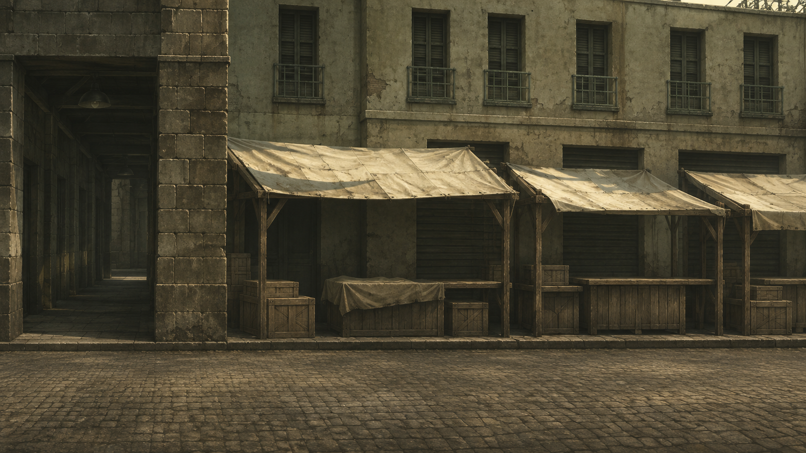</a> <strong>Marketplace — allée du marché</strong> P61 · MGS4 1672 × 941 px <a href="../../../public/cqc/assets/p61/mgs4-marketplace.png">PNG</a> · <a href="https://github.com/darknigthmare/shadow-codec-ops/blob/codex/cqc-p61-missing-static-sources-20261125/public/cqc/assets/p61/mgs4-marketplace.png">PNG GitHub</a> · <a href="../../../docs/cqc-reprise/pass61/batches/stages.json">Manifeste</a> · <a href="https://github.com/darknigthmare/shadow-codec-ops/blob/codex/cqc-p61-missing-static-sources-20261125/docs/cqc-reprise/pass61/batches/stages.json">Manifeste GitHub</a> Références : <a href="https://www.supercheats.com/guides/metal-gear-solid-4/marketplace">1</a> · <a href="https://www.supercheats.com/guides/files/guid/metal-gear-solid-4/mgs4act2s20.jpg">2</a> · <a href="https://www.supercheats.com/guides/files/guid/metal-gear-solid-4/mgs4act2s21.jpg">3</a> <a href="galerie.html#source-082">Carte et réserves détaillées</a> | <!-- asset-path:public/cqc/assets/p61/mgs4-safehouse.png --><a href="../../../public/cqc/assets/p61/mgs4-safehouse.png">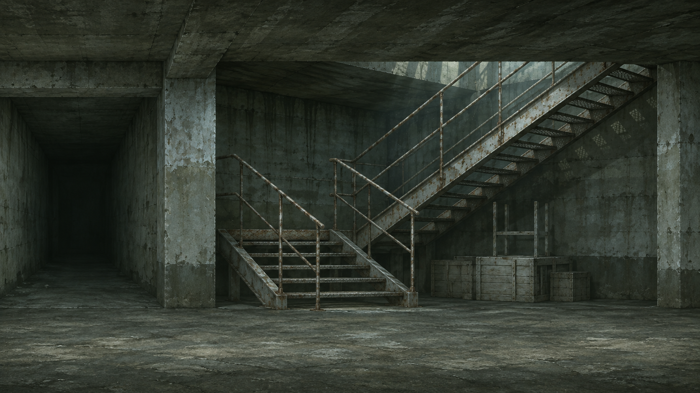</a> <strong>Militia Safe House — sous-sol et escalier</strong> P61 · MGS4 1672 × 941 px <a href="../../../public/cqc/assets/p61/mgs4-safehouse.png">PNG</a> · <a href="https://github.com/darknigthmare/shadow-codec-ops/blob/codex/cqc-p61-missing-static-sources-20261125/public/cqc/assets/p61/mgs4-safehouse.png">PNG GitHub</a> · <a href="../../../docs/cqc-reprise/pass61/batches/stages.json">Manifeste</a> · <a href="https://github.com/darknigthmare/shadow-codec-ops/blob/codex/cqc-p61-missing-static-sources-20261125/docs/cqc-reprise/pass61/batches/stages.json">Manifeste GitHub</a> Références : <a href="https://www.gamepressure.com/metalgearsolid4gunsofthepatriots/militia-safe-house/z1138e">1</a> · <a href="https://www.gamepressure.com/metalgearsolid4gunsofthepatriots/gfx/word/-2134089546.jpg">2</a> · <a href="https://www.gamepressure.com/metalgearsolid4gunsofthepatriots/gfx/word/-2134089484.jpg">3</a> <a href="galerie.html#source-083">Carte et réserves détaillées</a> |
| <!-- asset-path:public/cqc/assets/p61/mgs4-park.png --><a href="../../../public/cqc/assets/p61/mgs4-park.png">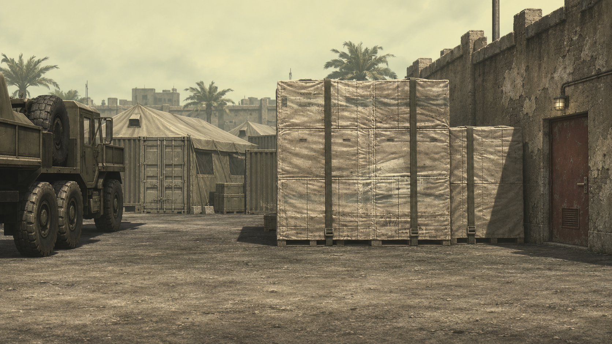</a> <strong>Millennium Park — camp PMC</strong> P61 · MGS4 1672 × 941 px <a href="../../../public/cqc/assets/p61/mgs4-park.png">PNG</a> · <a href="https://github.com/darknigthmare/shadow-codec-ops/blob/codex/cqc-p61-missing-static-sources-20261125/public/cqc/assets/p61/mgs4-park.png">PNG GitHub</a> · <a href="../../../docs/cqc-reprise/pass61/batches/stages.json">Manifeste</a> · <a href="https://github.com/darknigthmare/shadow-codec-ops/blob/codex/cqc-p61-missing-static-sources-20261125/docs/cqc-reprise/pass61/batches/stages.json">Manifeste GitHub</a> Références : <a href="https://www.supercheats.com/guides/metal-gear-solid-4/millenium-park">1</a> · <a href="https://www.supercheats.com/guides/files/guid/metal-gear-solid-4/mgs4act1s24.jpg">2</a> <a href="galerie.html#source-084">Carte et réserves détaillées</a> | <!-- asset-path:public/cqc/assets/p61/mgs4-nomad.png --><a href="../../../public/cqc/assets/p61/mgs4-nomad.png">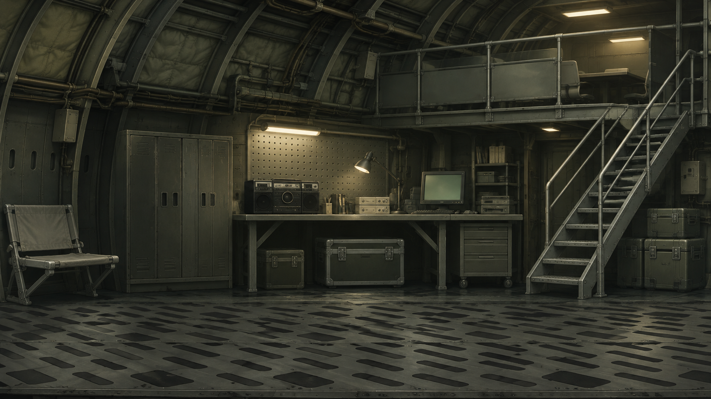</a> <strong>Nomad — atelier et accès mezzanine</strong> P61 · MGS4 1672 × 941 px <a href="../../../public/cqc/assets/p61/mgs4-nomad.png">PNG</a> · <a href="https://github.com/darknigthmare/shadow-codec-ops/blob/codex/cqc-p61-missing-static-sources-20261125/public/cqc/assets/p61/mgs4-nomad.png">PNG GitHub</a> · <a href="../../../docs/cqc-reprise/pass61/batches/stages.json">Manifeste</a> · <a href="https://github.com/darknigthmare/shadow-codec-ops/blob/codex/cqc-p61-missing-static-sources-20261125/docs/cqc-reprise/pass61/batches/stages.json">Manifeste GitHub</a> Références : <a href="https://img.konami.com/mg/mc2/s/img/top/book_sample_mgs4_en.pdf">1</a> · <a href="https://x.com/MetalGear_OOC/status/1473057910078861312">2</a> · <a href="https://pbs.twimg.com/media/FHFaXJtVIAA8Shz.jpg">3</a> <a href="galerie.html#source-085">Carte et réserves détaillées</a> |
| <!-- asset-path:public/cqc/assets/p61/mgs4-microwave.png --><a href="../../../public/cqc/assets/p61/mgs4-microwave.png">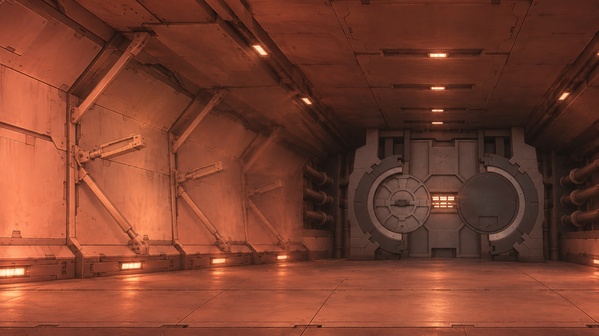</a> <strong>Outer Haven — couloir micro-ondes</strong> P61 · MGS4 1672 × 941 px <a href="../../../public/cqc/assets/p61/mgs4-microwave.png">PNG</a> · <a href="https://github.com/darknigthmare/shadow-codec-ops/blob/codex/cqc-p61-missing-static-sources-20261125/public/cqc/assets/p61/mgs4-microwave.png">PNG GitHub</a> · <a href="../../../docs/cqc-reprise/pass61/batches/stages.json">Manifeste</a> · <a href="https://github.com/darknigthmare/shadow-codec-ops/blob/codex/cqc-p61-missing-static-sources-20261125/docs/cqc-reprise/pass61/batches/stages.json">Manifeste GitHub</a> Références : <a href="https://www.gamepressure.com/metalgearsolid4gunsofthepatriots/command-center/z813ac">1</a> · <a href="https://www.gamepressure.com/metalgearsolid4gunsofthepatriots/gfx/word/-2138022296.jpg">2</a> · <a href="https://polycount.com/discussion/119405/metal-gear-solid-4-server-door">3</a> · <a href="https://i.imgur.com/lRM9ZhE.jpg">4</a> · <a href="https://i.imgur.com/Q1wg1Or.jpg">5</a> <a href="galerie.html#source-086">Carte et réserves détaillées</a> | <!-- asset-path:public/cqc/assets/p61/mgs4-gw-server.png --><a href="../../../public/cqc/assets/p61/mgs4-gw-server.png">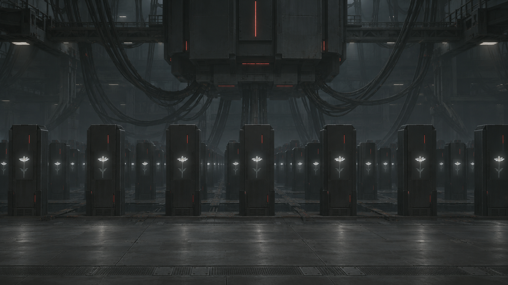</a> <strong>Outer Haven — salle serveurs GW</strong> P61 · MGS4 1672 × 941 px <a href="../../../public/cqc/assets/p61/mgs4-gw-server.png">PNG</a> · <a href="https://github.com/darknigthmare/shadow-codec-ops/blob/codex/cqc-p61-missing-static-sources-20261125/public/cqc/assets/p61/mgs4-gw-server.png">PNG GitHub</a> · <a href="../../../docs/cqc-reprise/pass61/batches/stages.json">Manifeste</a> · <a href="https://github.com/darknigthmare/shadow-codec-ops/blob/codex/cqc-p61-missing-static-sources-20261125/docs/cqc-reprise/pass61/batches/stages.json">Manifeste GitHub</a> Références : <a href="https://metalgear.fandom.com/wiki/GW">1</a> · <a href="https://metalgear.fandom.com/wiki/Outer_Haven">2</a> · <a href="https://www.creativeuncut.com/gallery-06/mgs4-outer-haven-server-room.html">3</a> · <a href="https://www.ideals.illinois.edu/items/42310/bitstreams/127471/data.pdf">4</a> <a href="galerie.html#source-087">Carte et réserves détaillées</a> |
| <!-- asset-path:public/cqc/assets/p61/mgs4-ship-bow.png --><a href="../../../public/cqc/assets/p61/mgs4-ship-bow.png">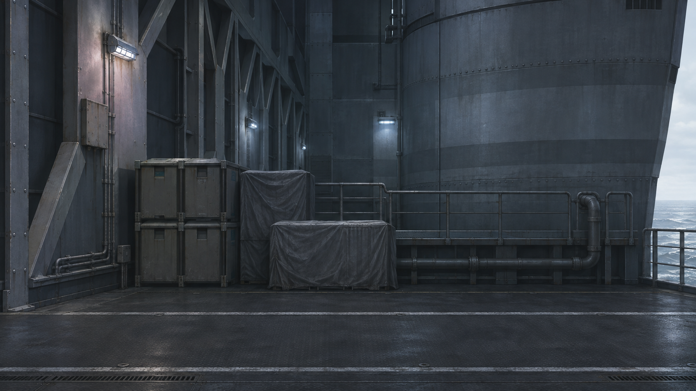</a> <strong>Outer Haven — Ship Bow, passage extérieur</strong> P61 · MGS4 1672 × 941 px <a href="../../../public/cqc/assets/p61/mgs4-ship-bow.png">PNG</a> · <a href="https://github.com/darknigthmare/shadow-codec-ops/blob/codex/cqc-p61-missing-static-sources-20261125/public/cqc/assets/p61/mgs4-ship-bow.png">PNG GitHub</a> · <a href="../../../docs/cqc-reprise/pass61/batches/stages.json">Manifeste</a> · <a href="https://github.com/darknigthmare/shadow-codec-ops/blob/codex/cqc-p61-missing-static-sources-20261125/docs/cqc-reprise/pass61/batches/stages.json">Manifeste GitHub</a> Références : <a href="https://www.gamepressure.com/metalgearsolid4gunsofthepatriots/ship-bow/z713ab">1</a> · <a href="https://www.supercheats.com/guides/files/guid/metal-gear-solid-4/mgs4act5s2.jpg">2</a> · <a href="https://www.gamepressure.com/metalgearsolid4gunsofthepatriots/gfx/word/-2137947609.jpg">3</a> <a href="galerie.html#source-088">Carte et réserves détaillées</a> | <!-- asset-path:public/cqc/assets/p61/mgs4-powerstation.png --><a href="../../../public/cqc/assets/p61/mgs4-powerstation.png">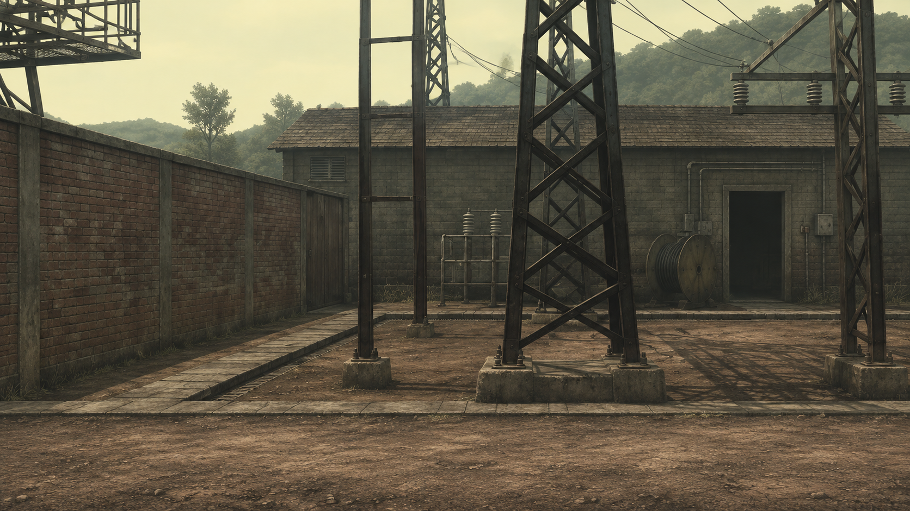</a> <strong>Power Station — cour du pylône</strong> P61 · MGS4 1672 × 941 px <a href="../../../public/cqc/assets/p61/mgs4-powerstation.png">PNG</a> · <a href="https://github.com/darknigthmare/shadow-codec-ops/blob/codex/cqc-p61-missing-static-sources-20261125/public/cqc/assets/p61/mgs4-powerstation.png">PNG GitHub</a> · <a href="../../../docs/cqc-reprise/pass61/batches/stages.json">Manifeste</a> · <a href="https://github.com/darknigthmare/shadow-codec-ops/blob/codex/cqc-p61-missing-static-sources-20261125/docs/cqc-reprise/pass61/batches/stages.json">Manifeste GitHub</a> Références : <a href="https://www.supercheats.com/guides/metal-gear-solid-4/power-station">1</a> · <a href="https://www.supercheats.com/guides/files/guid/metal-gear-solid-4/mgs4act2s7.jpg">2</a> <a href="galerie.html#source-089">Carte et réserves détaillées</a> |
| <!-- asset-path:public/cqc/assets/p61/mgs4-rex-hangar-2014.png --><a href="../../../public/cqc/assets/p61/mgs4-rex-hangar-2014.png">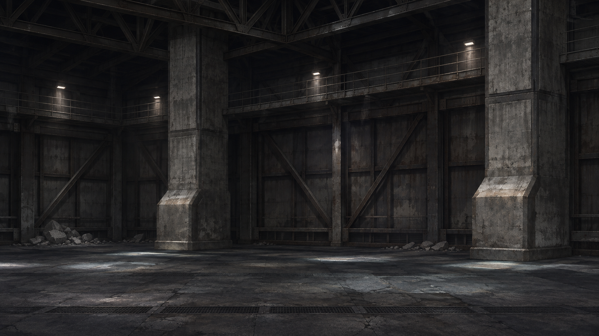</a> <strong>Shadow Moses — REX Hangar 2014, environnement</strong> P61 · MGS4 1672 × 941 px <a href="../../../public/cqc/assets/p61/mgs4-rex-hangar-2014.png">PNG</a> · <a href="https://github.com/darknigthmare/shadow-codec-ops/blob/codex/cqc-p61-missing-static-sources-20261125/public/cqc/assets/p61/mgs4-rex-hangar-2014.png">PNG GitHub</a> · <a href="../../../docs/cqc-reprise/pass61/batches/stages.json">Manifeste</a> · <a href="https://github.com/darknigthmare/shadow-codec-ops/blob/codex/cqc-p61-missing-static-sources-20261125/docs/cqc-reprise/pass61/batches/stages.json">Manifeste GitHub</a> Références : <a href="https://www.gamepressure.com/metalgearsolid4gunsofthepatriots/underground-base/ze13a9">1</a> · <a href="https://www.gamepressure.com/metalgearsolid4gunsofthepatriots/gfx/word/31146515.jpg">2</a> · <a href="https://www.gamepressure.com/metalgearsolid4gunsofthepatriots/gfx/word/31146578.jpg">3</a> <a href="galerie.html#source-090">Carte et réserves détaillées</a> |   |

<strong>MGSV — Ground Zeroes</strong> — 2 sources

| Source | Source |
|---|---|
| <!-- asset-path:public/cqc/assets/p61/gz-camp-day.png --><a href="../../../public/cqc/assets/p61/gz-camp-day.png">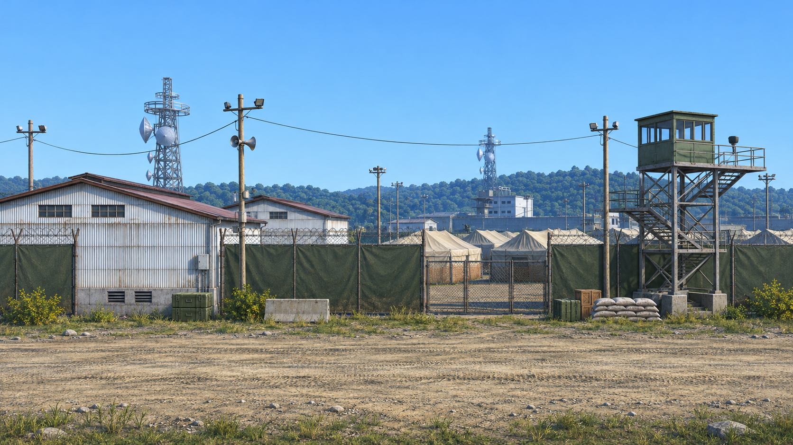</a> <strong>Camp Omega — jour / Side Ops</strong> P61 · MGSV: Ground Zeroes 1672 × 941 px <a href="../../../public/cqc/assets/p61/gz-camp-day.png">PNG</a> · <a href="https://github.com/darknigthmare/shadow-codec-ops/blob/codex/cqc-p61-missing-static-sources-20261125/public/cqc/assets/p61/gz-camp-day.png">PNG GitHub</a> · <a href="../../../docs/cqc-reprise/pass61/batches/gz-camp-day.json">Manifeste</a> · <a href="https://github.com/darknigthmare/shadow-codec-ops/blob/codex/cqc-p61-missing-static-sources-20261125/docs/cqc-reprise/pass61/batches/gz-camp-day.json">Manifeste GitHub</a> Références : <a href="https://www.gematsu.com/2013/10/metal-gear-solid-v-ground-zeroes-environment-screenshots">1</a> <a href="galerie.html#source-091">Carte et réserves détaillées</a> | <!-- asset-path:public/cqc/assets/p61/gz-motherbase-attack.png --><a href="../../../public/cqc/assets/p61/gz-motherbase-attack.png">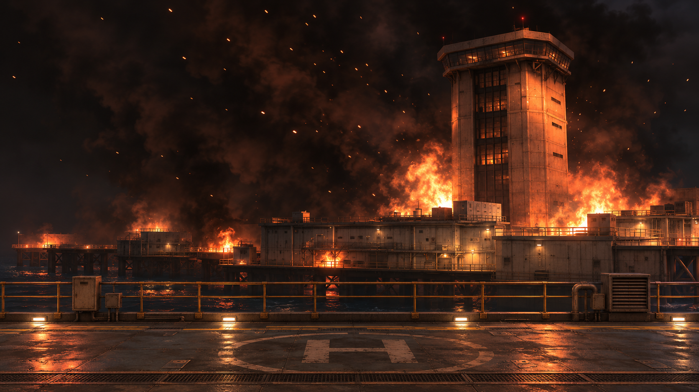</a> <strong>Mother Base MSF — attaque 1975</strong> P61 · MGSV: Ground Zeroes 1672 × 941 px <a href="../../../public/cqc/assets/p61/gz-motherbase-attack.png">PNG</a> · <a href="https://github.com/darknigthmare/shadow-codec-ops/blob/codex/cqc-p61-missing-static-sources-20261125/public/cqc/assets/p61/gz-motherbase-attack.png">PNG GitHub</a> · <a href="../../../docs/cqc-reprise/pass61/batches/gz-motherbase-attack.json">Manifeste</a> · <a href="https://github.com/darknigthmare/shadow-codec-ops/blob/codex/cqc-p61-missing-static-sources-20261125/docs/cqc-reprise/pass61/batches/gz-motherbase-attack.json">Manifeste GitHub</a> Références : <a href="https://www.youtube.com/watch?v=Mf371MMhxD0">1</a> <a href="galerie.html#source-092">Carte et réserves détaillées</a> |

<strong>MGSV — The Phantom Pain</strong> — 6 sources

| Source | Source |
|---|---|
| <!-- asset-path:public/cqc/assets/p61/tpp-mission00-route.png --><a href="../../../public/cqc/assets/p61/tpp-mission00-route.png">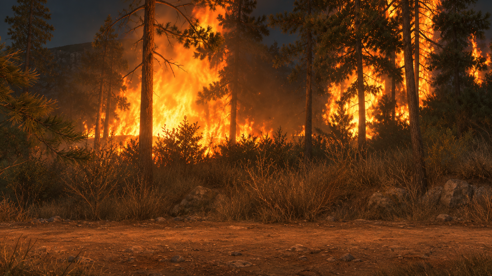</a> <strong>Chypre — route forestière de fuite, mission 00</strong> P61 · Metal Gear Solid V: The Phantom Pain 1672 × 941 px <a href="../../../public/cqc/assets/p61/tpp-mission00-route.png">PNG</a> · <a href="https://github.com/darknigthmare/shadow-codec-ops/blob/codex/cqc-p61-missing-static-sources-20261125/public/cqc/assets/p61/tpp-mission00-route.png">PNG GitHub</a> · <a href="../../../docs/cqc-reprise/pass61/batches/tpp-mission00-route.json">Manifeste</a> · <a href="https://github.com/darknigthmare/shadow-codec-ops/blob/codex/cqc-p61-missing-static-sources-20261125/docs/cqc-reprise/pass61/batches/tpp-mission00-route.json">Manifeste GitHub</a> Références : <a href="https://www.gamepressure.com/mgs5thephantompain/escaping-the-man-on-fire/z57b6f">1</a> · <a href="https://www.gamepressure.com/mgs5thephantompain/gfx/word/332996317.jpg">2</a> <a href="galerie.html#source-032">Carte et réserves détaillées</a> | <!-- asset-path:public/cqc/assets/p61/tpp-wialo.png --><a href="../../../public/cqc/assets/p61/tpp-wialo.png">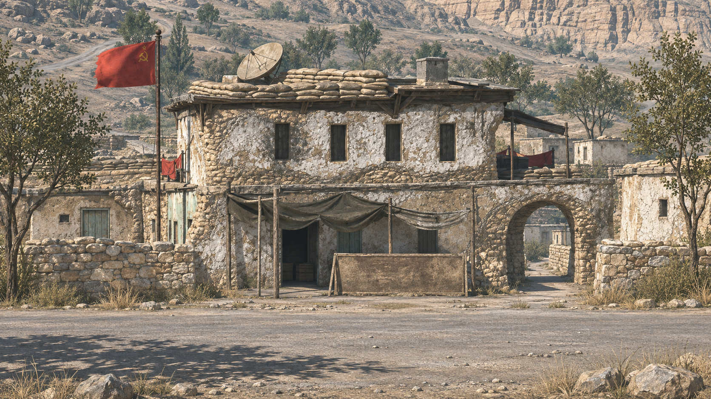</a> <strong>Da Wialo Kallai / village</strong> P61 · MGSV: The Phantom Pain 1672 × 941 px <a href="../../../public/cqc/assets/p61/tpp-wialo.png">PNG</a> · <a href="https://github.com/darknigthmare/shadow-codec-ops/blob/codex/cqc-p61-missing-static-sources-20261125/public/cqc/assets/p61/tpp-wialo.png">PNG GitHub</a> · <a href="../../../docs/cqc-reprise/pass61/batches/tpp-wialo.json">Manifeste</a> · <a href="https://github.com/darknigthmare/shadow-codec-ops/blob/codex/cqc-p61-missing-static-sources-20261125/docs/cqc-reprise/pass61/batches/tpp-wialo.json">Manifeste GitHub</a> Références : <a href="https://www.gamepressure.com/mgs5thephantompain/locating-kazuhira-miller/z27b72">1</a> <a href="galerie.html#source-093">Carte et réserves détaillées</a> |
| <!-- asset-path:public/cqc/assets/p61/tpp-lamar.png --><a href="../../../public/cqc/assets/p61/tpp-lamar.png">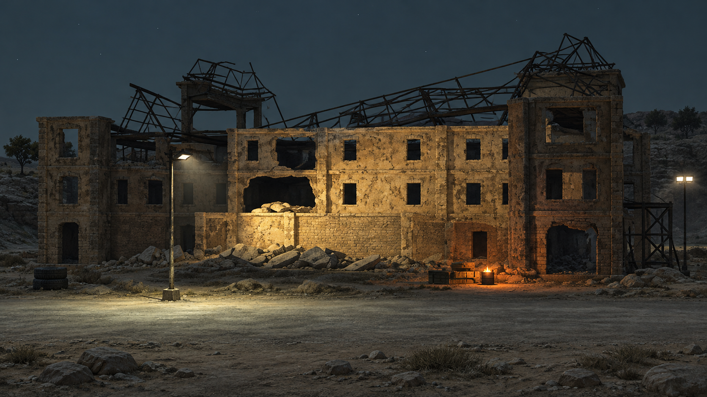</a> <strong>Lamar Khaate Palace</strong> P61 · MGSV: The Phantom Pain 1672 × 941 px <a href="../../../public/cqc/assets/p61/tpp-lamar.png">PNG</a> · <a href="https://github.com/darknigthmare/shadow-codec-ops/blob/codex/cqc-p61-missing-static-sources-20261125/public/cqc/assets/p61/tpp-lamar.png">PNG GitHub</a> · <a href="../../../docs/cqc-reprise/pass61/batches/tpp-lamar.json">Manifeste</a> · <a href="https://github.com/darknigthmare/shadow-codec-ops/blob/codex/cqc-p61-missing-static-sources-20261125/docs/cqc-reprise/pass61/batches/tpp-lamar.json">Manifeste GitHub</a> Références : <a href="https://www.gamepressure.com/mgs5thephantompain/131-140/za7e77">1</a> <a href="galerie.html#source-094">Carte et réserves détaillées</a> | <!-- asset-path:public/cqc/assets/p61/tpp-quarantine.png --><a href="../../../public/cqc/assets/p61/tpp-quarantine.png">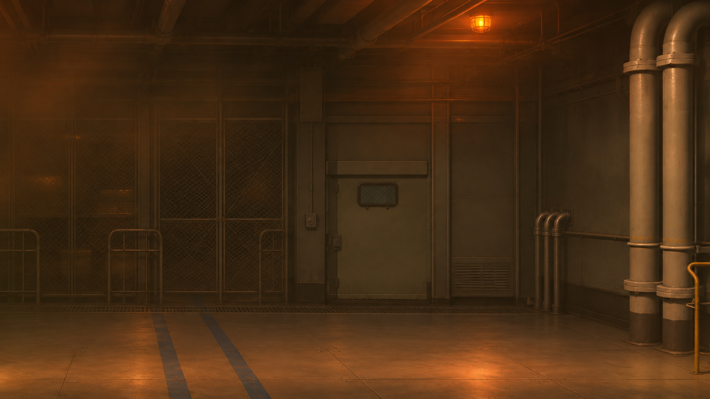</a> <strong>Mother Base — plateforme de quarantaine, salle industrielle</strong> P61 · Metal Gear Solid V: The Phantom Pain 1672 × 941 px <a href="../../../public/cqc/assets/p61/tpp-quarantine.png">PNG</a> · <a href="https://github.com/darknigthmare/shadow-codec-ops/blob/codex/cqc-p61-missing-static-sources-20261125/public/cqc/assets/p61/tpp-quarantine.png">PNG GitHub</a> · <a href="../../../docs/cqc-reprise/pass61/batches/tpp-quarantine.json">Manifeste</a> · <a href="https://github.com/darknigthmare/shadow-codec-ops/blob/codex/cqc-p61-missing-static-sources-20261125/docs/cqc-reprise/pass61/batches/tpp-quarantine.json">Manifeste GitHub</a> Références : <a href="https://steamcommunity.com/sharedfiles/filedetails/?id=1266308890">1</a> · <a href="https://www.gamepressure.com/mgs5thephantompain/identifying-the-person-who-sent-the-transmission/z37fa5">2</a> <a href="galerie.html#source-033">Carte et réserves détaillées</a> |
| <!-- asset-path:public/cqc/assets/p61/tpp-ngumba.png --><a href="../../../public/cqc/assets/p61/tpp-ngumba.png">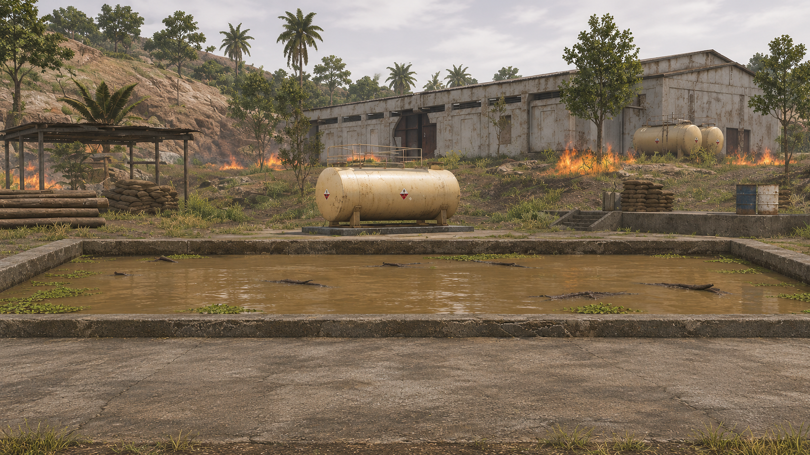</a> <strong>Ngumba Industrial Zone</strong> P61 · MGSV: The Phantom Pain 1672 × 941 px <a href="../../../public/cqc/assets/p61/tpp-ngumba.png">PNG</a> · <a href="https://github.com/darknigthmare/shadow-codec-ops/blob/codex/cqc-p61-missing-static-sources-20261125/public/cqc/assets/p61/tpp-ngumba.png">PNG GitHub</a> · <a href="../../../docs/cqc-reprise/pass61/batches/tpp-ngumba.json">Manifeste</a> · <a href="https://github.com/darknigthmare/shadow-codec-ops/blob/codex/cqc-p61-missing-static-sources-20261125/docs/cqc-reprise/pass61/batches/tpp-ngumba.json">Manifeste GitHub</a> Références : <a href="https://vandal.elespanol.com/guias/guia-metal-gear-solid-v-the-phantom-pain/mision-episodio-20-voces">1</a> <a href="galerie.html#source-095">Carte et réserves détaillées</a> | <!-- asset-path:public/cqc/assets/p61/tpp-fob.png --><a href="../../../public/cqc/assets/p61/tpp-fob.png">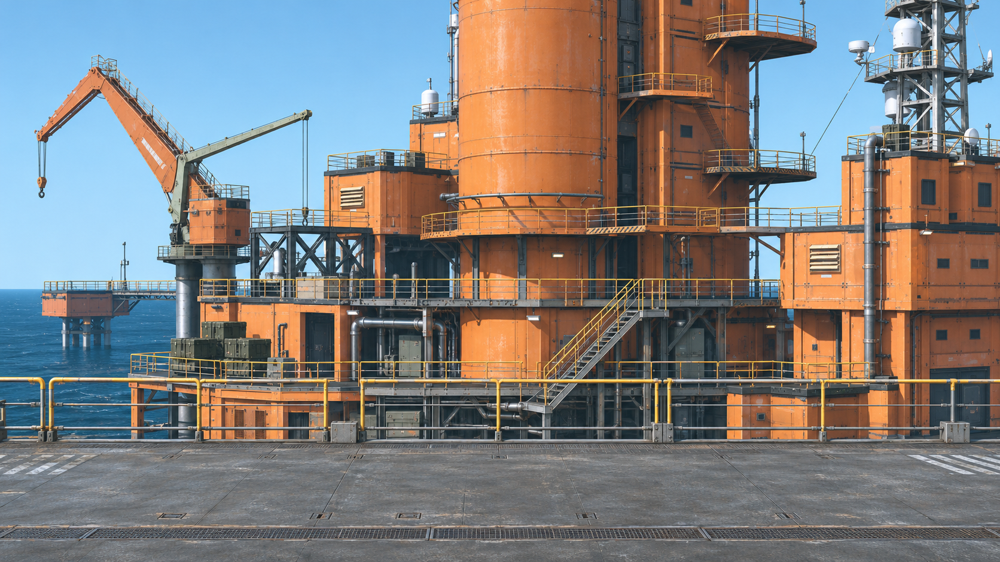</a> <strong>Plateformes FOB</strong> P61 · MGSV: The Phantom Pain 1672 × 941 px <a href="../../../public/cqc/assets/p61/tpp-fob.png">PNG</a> · <a href="https://github.com/darknigthmare/shadow-codec-ops/blob/codex/cqc-p61-missing-static-sources-20261125/public/cqc/assets/p61/tpp-fob.png">PNG GitHub</a> · <a href="../../../docs/cqc-reprise/pass61/batches/tpp-fob.json">Manifeste</a> · <a href="https://github.com/darknigthmare/shadow-codec-ops/blob/codex/cqc-p61-missing-static-sources-20261125/docs/cqc-reprise/pass61/batches/tpp-fob.json">Manifeste GitHub</a> Références : <a href="https://www.gamesradar.com/metal-gear-solid-5-wants-you-keep-invading-fobs-whats-point/">1</a> <a href="galerie.html#source-096">Carte et réserves détaillées</a> |

<strong>MGS — Peace Walker</strong> — 3 sources

| Source | Source |
|---|---|
| <!-- asset-path:public/cqc/assets/p60/pw-isla-monstruo.png --><a href="../../../public/cqc/assets/p60/pw-isla-monstruo.png">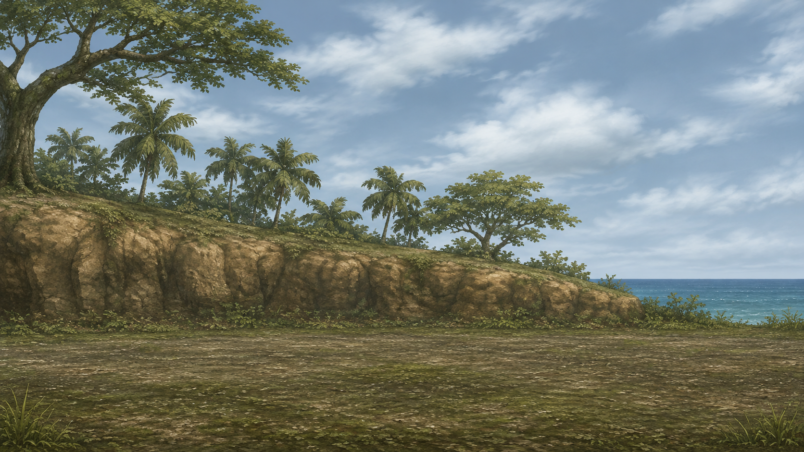</a> <strong>Isla del Monstruo</strong> P60 · Metal Gear Solid: Peace Walker · PSP (2010) 1672 × 941 px <a href="../../../public/cqc/assets/p60/pw-isla-monstruo.png">PNG</a> · <a href="https://github.com/darknigthmare/shadow-codec-ops/blob/codex/cqc-p61-missing-static-sources-20261125/public/cqc/assets/p60/pw-isla-monstruo.png">PNG GitHub</a> · <a href="../../../docs/cqc-reprise/pass60/batches/root.json">Manifeste</a> · <a href="https://github.com/darknigthmare/shadow-codec-ops/blob/codex/cqc-p61-missing-static-sources-20261125/docs/cqc-reprise/pass60/batches/root.json">Manifeste GitHub</a> Références : <a href="https://www.konami.com/mg/archive/mgs_pw/en/collabo/mh.html">1</a> · <a href="https://www.gamespark.jp/article/2025/09/23/157481.html">2</a> · <a href="https://www.youtube.com/watch?v=4QlvqoyDPVI">3</a> <a href="galerie.html#source-034">Carte et réserves détaillées</a> | <!-- asset-path:public/cqc/assets/p61/pw-peace-walker-hangar.png --><a href="../../../public/cqc/assets/p61/pw-peace-walker-hangar.png">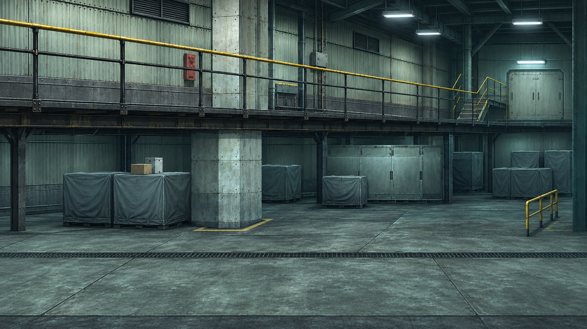</a> <strong>Peace Walker — Mine Base / hangar</strong> P61 · Metal Gear Solid Peace Walker (2010) 1672 × 941 px <a href="../../../public/cqc/assets/p61/pw-peace-walker-hangar.png">PNG</a> · <a href="https://github.com/darknigthmare/shadow-codec-ops/blob/codex/cqc-p61-missing-static-sources-20261125/public/cqc/assets/p61/pw-peace-walker-hangar.png">PNG GitHub</a> · <a href="../../../docs/cqc-reprise/pass61/batches/pw-peace-walker-hangar.json">Manifeste</a> · <a href="https://github.com/darknigthmare/shadow-codec-ops/blob/codex/cqc-p61-missing-static-sources-20261125/docs/cqc-reprise/pass61/batches/pw-peace-walker-hangar.json">Manifeste GitHub</a> Références : <a href="https://www.gamespot.com/articles/metal-gear-solid-peace-walker-walkthrough/1100-6268563/">1</a> <a href="galerie.html#source-030">Carte et réserves détaillées</a> |
| <!-- asset-path:public/cqc/assets/p61/pw-playa-del-alba.png --><a href="../../../public/cqc/assets/p61/pw-playa-del-alba.png">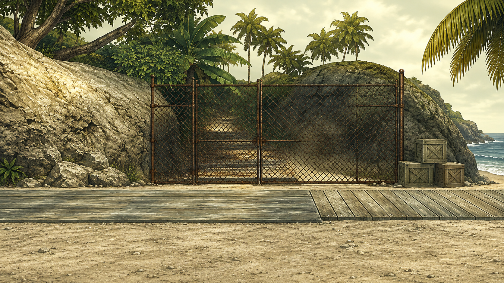</a> <strong>Peace Walker — Playa del Alba</strong> P61 · Metal Gear Solid Peace Walker (2010) 1672 × 941 px <a href="../../../public/cqc/assets/p61/pw-playa-del-alba.png">PNG</a> · <a href="https://github.com/darknigthmare/shadow-codec-ops/blob/codex/cqc-p61-missing-static-sources-20261125/public/cqc/assets/p61/pw-playa-del-alba.png">PNG GitHub</a> · <a href="../../../docs/cqc-reprise/pass61/batches/pw-playa-del-alba.json">Manifeste</a> · <a href="https://github.com/darknigthmare/shadow-codec-ops/blob/codex/cqc-p61-missing-static-sources-20261125/docs/cqc-reprise/pass61/batches/pw-playa-del-alba.json">Manifeste GitHub</a> Références : <a href="https://www.gamespot.com/articles/metal-gear-solid-peace-walker-walkthrough/1100-6268563/">1</a> <a href="galerie.html#source-031">Carte et réserves détaillées</a> |   |

<strong>MGS — Portable Ops</strong> — 6 sources

| Source | Source |
|---|---|
| <!-- asset-path:public/cqc/assets/p61/mpo-airport-cargo.png --><a href="../../../public/cqc/assets/p61/mpo-airport-cargo.png">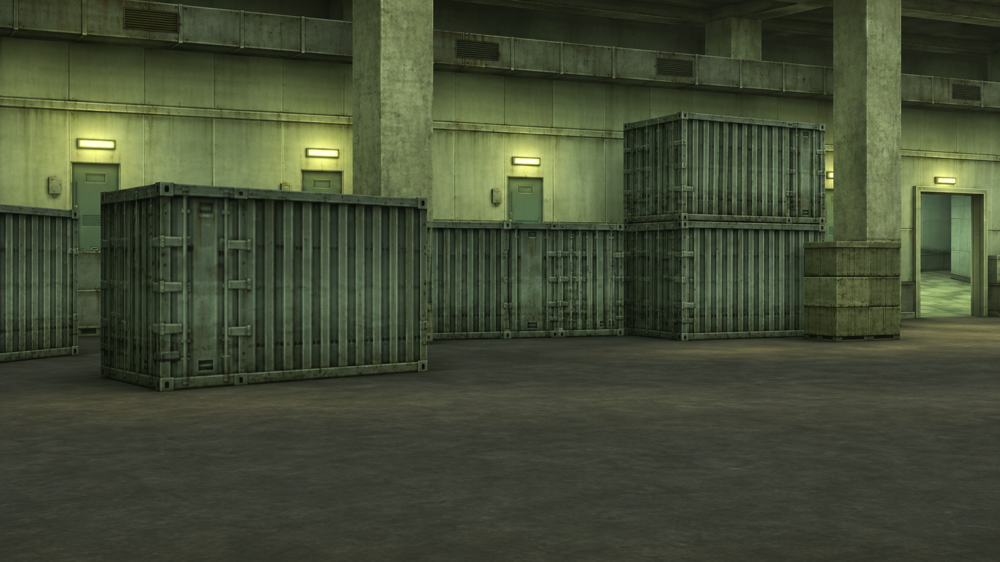</a> <strong>Airport — zone de fret du terminal</strong> P61 · Portable Ops 1672 × 941 px <a href="../../../public/cqc/assets/p61/mpo-airport-cargo.png">PNG</a> · <a href="https://github.com/darknigthmare/shadow-codec-ops/blob/codex/cqc-p61-missing-static-sources-20261125/public/cqc/assets/p61/mpo-airport-cargo.png">PNG GitHub</a> · <a href="../../../docs/cqc-reprise/pass61/batches/mpo-airport-cargo.json">Manifeste</a> · <a href="https://github.com/darknigthmare/shadow-codec-ops/blob/codex/cqc-p61-missing-static-sources-20261125/docs/cqc-reprise/pass61/batches/mpo-airport-cargo.json">Manifeste GitHub</a> Références : <a href="https://www.youtube.com/watch?v=MsP_EDz19DU">1</a> · <a href="https://www.youtube.com/watch?v=LvvRCGctAKk">2</a> <a href="galerie.html#source-098">Carte et réserves détaillées</a> | <!-- asset-path:public/cqc/assets/p61/mpo-guesthouse.png --><a href="../../../public/cqc/assets/p61/mpo-guesthouse.png">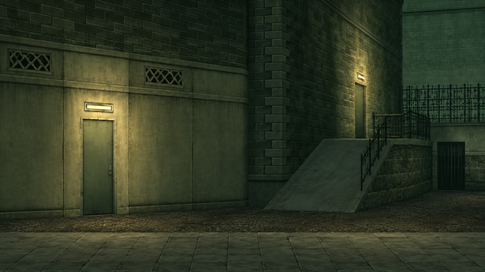</a> <strong>Guest House — façade et passage extérieur</strong> P61 · Portable Ops 1672 × 941 px <a href="../../../public/cqc/assets/p61/mpo-guesthouse.png">PNG</a> · <a href="https://github.com/darknigthmare/shadow-codec-ops/blob/codex/cqc-p61-missing-static-sources-20261125/public/cqc/assets/p61/mpo-guesthouse.png">PNG GitHub</a> · <a href="../../../docs/cqc-reprise/pass61/batches/mpo-guesthouse.json">Manifeste</a> · <a href="https://github.com/darknigthmare/shadow-codec-ops/blob/codex/cqc-p61-missing-static-sources-20261125/docs/cqc-reprise/pass61/batches/mpo-guesthouse.json">Manifeste GitHub</a> Références : <a href="https://www.youtube.com/watch?v=58UcgH1ipPk">1</a> <a href="galerie.html#source-099">Carte et réserves détaillées</a> |
| <!-- asset-path:public/cqc/assets/p61/mpo-hospital-ward.png --><a href="../../../public/cqc/assets/p61/mpo-hospital-ward.png">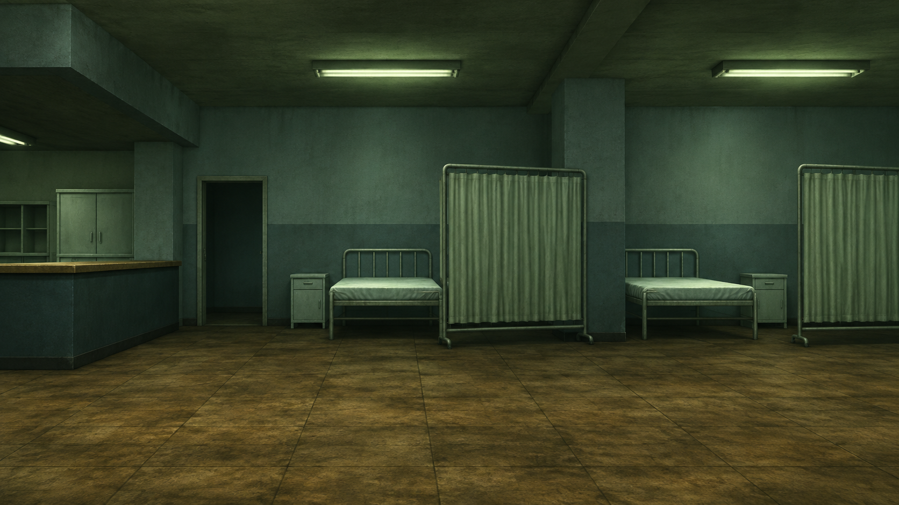</a> <strong>Hospital — salle de soins</strong> P61 · Portable Ops 1672 × 941 px <a href="../../../public/cqc/assets/p61/mpo-hospital-ward.png">PNG</a> · <a href="https://github.com/darknigthmare/shadow-codec-ops/blob/codex/cqc-p61-missing-static-sources-20261125/public/cqc/assets/p61/mpo-hospital-ward.png">PNG GitHub</a> · <a href="../../../docs/cqc-reprise/pass61/batches/mpo-hospital-ward.json">Manifeste</a> · <a href="https://github.com/darknigthmare/shadow-codec-ops/blob/codex/cqc-p61-missing-static-sources-20261125/docs/cqc-reprise/pass61/batches/mpo-hospital-ward.json">Manifeste GitHub</a> Références : <a href="https://www.youtube.com/watch?v=6g_6Ud9jVFo">1</a> <a href="galerie.html#source-100">Carte et réserves détaillées</a> | <!-- asset-path:public/cqc/assets/p61/mpo-railbridge.png --><a href="../../../public/cqc/assets/p61/mpo-railbridge.png">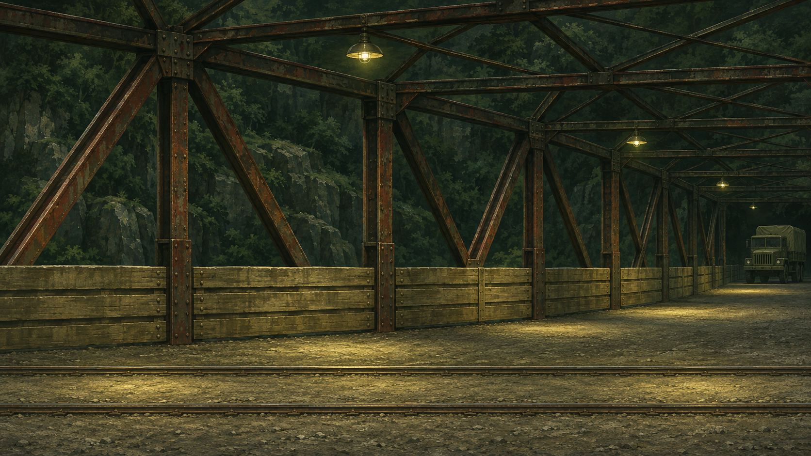</a> <strong>Rail Bridge — tablier et treillis métalliques</strong> P61 · Metal Gear Solid: Portable Ops 1672 × 941 px <a href="../../../public/cqc/assets/p61/mpo-railbridge.png">PNG</a> · <a href="https://github.com/darknigthmare/shadow-codec-ops/blob/codex/cqc-p61-missing-static-sources-20261125/public/cqc/assets/p61/mpo-railbridge.png">PNG GitHub</a> · <a href="../../../docs/cqc-reprise/pass61/batches/stages-mpo-machines.json">Manifeste</a> · <a href="https://github.com/darknigthmare/shadow-codec-ops/blob/codex/cqc-p61-missing-static-sources-20261125/docs/cqc-reprise/pass61/batches/stages-mpo-machines.json">Manifeste GitHub</a> Références : <a href="https://www.youtube.com/watch?v=M-S4icV8-84&amp;t=7710s">1</a> · <a href="https://www.youtube.com/watch?v=M-S4icV8-84&amp;t=7930s">2</a> · <a href="https://www.pocketgamer.com/metal-gear-solid-portable-ops/new-metal-gear-solid-portable-ops-screenshots/">3</a> <a href="galerie.html#source-035">Carte et réserves détaillées</a> |
| <!-- asset-path:public/cqc/assets/p61/mpo-research-lab.png --><a href="../../../public/cqc/assets/p61/mpo-research-lab.png">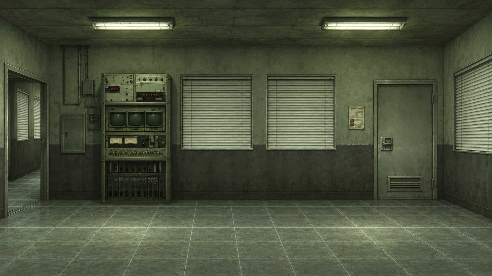</a> <strong>Research Lab — salle des appareils de contrôle</strong> P61 · Metal Gear Solid: Portable Ops 1672 × 941 px <a href="../../../public/cqc/assets/p61/mpo-research-lab.png">PNG</a> · <a href="https://github.com/darknigthmare/shadow-codec-ops/blob/codex/cqc-p61-missing-static-sources-20261125/public/cqc/assets/p61/mpo-research-lab.png">PNG GitHub</a> · <a href="../../../docs/cqc-reprise/pass61/batches/stages-mpo-machines.json">Manifeste</a> · <a href="https://github.com/darknigthmare/shadow-codec-ops/blob/codex/cqc-p61-missing-static-sources-20261125/docs/cqc-reprise/pass61/batches/stages-mpo-machines.json">Manifeste GitHub</a> Références : <a href="https://www.youtube.com/watch?v=M-S4icV8-84&amp;t=7240s">1</a> · <a href="https://www.youtube.com/watch?v=M-S4icV8-84&amp;t=7260s">2</a> · <a href="https://www.youtube.com/watch?v=FaD8a0ZDzbA">3</a> · <a href="https://img.youtube.com/vi/FaD8a0ZDzbA/hq1.jpg">4</a> · <a href="https://www.pocketgamer.com/metal-gear-solid-portable-ops/new-metal-gear-solid-portable-ops-screenshots/">5</a> <a href="galerie.html#source-036">Carte et réserves détaillées</a> | <!-- asset-path:public/cqc/assets/p61/mpo-null-silo.png --><a href="../../../public/cqc/assets/p61/mpo-null-silo.png">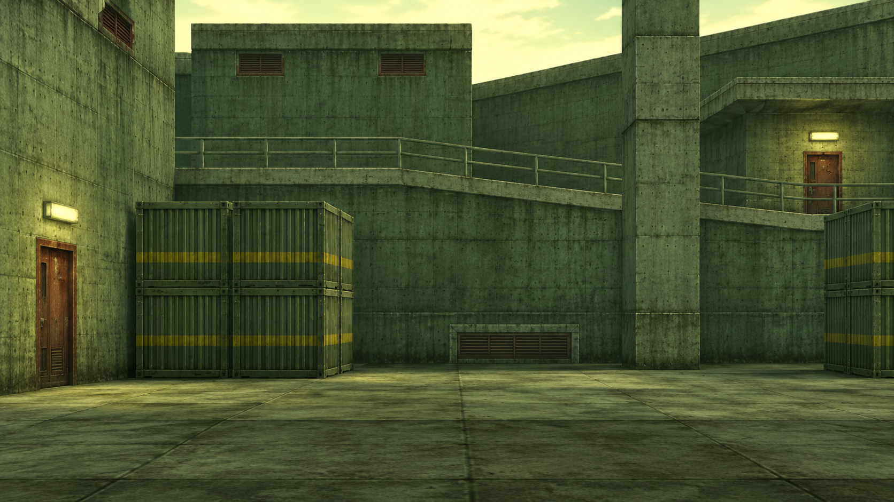</a> <strong>Silo Entrance — cour du premier duel de Null</strong> P61 · Portable Ops 1672 × 941 px <a href="../../../public/cqc/assets/p61/mpo-null-silo.png">PNG</a> · <a href="https://github.com/darknigthmare/shadow-codec-ops/blob/codex/cqc-p61-missing-static-sources-20261125/public/cqc/assets/p61/mpo-null-silo.png">PNG GitHub</a> · <a href="../../../docs/cqc-reprise/pass61/batches/mpo-null-silo.json">Manifeste</a> · <a href="https://github.com/darknigthmare/shadow-codec-ops/blob/codex/cqc-p61-missing-static-sources-20261125/docs/cqc-reprise/pass61/batches/mpo-null-silo.json">Manifeste GitHub</a> Références : <a href="https://www.youtube.com/watch?v=REaIXzOgq_w">1</a> · <a href="https://www.youtube.com/watch?v=jpqKHfiZ4P8">2</a> <a href="galerie.html#source-101">Carte et réserves détaillées</a> |

<strong>Metal Gear AC!D</strong> — 2 sources

| Source | Source |
|---|---|
| <!-- asset-path:public/cqc/assets/p61/acid-far-kodoque.png --><a href="../../../public/cqc/assets/p61/acid-far-kodoque.png">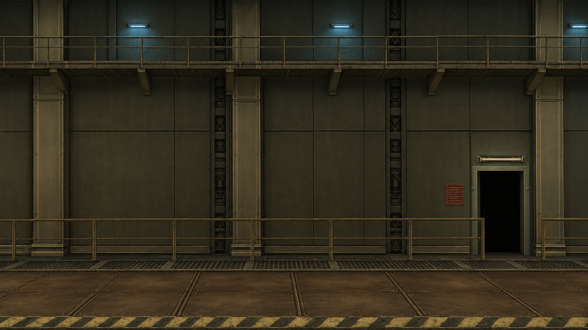</a> <strong>Lobito — chambre de KODOQUE</strong> P61 · Metal Gear AC!D 1672 × 941 px <a href="../../../public/cqc/assets/p61/acid-far-kodoque.png">PNG</a> · <a href="https://github.com/darknigthmare/shadow-codec-ops/blob/codex/cqc-p61-missing-static-sources-20261125/public/cqc/assets/p61/acid-far-kodoque.png">PNG GitHub</a> · <a href="../../../docs/cqc-reprise/pass61/batches/acid-far-kodoque.json">Manifeste</a> · <a href="https://github.com/darknigthmare/shadow-codec-ops/blob/codex/cqc-p61-missing-static-sources-20261125/docs/cqc-reprise/pass61/batches/acid-far-kodoque.json">Manifeste GitHub</a> Références : <a href="https://www.youtube.com/watch?v=14G4WosEgr4">1</a> <a href="galerie.html#source-004">Carte et réserves détaillées</a> | <!-- asset-path:public/cqc/assets/p61/acid-ruins-lower.png --> <strong>Lobito — Ruins Lower</strong> P61 · Metal Gear AC!D 1672 × 941 px <a href="../../../public/cqc/assets/p61/acid-ruins-lower.png">PNG</a> · <a href="https://github.com/darknigthmare/shadow-codec-ops/blob/codex/cqc-p61-missing-static-sources-20261125/public/cqc/assets/p61/acid-ruins-lower.png">PNG GitHub</a> · <a href="../../../docs/cqc-reprise/pass61/batches/acid-ruins-lower.json">Manifeste</a> · <a href="https://github.com/darknigthmare/shadow-codec-ops/blob/codex/cqc-p61-missing-static-sources-20261125/docs/cqc-reprise/pass61/batches/acid-ruins-lower.json">Manifeste GitHub</a> Références : <a href="https://www.youtube.com/watch?v=lEEfSgOvV4Q">1</a> <a href="galerie.html#source-005">Carte et réserves détaillées</a> |

<strong>Metal Gear AC!D 2</strong> — 4 sources

| Source | Source |
|---|---|
| <!-- asset-path:public/cqc/assets/p61/acid2-chaigidiel-room.png --> <strong>SaintLogic — salle de Chaigidiel</strong> P61 · Metal Gear AC!D2 1672 × 941 px <a href="../../../public/cqc/assets/p61/acid2-chaigidiel-room.png">PNG</a> · <a href="https://github.com/darknigthmare/shadow-codec-ops/blob/codex/cqc-p61-missing-static-sources-20261125/public/cqc/assets/p61/acid2-chaigidiel-room.png">PNG GitHub</a> · <a href="../../../docs/cqc-reprise/pass61/batches/acid2-chaigidiel-room.json">Manifeste</a> · <a href="https://github.com/darknigthmare/shadow-codec-ops/blob/codex/cqc-p61-missing-static-sources-20261125/docs/cqc-reprise/pass61/batches/acid2-chaigidiel-room.json">Manifeste GitHub</a> Références : <a href="https://www.youtube.com/watch?v=ygw_F3NjNLo">1</a> <a href="galerie.html#source-006">Carte et réserves détaillées</a> | <!-- asset-path:public/cqc/assets/p61/acid2-golab-room.png --> <strong>SaintLogic — salle de Golab</strong> P61 · Metal Gear AC!D2 1672 × 941 px <a href="../../../public/cqc/assets/p61/acid2-golab-room.png">PNG</a> · <a href="https://github.com/darknigthmare/shadow-codec-ops/blob/codex/cqc-p61-missing-static-sources-20261125/public/cqc/assets/p61/acid2-golab-room.png">PNG GitHub</a> · <a href="../../../docs/cqc-reprise/pass61/batches/acid2-golab-room.json">Manifeste</a> · <a href="https://github.com/darknigthmare/shadow-codec-ops/blob/codex/cqc-p61-missing-static-sources-20261125/docs/cqc-reprise/pass61/batches/acid2-golab-room.json">Manifeste GitHub</a> Références : <a href="https://www.youtube.com/watch?v=3lVO0aoSudY">1</a> <a href="galerie.html#source-007">Carte et réserves détaillées</a> |
| <!-- asset-path:public/cqc/assets/p61/acid2-harab-room.png --> <strong>SaintLogic — salle de Harab Serap</strong> P61 · Metal Gear AC!D2 1672 × 941 px <a href="../../../public/cqc/assets/p61/acid2-harab-room.png">PNG</a> · <a href="https://github.com/darknigthmare/shadow-codec-ops/blob/codex/cqc-p61-missing-static-sources-20261125/public/cqc/assets/p61/acid2-harab-room.png">PNG GitHub</a> · <a href="../../../docs/cqc-reprise/pass61/batches/acid2-harab-room.json">Manifeste</a> · <a href="https://github.com/darknigthmare/shadow-codec-ops/blob/codex/cqc-p61-missing-static-sources-20261125/docs/cqc-reprise/pass61/batches/acid2-harab-room.json">Manifeste GitHub</a> Références : <a href="https://www.youtube.com/watch?v=52YCX-cOsHQ">1</a> <a href="galerie.html#source-008">Carte et réserves détaillées</a> | <!-- asset-path:public/cqc/assets/p61/acid2-prototype.png --> <strong>SaintLogic — étage du prototype KODOQUE</strong> P61 · Metal Gear AC!D2 1672 × 941 px <a href="../../../public/cqc/assets/p61/acid2-prototype.png">PNG</a> · <a href="https://github.com/darknigthmare/shadow-codec-ops/blob/codex/cqc-p61-missing-static-sources-20261125/public/cqc/assets/p61/acid2-prototype.png">PNG GitHub</a> · <a href="../../../docs/cqc-reprise/pass61/batches/acid2-prototype.json">Manifeste</a> · <a href="https://github.com/darknigthmare/shadow-codec-ops/blob/codex/cqc-p61-missing-static-sources-20261125/docs/cqc-reprise/pass61/batches/acid2-prototype.json">Manifeste GitHub</a> Références : <a href="https://www.youtube.com/watch?v=d0LB89r0SL0">1</a> <a href="galerie.html#source-009">Carte et réserves détaillées</a> |

<strong>MGR — Revengeance</strong> — 4 sources

| Source | Source |
|---|---|
| <!-- asset-path:public/cqc/assets/p61/mgr-guadalajara-lab.png --> <strong>Guadalajara — atelier du laboratoire R-02</strong> P61 · Metal Gear Rising: Revengeance 1672 × 941 px <a href="../../../public/cqc/assets/p61/mgr-guadalajara-lab.png">PNG</a> · <a href="https://github.com/darknigthmare/shadow-codec-ops/blob/codex/cqc-p61-missing-static-sources-20261125/public/cqc/assets/p61/mgr-guadalajara-lab.png">PNG GitHub</a> · <a href="../../../docs/cqc-reprise/pass61/batches/mgr-guadalajara-lab.json">Manifeste</a> · <a href="https://github.com/darknigthmare/shadow-codec-ops/blob/codex/cqc-p61-missing-static-sources-20261125/docs/cqc-reprise/pass61/batches/mgr-guadalajara-lab.json">Manifeste GitHub</a> Références : <a href="https://www.youtube.com/watch?v=8po-JzqOJ_s">1</a> · <a href="https://www.youtube.com/watch?v=_8vF6G2N0UQ">2</a> · <a href="https://www.supercheats.com/metal-gear-rising-revengeance/walkthrough/file-r-02-research-facility">3</a> <a href="galerie.html#source-013">Carte et réserves détaillées</a> | <!-- asset-path:public/cqc/assets/p61/mgr-guadalajara-sewers.png --> <strong>Guadalajara — égouts R-02</strong> P61 · Metal Gear Rising: Revengeance 1672 × 941 px <a href="../../../public/cqc/assets/p61/mgr-guadalajara-sewers.png">PNG</a> · <a href="https://github.com/darknigthmare/shadow-codec-ops/blob/codex/cqc-p61-missing-static-sources-20261125/public/cqc/assets/p61/mgr-guadalajara-sewers.png">PNG GitHub</a> · <a href="../../../docs/cqc-reprise/pass61/batches/mgr-guadalajara-sewers.json">Manifeste</a> · <a href="https://github.com/darknigthmare/shadow-codec-ops/blob/codex/cqc-p61-missing-static-sources-20261125/docs/cqc-reprise/pass61/batches/mgr-guadalajara-sewers.json">Manifeste GitHub</a> Références : <a href="https://www.bazicenter.com/features/ign_guides/metal-gear-rising-revengeance.pdf">1</a> <a href="galerie.html#source-014">Carte et réserves détaillées</a> |
| <!-- asset-path:public/cqc/assets/p61/mgr-pakistan-hangar.png --> <strong>Pakistan — hangar de la base aérienne avant EXCELSUS</strong> P61 · Metal Gear Rising: Revengeance 1672 × 941 px <a href="../../../public/cqc/assets/p61/mgr-pakistan-hangar.png">PNG</a> · <a href="https://github.com/darknigthmare/shadow-codec-ops/blob/codex/cqc-p61-missing-static-sources-20261125/public/cqc/assets/p61/mgr-pakistan-hangar.png">PNG GitHub</a> · <a href="../../../docs/cqc-reprise/pass61/batches/mgr-pakistan-hangar.json">Manifeste</a> · <a href="https://github.com/darknigthmare/shadow-codec-ops/blob/codex/cqc-p61-missing-static-sources-20261125/docs/cqc-reprise/pass61/batches/mgr-pakistan-hangar.json">Manifeste GitHub</a> Références : <a href="https://www.youtube.com/watch?v=dMFBW2BJ_Cc">1</a> · <a href="https://www.supercheats.com/metal-gear-rising-revengeance/walkthrough/file-r-07">2</a> · <a href="https://www.bazicenter.com/features/ign_guides/metal-gear-rising-revengeance.pdf">3</a> <a href="galerie.html#source-015">Carte et réserves détaillées</a> | <!-- asset-path:public/cqc/assets/p61/mgr-wm-office.png --> <strong>World Marshal — bureaux du 20e étage</strong> P61 · Metal Gear Rising: Revengeance 1672 × 941 px <a href="../../../public/cqc/assets/p61/mgr-wm-office.png">PNG</a> · <a href="https://github.com/darknigthmare/shadow-codec-ops/blob/codex/cqc-p61-missing-static-sources-20261125/public/cqc/assets/p61/mgr-wm-office.png">PNG GitHub</a> · <a href="../../../docs/cqc-reprise/pass61/batches/mgr-wm-office.json">Manifeste</a> · <a href="https://github.com/darknigthmare/shadow-codec-ops/blob/codex/cqc-p61-missing-static-sources-20261125/docs/cqc-reprise/pass61/batches/mgr-wm-office.json">Manifeste GitHub</a> Références : <a href="https://www.youtube.com/watch?v=rdjltur81-Q">1</a> · <a href="https://www.supercheats.com/metal-gear-rising-revengeance/walkthrough/file-r-04-hostile-takeover">2</a> · <a href="https://www.bazicenter.com/features/ign_guides/metal-gear-rising-revengeance.pdf">3</a> <a href="galerie.html#source-016">Carte et réserves détaillées</a> |

<strong>MGR — DLC Jetstream</strong> — 1 source

| Source | Source |
|---|---|
| <!-- asset-path:public/cqc/assets/p61/mgr-sam-armstrong.png --> <strong>World Marshal — héliport Jetstream Sam / Armstrong</strong> P61 · Metal Gear Rising: Revengeance — DLC Jetstream 1672 × 941 px <a href="../../../public/cqc/assets/p61/mgr-sam-armstrong.png">PNG</a> · <a href="https://github.com/darknigthmare/shadow-codec-ops/blob/codex/cqc-p61-missing-static-sources-20261125/public/cqc/assets/p61/mgr-sam-armstrong.png">PNG GitHub</a> · <a href="../../../docs/cqc-reprise/pass61/batches/mgr-sam-armstrong.json">Manifeste</a> · <a href="https://github.com/darknigthmare/shadow-codec-ops/blob/codex/cqc-p61-missing-static-sources-20261125/docs/cqc-reprise/pass61/batches/mgr-sam-armstrong.json">Manifeste GitHub</a> Références : <a href="https://www.toplevelcanon.com/reviews/k8t8nhg1shttzrh692cnm8dtgecwnz">1</a> <a href="galerie.html#source-017">Carte et réserves détaillées</a> |   |

<strong>MGO1</strong> — 12 sources

| Source | Source |
|---|---|
| <!-- asset-path:public/cqc/assets/p61/mgo1-brown-town.png --> <strong>Brown Town — rue poussiéreuse</strong> P61 · MGO1 1672 × 941 px <a href="../../../public/cqc/assets/p61/mgo1-brown-town.png">PNG</a> · <a href="https://github.com/darknigthmare/shadow-codec-ops/blob/codex/cqc-p61-missing-static-sources-20261125/public/cqc/assets/p61/mgo1-brown-town.png">PNG GitHub</a> · <a href="../../../docs/cqc-reprise/pass61/batches/stages-online.json">Manifeste</a> · <a href="https://github.com/darknigthmare/shadow-codec-ops/blob/codex/cqc-p61-missing-static-sources-20261125/docs/cqc-reprise/pass61/batches/stages-online.json">Manifeste GitHub</a> Références : <a href="https://www.youtube.com/watch?v=noInC7utpTs">1</a> · <a href="https://i.ytimg.com/vi/noInC7utpTs/maxresdefault.jpg">2</a> · <a href="https://w.atwiki.jp/wiki6_snake/pages/84.html">3</a> <a href="galerie.html#source-040">Carte et réserves détaillées</a> | <!-- asset-path:public/cqc/assets/p61/mgo1-city-under-siege.png --> <strong>City Under Siege — allée de la ville</strong> P61 · MGO1 1672 × 941 px <a href="../../../public/cqc/assets/p61/mgo1-city-under-siege.png">PNG</a> · <a href="https://github.com/darknigthmare/shadow-codec-ops/blob/codex/cqc-p61-missing-static-sources-20261125/public/cqc/assets/p61/mgo1-city-under-siege.png">PNG GitHub</a> · <a href="../../../docs/cqc-reprise/pass61/batches/stages-online.json">Manifeste</a> · <a href="https://github.com/darknigthmare/shadow-codec-ops/blob/codex/cqc-p61-missing-static-sources-20261125/docs/cqc-reprise/pass61/batches/stages-online.json">Manifeste GitHub</a> Références : <a href="https://www.youtube.com/watch?v=aVRDileJetw">1</a> · <a href="https://i.ytimg.com/vi/aVRDileJetw/maxresdefault.jpg">2</a> · <a href="https://www.youtube.com/watch?v=xTZ735mlHc4">3</a> · <a href="https://www.youtube.com/watch?v=L5-TNrFw5NU">4</a> · <a href="https://w.atwiki.jp/wiki6_snake/pages/84.html">5</a> <a href="galerie.html#source-041">Carte et réserves détaillées</a> |
| <!-- asset-path:public/cqc/assets/p61/mgo1-ghost-factory.png --> <strong>Ghost Factory — étage en ruine</strong> P61 · MGO1 1672 × 941 px <a href="../../../public/cqc/assets/p61/mgo1-ghost-factory.png">PNG</a> · <a href="https://github.com/darknigthmare/shadow-codec-ops/blob/codex/cqc-p61-missing-static-sources-20261125/public/cqc/assets/p61/mgo1-ghost-factory.png">PNG GitHub</a> · <a href="../../../docs/cqc-reprise/pass61/batches/stages-online.json">Manifeste</a> · <a href="https://github.com/darknigthmare/shadow-codec-ops/blob/codex/cqc-p61-missing-static-sources-20261125/docs/cqc-reprise/pass61/batches/stages-online.json">Manifeste GitHub</a> Références : <a href="https://www.youtube.com/watch?v=gO9WfbZAbsc">1</a> · <a href="https://i.ytimg.com/vi/gO9WfbZAbsc/maxresdefault.jpg">2</a> · <a href="https://www.youtube.com/watch?v=CgpJ0ia5wks">3</a> · <a href="https://w.atwiki.jp/wiki6_snake/pages/84.html">4</a> <a href="galerie.html#source-042">Carte et réserves détaillées</a> | <!-- asset-path:public/cqc/assets/p61/mgo1-graniny-gorki-lab.png --> <strong>Graniny Gorki Lab — bibliothèque du laboratoire</strong> P61 · MGO1 1672 × 941 px <a href="../../../public/cqc/assets/p61/mgo1-graniny-gorki-lab.png">PNG</a> · <a href="https://github.com/darknigthmare/shadow-codec-ops/blob/codex/cqc-p61-missing-static-sources-20261125/public/cqc/assets/p61/mgo1-graniny-gorki-lab.png">PNG GitHub</a> · <a href="../../../docs/cqc-reprise/pass61/batches/stages-online.json">Manifeste</a> · <a href="https://github.com/darknigthmare/shadow-codec-ops/blob/codex/cqc-p61-missing-static-sources-20261125/docs/cqc-reprise/pass61/batches/stages-online.json">Manifeste GitHub</a> Références : <a href="https://www.metalgearweb.it/view/sezioni/mgw/mgm/2.pdf">1</a> · <a href="https://w.atwiki.jp/wiki6_snake/pages/84.html">2</a> · <a href="https://mgcvt.com/mgo/">3</a> <a href="galerie.html#source-043">Carte et réserves détaillées</a> |
| <!-- asset-path:public/cqc/assets/p61/mgo1-high-ice.png --> <strong>High Ice — dépôt sous la neige</strong> P61 · MGO1 1672 × 941 px <a href="../../../public/cqc/assets/p61/mgo1-high-ice.png">PNG</a> · <a href="https://github.com/darknigthmare/shadow-codec-ops/blob/codex/cqc-p61-missing-static-sources-20261125/public/cqc/assets/p61/mgo1-high-ice.png">PNG GitHub</a> · <a href="../../../docs/cqc-reprise/pass61/batches/stages-online.json">Manifeste</a> · <a href="https://github.com/darknigthmare/shadow-codec-ops/blob/codex/cqc-p61-missing-static-sources-20261125/docs/cqc-reprise/pass61/batches/stages-online.json">Manifeste GitHub</a> Références : <a href="https://www.youtube.com/watch?v=KvWlFQ0NcfM">1</a> · <a href="https://i.ytimg.com/vi/KvWlFQ0NcfM/maxresdefault.jpg">2</a> · <a href="https://w.atwiki.jp/wiki6_snake/pages/84.html">3</a> <a href="galerie.html#source-044">Carte et réserves détaillées</a> | <!-- asset-path:public/cqc/assets/p61/mgo1-killhouse-a.png --> <strong>Killhouse A — salle d’entraînement</strong> P61 · MGO1 1672 × 941 px <a href="../../../public/cqc/assets/p61/mgo1-killhouse-a.png">PNG</a> · <a href="https://github.com/darknigthmare/shadow-codec-ops/blob/codex/cqc-p61-missing-static-sources-20261125/public/cqc/assets/p61/mgo1-killhouse-a.png">PNG GitHub</a> · <a href="../../../docs/cqc-reprise/pass61/batches/stages-online.json">Manifeste</a> · <a href="https://github.com/darknigthmare/shadow-codec-ops/blob/codex/cqc-p61-missing-static-sources-20261125/docs/cqc-reprise/pass61/batches/stages-online.json">Manifeste GitHub</a> Références : <a href="https://www.youtube.com/watch?v=KY3TOKZzwhc">1</a> · <a href="https://i.ytimg.com/vi/KY3TOKZzwhc/hqdefault.jpg">2</a> · <a href="https://w.atwiki.jp/wiki6_snake/pages/84.html">3</a> <a href="galerie.html#source-045">Carte et réserves détaillées</a> |
| <!-- asset-path:public/cqc/assets/p61/mgo1-killhouse-b.png --> <strong>Killhouse B — passerelles du hangar</strong> P61 · MGO1 1672 × 941 px <a href="../../../public/cqc/assets/p61/mgo1-killhouse-b.png">PNG</a> · <a href="https://github.com/darknigthmare/shadow-codec-ops/blob/codex/cqc-p61-missing-static-sources-20261125/public/cqc/assets/p61/mgo1-killhouse-b.png">PNG GitHub</a> · <a href="../../../docs/cqc-reprise/pass61/batches/stages-online.json">Manifeste</a> · <a href="https://github.com/darknigthmare/shadow-codec-ops/blob/codex/cqc-p61-missing-static-sources-20261125/docs/cqc-reprise/pass61/batches/stages-online.json">Manifeste GitHub</a> Références : <a href="https://game.watch.impress.co.jp/docs/20060414/mgs.htm">1</a> · <a href="https://game.watch.impress.co.jp/docs/20060414/mgs02.gif">2</a> · <a href="https://w.atwiki.jp/wiki6_snake/pages/84.html">3</a> <a href="galerie.html#source-046">Carte et réserves détaillées</a> | <!-- asset-path:public/cqc/assets/p61/mgo1-killhouse-c.png --> <strong>Killhouse C — salles à conteneurs</strong> P61 · MGO1 1672 × 941 px <a href="../../../public/cqc/assets/p61/mgo1-killhouse-c.png">PNG</a> · <a href="https://github.com/darknigthmare/shadow-codec-ops/blob/codex/cqc-p61-missing-static-sources-20261125/public/cqc/assets/p61/mgo1-killhouse-c.png">PNG GitHub</a> · <a href="../../../docs/cqc-reprise/pass61/batches/stages-online.json">Manifeste</a> · <a href="https://github.com/darknigthmare/shadow-codec-ops/blob/codex/cqc-p61-missing-static-sources-20261125/docs/cqc-reprise/pass61/batches/stages-online.json">Manifeste GitHub</a> Références : <a href="https://www.youtube.com/watch?v=MmJZEszFLXA">1</a> · <a href="https://i.ytimg.com/vi/MmJZEszFLXA/maxresdefault.jpg">2</a> · <a href="https://w.atwiki.jp/wiki6_snake/pages/84.html">3</a> <a href="galerie.html#source-047">Carte et réserves détaillées</a> |
| <!-- asset-path:public/cqc/assets/p61/mgo1-lost-forest.png --> <strong>Lost Forest — passage sous le tronc</strong> P61 · MGO1 1672 × 941 px <a href="../../../public/cqc/assets/p61/mgo1-lost-forest.png">PNG</a> · <a href="https://github.com/darknigthmare/shadow-codec-ops/blob/codex/cqc-p61-missing-static-sources-20261125/public/cqc/assets/p61/mgo1-lost-forest.png">PNG GitHub</a> · <a href="../../../docs/cqc-reprise/pass61/batches/stages-online.json">Manifeste</a> · <a href="https://github.com/darknigthmare/shadow-codec-ops/blob/codex/cqc-p61-missing-static-sources-20261125/docs/cqc-reprise/pass61/batches/stages-online.json">Manifeste GitHub</a> Références : <a href="https://www.youtube.com/watch?v=Yg4sHQBe0KY">1</a> · <a href="https://i.ytimg.com/vi/Yg4sHQBe0KY/maxresdefault.jpg">2</a> · <a href="https://w.atwiki.jp/wiki6_snake/pages/84.html">3</a> <a href="galerie.html#source-048">Carte et réserves détaillées</a> | <!-- asset-path:public/cqc/assets/p61/mgo1-mountain-top.png --> <strong>Mountain Top — tranchées de Krasnogorje</strong> P61 · MGO1 1672 × 941 px <a href="../../../public/cqc/assets/p61/mgo1-mountain-top.png">PNG</a> · <a href="https://github.com/darknigthmare/shadow-codec-ops/blob/codex/cqc-p61-missing-static-sources-20261125/public/cqc/assets/p61/mgo1-mountain-top.png">PNG GitHub</a> · <a href="../../../docs/cqc-reprise/pass61/batches/stages-online.json">Manifeste</a> · <a href="https://github.com/darknigthmare/shadow-codec-ops/blob/codex/cqc-p61-missing-static-sources-20261125/docs/cqc-reprise/pass61/batches/stages-online.json">Manifeste GitHub</a> Références : <a href="https://www.metalgearweb.it/view/sezioni/mgw/mgm/2.pdf">1</a> · <a href="https://w.atwiki.jp/wiki6_snake/pages/84.html">2</a> <a href="galerie.html#source-049">Carte et réserves détaillées</a> |
| <!-- asset-path:public/cqc/assets/p61/mgo1-pillbox-purgatory.png --> <strong>Pillbox Purgatory — couloir du bunker</strong> P61 · MGO1 1672 × 941 px <a href="../../../public/cqc/assets/p61/mgo1-pillbox-purgatory.png">PNG</a> · <a href="https://github.com/darknigthmare/shadow-codec-ops/blob/codex/cqc-p61-missing-static-sources-20261125/public/cqc/assets/p61/mgo1-pillbox-purgatory.png">PNG GitHub</a> · <a href="../../../docs/cqc-reprise/pass61/batches/stages-online.json">Manifeste</a> · <a href="https://github.com/darknigthmare/shadow-codec-ops/blob/codex/cqc-p61-missing-static-sources-20261125/docs/cqc-reprise/pass61/batches/stages-online.json">Manifeste GitHub</a> Références : <a href="https://www.youtube.com/watch?v=_xwOnL5diLU">1</a> · <a href="https://i.ytimg.com/vi/_xwOnL5diLU/hqdefault.jpg">2</a> · <a href="https://w.atwiki.jp/wiki6_snake/pages/84.html">3</a> <a href="galerie.html#source-050">Carte et réserves détaillées</a> | <!-- asset-path:public/cqc/assets/p61/mgo1-svyatogornyj-east.png --> <strong>Svyatogornyj East — chalet de rondins</strong> P61 · MGO1 1672 × 941 px <a href="../../../public/cqc/assets/p61/mgo1-svyatogornyj-east.png">PNG</a> · <a href="https://github.com/darknigthmare/shadow-codec-ops/blob/codex/cqc-p61-missing-static-sources-20261125/public/cqc/assets/p61/mgo1-svyatogornyj-east.png">PNG GitHub</a> · <a href="../../../docs/cqc-reprise/pass61/batches/stages-online.json">Manifeste</a> · <a href="https://github.com/darknigthmare/shadow-codec-ops/blob/codex/cqc-p61-missing-static-sources-20261125/docs/cqc-reprise/pass61/batches/stages-online.json">Manifeste GitHub</a> Références : <a href="https://www.metalgearweb.it/view/sezioni/mgw/mgm/2.pdf">1</a> · <a href="https://w.atwiki.jp/wiki6_snake/pages/84.html">2</a> <a href="galerie.html#source-051">Carte et réserves détaillées</a> |

<strong>MGO2</strong> — 15 sources

| Source | Source |
|---|---|
| <!-- asset-path:public/cqc/assets/p61/mgo2-ambush-alley.png --> <strong>Ambush Alley — carrefour en ruines</strong> P61 · MGO2 1672 × 941 px <a href="../../../public/cqc/assets/p61/mgo2-ambush-alley.png">PNG</a> · <a href="https://github.com/darknigthmare/shadow-codec-ops/blob/codex/cqc-p61-missing-static-sources-20261125/public/cqc/assets/p61/mgo2-ambush-alley.png">PNG GitHub</a> · <a href="../../../docs/cqc-reprise/pass61/batches/stages-online.json">Manifeste</a> · <a href="https://github.com/darknigthmare/shadow-codec-ops/blob/codex/cqc-p61-missing-static-sources-20261125/docs/cqc-reprise/pass61/batches/stages-online.json">Manifeste GitHub</a> Références : <a href="https://forum.hardware.fr/hfr/JeuxVideo/Consoles/metal-online-dispo-sujet_132878_1.htm">1</a> · <a href="http://ariakan.free.fr/ftp/hfr/ambush.jpg">2</a> · <a href="https://w.atwiki.jp/2chmgo2/pages/41.html">3</a> <a href="galerie.html#source-052">Carte et réserves détaillées</a> | <!-- asset-path:public/cqc/assets/p61/mgo2-blood-bath.png --> <strong>Blood Bath — centre d’entraînement</strong> P61 · MGO2 1672 × 941 px <a href="../../../public/cqc/assets/p61/mgo2-blood-bath.png">PNG</a> · <a href="https://github.com/darknigthmare/shadow-codec-ops/blob/codex/cqc-p61-missing-static-sources-20261125/public/cqc/assets/p61/mgo2-blood-bath.png">PNG GitHub</a> · <a href="../../../docs/cqc-reprise/pass61/batches/stages-online.json">Manifeste</a> · <a href="https://github.com/darknigthmare/shadow-codec-ops/blob/codex/cqc-p61-missing-static-sources-20261125/docs/cqc-reprise/pass61/batches/stages-online.json">Manifeste GitHub</a> Références : <a href="https://forum.hardware.fr/hfr/JeuxVideo/Consoles/metal-online-dispo-sujet_132878_1.htm">1</a> · <a href="http://ariakan.free.fr/ftp/hfr/blood.jpg">2</a> · <a href="https://w.atwiki.jp/2chmgo2/pages/40.html">3</a> <a href="galerie.html#source-053">Carte et réserves détaillées</a> |
| <!-- asset-path:public/cqc/assets/p61/mgo2-coppertown-conflict.png --> <strong>Coppertown Conflict — rue industrielle</strong> P61 · MGO2 1672 × 941 px <a href="../../../public/cqc/assets/p61/mgo2-coppertown-conflict.png">PNG</a> · <a href="https://github.com/darknigthmare/shadow-codec-ops/blob/codex/cqc-p61-missing-static-sources-20261125/public/cqc/assets/p61/mgo2-coppertown-conflict.png">PNG GitHub</a> · <a href="../../../docs/cqc-reprise/pass61/batches/stages-online.json">Manifeste</a> · <a href="https://github.com/darknigthmare/shadow-codec-ops/blob/codex/cqc-p61-missing-static-sources-20261125/docs/cqc-reprise/pass61/batches/stages-online.json">Manifeste GitHub</a> Références : <a href="https://www.youtube.com/watch?v=SOk3eH6Z-I4">1</a> · <a href="https://i.ytimg.com/vi/SOk3eH6Z-I4/maxresdefault.jpg">2</a> · <a href="https://www.gematsu.com/2008/07/metal-gear-online-gene-expansion-pack-detailed">3</a> <a href="galerie.html#source-054">Carte et réserves détaillées</a> | <!-- asset-path:public/cqc/assets/p61/mgo2-forest-firefight.png --> <strong>Forest Firefight — baraquement forestier</strong> P61 · MGO2 1672 × 941 px <a href="../../../public/cqc/assets/p61/mgo2-forest-firefight.png">PNG</a> · <a href="https://github.com/darknigthmare/shadow-codec-ops/blob/codex/cqc-p61-missing-static-sources-20261125/public/cqc/assets/p61/mgo2-forest-firefight.png">PNG GitHub</a> · <a href="../../../docs/cqc-reprise/pass61/batches/stages-online.json">Manifeste</a> · <a href="https://github.com/darknigthmare/shadow-codec-ops/blob/codex/cqc-p61-missing-static-sources-20261125/docs/cqc-reprise/pass61/batches/stages-online.json">Manifeste GitHub</a> Références : <a href="https://www.4gamer.net/games/052/G005244/20081008069/">1</a> · <a href="https://www.4gamer.net/games/052/G005244/20081008069/SS/003.jpg">2</a> <a href="galerie.html#source-055">Carte et réserves détaillées</a> |
| <!-- asset-path:public/cqc/assets/p61/mgo2-groznyj-grad.png --> <strong>Groznyj Grad — cour de la forteresse</strong> P61 · MGO2 1672 × 941 px <a href="../../../public/cqc/assets/p61/mgo2-groznyj-grad.png">PNG</a> · <a href="https://github.com/darknigthmare/shadow-codec-ops/blob/codex/cqc-p61-missing-static-sources-20261125/public/cqc/assets/p61/mgo2-groznyj-grad.png">PNG GitHub</a> · <a href="../../../docs/cqc-reprise/pass61/batches/stages-online.json">Manifeste</a> · <a href="https://github.com/darknigthmare/shadow-codec-ops/blob/codex/cqc-p61-missing-static-sources-20261125/docs/cqc-reprise/pass61/batches/stages-online.json">Manifeste GitHub</a> Références : <a href="https://www.boards.ie/discussion/2057069091/memorable-favourite-multiplier-maps">1</a> · <a href="http://images2.wikia.nocookie.net/__cb20080910053420/metalgear/images/f/fc/Groznyj_Grad1.jpg">2</a> · <a href="https://w.atwiki.jp/2chmgo2/pages/20.html">3</a> <a href="galerie.html#source-056">Carte et réserves détaillées</a> | <!-- asset-path:public/cqc/assets/p61/mgo2-hazard-house.png --> <strong>Hazard House — cour du manoir</strong> P61 · MGO2 1672 × 941 px <a href="../../../public/cqc/assets/p61/mgo2-hazard-house.png">PNG</a> · <a href="https://github.com/darknigthmare/shadow-codec-ops/blob/codex/cqc-p61-missing-static-sources-20261125/public/cqc/assets/p61/mgo2-hazard-house.png">PNG GitHub</a> · <a href="../../../docs/cqc-reprise/pass61/batches/stages-online.json">Manifeste</a> · <a href="https://github.com/darknigthmare/shadow-codec-ops/blob/codex/cqc-p61-missing-static-sources-20261125/docs/cqc-reprise/pass61/batches/stages-online.json">Manifeste GitHub</a> Références : <a href="https://blog.playstation.com/2009/02/18/metal-gear-online-%E2%80%93-scene-expansion-details/">1</a> · <a href="https://farm4.static.flickr.com/3297/3290929756_b3948f5d33.jpg">2</a> <a href="galerie.html#source-057">Carte et réserves détaillées</a> |
| <!-- asset-path:public/cqc/assets/p61/mgo2-icebound-inferno.png --> <strong>Icebound Inferno — héliport enneigé</strong> P61 · MGO2 1672 × 941 px <a href="../../../public/cqc/assets/p61/mgo2-icebound-inferno.png">PNG</a> · <a href="https://github.com/darknigthmare/shadow-codec-ops/blob/codex/cqc-p61-missing-static-sources-20261125/public/cqc/assets/p61/mgo2-icebound-inferno.png">PNG GitHub</a> · <a href="../../../docs/cqc-reprise/pass61/batches/stages-online.json">Manifeste</a> · <a href="https://github.com/darknigthmare/shadow-codec-ops/blob/codex/cqc-p61-missing-static-sources-20261125/docs/cqc-reprise/pass61/batches/stages-online.json">Manifeste GitHub</a> Références : <a href="https://www.boards.ie/discussion/2057069091/memorable-favourite-multiplier-maps">1</a> · <a href="http://images3.wikia.nocookie.net/__cb20110317180102/metalgear/images/3/36/Iceboundinferno.jpg">2</a> · <a href="https://www.inside-games.jp/article/img/2009/06/16/35836/91492.html">3</a> <a href="galerie.html#source-058">Carte et réserves détaillées</a> | <!-- asset-path:public/cqc/assets/p61/mgo2-midtown-maelstrom.png --> <strong>Midtown Maelstrom — rue du Moyen-Orient</strong> P61 · MGO2 1672 × 941 px <a href="../../../public/cqc/assets/p61/mgo2-midtown-maelstrom.png">PNG</a> · <a href="https://github.com/darknigthmare/shadow-codec-ops/blob/codex/cqc-p61-missing-static-sources-20261125/public/cqc/assets/p61/mgo2-midtown-maelstrom.png">PNG GitHub</a> · <a href="../../../docs/cqc-reprise/pass61/batches/stages-online.json">Manifeste</a> · <a href="https://github.com/darknigthmare/shadow-codec-ops/blob/codex/cqc-p61-missing-static-sources-20261125/docs/cqc-reprise/pass61/batches/stages-online.json">Manifeste GitHub</a> Références : <a href="https://forum.hardware.fr/hfr/JeuxVideo/Consoles/metal-online-dispo-sujet_132878_1.htm">1</a> · <a href="http://ariakan.free.fr/ftp/hfr/midtown.jpg">2</a> · <a href="https://w.atwiki.jp/2chmgo2/pages/43.html">3</a> <a href="galerie.html#source-059">Carte et réserves détaillées</a> |
| <!-- asset-path:public/cqc/assets/p61/mgo2-outer-outlet.png --> <strong>Outer Outlet — galerie commerciale</strong> P61 · MGO2 1672 × 941 px <a href="../../../public/cqc/assets/p61/mgo2-outer-outlet.png">PNG</a> · <a href="https://github.com/darknigthmare/shadow-codec-ops/blob/codex/cqc-p61-missing-static-sources-20261125/public/cqc/assets/p61/mgo2-outer-outlet.png">PNG GitHub</a> · <a href="../../../docs/cqc-reprise/pass61/batches/stages-online.json">Manifeste</a> · <a href="https://github.com/darknigthmare/shadow-codec-ops/blob/codex/cqc-p61-missing-static-sources-20261125/docs/cqc-reprise/pass61/batches/stages-online.json">Manifeste GitHub</a> Références : <a href="https://blog.playstation.com/2009/02/18/metal-gear-online-%E2%80%93-scene-expansion-details/">1</a> · <a href="https://farm4.static.flickr.com/3586/3290110299_47c5cc2b39_m.jpg">2</a> · <a href="https://farm4.static.flickr.com/3405/3290929900_b13c2b45c2_m.jpg">3</a> <a href="galerie.html#source-060">Carte et réserves détaillées</a> | <!-- asset-path:public/cqc/assets/p61/mgo2-ravaged-riverfront.png --> <strong>Ravaged Riverfront — pont et canal</strong> P61 · MGO2 1672 × 941 px <a href="../../../public/cqc/assets/p61/mgo2-ravaged-riverfront.png">PNG</a> · <a href="https://github.com/darknigthmare/shadow-codec-ops/blob/codex/cqc-p61-missing-static-sources-20261125/public/cqc/assets/p61/mgo2-ravaged-riverfront.png">PNG GitHub</a> · <a href="../../../docs/cqc-reprise/pass61/batches/stages-online.json">Manifeste</a> · <a href="https://github.com/darknigthmare/shadow-codec-ops/blob/codex/cqc-p61-missing-static-sources-20261125/docs/cqc-reprise/pass61/batches/stages-online.json">Manifeste GitHub</a> Références : <a href="https://blog.playstation.com/2009/02/18/metal-gear-online-%E2%80%93-scene-expansion-details/">1</a> · <a href="https://farm4.static.flickr.com/3348/3290929948_6b713cac0b_m.jpg">2</a> · <a href="https://farm4.static.flickr.com/3478/3290110557_30aa79073c_m.jpg">3</a> <a href="galerie.html#source-061">Carte et réserves détaillées</a> |
| <!-- asset-path:public/cqc/assets/p61/mgo2-silo-sunset.png --> <strong>Silo Sunset — passerelle industrielle</strong> P61 · MGO2 1672 × 941 px <a href="../../../public/cqc/assets/p61/mgo2-silo-sunset.png">PNG</a> · <a href="https://github.com/darknigthmare/shadow-codec-ops/blob/codex/cqc-p61-missing-static-sources-20261125/public/cqc/assets/p61/mgo2-silo-sunset.png">PNG GitHub</a> · <a href="../../../docs/cqc-reprise/pass61/batches/stages-online.json">Manifeste</a> · <a href="https://github.com/darknigthmare/shadow-codec-ops/blob/codex/cqc-p61-missing-static-sources-20261125/docs/cqc-reprise/pass61/batches/stages-online.json">Manifeste GitHub</a> Références : <a href="https://www.4gamer.net/games/052/G005244/20081008069/">1</a> · <a href="https://www.4gamer.net/games/052/G005244/20081008069/SS/004.jpg">2</a> <a href="galerie.html#source-062">Carte et réserves détaillées</a> | <!-- asset-path:public/cqc/assets/p61/mgo2-tomb-of-tubes.png --> <strong>Tomb of Tubes — jonction des égouts</strong> P61 · MGO2 1672 × 941 px <a href="../../../public/cqc/assets/p61/mgo2-tomb-of-tubes.png">PNG</a> · <a href="https://github.com/darknigthmare/shadow-codec-ops/blob/codex/cqc-p61-missing-static-sources-20261125/public/cqc/assets/p61/mgo2-tomb-of-tubes.png">PNG GitHub</a> · <a href="../../../docs/cqc-reprise/pass61/batches/stages-online.json">Manifeste</a> · <a href="https://github.com/darknigthmare/shadow-codec-ops/blob/codex/cqc-p61-missing-static-sources-20261125/docs/cqc-reprise/pass61/batches/stages-online.json">Manifeste GitHub</a> Références : <a href="https://www.youtube.com/watch?v=w4FJnBQDBc8">1</a> · <a href="https://i.ytimg.com/vi/w4FJnBQDBc8/maxresdefault.jpg">2</a> · <a href="https://www.gematsu.com/2008/07/metal-gear-online-gene-expansion-pack-detailed">3</a> · <a href="https://w.atwiki.jp/2chmgo2/pages/61.html">4</a> <a href="galerie.html#source-063">Carte et réserves détaillées</a> |
| <!-- asset-path:public/cqc/assets/p61/mgo2-urban-ultimatum.png --> <strong>Urban Ultimatum — toit de la ville</strong> P61 · MGO2 1672 × 941 px <a href="../../../public/cqc/assets/p61/mgo2-urban-ultimatum.png">PNG</a> · <a href="https://github.com/darknigthmare/shadow-codec-ops/blob/codex/cqc-p61-missing-static-sources-20261125/public/cqc/assets/p61/mgo2-urban-ultimatum.png">PNG GitHub</a> · <a href="../../../docs/cqc-reprise/pass61/batches/stages-online.json">Manifeste</a> · <a href="https://github.com/darknigthmare/shadow-codec-ops/blob/codex/cqc-p61-missing-static-sources-20261125/docs/cqc-reprise/pass61/batches/stages-online.json">Manifeste GitHub</a> Références : <a href="https://forum.hardware.fr/hfr/JeuxVideo/Consoles/metal-online-dispo-sujet_132878_1.htm">1</a> · <a href="http://ariakan.free.fr/ftp/hfr/urban.jpg">2</a> · <a href="https://w.atwiki.jp/2chmgo2/pages/44.html">3</a> <a href="galerie.html#source-064">Carte et réserves détaillées</a> | <!-- asset-path:public/cqc/assets/p61/mgo2-virtuous-vista.png --> <strong>Virtuous Vista — bord de centrale</strong> P61 · MGO2 1672 × 941 px <a href="../../../public/cqc/assets/p61/mgo2-virtuous-vista.png">PNG</a> · <a href="https://github.com/darknigthmare/shadow-codec-ops/blob/codex/cqc-p61-missing-static-sources-20261125/public/cqc/assets/p61/mgo2-virtuous-vista.png">PNG GitHub</a> · <a href="../../../docs/cqc-reprise/pass61/batches/stages-online.json">Manifeste</a> · <a href="https://github.com/darknigthmare/shadow-codec-ops/blob/codex/cqc-p61-missing-static-sources-20261125/docs/cqc-reprise/pass61/batches/stages-online.json">Manifeste GitHub</a> Références : <a href="https://www.youtube.com/watch?v=0wDes410WQ4">1</a> · <a href="https://i.ytimg.com/vi/0wDes410WQ4/hqdefault.jpg">2</a> · <a href="https://www.youtube.com/watch?v=GKMPmnlZjhA">3</a> · <a href="https://www.gematsu.com/2008/07/metal-gear-online-gene-expansion-pack-detailed">4</a> <a href="galerie.html#source-065">Carte et réserves détaillées</a> |
| <!-- asset-path:public/cqc/assets/p61/mgo2-winter-warehouse.png --> <strong>Winter Warehouse — entrepôt enneigé</strong> P61 · MGO2 1672 × 941 px <a href="../../../public/cqc/assets/p61/mgo2-winter-warehouse.png">PNG</a> · <a href="https://github.com/darknigthmare/shadow-codec-ops/blob/codex/cqc-p61-missing-static-sources-20261125/public/cqc/assets/p61/mgo2-winter-warehouse.png">PNG GitHub</a> · <a href="../../../docs/cqc-reprise/pass61/batches/stages-online.json">Manifeste</a> · <a href="https://github.com/darknigthmare/shadow-codec-ops/blob/codex/cqc-p61-missing-static-sources-20261125/docs/cqc-reprise/pass61/batches/stages-online.json">Manifeste GitHub</a> Références : <a href="https://www.4gamer.net/games/052/G005244/20081008069/">1</a> · <a href="https://www.4gamer.net/games/052/G005244/20081008069/SS/005.jpg">2</a> <a href="galerie.html#source-066">Carte et réserves détaillées</a> |   |

<strong>MGO3</strong> — 7 sources

| Source | Source |
|---|---|
| <!-- asset-path:public/cqc/assets/p60/mgo3-amber-station.png --> <strong>Amber Station</strong> P60 · MGO3 1672 × 941 px <a href="../../../public/cqc/assets/p60/mgo3-amber-station.png">PNG</a> · <a href="https://github.com/darknigthmare/shadow-codec-ops/blob/codex/cqc-p61-missing-static-sources-20261125/public/cqc/assets/p60/mgo3-amber-station.png">PNG GitHub</a> · <a href="../../../docs/cqc-reprise/pass60/batches/stages.json">Manifeste</a> · <a href="https://github.com/darknigthmare/shadow-codec-ops/blob/codex/cqc-p61-missing-static-sources-20261125/docs/cqc-reprise/pass60/batches/stages.json">Manifeste GitHub</a> Références : <a href="https://www.konami.com/mg/mgs5/tpp/jp/online/stage.php">1</a> · <a href="https://www.konami.com/mg/mgs5/tpp/jp/online/_img/stage/images/pic_z_018_vhbu2r.png">2</a> · <a href="https://www.konami.com/mg/mgs5/tpp/jp/online/_img/stage/images/pic_z_019_w68h9f.png">3</a> · <a href="https://www.konami.com/mg/mgs5/tpp/jp/online/_img/stage/images/pic_z_020_3t5kv5.png">4</a> <a href="galerie.html#source-067">Carte et réserves détaillées</a> | <!-- asset-path:public/cqc/assets/p60/mgo3-azure-mountain.png --> <strong>Azure Mountain</strong> P60 · MGO3 1672 × 941 px <a href="../../../public/cqc/assets/p60/mgo3-azure-mountain.png">PNG</a> · <a href="https://github.com/darknigthmare/shadow-codec-ops/blob/codex/cqc-p61-missing-static-sources-20261125/public/cqc/assets/p60/mgo3-azure-mountain.png">PNG GitHub</a> · <a href="../../../docs/cqc-reprise/pass60/batches/stages.json">Manifeste</a> · <a href="https://github.com/darknigthmare/shadow-codec-ops/blob/codex/cqc-p61-missing-static-sources-20261125/docs/cqc-reprise/pass60/batches/stages.json">Manifeste GitHub</a> Références : <a href="https://www.konami.com/mg/mgs5/tpp/jp/online/news.php">1</a> · <a href="https://www.konami.com/games/eu/en/topics/4803/">2</a> · <a href="https://www.konami.com/mg/mgs5/tpp/jp/online/notes_13.php">3</a> · <a href="https://www.konami.com/mg/mgs5/tpp/jp/online/_img/news/ss_large/cis_1-9.jpg">4</a> · <a href="https://www.konami.com/mg/mgs5/tpp/jp/online/_img/news/ss_large/cis_1-10.jpg">5</a> · <a href="https://www.konami.com/mg/mgs5/tpp/jp/online/_img/news/ss_large/cis_1-11.jpg">6</a> · <a href="https://www.konami.com/mg/mgs5/tpp/jp/online/_img/news/ss_large/cis_1-12.jpg">7</a> <a href="galerie.html#source-068">Carte et réserves détaillées</a> |
| <!-- asset-path:public/cqc/assets/p60/mgo3-black-site.png --> <strong>Black Site</strong> P60 · MGO3 1672 × 941 px <a href="../../../public/cqc/assets/p60/mgo3-black-site.png">PNG</a> · <a href="https://github.com/darknigthmare/shadow-codec-ops/blob/codex/cqc-p61-missing-static-sources-20261125/public/cqc/assets/p60/mgo3-black-site.png">PNG GitHub</a> · <a href="../../../docs/cqc-reprise/pass60/batches/stages.json">Manifeste</a> · <a href="https://github.com/darknigthmare/shadow-codec-ops/blob/codex/cqc-p61-missing-static-sources-20261125/docs/cqc-reprise/pass60/batches/stages.json">Manifeste GitHub</a> Références : <a href="https://www.konami.com/mg/mgs5/tpp/jp/online/stage.php">1</a> · <a href="https://www.konami.com/mg/mgs5/tpp/jp/online/_img/stage/images/pic_z_023_1gitp5.png">2</a> · <a href="https://www.konami.com/mg/mgs5/tpp/jp/online/_img/stage/images/pic_z_024_7yusob.png">3</a> · <a href="https://www.konami.com/mg/mgs5/tpp/jp/online/_img/stage/images/pic_z_025_77niq3.png">4</a> <a href="galerie.html#source-069">Carte et réserves détaillées</a> | <!-- asset-path:public/cqc/assets/p60/mgo3-coral-complex.png --> <strong>Coral Complex</strong> P60 · MGO3 1672 × 941 px <a href="../../../public/cqc/assets/p60/mgo3-coral-complex.png">PNG</a> · <a href="https://github.com/darknigthmare/shadow-codec-ops/blob/codex/cqc-p61-missing-static-sources-20261125/public/cqc/assets/p60/mgo3-coral-complex.png">PNG GitHub</a> · <a href="../../../docs/cqc-reprise/pass60/batches/stages.json">Manifeste</a> · <a href="https://github.com/darknigthmare/shadow-codec-ops/blob/codex/cqc-p61-missing-static-sources-20261125/docs/cqc-reprise/pass60/batches/stages.json">Manifeste GitHub</a> Références : <a href="https://www.konami.com/mg/mgs5/tpp/jp/online/news.php">1</a> · <a href="https://www.konami.com/games/eu/en/topics/4803/">2</a> · <a href="https://www.konami.com/mg/mgs5/tpp/jp/online/notes_11.php">3</a> · <a href="https://www.konami.com/mg/mgs5/tpp/jp/online/_img/news/ss_large/cis_1-1.jpg">4</a> · <a href="https://www.konami.com/mg/mgs5/tpp/jp/online/_img/news/ss_large/cis_1-2.jpg">5</a> · <a href="https://www.konami.com/mg/mgs5/tpp/jp/online/_img/news/ss_large/cis_1-3.jpg">6</a> · <a href="https://www.konami.com/mg/mgs5/tpp/jp/online/_img/news/ss_large/cis_1-4.jpg">7</a> <a href="galerie.html#source-070">Carte et réserves détaillées</a> |
| <!-- asset-path:public/cqc/assets/p60/mgo3-gray-rampart.png --> <strong>Gray Rampart</strong> P60 · MGO3 1672 × 941 px <a href="../../../public/cqc/assets/p60/mgo3-gray-rampart.png">PNG</a> · <a href="https://github.com/darknigthmare/shadow-codec-ops/blob/codex/cqc-p61-missing-static-sources-20261125/public/cqc/assets/p60/mgo3-gray-rampart.png">PNG GitHub</a> · <a href="../../../docs/cqc-reprise/pass60/batches/stages.json">Manifeste</a> · <a href="https://github.com/darknigthmare/shadow-codec-ops/blob/codex/cqc-p61-missing-static-sources-20261125/docs/cqc-reprise/pass60/batches/stages.json">Manifeste GitHub</a> Références : <a href="https://www.konami.com/mg/mgs5/tpp/jp/online/stage.php">1</a> · <a href="https://www.konami.com/mg/mgs5/tpp/jp/online/_img/stage/images/pic_z_012_nxbzey.png">2</a> · <a href="https://www.konami.com/mg/mgs5/tpp/jp/online/_img/stage/images/pic_z_013_4y43pp.png">3</a> · <a href="https://www.konami.com/mg/mgs5/tpp/jp/online/_img/stage/images/pic_z_014_wlsn5l.png">4</a> <a href="galerie.html#source-071">Carte et réserves détaillées</a> | <!-- asset-path:public/cqc/assets/p60/mgo3-red-fortress.png --> <strong>Red Fortress</strong> P60 · MGO3 1672 × 941 px <a href="../../../public/cqc/assets/p60/mgo3-red-fortress.png">PNG</a> · <a href="https://github.com/darknigthmare/shadow-codec-ops/blob/codex/cqc-p61-missing-static-sources-20261125/public/cqc/assets/p60/mgo3-red-fortress.png">PNG GitHub</a> · <a href="../../../docs/cqc-reprise/pass60/batches/stages.json">Manifeste</a> · <a href="https://github.com/darknigthmare/shadow-codec-ops/blob/codex/cqc-p61-missing-static-sources-20261125/docs/cqc-reprise/pass60/batches/stages.json">Manifeste GitHub</a> Références : <a href="https://www.konami.com/mg/mgs5/tpp/jp/online/stage.php">1</a> · <a href="https://www.konami.com/mg/mgs5/tpp/jp/online/_img/stage/images/pic_z_007_89zuin.png">2</a> · <a href="https://www.konami.com/mg/mgs5/tpp/jp/online/_img/stage/images/pic_z_008_xn24gv.png">3</a> · <a href="https://www.konami.com/mg/mgs5/tpp/jp/online/_img/stage/images/pic_z_009_gsnoje.png">4</a> <a href="galerie.html#source-072">Carte et réserves détaillées</a> |
| <!-- asset-path:public/cqc/assets/p60/mgo3-rust-palace.png --> <strong>Rust Palace</strong> P60 · MGO3 1672 × 941 px <a href="../../../public/cqc/assets/p60/mgo3-rust-palace.png">PNG</a> · <a href="https://github.com/darknigthmare/shadow-codec-ops/blob/codex/cqc-p61-missing-static-sources-20261125/public/cqc/assets/p60/mgo3-rust-palace.png">PNG GitHub</a> · <a href="../../../docs/cqc-reprise/pass60/batches/stages.json">Manifeste</a> · <a href="https://github.com/darknigthmare/shadow-codec-ops/blob/codex/cqc-p61-missing-static-sources-20261125/docs/cqc-reprise/pass60/batches/stages.json">Manifeste GitHub</a> Références : <a href="https://www.konami.com/mg/mgs5/tpp/jp/online/news.php">1</a> · <a href="https://www.konami.com/games/eu/en/topics/4803/">2</a> · <a href="https://www.konami.com/mg/mgs5/tpp/jp/online/notes_12.php">3</a> · <a href="https://www.konami.com/mg/mgs5/tpp/jp/online/_img/news/ss_large/cis_1-5.jpg">4</a> · <a href="https://www.konami.com/mg/mgs5/tpp/jp/online/_img/news/ss_large/cis_1-6.jpg">5</a> · <a href="https://www.konami.com/mg/mgs5/tpp/jp/online/_img/news/ss_large/cis_1-7.jpg">6</a> · <a href="https://www.konami.com/mg/mgs5/tpp/jp/online/_img/news/ss_large/cis_1-8.jpg">7</a> <a href="galerie.html#source-073">Carte et réserves détaillées</a> |   |

<strong>Metal Gear Survive</strong> — 3 sources

| Source | Source |
|---|---|
| <!-- asset-path:public/cqc/assets/p61/survive-frostbite-arena.png --> <strong>Dite — avant-poste de Frostbite</strong> P61 · Metal Gear Survive 1672 × 941 px <a href="../../../public/cqc/assets/p61/survive-frostbite-arena.png">PNG</a> · <a href="https://github.com/darknigthmare/shadow-codec-ops/blob/codex/cqc-p61-missing-static-sources-20261125/public/cqc/assets/p61/survive-frostbite-arena.png">PNG GitHub</a> · <a href="../../../docs/cqc-reprise/pass61/batches/survive-frostbite-arena.json">Manifeste</a> · <a href="https://github.com/darknigthmare/shadow-codec-ops/blob/codex/cqc-p61-missing-static-sources-20261125/docs/cqc-reprise/pass61/batches/survive-frostbite-arena.json">Manifeste GitHub</a> Références : <a href="https://www.youtube.com/watch?v=HvmmnW5evQo">1</a> <a href="galerie.html#source-037">Carte et réserves détaillées</a> | <!-- asset-path:public/cqc/assets/p61/survive-final-defense.png --> <strong>Dite — périmètre de défense finale</strong> P61 · Metal Gear Survive 1672 × 941 px <a href="../../../public/cqc/assets/p61/survive-final-defense.png">PNG</a> · <a href="https://github.com/darknigthmare/shadow-codec-ops/blob/codex/cqc-p61-missing-static-sources-20261125/public/cqc/assets/p61/survive-final-defense.png">PNG GitHub</a> · <a href="../../../docs/cqc-reprise/pass61/batches/survive-final-defense.json">Manifeste</a> · <a href="https://github.com/darknigthmare/shadow-codec-ops/blob/codex/cqc-p61-missing-static-sources-20261125/docs/cqc-reprise/pass61/batches/survive-final-defense.json">Manifeste GitHub</a> Références : <a href="https://www.youtube.com/watch?v=zvRGVvSRvYU">1</a> <a href="galerie.html#source-038">Carte et réserves détaillées</a> |
| <!-- asset-path:public/cqc/assets/p61/survive-bigmouth-arena.png --> <strong>Dite — Ruins / Big Mouth</strong> P61 · Metal Gear Survive 1672 × 941 px <a href="../../../public/cqc/assets/p61/survive-bigmouth-arena.png">PNG</a> · <a href="https://github.com/darknigthmare/shadow-codec-ops/blob/codex/cqc-p61-missing-static-sources-20261125/public/cqc/assets/p61/survive-bigmouth-arena.png">PNG GitHub</a> · <a href="../../../docs/cqc-reprise/pass61/batches/survive-bigmouth-arena.json">Manifeste</a> · <a href="https://github.com/darknigthmare/shadow-codec-ops/blob/codex/cqc-p61-missing-static-sources-20261125/docs/cqc-reprise/pass61/batches/survive-bigmouth-arena.json">Manifeste GitHub</a> Références : <a href="https://gameranx.com/features/id/141534/article/metal-gear-survive-how-to-fight-two-legendary-end-game-bosses/">1</a> <a href="galerie.html#source-039">Carte et réserves détaillées</a> |   |

<strong>Metal Gear Arcade</strong> — 2 sources

| Source | Source |
|---|---|
| <!-- asset-path:public/cqc/assets/p61/arcade-desert-duel.png --> <strong>Desert Duel</strong> P61 · Metal Gear Arcade 1672 × 941 px <a href="../../../public/cqc/assets/p61/arcade-desert-duel.png">PNG</a> · <a href="https://github.com/darknigthmare/shadow-codec-ops/blob/codex/cqc-p61-missing-static-sources-20261125/public/cqc/assets/p61/arcade-desert-duel.png">PNG GitHub</a> · <a href="../../../docs/cqc-reprise/pass61/batches/stages-arcade-mobile.json">Manifeste</a> · <a href="https://github.com/darknigthmare/shadow-codec-ops/blob/codex/cqc-p61-missing-static-sources-20261125/docs/cqc-reprise/pass61/batches/stages-arcade-mobile.json">Manifeste GitHub</a> Références : <a href="https://www.youtube.com/watch?v=L-rxwVqxK6M">1</a> · <a href="https://www.youtube.com/watch?v=Vt0InyGpQOQ">2</a> · <a href="https://i.ytimg.com/vi/L-rxwVqxK6M/hq1.jpg">3</a> · <a href="https://i.ytimg.com/vi/L-rxwVqxK6M/hq2.jpg">4</a> · <a href="https://i.ytimg.com/vi/L-rxwVqxK6M/hq3.jpg">5</a> · <a href="https://www.metalgearsolid.fr/metal-gear-arcade-en-test-au-japon-176.html">6</a> · <a href="https://w.atwiki.jp/metalgear-arcade/pages/15.html">7</a> <a href="galerie.html#source-010">Carte et réserves détaillées</a> | <!-- asset-path:public/cqc/assets/p61/arcade-lethal-leviathan.png --> <strong>Lethal Leviathan</strong> P61 · Metal Gear Arcade 1672 × 941 px <a href="../../../public/cqc/assets/p61/arcade-lethal-leviathan.png">PNG</a> · <a href="https://github.com/darknigthmare/shadow-codec-ops/blob/codex/cqc-p61-missing-static-sources-20261125/public/cqc/assets/p61/arcade-lethal-leviathan.png">PNG GitHub</a> · <a href="../../../docs/cqc-reprise/pass61/batches/stages-arcade-mobile.json">Manifeste</a> · <a href="https://github.com/darknigthmare/shadow-codec-ops/blob/codex/cqc-p61-missing-static-sources-20261125/docs/cqc-reprise/pass61/batches/stages-arcade-mobile.json">Manifeste GitHub</a> Références : <a href="https://www.metalgearsolid.fr/metal-gear-arcade-en-test-au-japon-176.html">1</a> · <a href="https://www.metalgearsolid.fr/images/a100728-metal-gear-arcade-g-01.jpg">2</a> · <a href="https://www.metalgearsolid.fr/images/a100728-metal-gear-arcade-g-02.jpg">3</a> · <a href="https://www.youtube.com/watch?v=RYGegN5YrHc">4</a> · <a href="https://w.atwiki.jp/metalgear-arcade/pages/15.html">5</a> <a href="galerie.html#source-011">Carte et réserves détaillées</a> |

<strong>Metal Gear Solid Mobile</strong> — 1 source

| Source | Source |
|---|---|
| <!-- asset-path:public/cqc/assets/p61/mobile-vr-final.png --> <strong>MGS Mobile — finale/VR</strong> P61 · Mobile (N-Gage 2.0, 2008) 1672 × 941 px <a href="../../../public/cqc/assets/p61/mobile-vr-final.png">PNG</a> · <a href="https://github.com/darknigthmare/shadow-codec-ops/blob/codex/cqc-p61-missing-static-sources-20261125/public/cqc/assets/p61/mobile-vr-final.png">PNG GitHub</a> · <a href="../../../docs/cqc-reprise/pass61/batches/stages-arcade-mobile.json">Manifeste</a> · <a href="https://github.com/darknigthmare/shadow-codec-ops/blob/codex/cqc-p61-missing-static-sources-20261125/docs/cqc-reprise/pass61/batches/stages-arcade-mobile.json">Manifeste GitHub</a> Références : <a href="https://www.youtube.com/watch?v=fuT-ewSXYN8">1</a> · <a href="https://i.ytimg.com/vi/fuT-ewSXYN8/hq2.jpg">2</a> · <a href="https://i.ytimg.com/vi/fuT-ewSXYN8/hq3.jpg">3</a> · <a href="https://www.youtube.com/watch?v=q7NymtRjoOc&amp;t=8730s">4</a> · <a href="https://metalgear.fandom.com/wiki/Metal_Gear_Solid_Mobile">5</a> <a href="galerie.html#source-097">Carte et réserves détaillées</a> |   |

<strong>Metal Gear — NES</strong> — 1 source

| Source | Source |
|---|---|
| <!-- asset-path:public/cqc/assets/p60/nes-supercomputer-room.png --> <strong>Outer Heaven NES — salle du Supercomputer</strong> P60 · Metal Gear NES 1672 × 941 px <a href="../../../public/cqc/assets/p60/nes-supercomputer-room.png">PNG</a> · <a href="https://github.com/darknigthmare/shadow-codec-ops/blob/codex/cqc-p61-missing-static-sources-20261125/public/cqc/assets/p60/nes-supercomputer-room.png">PNG GitHub</a> · <a href="../../../docs/cqc-reprise/pass60/batches/root.json">Manifeste</a> · <a href="https://github.com/darknigthmare/shadow-codec-ops/blob/codex/cqc-p61-missing-static-sources-20261125/docs/cqc-reprise/pass60/batches/root.json">Manifeste GitHub</a> Références : <a href="https://bitmob.com/articles/metal-gear-retrospective-part-2-metal-gear-on-the-nes-c64-and-ms-dos.html">1</a> · <a href="https://bitmob.com/albums/ad360/chrisplayedthat/supercomputer.jpg">2</a> <a href="galerie.html#source-012">Carte et réserves détaillées</a> |   |

<strong>Snake’s Revenge — NES</strong> — 1 source

| Source | Source |
|---|---|
| <!-- asset-path:public/cqc/assets/p60/snakes-revenge-metal-gear-2-room.png --> <strong>Snake’s Revenge — chambre Metal Gear 2</strong> P60 · Snake’s Revenge NES 1672 × 941 px <a href="../../../public/cqc/assets/p60/snakes-revenge-metal-gear-2-room.png">PNG</a> · <a href="https://github.com/darknigthmare/shadow-codec-ops/blob/codex/cqc-p61-missing-static-sources-20261125/public/cqc/assets/p60/snakes-revenge-metal-gear-2-room.png">PNG GitHub</a> · <a href="../../../docs/cqc-reprise/pass60/batches/root.json">Manifeste</a> · <a href="https://github.com/darknigthmare/shadow-codec-ops/blob/codex/cqc-p61-missing-static-sources-20261125/docs/cqc-reprise/pass60/batches/root.json">Manifeste GitHub</a> Références : <a href="https://lparchive.org/Metal-Gear-1-2/Update%2019/">1</a> · <a href="https://lparchive.org/Metal-Gear-1-2/Update%2019/42-Snake_s_Revenge_479.png">2</a> <a href="galerie.html#source-102">Carte et réserves détaillées</a> |   |

## Personnages — 17 sources

<strong>MGS2 — Sons of Liberty</strong> — 1 source

| Source | Source |
|---|---|
| <!-- asset-path:public/cqc/assets/p61/mgs2-tanker-marine-right.png --> <strong>Marine du Tanker — archétype de base MGS2</strong> P61 · Metal Gear Solid 2: Sons of Liberty / Substance, original PS2 1024 × 1536 px <a href="../../../public/cqc/assets/p61/mgs2-tanker-marine-right.png">PNG</a> · <a href="https://github.com/darknigthmare/shadow-codec-ops/blob/codex/cqc-p61-missing-static-sources-20261125/public/cqc/assets/p61/mgs2-tanker-marine-right.png">PNG GitHub</a> · <a href="../../../docs/cqc-reprise/pass61/batches/personnages-extra.json">Manifeste</a> · <a href="https://github.com/darknigthmare/shadow-codec-ops/blob/codex/cqc-p61-missing-static-sources-20261125/docs/cqc-reprise/pass61/batches/personnages-extra.json">Manifeste GitHub</a> Références : <a href="https://superadventuresingaming.blogspot.com/2020/03/metal-gear-solid-2-substance-ps2.html">1</a> <a href="galerie.html#source-107">Carte et réserves détaillées</a> |   |

<strong>MGS3 — PS2</strong> — 3 sources

| Source | Source |
|---|---|
| <!-- asset-path:public/cqc/assets/p61/mgs3-cia-director-right.png --> <strong>Directeur de la CIA — modèle MGS3 original</strong> P61 · MGS3 / PS2 original model 1024 × 1536 px <a href="../../../public/cqc/assets/p61/mgs3-cia-director-right.png">PNG</a> · <a href="https://github.com/darknigthmare/shadow-codec-ops/blob/codex/cqc-p61-missing-static-sources-20261125/public/cqc/assets/p61/mgs3-cia-director-right.png">PNG GitHub</a> · <a href="../../../docs/cqc-reprise/pass61/batches/personnages-extra.json">Manifeste</a> · <a href="https://github.com/darknigthmare/shadow-codec-ops/blob/codex/cqc-p61-missing-static-sources-20261125/docs/cqc-reprise/pass61/batches/personnages-extra.json">Manifeste GitHub</a> Références : <a href="https://metalgear.fandom.com/wiki/CIA_Director">1</a> · <a href="https://static.wikia.nocookie.net/metalgear/images/a/a6/CIADpp.png/revision/latest">2</a> · <a href="https://www.youtube.com/watch?v=eFSiIgd05M8">3</a> <a href="galerie.html#source-119">Carte et réserves détaillées</a> | <!-- asset-path:public/cqc/assets/p61/mgs3-pipo-tea-right.png --> <strong>Pipo MGS3 PS2 — sans lunettes, balise bleue, pose assise avec tasse</strong> P61 · Metal Gear Solid 3: Subsistence / original PS2 appearance 1089 × 1444 px <a href="../../../public/cqc/assets/p61/mgs3-pipo-tea-right.png">PNG</a> · <a href="https://github.com/darknigthmare/shadow-codec-ops/blob/codex/cqc-p61-missing-static-sources-20261125/public/cqc/assets/p61/mgs3-pipo-tea-right.png">PNG GitHub</a> · <a href="../../../docs/cqc-reprise/pass61/batches/personnages-extra.json">Manifeste</a> · <a href="https://github.com/darknigthmare/shadow-codec-ops/blob/codex/cqc-p61-missing-static-sources-20261125/docs/cqc-reprise/pass61/batches/personnages-extra.json">Manifeste GitHub</a> Références : <a href="https://games.kikizo.com/reviews/ps2/metalgearsolid3_subsistence.asp">1</a> · <a href="https://games.kikizo.com/media/mgs3_subsistence_rev/05.jpg">2</a> · <a href="https://www.piggyback.com/fr/wp-content/uploads/sites/3/2020/04/MGS3_F_SamplePages.pdf">3</a> · <a href="https://www.youtube.com/watch?v=BUMVSmLRPss">4</a> <a href="galerie.html#source-108">Carte et réserves détaillées</a> |
| <!-- asset-path:public/cqc/assets/p61/mgs3-president-johnson-right.png --> <strong>Président Johnson — modèle MGS3 original</strong> P61 · MGS3 / original PS2 model 1024 × 1536 px <a href="../../../public/cqc/assets/p61/mgs3-president-johnson-right.png">PNG</a> · <a href="https://github.com/darknigthmare/shadow-codec-ops/blob/codex/cqc-p61-missing-static-sources-20261125/public/cqc/assets/p61/mgs3-president-johnson-right.png">PNG GitHub</a> · <a href="../../../docs/cqc-reprise/pass61/batches/personnages-extra.json">Manifeste</a> · <a href="https://github.com/darknigthmare/shadow-codec-ops/blob/codex/cqc-p61-missing-static-sources-20261125/docs/cqc-reprise/pass61/batches/personnages-extra.json">Manifeste GitHub</a> Références : <a href="https://www.youtube.com/watch?v=-lTtkL-50bw">1</a> · <a href="https://i.ytimg.com/vi/-lTtkL-50bw/hq1.jpg">2</a> <a href="galerie.html#source-118">Carte et réserves détaillées</a> |   |

<strong>MGS Delta — Snake Eater</strong> — 3 sources

| Source | Source |
|---|---|
| <!-- asset-path:public/cqc/assets/p61/delta-cia-director-right.png --> <strong>Directeur de la CIA — modèle Delta</strong> P61 · Metal Gear Solid Delta: Snake Eater 1024 × 1536 px <a href="../../../public/cqc/assets/p61/delta-cia-director-right.png">PNG</a> · <a href="https://github.com/darknigthmare/shadow-codec-ops/blob/codex/cqc-p61-missing-static-sources-20261125/public/cqc/assets/p61/delta-cia-director-right.png">PNG GitHub</a> · <a href="../../../docs/cqc-reprise/pass61/batches/personnages-extra.json">Manifeste</a> · <a href="https://github.com/darknigthmare/shadow-codec-ops/blob/codex/cqc-p61-missing-static-sources-20261125/docs/cqc-reprise/pass61/batches/personnages-extra.json">Manifeste GitHub</a> Références : <a href="https://www.youtube.com/watch?v=KRVzikZATdE">1</a> · <a href="https://www.playstation.com/fr-fr/games/metal-gear-solid-delta-snake-eater/">2</a> <a href="galerie.html#source-109">Carte et réserves détaillées</a> | <!-- asset-path:public/cqc/assets/p61/delta-pipo-goggles-alert-right.png --> <strong>Pipo Delta — lunettes, short camouflage, alerte rouge</strong> P61 · Metal Gear Solid Delta: Snake Eater / Snake vs Monkey 1086 × 1448 px <a href="../../../public/cqc/assets/p61/delta-pipo-goggles-alert-right.png">PNG</a> · <a href="https://github.com/darknigthmare/shadow-codec-ops/blob/codex/cqc-p61-missing-static-sources-20261125/public/cqc/assets/p61/delta-pipo-goggles-alert-right.png">PNG GitHub</a> · <a href="../../../docs/cqc-reprise/pass61/batches/personnages-extra.json">Manifeste</a> · <a href="https://github.com/darknigthmare/shadow-codec-ops/blob/codex/cqc-p61-missing-static-sources-20261125/docs/cqc-reprise/pass61/batches/personnages-extra.json">Manifeste GitHub</a> Références : <a href="https://www.konami.com/games/eu/fr/topics/18806/">1</a> · <a href="https://www.konami.com/games_cms/promo/eu/uploads/screenshot4-1.jpg">2</a> · <a href="https://www.youtube.com/watch?v=AMagBqMUVmA">3</a> <a href="galerie.html#source-111">Carte et réserves détaillées</a> |
| <!-- asset-path:public/cqc/assets/p61/delta-president-johnson-right.png --> <strong>Président Johnson — modèle Delta</strong> P61 · Metal Gear Solid Delta: Snake Eater 887 × 1774 px <a href="../../../public/cqc/assets/p61/delta-president-johnson-right.png">PNG</a> · <a href="https://github.com/darknigthmare/shadow-codec-ops/blob/codex/cqc-p61-missing-static-sources-20261125/public/cqc/assets/p61/delta-president-johnson-right.png">PNG GitHub</a> · <a href="../../../docs/cqc-reprise/pass61/batches/personnages-extra.json">Manifeste</a> · <a href="https://github.com/darknigthmare/shadow-codec-ops/blob/codex/cqc-p61-missing-static-sources-20261125/docs/cqc-reprise/pass61/batches/personnages-extra.json">Manifeste GitHub</a> Références : <a href="https://www.youtube.com/watch?v=KRVzikZATdE">1</a> · <a href="https://www.playstation.com/fr-fr/games/metal-gear-solid-delta-snake-eater/">2</a> <a href="galerie.html#source-110">Carte et réserves détaillées</a> |   |

<strong>MGSV — Ground Zeroes</strong> — 4 sources

| Source | Source |
|---|---|
| <!-- asset-path:public/cqc/assets/p61/gz-jcs-undercover-agent-right.png --> <strong>Agent infiltré du JCS — Brian / Mad Wallaby</strong> P61 · Metal Gear Solid V: Ground Zeroes, Classified Intel Acquisition 1024 × 1536 px <a href="../../../public/cqc/assets/p61/gz-jcs-undercover-agent-right.png">PNG</a> · <a href="https://github.com/darknigthmare/shadow-codec-ops/blob/codex/cqc-p61-missing-static-sources-20261125/public/cqc/assets/p61/gz-jcs-undercover-agent-right.png">PNG GitHub</a> · <a href="../../../docs/cqc-reprise/pass61/batches/personnages-extra.json">Manifeste</a> · <a href="https://github.com/darknigthmare/shadow-codec-ops/blob/codex/cqc-p61-missing-static-sources-20261125/docs/cqc-reprise/pass61/batches/personnages-extra.json">Manifeste GitHub</a> Références : <a href="https://www.youtube.com/watch?v=EpnCM0SIDTc">1</a> · <a href="https://www.youtube.com/watch?v=bHatPyvQMCE">2</a> · <a href="https://metalgear.fandom.com/wiki/Undercover_agent_%28JCS%29">3</a> <a href="galerie.html#source-114">Carte et réserves détaillées</a> | <!-- asset-path:public/cqc/assets/p61/gz-hooded-prisoner-right.png --> <strong>Détenu adulte générique de Camp Omega — cagoulé, assis</strong> P61 · Metal Gear Solid V: Ground Zeroes 1024 × 1536 px <a href="../../../public/cqc/assets/p61/gz-hooded-prisoner-right.png">PNG</a> · <a href="https://github.com/darknigthmare/shadow-codec-ops/blob/codex/cqc-p61-missing-static-sources-20261125/public/cqc/assets/p61/gz-hooded-prisoner-right.png">PNG GitHub</a> · <a href="../../../docs/cqc-reprise/pass61/batches/personnages-extra.json">Manifeste</a> · <a href="https://github.com/darknigthmare/shadow-codec-ops/blob/codex/cqc-p61-missing-static-sources-20261125/docs/cqc-reprise/pass61/batches/personnages-extra.json">Manifeste GitHub</a> Références : <a href="https://www.youtube.com/watch?v=-tZ-I7pf0kQ">1</a> · <a href="https://www.youtube.com/watch?v=Y3EYAIO1NuM">2</a> · <a href="https://metalgear.fandom.com/wiki/Prisoner_of_war">3</a> <a href="galerie.html#source-112">Carte et réserves détaillées</a> |
| <!-- asset-path:public/cqc/assets/p61/gz-camp-guard-right.png --> <strong>Garde Marine de Camp Omega — archétype casquette</strong> P61 · Metal Gear Solid V: Ground Zeroes 1024 × 1536 px <a href="../../../public/cqc/assets/p61/gz-camp-guard-right.png">PNG</a> · <a href="https://github.com/darknigthmare/shadow-codec-ops/blob/codex/cqc-p61-missing-static-sources-20261125/public/cqc/assets/p61/gz-camp-guard-right.png">PNG GitHub</a> · <a href="../../../docs/cqc-reprise/pass61/batches/personnages-extra.json">Manifeste</a> · <a href="https://github.com/darknigthmare/shadow-codec-ops/blob/codex/cqc-p61-missing-static-sources-20261125/docs/cqc-reprise/pass61/batches/personnages-extra.json">Manifeste GitHub</a> Références : <a href="https://www.imfdb.org/wiki/Metal_Gear_Solid_V%3A_Ground_Zeroes">1</a> · <a href="https://www.imfdb.org/images/a/ad/US_Marine_armed_with_AM-69.jpg">2</a> · <a href="https://steamcommunity.com/workshop/filedetails/?id=420729039">3</a> · <a href="https://www.youtube.com/watch?v=bHatPyvQMCE">4</a> <a href="galerie.html#source-113">Carte et réserves détaillées</a> | <!-- asset-path:public/cqc/assets/p61/hideo-ground-zeroes-right.png --> <strong>Hideo — Ground Zeroes, après retrait du casque</strong> P61 · Metal Gear Solid V: Ground Zeroes, Intel Operative Rescue 1024 × 1536 px <a href="../../../public/cqc/assets/p61/hideo-ground-zeroes-right.png">PNG</a> · <a href="https://github.com/darknigthmare/shadow-codec-ops/blob/codex/cqc-p61-missing-static-sources-20261125/public/cqc/assets/p61/hideo-ground-zeroes-right.png">PNG GitHub</a> · <a href="../../../docs/cqc-reprise/pass61/batches/personnages-extra.json">Manifeste</a> · <a href="https://github.com/darknigthmare/shadow-codec-ops/blob/codex/cqc-p61-missing-static-sources-20261125/docs/cqc-reprise/pass61/batches/personnages-extra.json">Manifeste GitHub</a> Références : <a href="https://www.metalgearinformer.com/memorable-metal-gear-moments-rescuing-hideo-kojima-in-ground-zeroes/">1</a> · <a href="https://www.youtube.com/watch?v=9yiwPhdVIOo">2</a> · <a href="https://saikai0.blogspot.com/2015/10/hideo-kojima-metal-gear-solid-v-ground.html">3</a> · <a href="https://3.bp.blogspot.com/-u0amIZ6ZpgI/VgxKwXzpAsI/AAAAAAAACxg/ven_kRSMM-k/s1600/4.jpg">4</a> <a href="galerie.html#source-115">Carte et réserves détaillées</a> |

<strong>MGSV — The Phantom Pain</strong> — 1 source

| Source | Source |
|---|---|
| <!-- asset-path:public/cqc/assets/p61/hideo-the-phantom-pain-right.png --> <strong>Hideo — The Phantom Pain, Side Op 112</strong> P61 · Metal Gear Solid V: The Phantom Pain 1024 × 1536 px <a href="../../../public/cqc/assets/p61/hideo-the-phantom-pain-right.png">PNG</a> · <a href="https://github.com/darknigthmare/shadow-codec-ops/blob/codex/cqc-p61-missing-static-sources-20261125/public/cqc/assets/p61/hideo-the-phantom-pain-right.png">PNG GitHub</a> · <a href="../../../docs/cqc-reprise/pass61/batches/personnages-extra.json">Manifeste</a> · <a href="https://github.com/darknigthmare/shadow-codec-ops/blob/codex/cqc-p61-missing-static-sources-20261125/docs/cqc-reprise/pass61/batches/personnages-extra.json">Manifeste GitHub</a> Références : <a href="https://www.youtube.com/watch?v=9yiwPhdVIOo">1</a> · <a href="https://rushbfast.com/rette-den-spieleentwickler-metal-gear-solid-v-the-phantom-pain/">2</a> · <a href="https://rushbfast.com/wp-content/uploads/2018/07/metal-gear-solid-v-the-phantom-pain_kojima-287700_screenshots_2015-09-14_000461.jpg">3</a> <a href="galerie.html#source-116">Carte et réserves détaillées</a> |   |

<strong>MGS — Peace Walker</strong> — 1 source

| Source | Source |
|---|---|
| <!-- asset-path:public/cqc/assets/p61/trenya-pw-right.png --> <strong>Trenya — apparition Monster Hunter dans Peace Walker</strong> P61 · Metal Gear Solid: Peace Walker (2010), crossover Monster Hunter 1199 × 1312 px <a href="../../../public/cqc/assets/p61/trenya-pw-right.png">PNG</a> · <a href="https://github.com/darknigthmare/shadow-codec-ops/blob/codex/cqc-p61-missing-static-sources-20261125/public/cqc/assets/p61/trenya-pw-right.png">PNG GitHub</a> · <a href="../../../docs/cqc-reprise/pass61/batches/personnages-extra.json">Manifeste</a> · <a href="https://github.com/darknigthmare/shadow-codec-ops/blob/codex/cqc-p61-missing-static-sources-20261125/docs/cqc-reprise/pass61/batches/personnages-extra.json">Manifeste GitHub</a> Références : <a href="https://www.youtube.com/watch?v=JjJdFFNbNCU">1</a> · <a href="https://img.youtube.com/vi/JjJdFFNbNCU/hqdefault.jpg">2</a> <a href="galerie.html#source-117">Carte et réserves détaillées</a> |   |

<strong>MGR — Revengeance</strong> — 4 sources

| Source | Source |
|---|---|
| <!-- asset-path:public/cqc/assets/p61/mgr-berserker-right.png --> <strong>Cyborg lourd / Berserker — Metal Gear Rising</strong> P61 · Metal Gear Rising: Revengeance (2013) 1254 × 1254 px <a href="../../../public/cqc/assets/p61/mgr-berserker-right.png">PNG</a> · <a href="https://github.com/darknigthmare/shadow-codec-ops/blob/codex/cqc-p61-missing-static-sources-20261125/public/cqc/assets/p61/mgr-berserker-right.png">PNG GitHub</a> · <a href="../../../docs/cqc-reprise/pass61/batches/personnages-extra.json">Manifeste</a> · <a href="https://github.com/darknigthmare/shadow-codec-ops/blob/codex/cqc-p61-missing-static-sources-20261125/docs/cqc-reprise/pass61/batches/personnages-extra.json">Manifeste GitHub</a> Références : <a href="https://metalgear.fandom.com/wiki/Category%3AMetal_Gear_Rising%3A_Revengeance_Screenshots">1</a> · <a href="https://static.wikia.nocookie.net/metalgear/images/f/f0/Cyborg_%28Heavily_Armed%29_ready_01.jpg/revision/latest">2</a> · <a href="https://static.wikia.nocookie.net/metalgear/images/a/ac/Cyborg_%28Heavily_Armed%29_lengthwise_01.jpg/revision/latest">3</a> · <a href="https://static.wikia.nocookie.net/metalgear/images/2/22/Cyborg_%28Heavily_Armed%29_wide.jpg/revision/latest">4</a> <a href="galerie.html#source-103">Carte et réserves détaillées</a> | <!-- asset-path:public/cqc/assets/p61/mgr-denver-police-right.png --> <strong>Policier cyborg de Denver — archétype masqué</strong> P61 · Metal Gear Rising: Revengeance, File R-03 887 × 1774 px <a href="../../../public/cqc/assets/p61/mgr-denver-police-right.png">PNG</a> · <a href="https://github.com/darknigthmare/shadow-codec-ops/blob/codex/cqc-p61-missing-static-sources-20261125/public/cqc/assets/p61/mgr-denver-police-right.png">PNG GitHub</a> · <a href="../../../docs/cqc-reprise/pass61/batches/personnages-extra.json">Manifeste</a> · <a href="https://github.com/darknigthmare/shadow-codec-ops/blob/codex/cqc-p61-missing-static-sources-20261125/docs/cqc-reprise/pass61/batches/personnages-extra.json">Manifeste GitHub</a> Références : <a href="https://www.piggyback.com/us/wp-content/uploads/sites/6/2020/04/MGR_U_SamplePages.pdf">1</a> · <a href="https://www.youtube.com/watch?v=96DdjYc3_30">2</a> · <a href="https://www.toplevelcanon.com/reviews/wgwd2p6guqo58y5uev5k3nm5m2rtf8">3</a> <a href="galerie.html#source-106">Carte et réserves détaillées</a> |
| <!-- asset-path:public/cqc/assets/p61/mgr-scientist-right.png --> <strong>Scientifique Desperado — laboratoire R-02</strong> P61 · Metal Gear Rising: Revengeance (2013) 1024 × 1536 px <a href="../../../public/cqc/assets/p61/mgr-scientist-right.png">PNG</a> · <a href="https://github.com/darknigthmare/shadow-codec-ops/blob/codex/cqc-p61-missing-static-sources-20261125/public/cqc/assets/p61/mgr-scientist-right.png">PNG GitHub</a> · <a href="../../../docs/cqc-reprise/pass61/batches/personnages-extra.json">Manifeste</a> · <a href="https://github.com/darknigthmare/shadow-codec-ops/blob/codex/cqc-p61-missing-static-sources-20261125/docs/cqc-reprise/pass61/batches/personnages-extra.json">Manifeste GitHub</a> Références : <a href="https://www.youtube.com/watch?v=z76s8CwCg1o">1</a> · <a href="https://metalgear.fandom.com/wiki/Desperado_scientist">2</a> <a href="galerie.html#source-104">Carte et réserves détaillées</a> | <!-- asset-path:public/cqc/assets/p61/desperado-cyborg-right.png --> <strong>Soldat cyborg Desperado — variante standard</strong> P61 · Metal Gear Rising: Revengeance (2013) 1024 × 1536 px <a href="../../../public/cqc/assets/p61/desperado-cyborg-right.png">PNG</a> · <a href="https://github.com/darknigthmare/shadow-codec-ops/blob/codex/cqc-p61-missing-static-sources-20261125/public/cqc/assets/p61/desperado-cyborg-right.png">PNG GitHub</a> · <a href="../../../docs/cqc-reprise/pass61/batches/desperado-cyborg.json">Manifeste</a> · <a href="https://github.com/darknigthmare/shadow-codec-ops/blob/codex/cqc-p61-missing-static-sources-20261125/docs/cqc-reprise/pass61/batches/desperado-cyborg.json">Manifeste GitHub</a> Références : <a href="https://www.piggyback.com/us/wp-content/uploads/sites/6/2020/04/MGR_U_SamplePages.pdf">1</a> · <a href="https://www.platinumgames.com/official-blog/article/4694">2</a> <a href="galerie.html#source-105">Carte et réserves détaillées</a> |

## Costumes — 7 sources

<strong>MGS Delta — Snake Eater</strong> — 1 source

| Source | Source |
|---|---|
| <!-- asset-path:public/cqc/assets/p61/volgin-delta-battle-right.png --> <strong>Volgin — combinaison rouge de combat Delta, bras nus</strong> P61 · Metal Gear Solid Delta: Snake Eater (2025) 1024 × 1536 px <a href="../../../public/cqc/assets/p61/volgin-delta-battle-right.png">PNG</a> · <a href="https://github.com/darknigthmare/shadow-codec-ops/blob/codex/cqc-p61-missing-static-sources-20261125/public/cqc/assets/p61/volgin-delta-battle-right.png">PNG GitHub</a> · <a href="../../../docs/cqc-reprise/pass61/batches/costumes.json">Manifeste</a> · <a href="https://github.com/darknigthmare/shadow-codec-ops/blob/codex/cqc-p61-missing-static-sources-20261125/docs/cqc-reprise/pass61/batches/costumes.json">Manifeste GitHub</a> Références : <a href="https://www.hobbyconsolas.com/guias-trucos/metal-gear-solid-delta-snake-eater/como-derrotar-volgin-metal-gear-solid-delta-snake-eater-1481485">1</a> · <a href="https://imagenes.hobbyconsolas.com/files/image_1920_1080/uploads/imagenes/2025/09/02/6904ad11bfc60.jpeg">2</a> · <a href="https://www.youtube.com/watch?v=W0My43EPcVM">3</a> · <a href="https://img.youtube.com/vi/W0My43EPcVM/hq2.jpg">4</a> · <a href="https://img.youtube.com/vi/W0My43EPcVM/hq3.jpg">5</a> <a href="galerie.html#source-124">Carte et réserves détaillées</a> |   |

<strong>MGS4 — Guns of the Patriots</strong> — 3 sources

| Source | Source |
|---|---|
| <!-- asset-path:public/cqc/assets/p61/old-snake-digital-red-right.png --> <strong>Old Snake — OctoCamo Digital Red</strong> P61 · Metal Gear Solid 4: Guns of the Patriots (PS3 2008) 1024 × 1536 px <a href="../../../public/cqc/assets/p61/old-snake-digital-red-right.png">PNG</a> · <a href="https://github.com/darknigthmare/shadow-codec-ops/blob/codex/cqc-p61-missing-static-sources-20261125/public/cqc/assets/p61/old-snake-digital-red-right.png">PNG GitHub</a> · <a href="../../../docs/cqc-reprise/pass61/batches/old-snake-digital-red.json">Manifeste</a> · <a href="https://github.com/darknigthmare/shadow-codec-ops/blob/codex/cqc-p61-missing-static-sources-20261125/docs/cqc-reprise/pass61/batches/old-snake-digital-red.json">Manifeste GitHub</a> Références : <a href="https://www.konami.com/mg/archive/mgs4/jp/images/mgs4-pic01b.jpg">1</a> · <a href="https://www.konami.com/mg/archive/mgs4/jp/images/mgs4-pic03b.jpg">2</a> · <a href="https://static.wikia.nocookie.net/metalgear/images/c/c3/Reddigital.jpg/revision/latest">3</a> <a href="galerie.html#source-123">Carte et réserves détaillées</a> | <!-- asset-path:public/cqc/assets/p60/old-snake-laughing-right.png --> <strong>Old Snake — OctoCamo Laughing</strong> P60 · Metal Gear Solid 4: Guns of the Patriots (2008, original PS3 design) 1024 × 1536 px <a href="../../../public/cqc/assets/p60/old-snake-laughing-right.png">PNG</a> · <a href="https://github.com/darknigthmare/shadow-codec-ops/blob/codex/cqc-p61-missing-static-sources-20261125/public/cqc/assets/p60/old-snake-laughing-right.png">PNG GitHub</a> · <a href="../../../docs/cqc-reprise/pass60/batches/costumes-vr.json">Manifeste</a> · <a href="https://github.com/darknigthmare/shadow-codec-ops/blob/codex/cqc-p61-missing-static-sources-20261125/docs/cqc-reprise/pass60/batches/costumes-vr.json">Manifeste GitHub</a> Références : <a href="https://www.konami.com/mg/archive/mgs4/jp/images/mgs4-pic01b.jpg">1</a> · <a href="https://www.konami.com/mg/archive/mgs4/jp/images/mgs4-pic03b.jpg">2</a> · <a href="https://www.youtube.com/watch?v=xrMGvpXTF7A&amp;t=64s">3</a> · <a href="https://static.wikia.nocookie.net/metalgear/images/7/7c/E81m3t.jpg/revision/latest">4</a> <a href="galerie.html#source-121">Carte et réserves détaillées</a> |
| <!-- asset-path:public/cqc/assets/p60/old-snake-snake-camo-right.png --> <strong>Old Snake — Snake Camo</strong> P60 · Metal Gear Solid 4: Guns of the Patriots (2008, original PS3 design) 1024 × 1536 px <a href="../../../public/cqc/assets/p60/old-snake-snake-camo-right.png">PNG</a> · <a href="https://github.com/darknigthmare/shadow-codec-ops/blob/codex/cqc-p61-missing-static-sources-20261125/public/cqc/assets/p60/old-snake-snake-camo-right.png">PNG GitHub</a> · <a href="../../../docs/cqc-reprise/pass60/batches/costumes-vr.json">Manifeste</a> · <a href="https://github.com/darknigthmare/shadow-codec-ops/blob/codex/cqc-p61-missing-static-sources-20261125/docs/cqc-reprise/pass60/batches/costumes-vr.json">Manifeste GitHub</a> Références : <a href="https://www.konami.com/mg/archive/mgs4/jp/images/mgs4-pic01b.jpg">1</a> · <a href="https://www.konami.com/mg/archive/mgs4/jp/images/mgs4-pic03b.jpg">2</a> · <a href="https://img.youtube.com/vi/xrMGvpXTF7A/hq3.jpg">3</a> <a href="galerie.html#source-122">Carte et réserves détaillées</a> |   |

<strong>MGSV — The Phantom Pain</strong> — 1 source

| Source | Source |
|---|---|
| <!-- asset-path:public/cqc/assets/p61/diamond-dogs-scout-tactical-right.png --> <strong>Diamond Dogs — équipement casque, masque et gilet tactique</strong> P61 · Metal Gear Solid V: The Phantom Pain (1984) 1024 × 1536 px <a href="../../../public/cqc/assets/p61/diamond-dogs-scout-tactical-right.png">PNG</a> · <a href="https://github.com/darknigthmare/shadow-codec-ops/blob/codex/cqc-p61-missing-static-sources-20261125/public/cqc/assets/p61/diamond-dogs-scout-tactical-right.png">PNG GitHub</a> · <a href="../../../docs/cqc-reprise/pass61/batches/costumes.json">Manifeste</a> · <a href="https://github.com/darknigthmare/shadow-codec-ops/blob/codex/cqc-p61-missing-static-sources-20261125/docs/cqc-reprise/pass61/batches/costumes.json">Manifeste GitHub</a> Références : <a href="https://www.creativeuncut.com/gallery-27/mgs5-motherbase-staff.html">1</a> · <a href="https://www.creativeuncut.com/gallery-27/art/mgs5-motherbase-staff.jpg">2</a> <a href="galerie.html#source-125">Carte et réserves détaillées</a> |   |

<strong>Metal Gear AC!D 2</strong> — 1 source

| Source | Source |
|---|---|
| <!-- asset-path:public/cqc/assets/p61/snake-acid2-bandages-right.png --> <strong>Snake AC!D² — bandages de l&#x27;épilogue, posture assise</strong> P61 · Metal Gear AC!D 2 (PSP 2005) 1199 × 1312 px <a href="../../../public/cqc/assets/p61/snake-acid2-bandages-right.png">PNG</a> · <a href="https://github.com/darknigthmare/shadow-codec-ops/blob/codex/cqc-p61-missing-static-sources-20261125/public/cqc/assets/p61/snake-acid2-bandages-right.png">PNG GitHub</a> · <a href="../../../docs/cqc-reprise/pass61/batches/costumes.json">Manifeste</a> · <a href="https://github.com/darknigthmare/shadow-codec-ops/blob/codex/cqc-p61-missing-static-sources-20261125/docs/cqc-reprise/pass61/batches/costumes.json">Manifeste GitHub</a> Références : <a href="https://www.youtube.com/watch?v=3uZwq_OU07Q">1</a> · <a href="https://img.youtube.com/vi/3uZwq_OU07Q/maxresdefault.jpg">2</a> · <a href="https://www.youtube.com/watch?v=bDL_RC-L2lQ">3</a> · <a href="https://img.youtube.com/vi/bDL_RC-L2lQ/maxresdefault.jpg">4</a> · <a href="https://metalgearspeedrunners.com/wiki/doku.php?id=acid2ng">5</a> <a href="galerie.html#source-120">Carte et réserves détaillées</a> |   |

<strong>Metal Gear Survive</strong> — 1 source

| Source | Source |
|---|---|
| <!-- asset-path:public/cqc/assets/p61/virgil-at9-deployed-right.png --> <strong>Virgil AT-9 — pod déployé ouvert</strong> P61 · Metal Gear Survive (2018) 1024 × 1536 px <a href="../../../public/cqc/assets/p61/virgil-at9-deployed-right.png">PNG</a> · <a href="https://github.com/darknigthmare/shadow-codec-ops/blob/codex/cqc-p61-missing-static-sources-20261125/public/cqc/assets/p61/virgil-at9-deployed-right.png">PNG GitHub</a> · <a href="../../../docs/cqc-reprise/pass61/batches/costumes.json">Manifeste</a> · <a href="https://github.com/darknigthmare/shadow-codec-ops/blob/codex/cqc-p61-missing-static-sources-20261125/docs/cqc-reprise/pass61/batches/costumes.json">Manifeste GitHub</a> Références : <a href="https://www.youtube.com/watch?v=lJVzJ_591U8">1</a> · <a href="https://img.youtube.com/vi/lJVzJ_591U8/maxresdefault.jpg">2</a> · <a href="https://static.wikia.nocookie.net/metalgear/images/f/f9/Virgil_AT-9.png/revision/latest">3</a> <a href="galerie.html#source-126">Carte et réserves détaillées</a> |   |

## Machines — 45 sources

<strong>MGS1 — Integral / VR Missions</strong> — 1 source

| Source | Source |
|---|---|
| <!-- asset-path:public/cqc/assets/p60/vr-genola-1999-right.png --> <strong>Genola — Integral / VR Missions (1999)</strong> P60 · Metal Gear Solid: Integral / VR Missions (1999, original PlayStation incarnation) 1024 × 1536 px <a href="../../../public/cqc/assets/p60/vr-genola-1999-right.png">PNG</a> · <a href="https://github.com/darknigthmare/shadow-codec-ops/blob/codex/cqc-p61-missing-static-sources-20261125/public/cqc/assets/p60/vr-genola-1999-right.png">PNG GitHub</a> · <a href="../../../docs/cqc-reprise/pass60/batches/costumes-vr.json">Manifeste</a> · <a href="https://github.com/darknigthmare/shadow-codec-ops/blob/codex/cqc-p61-missing-static-sources-20261125/docs/cqc-reprise/pass60/batches/costumes-vr.json">Manifeste GitHub</a> Références : <a href="https://m.media-amazon.com/images/M/MV5BZjI5MjVlNDEtZTJiNC00OGY4LTliZWEtMjI1NDEzMjZhNmRjXkEyXkFqcGc%40._V1_.jpg">1</a> · <a href="https://www.konami.com/mg/archive/integral/vr/pic2/variety_13.jpg">2</a> · <a href="https://www.konami.com/mg/archive/integral/vr/enquete2.html">3</a> · <a href="https://www.imdb.com/title/tt0292103/">4</a> <a href="galerie.html#source-133">Carte et réserves détaillées</a> |   |

<strong>MGS2 — Sons of Liberty</strong> — 1 source

| Source | Source |
|---|---|
| <!-- asset-path:public/cqc/assets/p61/ray-mgs2-prototype-right.png --> <strong>RAY — prototype piloté du Tanker</strong> P61 · Metal Gear Solid 2: Sons of Liberty 1536 × 1024 px <a href="../../../public/cqc/assets/p61/ray-mgs2-prototype-right.png">PNG</a> · <a href="https://github.com/darknigthmare/shadow-codec-ops/blob/codex/cqc-p61-missing-static-sources-20261125/public/cqc/assets/p61/ray-mgs2-prototype-right.png">PNG GitHub</a> · <a href="../../../docs/cqc-reprise/pass61/batches/machines.json">Manifeste</a> · <a href="https://github.com/darknigthmare/shadow-codec-ops/blob/codex/cqc-p61-missing-static-sources-20261125/docs/cqc-reprise/pass61/batches/machines.json">Manifeste GitHub</a> Références : <a href="https://www.konami.com/mg/archive/mgs2_sub/english/alldogtags/ray_800.html">1</a> · <a href="https://img.konami.com/mg/archive/mgs2_sub/english/alldogtags/present/wall_ray/800_600.jpg">2</a> · <a href="https://vignette.wikia.nocookie.net/metalgear/images/e/e5/MGS2_RAY2.png/revision/latest?cb=20160811233427&amp;path-prefix=es">3</a> · <a href="https://www.fategate.com/res/photo/eshop_item/mcfr06-mgs20-metalgearray_03.jpg">4</a> <a href="galerie.html#source-129">Carte et réserves détaillées</a> |   |

<strong>MGS2 — Substance</strong> — 2 sources

| Source | Source |
|---|---|
| <!-- asset-path:public/cqc/assets/p60/vr-gurlugon-substance-right.png --> <strong>Gurlugon — MGS2 Substance VR</strong> P60 · Metal Gear Solid 2: Substance (2002–2003 design; actual gameplay captured in HD Collection / later port) 1024 × 1536 px <a href="../../../public/cqc/assets/p60/vr-gurlugon-substance-right.png">PNG</a> · <a href="https://github.com/darknigthmare/shadow-codec-ops/blob/codex/cqc-p61-missing-static-sources-20261125/public/cqc/assets/p60/vr-gurlugon-substance-right.png">PNG GitHub</a> · <a href="../../../docs/cqc-reprise/pass60/batches/costumes-vr.json">Manifeste</a> · <a href="https://github.com/darknigthmare/shadow-codec-ops/blob/codex/cqc-p61-missing-static-sources-20261125/docs/cqc-reprise/pass60/batches/costumes-vr.json">Manifeste GitHub</a> Références : <a href="https://img.youtube.com/vi/aESWIx8bVfs/maxresdefault.jpg">1</a> · <a href="https://www.youtube.com/watch?v=4u_vcVwyjHQ&amp;t=24s">2</a> · <a href="https://www.youtube.com/watch?v=4u_vcVwyjHQ&amp;t=162s">3</a> · <a href="https://www.youtube.com/watch?v=4u_vcVwyjHQ&amp;t=16s">4</a> · <a href="https://www.piggyback.com/fr/wp-content/uploads/sites/3/2020/04/F_MGS2SUB_PS2.pdf">5</a> · <a href="https://www.youtube.com/watch?v=aESWIx8bVfs">6</a> · <a href="https://www.konami.com/mg/mgs5/tpp/jp/online/notes_17.php/news.php">7</a> <a href="galerie.html#source-131">Carte et réserves détaillées</a> | <!-- asset-path:public/cqc/assets/p61/vr-mech-genola-right.png --> <strong>Mech Genola — MGS2 Substance VR</strong> P61 · Metal Gear Solid 2: Substance 1024 × 1536 px <a href="../../../public/cqc/assets/p61/vr-mech-genola-right.png">PNG</a> · <a href="https://github.com/darknigthmare/shadow-codec-ops/blob/codex/cqc-p61-missing-static-sources-20261125/public/cqc/assets/p61/vr-mech-genola-right.png">PNG GitHub</a> · <a href="../../../docs/cqc-reprise/pass61/batches/machines.json">Manifeste</a> · <a href="https://github.com/darknigthmare/shadow-codec-ops/blob/codex/cqc-p61-missing-static-sources-20261125/docs/cqc-reprise/pass61/batches/machines.json">Manifeste GitHub</a> Références : <a href="https://www.youtube.com/watch?v=dY5b_V_ApQY">1</a> · <a href="https://img.youtube.com/vi/dY5b_V_ApQY/maxresdefault.jpg">2</a> · <a href="https://www.youtube.com/watch?v=Pl2jRfN3-ck">3</a> · <a href="https://kb.speeddemosarchive.com/Metal_Gear_Solid_2%3A_Sons_of_Liberty/Bosses">4</a> · <a href="https://w.atwiki.jp/aniwotawiki/pages/33463.html">5</a> <a href="galerie.html#source-130">Carte et réserves détaillées</a> |

<strong>MGS Delta — Snake Eater</strong> — 1 source

| Source | Source |
|---|---|
| <!-- asset-path:public/cqc/assets/p61/shagohod-delta-front-module-right.png --> <strong>Shagohod Delta — module avant, combat après le pont</strong> P61 · Metal Gear Solid Delta: Snake Eater 1774 × 887 px <a href="../../../public/cqc/assets/p61/shagohod-delta-front-module-right.png">PNG</a> · <a href="https://github.com/darknigthmare/shadow-codec-ops/blob/codex/cqc-p61-missing-static-sources-20261125/public/cqc/assets/p61/shagohod-delta-front-module-right.png">PNG GitHub</a> · <a href="../../../docs/cqc-reprise/pass61/batches/machines.json">Manifeste</a> · <a href="https://github.com/darknigthmare/shadow-codec-ops/blob/codex/cqc-p61-missing-static-sources-20261125/docs/cqc-reprise/pass61/batches/machines.json">Manifeste GitHub</a> Références : <a href="https://gameranx.com/features/id/546914/article/metal-gear-solid-delta-snake-eater-shagohod-boss-fight-guide/">1</a> · <a href="https://gameranx.com/wp-content/uploads/2025/08/mgs-shagohod-featured-1024x576.jpg">2</a> · <a href="https://www.xboxachievements.com/game/metal-gear-solid-delta-snake-eater/screenshots/">3</a> · <a href="https://img.xboxachievements.com/images/monthly_2025_08/screenshots/10001/mgs_delta_snake_eater_4_e7f3aed6-8685-42b7-baec-c50145fef75d.jpg">4</a> · <a href="https://gameranx.com/wp-content/uploads/2025/08/mgs-shagohod-weak-1024x576.jpg">5</a> <a href="galerie.html#source-132">Carte et réserves détaillées</a> |   |

<strong>MGS — Peace Walker</strong> — 35 sources

| Source | Source |
|---|---|
| <!-- asset-path:public/cqc/assets/p60/pw-ah56a-bomber-custom.png --> <strong>AH56A Bomber — Custom</strong> P60 · Metal Gear Solid: Peace Walker · PSP 1920 × 819 px <a href="../../../public/cqc/assets/p60/pw-ah56a-bomber-custom.png">PNG</a> · <a href="https://github.com/darknigthmare/shadow-codec-ops/blob/codex/cqc-p61-missing-static-sources-20261125/public/cqc/assets/p60/pw-ah56a-bomber-custom.png">PNG GitHub</a> · <a href="../../../docs/cqc-reprise/pass60/batches/helicopters.json">Manifeste</a> · <a href="https://github.com/darknigthmare/shadow-codec-ops/blob/codex/cqc-p61-missing-static-sources-20261125/docs/cqc-reprise/pass60/batches/helicopters.json">Manifeste GitHub</a> Références : <a href="https://w.atwiki.jp/2chmgspw/pages/34.html">1</a> · <a href="https://img.atwiki.jp/2chmgspw/attach/34/60/AH56A-B%28C%29.JPG">2</a> <a href="galerie.html#source-151">Carte et réserves détaillées</a> | <!-- asset-path:public/cqc/assets/p60/pw-ah56a-bomber-normal.png --> <strong>AH56A Bomber — normal</strong> P60 · Metal Gear Solid: Peace Walker · PSP 1774 × 887 px <a href="../../../public/cqc/assets/p60/pw-ah56a-bomber-normal.png">PNG</a> · <a href="https://github.com/darknigthmare/shadow-codec-ops/blob/codex/cqc-p61-missing-static-sources-20261125/public/cqc/assets/p60/pw-ah56a-bomber-normal.png">PNG GitHub</a> · <a href="../../../docs/cqc-reprise/pass60/batches/helicopters.json">Manifeste</a> · <a href="https://github.com/darknigthmare/shadow-codec-ops/blob/codex/cqc-p61-missing-static-sources-20261125/docs/cqc-reprise/pass60/batches/helicopters.json">Manifeste GitHub</a> Références : <a href="https://w.atwiki.jp/2chmgspw/pages/34.html">1</a> · <a href="https://img.atwiki.jp/2chmgspw/attach/34/43/AH56A-B.JPG">2</a> <a href="galerie.html#source-152">Carte et réserves détaillées</a> |
| <!-- asset-path:public/cqc/assets/p60/pw-ah56a-raider-custom.png --> <strong>AH56A Raider — Custom</strong> P60 · Metal Gear Solid: Peace Walker · PSP 1671 × 941 px <a href="../../../public/cqc/assets/p60/pw-ah56a-raider-custom.png">PNG</a> · <a href="https://github.com/darknigthmare/shadow-codec-ops/blob/codex/cqc-p61-missing-static-sources-20261125/public/cqc/assets/p60/pw-ah56a-raider-custom.png">PNG GitHub</a> · <a href="../../../docs/cqc-reprise/pass60/batches/helicopters.json">Manifeste</a> · <a href="https://github.com/darknigthmare/shadow-codec-ops/blob/codex/cqc-p61-missing-static-sources-20261125/docs/cqc-reprise/pass60/batches/helicopters.json">Manifeste GitHub</a> Références : <a href="https://w.atwiki.jp/2chmgspw/pages/34.html">1</a> · <a href="https://img.atwiki.jp/2chmgspw/attach/34/61/AH56A-R%28C%29%E3%80%80%E3%80%80.JPG">2</a> <a href="galerie.html#source-153">Carte et réserves détaillées</a> | <!-- asset-path:public/cqc/assets/p60/pw-ah56a-raider-normal.png --> <strong>AH56A Raider — normal</strong> P60 · Metal Gear Solid: Peace Walker · PSP 2041 × 770 px <a href="../../../public/cqc/assets/p60/pw-ah56a-raider-normal.png">PNG</a> · <a href="https://github.com/darknigthmare/shadow-codec-ops/blob/codex/cqc-p61-missing-static-sources-20261125/public/cqc/assets/p60/pw-ah56a-raider-normal.png">PNG GitHub</a> · <a href="../../../docs/cqc-reprise/pass60/batches/helicopters.json">Manifeste</a> · <a href="https://github.com/darknigthmare/shadow-codec-ops/blob/codex/cqc-p61-missing-static-sources-20261125/docs/cqc-reprise/pass60/batches/helicopters.json">Manifeste GitHub</a> Références : <a href="https://w.atwiki.jp/2chmgspw/pages/34.html">1</a> · <a href="https://img.atwiki.jp/2chmgspw/attach/34/44/AH56A-R.JPG">2</a> <a href="galerie.html#source-154">Carte et réserves détaillées</a> |
| <!-- asset-path:public/cqc/assets/p60/pw-btr-60-pa-normal.png --> <strong>BTR-60 PA — normal</strong> P60 · Metal Gear Solid: Peace Walker · PSP (2010) 1920 × 819 px <a href="../../../public/cqc/assets/p60/pw-btr-60-pa-normal.png">PNG</a> · <a href="https://github.com/darknigthmare/shadow-codec-ops/blob/codex/cqc-p61-missing-static-sources-20261125/public/cqc/assets/p60/pw-btr-60-pa-normal.png">PNG GitHub</a> · <a href="../../../docs/cqc-reprise/pass60/batches/root.json">Manifeste</a> · <a href="https://github.com/darknigthmare/shadow-codec-ops/blob/codex/cqc-p61-missing-static-sources-20261125/docs/cqc-reprise/pass60/batches/root.json">Manifeste GitHub</a> Références : <a href="https://www.youtube.com/watch?v=Wko9vc-99KA">1</a> · <a href="https://w.atwiki.jp/2chmgspw/pages/34.html">2</a> <a href="galerie.html#source-158">Carte et réserves détaillées</a> | <!-- asset-path:public/cqc/assets/p60/pw-btr-60-pb-normal.png --> <strong>BTR-60 PB — normal</strong> P60 · Metal Gear Solid: Peace Walker · PSP (2010) 1536 × 1024 px <a href="../../../public/cqc/assets/p60/pw-btr-60-pb-normal.png">PNG</a> · <a href="https://github.com/darknigthmare/shadow-codec-ops/blob/codex/cqc-p61-missing-static-sources-20261125/public/cqc/assets/p60/pw-btr-60-pb-normal.png">PNG GitHub</a> · <a href="../../../docs/cqc-reprise/pass60/batches/root.json">Manifeste</a> · <a href="https://github.com/darknigthmare/shadow-codec-ops/blob/codex/cqc-p61-missing-static-sources-20261125/docs/cqc-reprise/pass60/batches/root.json">Manifeste GitHub</a> Références : <a href="https://w.atwiki.jp/2chmgspw/pages/34.html">1</a> <a href="galerie.html#source-159">Carte et réserves détaillées</a> |
| <!-- asset-path:public/cqc/assets/p61/pw-btr-60-pa-custom-right.png --> <strong>BTR-60PA Custom — Peace Walker</strong> P61 · Metal Gear Solid: Peace Walker 1893 × 831 px <a href="../../../public/cqc/assets/p61/pw-btr-60-pa-custom-right.png">PNG</a> · <a href="https://github.com/darknigthmare/shadow-codec-ops/blob/codex/cqc-p61-missing-static-sources-20261125/public/cqc/assets/p61/pw-btr-60-pa-custom-right.png">PNG GitHub</a> · <a href="../../../docs/cqc-reprise/pass61/batches/machines.json">Manifeste</a> · <a href="https://github.com/darknigthmare/shadow-codec-ops/blob/codex/cqc-p61-missing-static-sources-20261125/docs/cqc-reprise/pass61/batches/machines.json">Manifeste GitHub</a> Références : <a href="https://www.youtube.com/watch?v=j402ScVN7tA">1</a> · <a href="https://img.youtube.com/vi/j402ScVN7tA/maxresdefault.jpg">2</a> · <a href="https://w.atwiki.jp/2chmgspw/pages/34.html">3</a> <a href="galerie.html#source-134">Carte et réserves détaillées</a> | <!-- asset-path:public/cqc/assets/p61/pw-btr-60-pb-custom-right.png --> <strong>BTR-60PB Custom — Peace Walker</strong> P61 · Metal Gear Solid: Peace Walker 1774 × 887 px <a href="../../../public/cqc/assets/p61/pw-btr-60-pb-custom-right.png">PNG</a> · <a href="https://github.com/darknigthmare/shadow-codec-ops/blob/codex/cqc-p61-missing-static-sources-20261125/public/cqc/assets/p61/pw-btr-60-pb-custom-right.png">PNG GitHub</a> · <a href="../../../docs/cqc-reprise/pass61/batches/machines.json">Manifeste</a> · <a href="https://github.com/darknigthmare/shadow-codec-ops/blob/codex/cqc-p61-missing-static-sources-20261125/docs/cqc-reprise/pass61/batches/machines.json">Manifeste GitHub</a> Références : <a href="https://www.youtube.com/watch?v=BBcEdUwFqaA">1</a> · <a href="https://img.youtube.com/vi/BBcEdUwFqaA/hq2.jpg">2</a> · <a href="https://www.youtube.com/watch?v=7lkPzEOEKPk">3</a> · <a href="https://img.youtube.com/vi/7lkPzEOEKPk/hq2.jpg">4</a> · <a href="https://www.youtube.com/watch?v=SVIBcZ7YG18">5</a> · <a href="https://img.youtube.com/vi/SVIBcZ7YG18/maxresdefault.jpg">6</a> · <a href="https://w.atwiki.jp/2chmgspw/pages/34.html">7</a> <a href="galerie.html#source-135">Carte et réserves détaillées</a> |
| <!-- asset-path:public/cqc/assets/p61/pw-chrysalis-custom-right.png --> <strong>Chrysalis Custom — Peace Walker</strong> P61 · Metal Gear Solid: Peace Walker 1672 × 941 px <a href="../../../public/cqc/assets/p61/pw-chrysalis-custom-right.png">PNG</a> · <a href="https://github.com/darknigthmare/shadow-codec-ops/blob/codex/cqc-p61-missing-static-sources-20261125/public/cqc/assets/p61/pw-chrysalis-custom-right.png">PNG GitHub</a> · <a href="../../../docs/cqc-reprise/pass61/batches/machines.json">Manifeste</a> · <a href="https://github.com/darknigthmare/shadow-codec-ops/blob/codex/cqc-p61-missing-static-sources-20261125/docs/cqc-reprise/pass61/batches/machines.json">Manifeste GitHub</a> Références : <a href="https://www.amiami.jp/top/detail/review?gcode=FIG-IPN-1202-R">1</a> · <a href="https://img.amiami.jp/images/product/review/104/FIG-IPN-1202_08.jpg">2</a> · <a href="https://www.youtube.com/watch?v=_p27eoKXyGA">3</a> · <a href="https://www.youtube.com/watch?v=StOuLpXiNyE">4</a> · <a href="https://daynglsgameguides.com/2026/08/26/metal-gear-solid-peace-walker-s-rank-guide/">5</a> <a href="galerie.html#source-136">Carte et réserves détaillées</a> | <!-- asset-path:public/cqc/assets/p61/pw-chrysalis-type-ii-right.png --> <strong>Chrysalis Type II — Peace Walker</strong> P61 · Metal Gear Solid: Peace Walker 1774 × 887 px <a href="../../../public/cqc/assets/p61/pw-chrysalis-type-ii-right.png">PNG</a> · <a href="https://github.com/darknigthmare/shadow-codec-ops/blob/codex/cqc-p61-missing-static-sources-20261125/public/cqc/assets/p61/pw-chrysalis-type-ii-right.png">PNG GitHub</a> · <a href="../../../docs/cqc-reprise/pass61/batches/machines.json">Manifeste</a> · <a href="https://github.com/darknigthmare/shadow-codec-ops/blob/codex/cqc-p61-missing-static-sources-20261125/docs/cqc-reprise/pass61/batches/machines.json">Manifeste GitHub</a> Références : <a href="https://www.amiami.jp/top/detail/review?gcode=FIG-IPN-1202-R">1</a> · <a href="https://img.amiami.jp/images/product/review/104/FIG-IPN-1202_08.jpg">2</a> · <a href="https://www.youtube.com/watch?v=9e2d_kTnSGQ">3</a> · <a href="https://daynglsgameguides.com/2026/08/26/metal-gear-solid-peace-walker-s-rank-guide/">4</a> <a href="galerie.html#source-137">Carte et réserves détaillées</a> |
| <!-- asset-path:public/cqc/assets/p61/pw-cocoon-custom-right.png --> <strong>Cocoon Custom — Peace Walker</strong> P61 · Metal Gear Solid: Peace Walker 1536 × 1024 px <a href="../../../public/cqc/assets/p61/pw-cocoon-custom-right.png">PNG</a> · <a href="https://github.com/darknigthmare/shadow-codec-ops/blob/codex/cqc-p61-missing-static-sources-20261125/public/cqc/assets/p61/pw-cocoon-custom-right.png">PNG GitHub</a> · <a href="../../../docs/cqc-reprise/pass61/batches/machines.json">Manifeste</a> · <a href="https://github.com/darknigthmare/shadow-codec-ops/blob/codex/cqc-p61-missing-static-sources-20261125/docs/cqc-reprise/pass61/batches/machines.json">Manifeste GitHub</a> Références : <a href="https://www.amiami.jp/top/detail/review?gcode=FIG-IPN-1357">1</a> · <a href="https://img.amiami.jp/images/product/review/103/FIG-IPN-1357_04.jpg">2</a> · <a href="https://www.youtube.com/watch?v=HqYY9z_cy1g">3</a> · <a href="https://daynglsgameguides.com/2026/08/26/metal-gear-solid-peace-walker-s-rank-guide/">4</a> <a href="galerie.html#source-138">Carte et réserves détaillées</a> | <!-- asset-path:public/cqc/assets/p61/pw-cocoon-type-ii-right.png --> <strong>Cocoon Type II — Peace Walker</strong> P61 · Metal Gear Solid: Peace Walker 1536 × 1024 px <a href="../../../public/cqc/assets/p61/pw-cocoon-type-ii-right.png">PNG</a> · <a href="https://github.com/darknigthmare/shadow-codec-ops/blob/codex/cqc-p61-missing-static-sources-20261125/public/cqc/assets/p61/pw-cocoon-type-ii-right.png">PNG GitHub</a> · <a href="../../../docs/cqc-reprise/pass61/batches/machines.json">Manifeste</a> · <a href="https://github.com/darknigthmare/shadow-codec-ops/blob/codex/cqc-p61-missing-static-sources-20261125/docs/cqc-reprise/pass61/batches/machines.json">Manifeste GitHub</a> Références : <a href="https://www.amiami.jp/top/detail/review?gcode=FIG-IPN-1357">1</a> · <a href="https://img.amiami.jp/images/product/review/103/FIG-IPN-1357_04.jpg">2</a> · <a href="https://www.youtube.com/watch?v=VrGRREh7n8k">3</a> · <a href="https://daynglsgameguides.com/2026/08/26/metal-gear-solid-peace-walker-s-rank-guide/">4</a> <a href="galerie.html#source-139">Carte et réserves détaillées</a> |
| <!-- asset-path:public/cqc/assets/p61/pw-gear-rex-right.png --> <strong>Gear REX</strong> P61 · Metal Gear Solid: Peace Walker 1962 × 802 px <a href="../../../public/cqc/assets/p61/pw-gear-rex-right.png">PNG</a> · <a href="https://github.com/darknigthmare/shadow-codec-ops/blob/codex/cqc-p61-missing-static-sources-20261125/public/cqc/assets/p61/pw-gear-rex-right.png">PNG GitHub</a> · <a href="../../../docs/cqc-reprise/pass61/batches/machines.json">Manifeste</a> · <a href="https://github.com/darknigthmare/shadow-codec-ops/blob/codex/cqc-p61-missing-static-sources-20261125/docs/cqc-reprise/pass61/batches/machines.json">Manifeste GitHub</a> Références : <a href="https://www.gamespark.jp/article/2025/09/23/157481.html">1</a> · <a href="https://www.gamespark.jp/imgs/zoom/1031817.png">2</a> · <a href="https://www.gamespark.jp/imgs/zoom/1031804.png">3</a> · <a href="https://www.gamespark.jp/imgs/zoom/1031810.png">4</a> <a href="galerie.html#source-140">Carte et réserves détaillées</a> | <!-- asset-path:public/cqc/assets/p60/pw-kpz70-custom.png --> <strong>KPz 70 — Custom</strong> P60 · Metal Gear Solid: Peace Walker · PSP (2010) 1774 × 887 px <a href="../../../public/cqc/assets/p60/pw-kpz70-custom.png">PNG</a> · <a href="https://github.com/darknigthmare/shadow-codec-ops/blob/codex/cqc-p61-missing-static-sources-20261125/public/cqc/assets/p60/pw-kpz70-custom.png">PNG GitHub</a> · <a href="../../../docs/cqc-reprise/pass60/batches/root.json">Manifeste</a> · <a href="https://github.com/darknigthmare/shadow-codec-ops/blob/codex/cqc-p61-missing-static-sources-20261125/docs/cqc-reprise/pass60/batches/root.json">Manifeste GitHub</a> Références : <a href="https://w.atwiki.jp/2chmgspw/pages/34.html">1</a> <a href="galerie.html#source-160">Carte et réserves détaillées</a> |
| <!-- asset-path:public/cqc/assets/p60/pw-kpz70-normal.png --> <strong>KPz 70 — normal</strong> P60 · Metal Gear Solid: Peace Walker · PSP (2010) 1665 × 944 px <a href="../../../public/cqc/assets/p60/pw-kpz70-normal.png">PNG</a> · <a href="https://github.com/darknigthmare/shadow-codec-ops/blob/codex/cqc-p61-missing-static-sources-20261125/public/cqc/assets/p60/pw-kpz70-normal.png">PNG GitHub</a> · <a href="../../../docs/cqc-reprise/pass60/batches/root.json">Manifeste</a> · <a href="https://github.com/darknigthmare/shadow-codec-ops/blob/codex/cqc-p61-missing-static-sources-20261125/docs/cqc-reprise/pass60/batches/root.json">Manifeste GitHub</a> Références : <a href="https://w.atwiki.jp/2chmgspw/pages/34.html">1</a> <a href="galerie.html#source-161">Carte et réserves détaillées</a> | <!-- asset-path:public/cqc/assets/p61/pw-lav-type-c-custom-right.png --> <strong>LAV-Type C Custom — Peace Walker</strong> P61 · Metal Gear Solid: Peace Walker 1774 × 887 px <a href="../../../public/cqc/assets/p61/pw-lav-type-c-custom-right.png">PNG</a> · <a href="https://github.com/darknigthmare/shadow-codec-ops/blob/codex/cqc-p61-missing-static-sources-20261125/public/cqc/assets/p61/pw-lav-type-c-custom-right.png">PNG GitHub</a> · <a href="../../../docs/cqc-reprise/pass61/batches/machines.json">Manifeste</a> · <a href="https://github.com/darknigthmare/shadow-codec-ops/blob/codex/cqc-p61-missing-static-sources-20261125/docs/cqc-reprise/pass61/batches/machines.json">Manifeste GitHub</a> Références : <a href="https://www.youtube.com/watch?v=JD-X1o_-ta8">1</a> · <a href="https://img.youtube.com/vi/JD-X1o_-ta8/maxresdefault.jpg">2</a> · <a href="https://www.youtube.com/watch?v=jCF35floQZM">3</a> · <a href="https://img.youtube.com/vi/jCF35floQZM/hq2.jpg">4</a> · <a href="https://w.atwiki.jp/2chmgspw/pages/34.html">5</a> <a href="galerie.html#source-141">Carte et réserves détaillées</a> |
| <!-- asset-path:public/cqc/assets/p60/pw-lav-type-c-normal.png --> <strong>LAV-Type C — normal</strong> P60 · Metal Gear Solid: Peace Walker · PSP (2010) 1666 × 944 px <a href="../../../public/cqc/assets/p60/pw-lav-type-c-normal.png">PNG</a> · <a href="https://github.com/darknigthmare/shadow-codec-ops/blob/codex/cqc-p61-missing-static-sources-20261125/public/cqc/assets/p60/pw-lav-type-c-normal.png">PNG GitHub</a> · <a href="../../../docs/cqc-reprise/pass60/batches/root.json">Manifeste</a> · <a href="https://github.com/darknigthmare/shadow-codec-ops/blob/codex/cqc-p61-missing-static-sources-20261125/docs/cqc-reprise/pass60/batches/root.json">Manifeste GitHub</a> Références : <a href="https://w.atwiki.jp/2chmgspw/pages/34.html">1</a> <a href="galerie.html#source-162">Carte et réserves détaillées</a> | <!-- asset-path:public/cqc/assets/p61/pw-lav-type-g-custom-right.png --> <strong>LAV-Type G Custom — Peace Walker</strong> P61 · Metal Gear Solid: Peace Walker 1774 × 887 px <a href="../../../public/cqc/assets/p61/pw-lav-type-g-custom-right.png">PNG</a> · <a href="https://github.com/darknigthmare/shadow-codec-ops/blob/codex/cqc-p61-missing-static-sources-20261125/public/cqc/assets/p61/pw-lav-type-g-custom-right.png">PNG GitHub</a> · <a href="../../../docs/cqc-reprise/pass61/batches/machines.json">Manifeste</a> · <a href="https://github.com/darknigthmare/shadow-codec-ops/blob/codex/cqc-p61-missing-static-sources-20261125/docs/cqc-reprise/pass61/batches/machines.json">Manifeste GitHub</a> Références : <a href="https://img.atwiki.jp/2chmgspw/attach/56/28/LAV-G.JPG">1</a> · <a href="https://www.youtube.com/watch?v=AjEbCfxp9Vg">2</a> · <a href="https://www.youtube.com/watch?v=DVDqBTfZRCU">3</a> · <a href="https://daynglsgameguides.com/2026/08/26/metal-gear-solid-peace-walker-s-rank-guide/">4</a> <a href="galerie.html#source-142">Carte et réserves détaillées</a> |
| <!-- asset-path:public/cqc/assets/p61/pw-lav-type-g-normal-right.png --> <strong>LAV-Type G — normal</strong> P61 · Metal Gear Solid: Peace Walker 1774 × 887 px <a href="../../../public/cqc/assets/p61/pw-lav-type-g-normal-right.png">PNG</a> · <a href="https://github.com/darknigthmare/shadow-codec-ops/blob/codex/cqc-p61-missing-static-sources-20261125/public/cqc/assets/p61/pw-lav-type-g-normal-right.png">PNG GitHub</a> · <a href="../../../docs/cqc-reprise/pass61/batches/machines.json">Manifeste</a> · <a href="https://github.com/darknigthmare/shadow-codec-ops/blob/codex/cqc-p61-missing-static-sources-20261125/docs/cqc-reprise/pass61/batches/machines.json">Manifeste GitHub</a> Références : <a href="https://w.atwiki.jp/2chmgspw/pages/34.html">1</a> · <a href="https://img.atwiki.jp/2chmgspw/attach/56/28/LAV-G.JPG">2</a> <a href="galerie.html#source-143">Carte et réserves détaillées</a> | <!-- asset-path:public/cqc/assets/p60/pw-mbtk-70-custom.png --> <strong>MBTk-70 — Custom</strong> P60 · Metal Gear Solid: Peace Walker · PSP (2010) 1774 × 887 px <a href="../../../public/cqc/assets/p60/pw-mbtk-70-custom.png">PNG</a> · <a href="https://github.com/darknigthmare/shadow-codec-ops/blob/codex/cqc-p61-missing-static-sources-20261125/public/cqc/assets/p60/pw-mbtk-70-custom.png">PNG GitHub</a> · <a href="../../../docs/cqc-reprise/pass60/batches/root.json">Manifeste</a> · <a href="https://github.com/darknigthmare/shadow-codec-ops/blob/codex/cqc-p61-missing-static-sources-20261125/docs/cqc-reprise/pass60/batches/root.json">Manifeste GitHub</a> Références : <a href="https://w.atwiki.jp/2chmgspw/pages/34.html">1</a> <a href="galerie.html#source-163">Carte et réserves détaillées</a> |
| <!-- asset-path:public/cqc/assets/p60/pw-mbtk-70-normal.png --> <strong>MBTk-70 — normal</strong> P60 · Metal Gear Solid: Peace Walker · PSP (2010) 1774 × 887 px <a href="../../../public/cqc/assets/p60/pw-mbtk-70-normal.png">PNG</a> · <a href="https://github.com/darknigthmare/shadow-codec-ops/blob/codex/cqc-p61-missing-static-sources-20261125/public/cqc/assets/p60/pw-mbtk-70-normal.png">PNG GitHub</a> · <a href="../../../docs/cqc-reprise/pass60/batches/root.json">Manifeste</a> · <a href="https://github.com/darknigthmare/shadow-codec-ops/blob/codex/cqc-p61-missing-static-sources-20261125/docs/cqc-reprise/pass60/batches/root.json">Manifeste GitHub</a> Références : <a href="https://w.atwiki.jp/2chmgspw/pages/34.html">1</a> <a href="galerie.html#source-164">Carte et réserves détaillées</a> | <!-- asset-path:public/cqc/assets/p61/pw-mi-24a-custom-right.png --> <strong>Mi-24A — Custom</strong> P61 · Metal Gear Solid: Peace Walker 2172 × 724 px <a href="../../../public/cqc/assets/p61/pw-mi-24a-custom-right.png">PNG</a> · <a href="https://github.com/darknigthmare/shadow-codec-ops/blob/codex/cqc-p61-missing-static-sources-20261125/public/cqc/assets/p61/pw-mi-24a-custom-right.png">PNG GitHub</a> · <a href="../../../docs/cqc-reprise/pass61/batches/machines.json">Manifeste</a> · <a href="https://github.com/darknigthmare/shadow-codec-ops/blob/codex/cqc-p61-missing-static-sources-20261125/docs/cqc-reprise/pass61/batches/machines.json">Manifeste GitHub</a> Références : <a href="https://w.atwiki.jp/2chmgspw/pages/34.html">1</a> · <a href="https://img.atwiki.jp/2chmgspw/attach/34/62/Mi-24A%28C%29%E3%80%80.JPG">2</a> · <a href="https://img.atwiki.jp/2chmgspw/attach/56/31/Mi-24A.JPG">3</a> <a href="galerie.html#source-144">Carte et réserves détaillées</a> |
| <!-- asset-path:public/cqc/assets/p60/pw-mi-24a-normal.png --> <strong>Mi-24A — normal</strong> P60 · Metal Gear Solid: Peace Walker · PSP 1920 × 819 px <a href="../../../public/cqc/assets/p60/pw-mi-24a-normal.png">PNG</a> · <a href="https://github.com/darknigthmare/shadow-codec-ops/blob/codex/cqc-p61-missing-static-sources-20261125/public/cqc/assets/p60/pw-mi-24a-normal.png">PNG GitHub</a> · <a href="../../../docs/cqc-reprise/pass60/batches/helicopters.json">Manifeste</a> · <a href="https://github.com/darknigthmare/shadow-codec-ops/blob/codex/cqc-p61-missing-static-sources-20261125/docs/cqc-reprise/pass60/batches/helicopters.json">Manifeste GitHub</a> Références : <a href="https://w.atwiki.jp/2chmgspw/pages/34.html">1</a> · <a href="https://img.atwiki.jp/2chmgspw/attach/56/31/Mi-24A.JPG">2</a> <a href="galerie.html#source-155">Carte et réserves détaillées</a> | <!-- asset-path:public/cqc/assets/p60/pw-mi-24d-custom.png --> <strong>Mi-24D — Custom</strong> P60 · Metal Gear Solid: Peace Walker · PSP 1665 × 944 px <a href="../../../public/cqc/assets/p60/pw-mi-24d-custom.png">PNG</a> · <a href="https://github.com/darknigthmare/shadow-codec-ops/blob/codex/cqc-p61-missing-static-sources-20261125/public/cqc/assets/p60/pw-mi-24d-custom.png">PNG GitHub</a> · <a href="../../../docs/cqc-reprise/pass60/batches/helicopters.json">Manifeste</a> · <a href="https://github.com/darknigthmare/shadow-codec-ops/blob/codex/cqc-p61-missing-static-sources-20261125/docs/cqc-reprise/pass60/batches/helicopters.json">Manifeste GitHub</a> Références : <a href="https://w.atwiki.jp/2chmgspw/pages/34.html">1</a> · <a href="https://img.atwiki.jp/2chmgspw/attach/34/63/%E3%83%AF%E3%83%8B.JPG">2</a> <a href="galerie.html#source-156">Carte et réserves détaillées</a> |
| <!-- asset-path:public/cqc/assets/p60/pw-mi-24d-normal.png --> <strong>Mi-24D — normal</strong> P60 · Metal Gear Solid: Peace Walker · PSP 2001 × 786 px <a href="../../../public/cqc/assets/p60/pw-mi-24d-normal.png">PNG</a> · <a href="https://github.com/darknigthmare/shadow-codec-ops/blob/codex/cqc-p61-missing-static-sources-20261125/public/cqc/assets/p60/pw-mi-24d-normal.png">PNG GitHub</a> · <a href="../../../docs/cqc-reprise/pass60/batches/helicopters.json">Manifeste</a> · <a href="https://github.com/darknigthmare/shadow-codec-ops/blob/codex/cqc-p61-missing-static-sources-20261125/docs/cqc-reprise/pass60/batches/helicopters.json">Manifeste GitHub</a> Références : <a href="https://w.atwiki.jp/2chmgspw/pages/34.html">1</a> · <a href="https://img.atwiki.jp/2chmgspw/attach/34/41/Mi-24D.JPG">2</a> <a href="galerie.html#source-157">Carte et réserves détaillées</a> | <!-- asset-path:public/cqc/assets/p61/pw-peace-walker-custom-right.png --> <strong>Peace Walker Custom — Peace Walker</strong> P61 · Metal Gear Solid: Peace Walker 1536 × 1024 px <a href="../../../public/cqc/assets/p61/pw-peace-walker-custom-right.png">PNG</a> · <a href="https://github.com/darknigthmare/shadow-codec-ops/blob/codex/cqc-p61-missing-static-sources-20261125/public/cqc/assets/p61/pw-peace-walker-custom-right.png">PNG GitHub</a> · <a href="../../../docs/cqc-reprise/pass61/batches/machines.json">Manifeste</a> · <a href="https://github.com/darknigthmare/shadow-codec-ops/blob/codex/cqc-p61-missing-static-sources-20261125/docs/cqc-reprise/pass61/batches/machines.json">Manifeste GitHub</a> Références : <a href="https://www.konami.com/mg/archive/mgs_pw/jp/lineup/item.html">1</a> · <a href="https://www.1999.co.jp/10115894">2</a> · <a href="https://www.1999.co.jp/itbig11/10115894a6.jpg">3</a> · <a href="https://www.1999.co.jp/itbig11/10115894a7.jpg">4</a> · <a href="https://www.1999.co.jp/itbig11/10115894a2.jpg">5</a> · <a href="https://www.youtube.com/watch?v=JO1bA0wXDBg">6</a> · <a href="https://metalgear.fandom.com/wiki/Peace_Walker_%28Basilisk%29">7</a> <a href="galerie.html#source-145">Carte et réserves détaillées</a> |
| <!-- asset-path:public/cqc/assets/p61/pw-peace-walker-type-ii-right.png --> <strong>Peace Walker Type II — Peace Walker</strong> P61 · Metal Gear Solid: Peace Walker 1536 × 1024 px <a href="../../../public/cqc/assets/p61/pw-peace-walker-type-ii-right.png">PNG</a> · <a href="https://github.com/darknigthmare/shadow-codec-ops/blob/codex/cqc-p61-missing-static-sources-20261125/public/cqc/assets/p61/pw-peace-walker-type-ii-right.png">PNG GitHub</a> · <a href="../../../docs/cqc-reprise/pass61/batches/machines.json">Manifeste</a> · <a href="https://github.com/darknigthmare/shadow-codec-ops/blob/codex/cqc-p61-missing-static-sources-20261125/docs/cqc-reprise/pass61/batches/machines.json">Manifeste GitHub</a> Références : <a href="https://www.konami.com/mg/archive/mgs_pw/jp/lineup/item.html">1</a> · <a href="https://www.1999.co.jp/10115894">2</a> · <a href="https://www.1999.co.jp/itbig11/10115894a6.jpg">3</a> · <a href="https://www.1999.co.jp/itbig11/10115894a7.jpg">4</a> · <a href="https://www.1999.co.jp/itbig11/10115894a2.jpg">5</a> · <a href="https://www.youtube.com/watch?v=XYV5WYGqR1A">6</a> · <a href="https://metalgear.fandom.com/wiki/Peace_Walker_%28Basilisk%29">7</a> <a href="galerie.html#source-146">Carte et réserves détaillées</a> | <!-- asset-path:public/cqc/assets/p61/pw-pupa-custom-right.png --> <strong>Pupa Custom — Peace Walker</strong> P61 · Metal Gear Solid: Peace Walker 1536 × 1024 px <a href="../../../public/cqc/assets/p61/pw-pupa-custom-right.png">PNG</a> · <a href="https://github.com/darknigthmare/shadow-codec-ops/blob/codex/cqc-p61-missing-static-sources-20261125/public/cqc/assets/p61/pw-pupa-custom-right.png">PNG GitHub</a> · <a href="../../../docs/cqc-reprise/pass61/batches/machines.json">Manifeste</a> · <a href="https://github.com/darknigthmare/shadow-codec-ops/blob/codex/cqc-p61-missing-static-sources-20261125/docs/cqc-reprise/pass61/batches/machines.json">Manifeste GitHub</a> Références : <a href="https://wikiwiki.jp/mgspwmatome/%E3%83%9C%E3%82%B9%E6%94%BB%E7%95%A5">1</a> · <a href="https://cdn.wikiwiki.jp/to/w/mgspwmatome/%E3%83%9C%E3%82%B9%E6%94%BB%E7%95%A5/%3A%3Aref/PUPA-01.JPG?rev=54ae1edf6a925e670312a591a6ffc734&amp;t=20100530195456">2</a> · <a href="https://www.youtube.com/watch?v=iyJkKJ8DasE">3</a> · <a href="https://daynglsgameguides.com/2026/08/26/metal-gear-solid-peace-walker-s-rank-guide/">4</a> <a href="galerie.html#source-147">Carte et réserves détaillées</a> |
| <!-- asset-path:public/cqc/assets/p61/pw-pupa-type-ii-right.png --> <strong>Pupa Type II — Peace Walker</strong> P61 · Metal Gear Solid: Peace Walker 1536 × 1024 px <a href="../../../public/cqc/assets/p61/pw-pupa-type-ii-right.png">PNG</a> · <a href="https://github.com/darknigthmare/shadow-codec-ops/blob/codex/cqc-p61-missing-static-sources-20261125/public/cqc/assets/p61/pw-pupa-type-ii-right.png">PNG GitHub</a> · <a href="../../../docs/cqc-reprise/pass61/batches/machines.json">Manifeste</a> · <a href="https://github.com/darknigthmare/shadow-codec-ops/blob/codex/cqc-p61-missing-static-sources-20261125/docs/cqc-reprise/pass61/batches/machines.json">Manifeste GitHub</a> Références : <a href="https://wikiwiki.jp/mgspwmatome/%E3%83%9C%E3%82%B9%E6%94%BB%E7%95%A5">1</a> · <a href="https://cdn.wikiwiki.jp/to/w/mgspwmatome/%E3%83%9C%E3%82%B9%E6%94%BB%E7%95%A5/%3A%3Aref/PUPA-01.JPG?rev=54ae1edf6a925e670312a591a6ffc734&amp;t=20100530195456">2</a> · <a href="https://www.youtube.com/watch?v=fCSsaBXVCFg">3</a> · <a href="https://daynglsgameguides.com/2026/08/26/metal-gear-solid-peace-walker-s-rank-guide/">4</a> <a href="galerie.html#source-148">Carte et réserves détaillées</a> | <!-- asset-path:public/cqc/assets/p61/pw-mh-rathalos-right.png --> <strong>Rathalos — Peace Walker</strong> P61 · Metal Gear Solid: Peace Walker 1774 × 887 px <a href="../../../public/cqc/assets/p61/pw-mh-rathalos-right.png">PNG</a> · <a href="https://github.com/darknigthmare/shadow-codec-ops/blob/codex/cqc-p61-missing-static-sources-20261125/public/cqc/assets/p61/pw-mh-rathalos-right.png">PNG GitHub</a> · <a href="../../../docs/cqc-reprise/pass61/batches/machines.json">Manifeste</a> · <a href="https://github.com/darknigthmare/shadow-codec-ops/blob/codex/cqc-p61-missing-static-sources-20261125/docs/cqc-reprise/pass61/batches/machines.json">Manifeste GitHub</a> Références : <a href="https://www.gamespark.jp/article/2025/09/23/157481.html">1</a> · <a href="https://www.gamespark.jp/imgs/zoom/1031813.png">2</a> · <a href="https://x.com/MHKogath/status/1670550485219303424">3</a> · <a href="https://pbs.twimg.com/media/Fy78zvAaYAAJ2LF.jpg">4</a> <a href="galerie.html#source-149">Carte et réserves détaillées</a> |
| <!-- asset-path:public/cqc/assets/p60/pw-t-72a-custom.png --> <strong>T-72A — Custom</strong> P60 · Metal Gear Solid: Peace Walker · PSP (2010) 1774 × 887 px <a href="../../../public/cqc/assets/p60/pw-t-72a-custom.png">PNG</a> · <a href="https://github.com/darknigthmare/shadow-codec-ops/blob/codex/cqc-p61-missing-static-sources-20261125/public/cqc/assets/p60/pw-t-72a-custom.png">PNG GitHub</a> · <a href="../../../docs/cqc-reprise/pass60/batches/root.json">Manifeste</a> · <a href="https://github.com/darknigthmare/shadow-codec-ops/blob/codex/cqc-p61-missing-static-sources-20261125/docs/cqc-reprise/pass60/batches/root.json">Manifeste GitHub</a> Références : <a href="https://w.atwiki.jp/2chmgspw/pages/34.html">1</a> <a href="galerie.html#source-165">Carte et réserves détaillées</a> | <!-- asset-path:public/cqc/assets/p60/pw-t-72a-normal.png --> <strong>T-72A — normal</strong> P60 · Metal Gear Solid: Peace Walker · PSP (2010) 1969 × 799 px <a href="../../../public/cqc/assets/p60/pw-t-72a-normal.png">PNG</a> · <a href="https://github.com/darknigthmare/shadow-codec-ops/blob/codex/cqc-p61-missing-static-sources-20261125/public/cqc/assets/p60/pw-t-72a-normal.png">PNG GitHub</a> · <a href="../../../docs/cqc-reprise/pass60/batches/root.json">Manifeste</a> · <a href="https://github.com/darknigthmare/shadow-codec-ops/blob/codex/cqc-p61-missing-static-sources-20261125/docs/cqc-reprise/pass60/batches/root.json">Manifeste GitHub</a> Références : <a href="https://w.atwiki.jp/2chmgspw/pages/34.html">1</a> <a href="galerie.html#source-166">Carte et réserves détaillées</a> |
| <!-- asset-path:public/cqc/assets/p60/pw-t-72u-custom.png --> <strong>T-72U — Custom</strong> P60 · Metal Gear Solid: Peace Walker · PSP (2010) 1672 × 941 px <a href="../../../public/cqc/assets/p60/pw-t-72u-custom.png">PNG</a> · <a href="https://github.com/darknigthmare/shadow-codec-ops/blob/codex/cqc-p61-missing-static-sources-20261125/public/cqc/assets/p60/pw-t-72u-custom.png">PNG GitHub</a> · <a href="../../../docs/cqc-reprise/pass60/batches/root.json">Manifeste</a> · <a href="https://github.com/darknigthmare/shadow-codec-ops/blob/codex/cqc-p61-missing-static-sources-20261125/docs/cqc-reprise/pass60/batches/root.json">Manifeste GitHub</a> Références : <a href="https://w.atwiki.jp/2chmgspw/pages/34.html">1</a> <a href="galerie.html#source-167">Carte et réserves détaillées</a> | <!-- asset-path:public/cqc/assets/p60/pw-t-72u-normal.png --> <strong>T-72U — normal</strong> P60 · Metal Gear Solid: Peace Walker · PSP (2010) 1881 × 836 px <a href="../../../public/cqc/assets/p60/pw-t-72u-normal.png">PNG</a> · <a href="https://github.com/darknigthmare/shadow-codec-ops/blob/codex/cqc-p61-missing-static-sources-20261125/public/cqc/assets/p60/pw-t-72u-normal.png">PNG GitHub</a> · <a href="../../../docs/cqc-reprise/pass60/batches/root.json">Manifeste</a> · <a href="https://github.com/darknigthmare/shadow-codec-ops/blob/codex/cqc-p61-missing-static-sources-20261125/docs/cqc-reprise/pass60/batches/root.json">Manifeste GitHub</a> Références : <a href="https://w.atwiki.jp/2chmgspw/pages/34.html">1</a> <a href="galerie.html#source-168">Carte et réserves détaillées</a> |
| <!-- asset-path:public/cqc/assets/p61/pw-mh-tigrex-right.png --> <strong>Tigrex — Peace Walker</strong> P61 · Metal Gear Solid: Peace Walker 1774 × 887 px <a href="../../../public/cqc/assets/p61/pw-mh-tigrex-right.png">PNG</a> · <a href="https://github.com/darknigthmare/shadow-codec-ops/blob/codex/cqc-p61-missing-static-sources-20261125/public/cqc/assets/p61/pw-mh-tigrex-right.png">PNG GitHub</a> · <a href="../../../docs/cqc-reprise/pass61/batches/machines.json">Manifeste</a> · <a href="https://github.com/darknigthmare/shadow-codec-ops/blob/codex/cqc-p61-missing-static-sources-20261125/docs/cqc-reprise/pass61/batches/machines.json">Manifeste GitHub</a> Références : <a href="https://www.famitsu.com/article/202504/40739">1</a> · <a href="https://cimg.kgl-systems.io/camion/files/famitsu/40739/a2de40e0d504f583cda7465979f958a98.jpg">2</a> · <a href="https://www.wanuxi.com/monster-hunter-portable-2-%E6%80%AA%E7%89%A9%E4%BB%8B%E7%BB%8D-%E8%BD%B0%E9%BE%99-tigrex/">3</a> · <a href="https://img2.wikia.nocookie.net/__cb20140424203102/monsterhunter/images/3/3e/2ndGen-Tigrex_Render_001.png">4</a> <a href="galerie.html#source-150">Carte et réserves détaillées</a> |   |

<strong>Metal Gear Survive</strong> — 2 sources

| Source | Source |
|---|---|
| <!-- asset-path:public/cqc/assets/p61/survive-devastator-right.png --> <strong>Devastator — Metal Gear Survive</strong> P61 · Metal Gear Survive 1024 × 1536 px <a href="../../../public/cqc/assets/p61/survive-devastator-right.png">PNG</a> · <a href="https://github.com/darknigthmare/shadow-codec-ops/blob/codex/cqc-p61-missing-static-sources-20261125/public/cqc/assets/p61/survive-devastator-right.png">PNG GitHub</a> · <a href="../../../docs/cqc-reprise/pass61/batches/machines.json">Manifeste</a> · <a href="https://github.com/darknigthmare/shadow-codec-ops/blob/codex/cqc-p61-missing-static-sources-20261125/docs/cqc-reprise/pass61/batches/machines.json">Manifeste GitHub</a> Références : <a href="https://www.youtube.com/watch?v=PDunHLohNm8">1</a> · <a href="https://www.youtube.com/watch?v=n_emLywXvSw">2</a> · <a href="https://www.youtube.com/watch?v=t-WMTkkDAo0">3</a> · <a href="https://w.atwiki.jp/mgsurvive/pages/51.html">4</a> <a href="galerie.html#source-169">Carte et réserves détaillées</a> | <!-- asset-path:public/cqc/assets/p61/lord-of-dust-right.png --> <strong>Lord of Dust — forme terrestre segmentée</strong> P61 · Metal Gear Survive 2172 × 724 px <a href="../../../public/cqc/assets/p61/lord-of-dust-right.png">PNG</a> · <a href="https://github.com/darknigthmare/shadow-codec-ops/blob/codex/cqc-p61-missing-static-sources-20261125/public/cqc/assets/p61/lord-of-dust-right.png">PNG GitHub</a> · <a href="../../../docs/cqc-reprise/pass61/batches/machines.json">Manifeste</a> · <a href="https://github.com/darknigthmare/shadow-codec-ops/blob/codex/cqc-p61-missing-static-sources-20261125/docs/cqc-reprise/pass61/batches/machines.json">Manifeste GitHub</a> Références : <a href="https://gameranx.com/features/id/141165/article/metal-gear-survive-walkthrough-chapter-23-24-the-final-battle/">1</a> · <a href="https://gameranx.com/wp-content/uploads/2018/03/METAL-GEAR-SURVIVE_20180302185023.jpg">2</a> <a href="galerie.html#source-170">Carte et réserves détaillées</a> |

<strong>Metal Gear — NES</strong> — 1 source

| Source | Source |
|---|---|
| <!-- asset-path:public/cqc/assets/p61/nes-supercomputer.png --> <strong>Supercomputer NES</strong> P61 · Metal Gear NES 1620 × 971 px <a href="../../../public/cqc/assets/p61/nes-supercomputer.png">PNG</a> · <a href="https://github.com/darknigthmare/shadow-codec-ops/blob/codex/cqc-p61-missing-static-sources-20261125/public/cqc/assets/p61/nes-supercomputer.png">PNG GitHub</a> · <a href="../../../docs/cqc-reprise/pass61/batches/machines.json">Manifeste</a> · <a href="https://github.com/darknigthmare/shadow-codec-ops/blob/codex/cqc-p61-missing-static-sources-20261125/docs/cqc-reprise/pass61/batches/machines.json">Manifeste GitHub</a> Références : <a href="https://bitmob.com/articles/metal-gear-retrospective-part-2-metal-gear-on-the-nes-c64-and-ms-dos.html">1</a> · <a href="https://bitmob.com/albums/ad360/chrisplayedthat/supercomputer.jpg">2</a> <a href="galerie.html#source-128">Carte et réserves détaillées</a> |   |

<strong>Metal Gear 2 — Solid Snake</strong> — 1 source

| Source | Source |
|---|---|
| <!-- asset-path:public/cqc/assets/p61/hind-mg2-msx2-top-right.png --> <strong>Hind D — MSX2</strong> P61 · Metal Gear 2: Solid Snake 1983 × 793 px <a href="../../../public/cqc/assets/p61/hind-mg2-msx2-top-right.png">PNG</a> · <a href="https://github.com/darknigthmare/shadow-codec-ops/blob/codex/cqc-p61-missing-static-sources-20261125/public/cqc/assets/p61/hind-mg2-msx2-top-right.png">PNG GitHub</a> · <a href="../../../docs/cqc-reprise/pass61/batches/machines.json">Manifeste</a> · <a href="https://github.com/darknigthmare/shadow-codec-ops/blob/codex/cqc-p61-missing-static-sources-20261125/docs/cqc-reprise/pass61/batches/machines.json">Manifeste GitHub</a> Références : <a href="https://www.spriters-resource.com/msx2/mg2solidsnake/">1</a> · <a href="https://i.pinimg.com/564x/5f/1d/89/5f1d898b04d88e1a3d48bac61ebce7db.jpg">2</a> <a href="galerie.html#source-127">Carte et réserves détaillées</a> |   |

<strong>Snake’s Revenge — NES</strong> — 1 source

| Source | Source |
|---|---|
| <!-- asset-path:public/cqc/assets/p61/revenge-metal-gear-2.png --> <strong>Metal Gear 2 — Snake’s Revenge</strong> P61 · Snake’s Revenge NES 1196 × 1315 px <a href="../../../public/cqc/assets/p61/revenge-metal-gear-2.png">PNG</a> · <a href="https://github.com/darknigthmare/shadow-codec-ops/blob/codex/cqc-p61-missing-static-sources-20261125/public/cqc/assets/p61/revenge-metal-gear-2.png">PNG GitHub</a> · <a href="../../../docs/cqc-reprise/pass61/batches/machines.json">Manifeste</a> · <a href="https://github.com/darknigthmare/shadow-codec-ops/blob/codex/cqc-p61-missing-static-sources-20261125/docs/cqc-reprise/pass61/batches/machines.json">Manifeste GitHub</a> Références : <a href="https://lparchive.org/Metal-Gear-1-2/Update%2019/">1</a> · <a href="https://lparchive.org/Metal-Gear-1-2/Update%2019/42-Snake_s_Revenge_479.png">2</a> <a href="galerie.html#source-171">Carte et réserves détaillées</a> |   |

## Effets visuels — 1 sources

<strong>CQC — effets MGS transversaux</strong> — 1 source

| Source | Source |
|---|---|
| <!-- asset-path:public/cqc/assets/p61/smoke-cloud.png --> <strong>Nuage fumigène dédié</strong> P61 · CQC — famille fumigène MGS 1774 × 887 px <a href="../../../public/cqc/assets/p61/smoke-cloud.png">PNG</a> · <a href="https://github.com/darknigthmare/shadow-codec-ops/blob/codex/cqc-p61-missing-static-sources-20261125/public/cqc/assets/p61/smoke-cloud.png">PNG GitHub</a> · <a href="../../../docs/cqc-reprise/pass61/batches/smoke-cloud.json">Manifeste</a> · <a href="https://github.com/darknigthmare/shadow-codec-ops/blob/codex/cqc-p61-missing-static-sources-20261125/docs/cqc-reprise/pass61/batches/smoke-cloud.json">Manifeste GitHub</a> Références : <a href="https://github.com/darknigthmare/shadow-codec-ops/blob/2e2864e3cba653c10727113f574ec1107c274e41/public/cqc/assets/vfx-pass18/ambient-and-machines-native-pass18.png">1</a> · <a href="https://metalgear.fandom.com/wiki/Cardboard_box">2</a> <a href="galerie.html#source-172">Carte et réserves détaillées</a> |   |

---

Généré le 2026-11-25 depuis `delivery-manifest.json`. Branche : `codex/cqc-p61-missing-static-sources-20261125`.

Empreinte SHA-256 du manifeste utilisé : `353501bc6e95d191fb584ccde46ef65120cb9fc78fe56bf4c2d5d9b4370cf0b6`.
