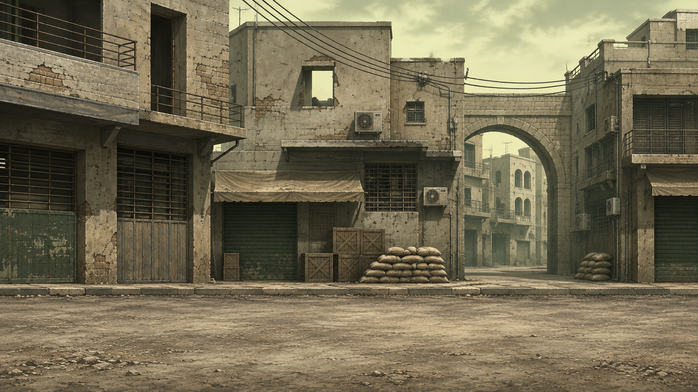
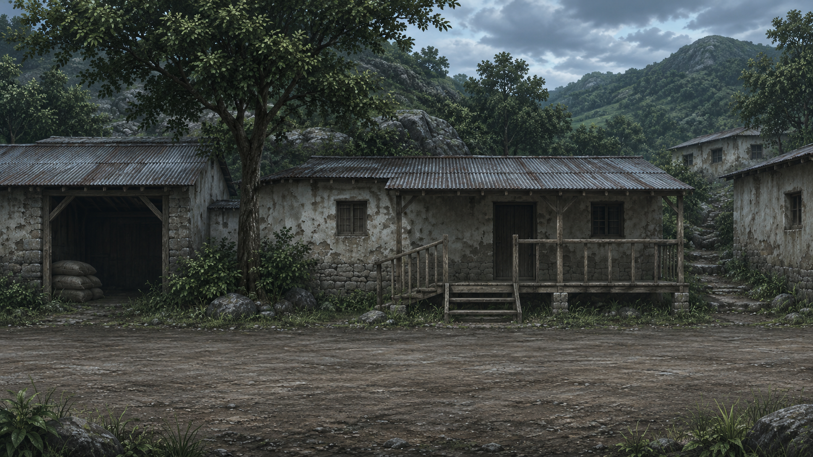
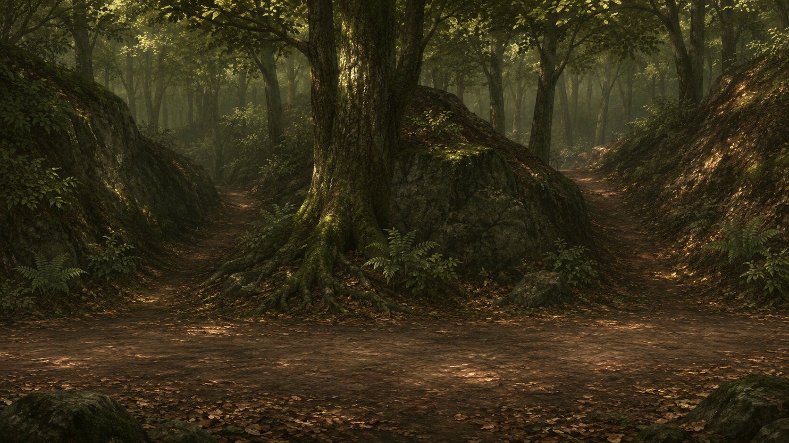
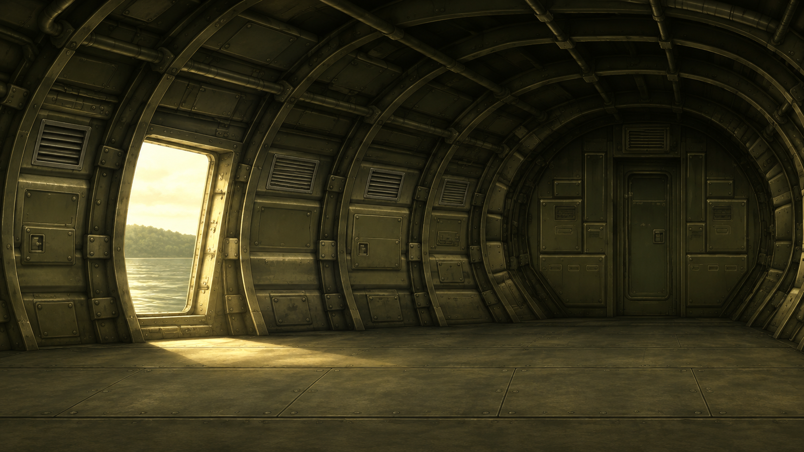
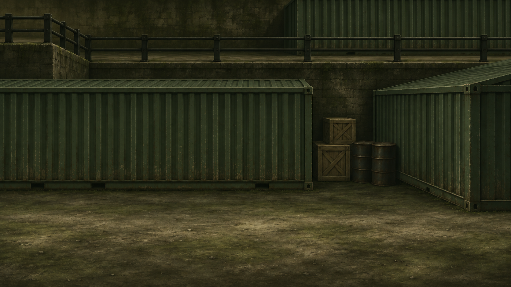

# P62 — guide intégré à la bible et poursuite des sources fixes

**25 novembre 2026 · CQC Versus Legacy · PR #25.** Cette passe associe le guide général fourni par Darknigthmare au jeu existant, complète la conception de combat et de narration, et ajoute cinq décors fixes à la livraison P60/P61. Les données sont reliées par les UID du roster, les périmètres historiques, les identifiants de sources et les critères d’admission.

**Entrée principale : [Bible CQC](../../cqc-bible/README.md).** Le [guide original](../../cqc-bible/sources/Combat_Games_Guide_General_v1.0.txt) est conservé intégralement et sans modification : 55 172 octets, SHA-256 `4844584616072ac0d52d37c2fab4365e1ec489240f17a721ee216e223b0355b7`.

## 1. Ce que cette passe ajoute

| Livrable | Contenu vérifiable | Portée |
|---|---|---|
| Guide contextualisé | 30 rubriques, 90 exigences identifiées, critères et documents associés | 87 exigences retenues ; 3 différées. Une décision de conception ne vaut pas validation du jeu. |
| État du jeu | 29 preuves et 17 domaines de fonctionnalité examinés | Lecture du code à des commits fixés ; aucun test de parcours annoncé sur cette seule base. |
| Combat | 8 profils pilotes et leurs 80 emplacements d’action compilés ; 8 propositions de neutralisation | Identifiants conservés, limites de loadout et contre-jeu documentés. |
| Roster | 354 profils de la base compilée, 3 540 emplacements d’action | Ce compte précède les installateurs et adaptateurs runtime. |
| Histoires individuelles | 8 parcours enrichis, 64 rencontres, 8 rivalités | Nouveaux dialogues de projet ; héritage conservé. |
| Campagne commune | « La ligne effacée », 10 chapitres | Proposition distincte des routes individuelles et des circuits de duels. |
| Préparation des scènes | 36 séquences et 108 briefs de plans distincts | 72 plans pour les routes, 36 pour la campagne ; **0 nouvelle image narrative produite**. |
| Arènes et boss | Quatre axes indépendants, 6 connexions proposées, transition détaillée et 3 fiches de boss géants | Présentation, interactions, dangers et transitions suivent leurs propres critères. |
| Sources fixes | **5 PNG sélectionnés**, 1 essai archivé | Cinq vues couvrant des portions de quatre périmètres historiques déjà partiels. |
| Associations | **177 sources sélectionnées**, reliées au guide et aux besoins de la bible | 24 sources ont en plus des liens réciproques avec les routes, chapitres, séquences et plans qui les utilisent comme références. |

Les neuf unités suivantes restent distinctes : profil, incarnation, costume, emplacement d’action, périmètre d’inventaire, source PNG, séquence, plan écrit et fonctionnalité admise. Les compteurs ne sont pas additionnés entre ces unités.

## 2. Navigation dans la bible

| Question | Document |
|---|---|
| Comment chaque rubrique du guide s’applique-t-elle au projet ? | [EXIGENCES.md](../../cqc-bible/EXIGENCES.md), [guide-map.json](../../cqc-bible/guide-map.json) |
| Que montre réellement le code existant ? | [ETAT_DU_JEU.md](../../cqc-bible/ETAT_DU_JEU.md), [runtime-evidence.json](../../cqc-bible/runtime-evidence.json) |
| Comment se différencient les huit pilotes ? | [COMBAT.md](../../cqc-bible/COMBAT.md), [combat-pilots.json](../../cqc-bible/combat-pilots.json) |
| Quels profils compilés sont couverts ? | [ROSTER.md](../../cqc-bible/ROSTER.md), [roster-coverage.json](../../cqc-bible/roster-coverage.json) |
| Où sont les routes, rivalités et plans ? | [NARRATION.md](../../cqc-bible/NARRATION.md), [narrative-registry.json](../../cqc-bible/narrative-registry.json) |
| Quelles règles pour les arènes et les grandes machines ? | [ARENES_ET_BOSS.md](../../cqc-bible/ARENES_ET_BOSS.md) |
| À quel besoin correspond chaque image ? | [ASSOCIATIONS.md](../../cqc-bible/ASSOCIATIONS.md), [asset-associations.json](../../cqc-bible/asset-associations.json) |
| Quelles fiches et quelles validations préparer ? | [FICHES_ET_VALIDATION.md](../../cqc-bible/FICHES_ET_VALIDATION.md) |
| Quelles références et empreintes pour les nouvelles images ? | [stages-continuation.json](batches/stages-continuation.json), [delivery-manifest.json](delivery-manifest.json) |

## 3. Galerie des cinq nouvelles sources

Les cinq images sélectionnées sont des **PNG RGB opaques de 1672 × 941 pixels**. Chaque fichier contient une vue complète, conservée dans les octets de la sortie imagegen. Les références publiques, plages temporelles, prompts, observations visuelles et limites figurent dans le manifeste du lot. La perspective latérale et certaines surfaces non visibles dans les captures de référence nécessitent une adaptation ; aucune équivalence géométrique intégrale n’est certifiée.

### Crescent Meridian — MGS4

Périmètre historique : `stage:mgs4_park`. La rue complète l’environnement du secteur ; elle prépare la fiche de liaison vers Millennium Park. La source ne constitue pas une transition jouable ni une nouvelle zone intégrée.



### Cove Valley Village — MGS4

Périmètre historique : `stage:mgs4_powerstation`. La cour extérieure ajoute le contexte du village au groupe de lieux suivi sous ce périmètre. Les limites de passage, objets interactifs et dangers doivent être définis séparément du décor.



### Zaozyorje East — MGS3

Périmètre historique : `stage:mgs3_zaozyorje_wig`. Cette vue représente l’embranchement forestier oriental. Elle ne clôt pas l’ensemble des secteurs de Zaozyorje.



### Intérieur du WIG — MGS3

Périmètre historique : `stage:mgs3_zaozyorje_wig`. La cabine du duel final possède sa propre fiche. L’extérieur de l’appareil et l’embarquement au lac restent des besoins distincts.



### Ruins Upper — Metal Gear AC!D

Périmètre historique : `stage:acid_ruins`. La source sélectionnée représente la voie des conteneurs de Ruins Upper 03B. Un premier résultat plaçait des portes au milieu des longues faces des conteneurs ; il a été remplacé après correction. La forêt AC!D n’est pas couverte par cette image.



L’essai remplacé est conservé dans `public/cqc/assets/p62/rejected/acid-ruins-upper-v1.png`, avec `selected: false`. Il compte comme **une archive**, jamais comme un sixième décor sélectionné.

## 4. Compteurs consolidés et manques conservés

| Catégorie de source sélectionnée | Total P60/P61/P62 |
|---|---:|
| Stages | 107 |
| Personnages | 17 |
| Costumes | 7 |
| Machines | 45 |
| VFX | 1 |
| **Total** | **177** |

Répartition par passe : **40 P60 + 132 P61 + 5 P62**. Les **9 archives** sont exclues : 2 P60, 6 P61 et 1 P62. Les livraisons précédentes restent accessibles dans la [galerie P61](../pass61/README.md).

L’inventaire historique conserve **277 lignes**, dont **97 sans correspondance démontrée** : 69 personnages/groupes/profils d’identité, 13 costumes/concepts, 8 groupes de stages, 4 machines et 3 corps de projectiles. Deux costumes P60 déjà produits sont reliés dans des périmètres auxiliaires, hors de ces 277 lignes.

Les cinq nouvelles images enrichissent **quatre lignes déjà partiellement dotées**. Elles ne font donc pas baisser le nombre de 97 lignes ouvertes. Les corps BOX-T (SMK), BOX-T (STN) et le projectile du Mortar de Survive restent distingués du VFX fumée déjà produit. Le détail nominatif est conservé dans l’[inventaire P61](../pass61/INVENTAIRE.md).

Le registre narratif documente **380 UID historiques**, dont 354 avec une histoire Chroniques observée et 26 sans histoire dans la source auditée. Il enrichit huit parcours ; 372 UID ne sont pas réécrits dans cette passe. Ce dénominateur historique ne remplace pas le compte de 354 profils compilés, les 384 incarnations de la garde-robe ou un futur recensement du roster admis après exécution des installateurs.

## 5. Vérifications effectuées et portée

Le [rapport de vérification](verification.json) est produit par le contrôleur documentaire. Les contrôles portent sur les unités et identités livrées :

- Copie du guide identique à la pièce jointe : longueur et SHA-256.
- Présence des 30 rubriques et unicité des 90 exigences.
- Résolution des preuves de code, UID, sources sélectionnées, périmètres, scènes, rencontres et liens réciproques.
- Cohérence des 177 sources, 9 archives, 277 périmètres historiques et 2 périmètres auxiliaires.
- Identité exacte des six nouveaux PNG, archive comprise : SHA-256 et Git blob SHA ; signatures, dimensions, décodage Pillow et contrôle visuel.
- Concordance des huit profils de combat avec leurs parcours et propositions de neutralisation.
- Séparation explicite des 108 briefs narratifs et des images réellement générées.

Commandes exécutables depuis la racine du dépôt :

```bash
python3 docs/cqc-bible/build_registry.py --verify-images
node scripts/check-cqc-bible.mjs
```

Le premier contrôle requiert Pillow pour décoder les nouveaux PNG. Les sources historiques P60/P61 conservent les empreintes et limites de leurs manifests épinglés ; leur intégralité n’est pas redécodée pour cette passe.

Cette livraison ajoute **0 admission runtime et 0 certification 1:1**. Les vérifications documentaires ne constituent pas un test de combat, de performance, de sauvegarde en jeu ou de réseau. Les fiches décrivent les critères de ces étapes ultérieures, notamment le binding, les collisions, les états, les transitions et les animations prévues.

## 6. Références de publication

- Livraison P61 de départ : `5c2cbed73f15c4583f5ffd2cee0c2344180b5d68`.
- Base réelle de la PR : `67b61f0b536b34921b3d604631409e2b9d384ce4`, branche `codex/cqc-p51-remaining-costumes-20261113`.
- `main` inspecté : `02cce7c56c97d0c0008b1dfe805c7d003c9f63e1`.
- Branche de livraison : `codex/cqc-p61-missing-static-sources-20261125`.
- Revue : [PR #25](https://github.com/darknigthmare/shadow-codec-ops/pull/25).

Les différences de gameplay entre `main` et la branche de livraison sont héritées de la base réelle de la PR. P62 ajoute les documents, leurs registres, le contrôleur d’intégrité et les sources fixes décrites ici. La présence en PR reste distincte d’une fusion, d’un déploiement et d’une admission au combat.
