# CQC P63 — quatre jeux, 17 sources et Atlas intégré

**26 novembre 2026.** Cette continuation ajoute **17 PNG individuels sélectionnés** pour Metal Gear Survive, Metal Gear AC!D, AC!D 2 et Metal Gear Rising: Revengeance. Le total P60/P61/P62/P63 est **194 sources sélectionnées**. Les **3 essais P63 écartés** sont conservés séparément ; le total historique des essais archivés passe de 9 à 12.

Le menu CQC ouvre désormais l’**Atlas des sources** : `/cqc/?module=atlas63`. Ses filtres, sa recherche et ses fiches donnent accès aux images, références et documents de la bible. Les images sont consultables dans le jeu ; **aucune de ces vues plates n’est déclarée arène de combat complète, et aucune n’est certifiée 1:1**.

## Livrables

| Jeu | PNG sélectionnés | Périmètre |
|---|---:|---|
| Metal Gear Survive | 4 | Wrecked Base, Fallen Village, Deserted Mine, Abandoned Airport |
| Metal Gear AC!D | 3 | Forêt de Lobito, extérieur FAR, accès intérieur FAR |
| Metal Gear AC!D 2 | 3 | Harbor Area, Cargo Train, Security Section / Monitor Room |
| Metal Gear Rising: Revengeance | 7 | Hall, ascenseur, jardin et serveurs World Marshal ; chambre biologique, salle GRAD ; extérieur Pakistan |
| **Total P63** | **17** | **Un fichier individuel par décor** |

[Manifest détaillé](delivery-manifest.json) · [Prompts et corrections](prompts.json) · [Bible P63](../../cqc-bible/CONTINUATION_P63.md) · [Associations P63](../../cqc-bible/asset-associations-p63.json) · [Audit préalable](AUDIT_QUATRE_JEUX.md) · [Rapport de vérification](verification.json)

## Sources individuelles

| Source | Identifiant | Dimensions |
|---|---|---|
| [AC!D — Lobito / forêt](../../../public/cqc/assets/p63/acid-lobito-forest.png) | `acid-lobito-forest` | 1672 × 941 |
| [AC!D — FAR / extérieur](../../../public/cqc/assets/p63/acid-far-exterior.png) | `acid-far-exterior` | 1672 × 941 |
| [AC!D — FAR / accès intérieur](../../../public/cqc/assets/p63/acid-far-interior.png) | `acid-far-interior` | 1672 × 941 |
| [AC!D 2 — Harbor Area](../../../public/cqc/assets/p63/acid2-harbor-area.png) | `acid2-harbor-area` | 1672 × 941 |
| [AC!D 2 — Cargo Train](../../../public/cqc/assets/p63/acid2-cargo-train.png) | `acid2-cargo-train` | 1672 × 941 |
| [AC!D 2 — Security Section / Monitor Room](../../../public/cqc/assets/p63/acid2-security-monitor-room.png) | `acid2-security-monitor-room` | 1672 × 941 |
| [Revengeance — World Marshal / hall](../../../public/cqc/assets/p63/mgr-wm-lobby.png) | `mgr-wm-lobby` | 1672 × 941 |
| [Revengeance — World Marshal / ascenseur de fret](../../../public/cqc/assets/p63/mgr-wm-freight-elevator.png) | `mgr-wm-freight-elevator` | 1659 × 948 |
| [Revengeance — World Marshal / jardin japonais](../../../public/cqc/assets/p63/mgr-wm-japanese-garden.png) | `mgr-wm-japanese-garden` | 1672 × 941 |
| [Revengeance — World Marshal / serveurs](../../../public/cqc/assets/p63/mgr-wm-server-room.png) | `mgr-wm-server-room` | 1672 × 941 |
| [Revengeance — R-02 / chambre biologique](../../../public/cqc/assets/p63/mgr-guadalajara-brain-chamber.png) | `mgr-guadalajara-brain-chamber` | 1672 × 941 |
| [Revengeance — R-02 / salle du GRAD](../../../public/cqc/assets/p63/mgr-guadalajara-grad-arena.png) | `mgr-guadalajara-grad-arena` | 1672 × 941 |
| [Revengeance — R-07 / base pakistanaise extérieure](../../../public/cqc/assets/p63/mgr-pakistan-exterior.png) | `mgr-pakistan-exterior` | 1672 × 941 |
| [Survive — Wrecked Base](../../../public/cqc/assets/p63/survive-wrecked-base.png) | `survive-wrecked-base` | 1672 × 941 |
| [Survive — Fallen Village](../../../public/cqc/assets/p63/survive-fallen-village.png) | `survive-fallen-village` | 1672 × 941 |
| [Survive — Deserted Mine](../../../public/cqc/assets/p63/survive-deserted-mine.png) | `survive-deserted-mine` | 1672 × 941 |
| [Survive — Abandoned Airport](../../../public/cqc/assets/p63/survive-abandoned-airport.png) | `survive-abandoned-airport` | 1672 × 941 |

Les 17 fichiers représentent **41 387 691 octets**. Les dimensions sont relevées dans les PNG ; l’ascenseur fait 1659 × 948, les autres 1672 × 941. Les empreintes SHA-256 et Git blob, les références, le statut et les réserves sont dans le manifeste.

## Intégration réelle

L’Atlas est accessible dans **Chroniques** et **Extras**. Il propose quatre filtres de jeu, un filtre de catégorie, une recherche insensible aux accents, la consultation de chaque source et des liens vers les dossiers CQC déjà disponibles. Les nouveaux PNG sont ajoutés au graphe de chargement du runtime, sans modifier les registres de combattants et d’arènes.

Un lien tel que `/cqc/?module=atlas63&episode=acid2&kind=stage&asset=acid2-cargo-train` transmet la sélection initiale au module. Ensuite, les interactions mettent à jour l’URL de l’iframe ; le shell ne resynchronise pas son adresse. En ouverture autonome de `modules/source-atlas-v063.html`, l’adresse courante suit la sélection.

[Contrat d’intégration](ATLAS_INTEGRATION.md) · [Tests Atlas et limites](atlas-verification.json) · [Préservation du manifeste runtime](runtime-verification.json)

## Fidélité et état de production

Le cadrage latéral, le dégagement du sol et le retrait des personnages/objets de combat sont des adaptations explicites pour CQC. Les sources documentent des repères ; les géométries exactes, textures et proportions demandent une comparaison aux captures finales. Des éléments restent absents, notamment les Hammerheads suspendus du hall, les canisters destructibles du GRAD et les volumes complets des serveurs.

Aucune image de référence externe n’est prétendue téléchargée, fournie au générateur ou validée pixel à pixel si seuls le document et ses repères textuels ont pu être consultés. Les prompts exacts sont conservés. Le guide artistique officiel PlatinumGames a servi au vocabulaire de matériaux Rising ; il ne certifie pas l’agencement final d’une pièce.

Pour une admission au combat, il reste à produire des plans indépendants, leurs profondeurs et transparences, le sol/collision, les éléments interactifs séparés, les références visuelles et la revue, puis à tester les modes concernés. L’Atlas est le premier raccord effectif de ces fichiers à l’interface.

## Essais écartés

| Essai archivé | Motif | Remplacement sélectionné |
|---|---|---|
| [Survive — Wrecked Base — essai écarté](rejected/survive-wrecked-base-v1.png) | Mother Base métallique domine l’essai ; l’identité de Da Shago Kallai en maçonnerie est absente. | `survive-wrecked-base` |
| [Survive — Deserted Mine — essai écarté](rejected/survive-deserted-mine-v1.png) | Carrière désertique ocre ; biome africain humide et navire absents. | `survive-deserted-mine` |
| [Revengeance — R-07 / base pakistanaise extérieure — essai écarté](rejected/mgr-pakistan-exterior-v1.png) | Interprétation erronée de tanks comme réservoirs dans la cour ; remplacée par une version sans ces réservoirs. | `mgr-pakistan-exterior` |

Ces trois PNG figurent dans Git et dans les documents de revue. Ils sont absents du catalogue de l’Atlas et du manifeste runtime.

## Ce qui reste ouvert

- **Forsaken Ruins**, les détails du **Wormhole Digger**, **DL-VR 005**, les autres secteurs AC!D 2 et l’emprise EXCELSUS exigent encore leurs références ou leur décomposition précise.
- L’accès FAR produit ici ne représente pas tous les sous-sols B3F/B4F/B5F, ni une scène Teliko désignée sans preuve.
- Les variantes d’avatar Captain, les identités documentaires sans corps établi, les groupes de gardes et le projectile Mortar ne sont pas clos par ces décors.
- Les refus antérieurs consignés dans l’audit restent conservés, sans nouvel essai sous un autre nom.
- Les **277 lignes historiques, dont 97 sans correspondance démontrée**, conservent leur unité. Les sept nouveaux identifiants de secteurs P63 sont une extension, pas une réduction artificielle de ce dénominateur.
- L’audit ciblé des quatre jeux conserve ses **33 lignes historiques, dont 10 non résolues**, comme photographie préalable. Les 17 images étendent des sources partielles et de nouveaux secteurs ; elles ne valent pas une déclaration « tout terminé ».

## Vérification reproductible

```sh
node scripts/test-cqc-p63-source-atlas.mjs
node scripts/check-cqc-p63.mjs
```

Les **14 tests Node du module ont passé avant la panne de l’environnement**. Après récupération, les mêmes 14 cas ont passé dans V8 avec des adaptateurs explicites ; 23 contrôles statiques du HTML/CSS ont passé. Le navigateur Chromium, la suite Node complète après récupération et le nouveau contrôleur de livraison sur le système de fichiers n’ont pas été exécutés. Les rapports distinguent ces états.

Les 20 PNG P63, archives comprises, ont reçu un contrôle de signature, dimensions, blocs et CRC, puis une empreinte SHA-256 et un enregistrement Git blob. Le décodage complet IDAT n’a pas été refait après la panne ; le script fourni le vérifie lorsqu’il est exécuté dans un checkout matérialisé. La consultation visuelle des sorties a servi à écarter les trois essais décrits.

## Galerie

### AC!D — Lobito / forêt

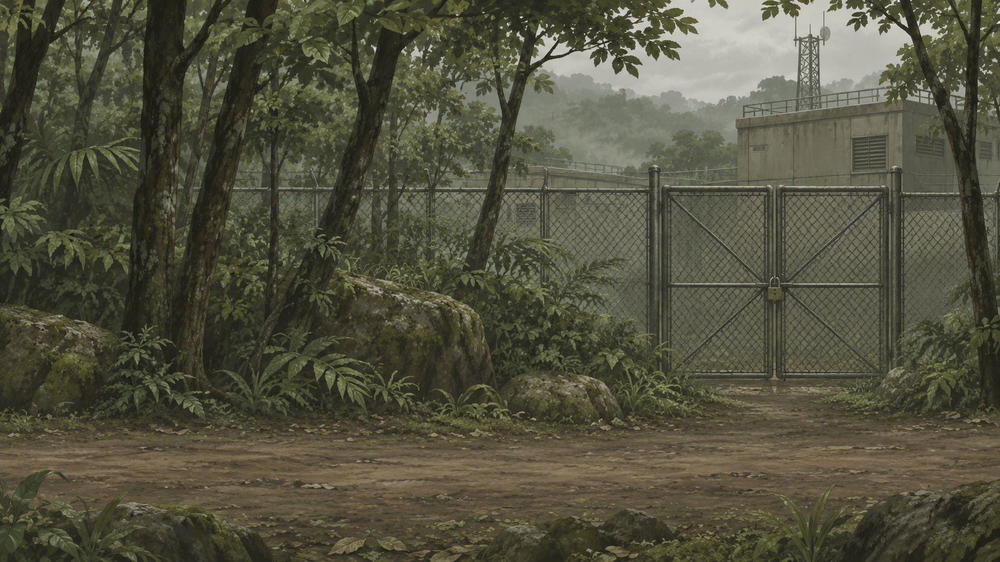

Forêt d’approche de Lobito, distincte de Ruins Lower P61 et Ruins Upper P62.

- Végétation, sentier et clôture d’accès ; projection latérale du secteur forestier.
- Une vue candidate ne valide pas la géométrie complète des secteurs PSP.

[Fiche bible](../../cqc-bible/CONTINUATION_P63.md#acid-lobito-forest) · [PNG individuel](../../../public/cqc/assets/p63/acid-lobito-forest.png)

### AC!D — FAR / extérieur

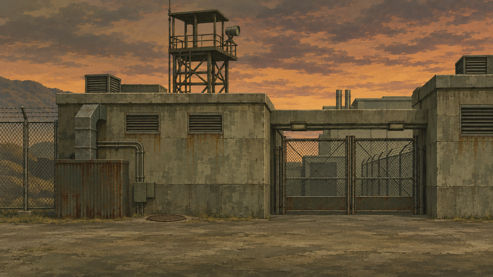

Approche extérieure de FAR, distincte du hangar KODOQUE déjà présent.

- Petits bâtiments de service, tour de garde, clôture et accès technique.
- Proportions et position des éléments recomposées pour une vue latérale ; captures natives à comparer.

[Fiche bible](../../cqc-bible/CONTINUATION_P63.md#acid-far-exterior) · [PNG individuel](../../../public/cqc/assets/p63/acid-far-exterior.png)

### AC!D — FAR / accès intérieur

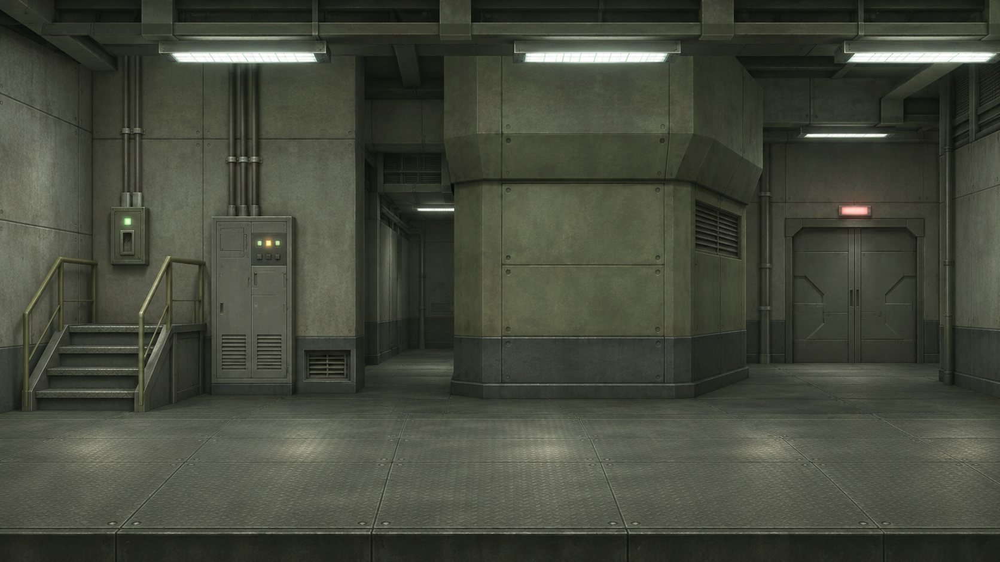

Salle d’accès et infrastructure intérieure de FAR avant les sous-sols.

- Bloc central, passages, porte, escalier, panneau et grille de service.
- Ne représente pas la cinématique d’introduction de Teliko ni l’ensemble B3F/B4F/B5F ; volumes à valider sur PSP.

[Fiche bible](../../cqc-bible/CONTINUATION_P63.md#acid-far-interior) · [PNG individuel](../../../public/cqc/assets/p63/acid-far-interior.png)

### AC!D 2 — Harbor Area

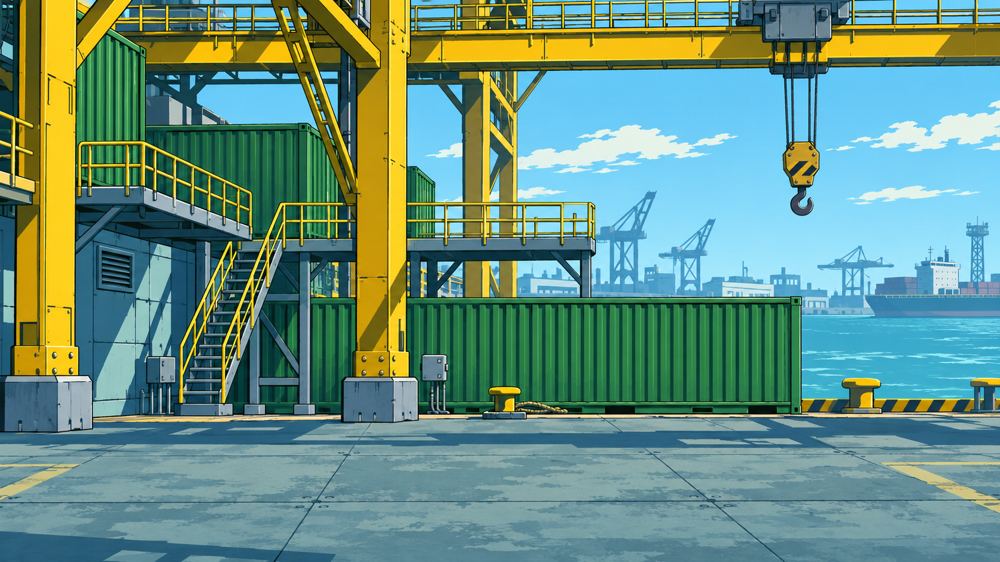

Port de SaintLogic, Stage 01, source fixe d’approche.

- Palette vive, conteneurs verts, structure de levage jaune et mer.
- Composition de quai adaptée ; position exacte des conteneurs et du crochet à revoir sur le niveau natif.

[Fiche bible](../../cqc-bible/CONTINUATION_P63.md#acid2-harbor-area) · [PNG individuel](../../../public/cqc/assets/p63/acid2-harbor-area.png)

### AC!D 2 — Cargo Train

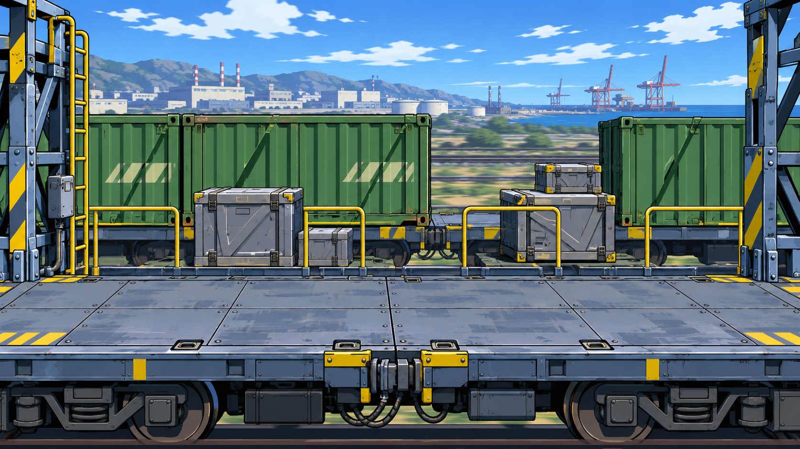

Wagon de fret de Stage 07 ; vue latérale unique.

- Wagon plat, conteneurs et garde-corps industriels.
- Mouvement du train, transitions entre wagons et découpage des plans non produits.

[Fiche bible](../../cqc-bible/CONTINUATION_P63.md#acid2-cargo-train) · [PNG individuel](../../../public/cqc/assets/p63/acid2-cargo-train.png)

### AC!D 2 — Security Section / Monitor Room

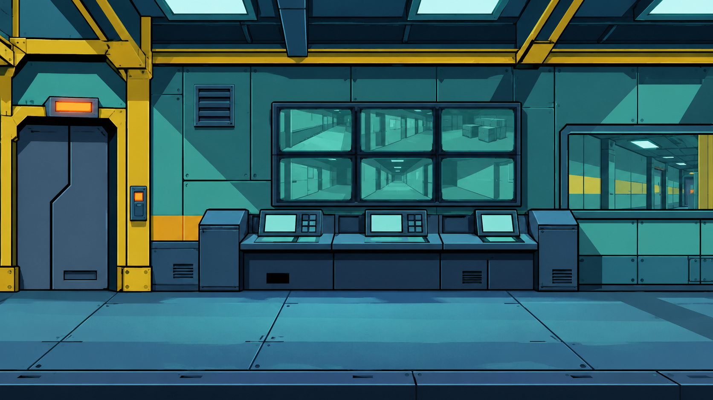

Salle de surveillance du deuxième étage de Security Section, Stage 05.

- Postes de surveillance et terminaux dans un rendu cel-shading.
- Le bleu/jaune du schéma réseau n’est pas pris comme plan architectural ; nombre et implantation des moniteurs à vérifier.

[Fiche bible](../../cqc-bible/CONTINUATION_P63.md#acid2-security-monitor-room) · [PNG individuel](../../../public/cqc/assets/p63/acid2-security-monitor-room.png)

### Revengeance — World Marshal / hall

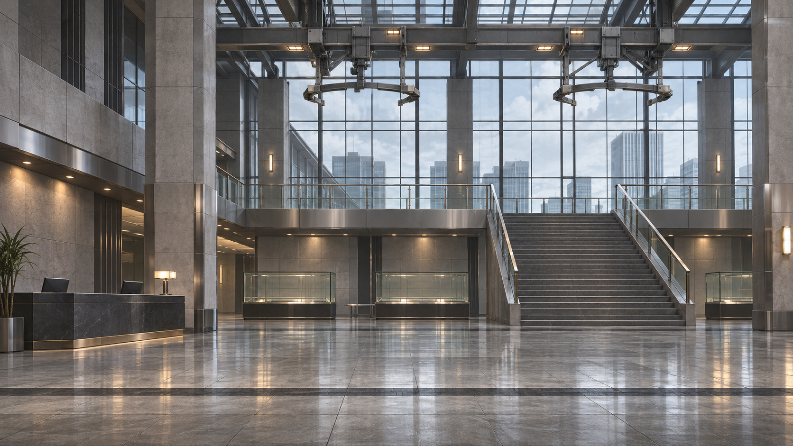

Hall d’entrée World Marshal, distinct des bureaux du vingtième étage.

- Béton, acier, verre, mezzanine et escalier ; architecture contemporaine.
- Les deux Hammerheads décoratifs ne sont pas peints dans le fond : source d’environnement incomplète pour une reconstruction 1:1.

[Fiche bible](../../cqc-bible/CONTINUATION_P63.md#mgr-wm-lobby) · [PNG individuel](../../../public/cqc/assets/p63/mgr-wm-lobby.png)

### Revengeance — World Marshal / ascenseur de fret

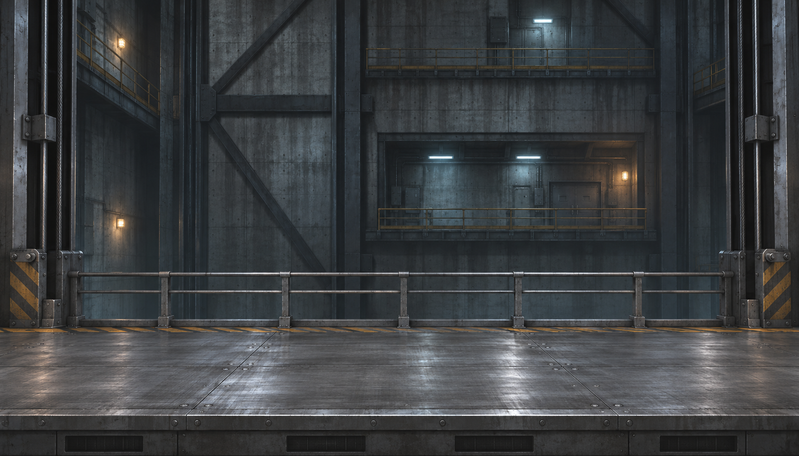

Plateforme et cage de l’ascenseur de fret, vue de travail latérale.

- Guidages, rails, dalle métallique et infrastructure de béton.
- Le concept officiel documente le langage architectural ; le palier exact et le modèle final restent à comparer.

[Fiche bible](../../cqc-bible/CONTINUATION_P63.md#mgr-wm-freight-elevator) · [PNG individuel](../../../public/cqc/assets/p63/mgr-wm-freight-elevator.png)

### Revengeance — World Marshal / jardin japonais

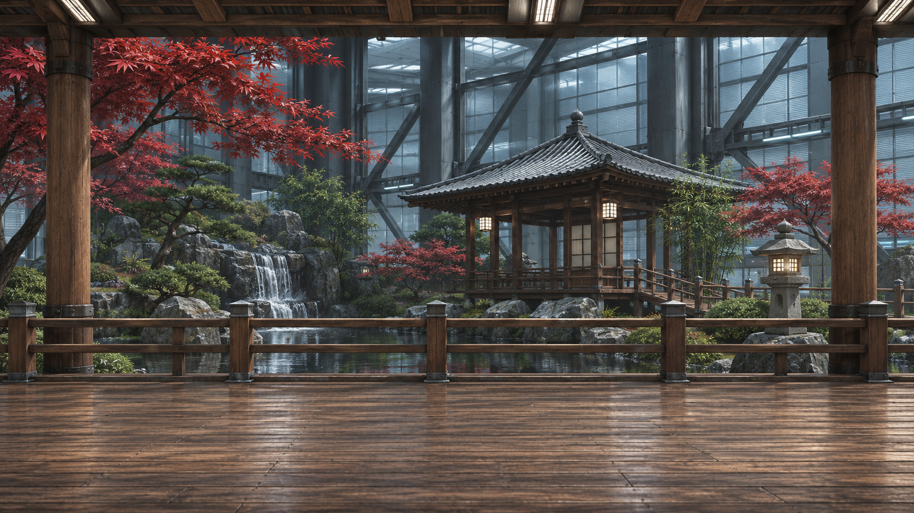

Jardin japonais intérieur de World Marshal, composition latérale.

- Pavillon, végétation et eau dans un atrium d’entreprise.
- Architecture et plantation recomposées ; aucune revendication de reconstruction métrique.

[Fiche bible](../../cqc-bible/CONTINUATION_P63.md#mgr-wm-japanese-garden) · [PNG individuel](../../../public/cqc/assets/p63/mgr-wm-japanese-garden.png)

### Revengeance — World Marshal / serveurs

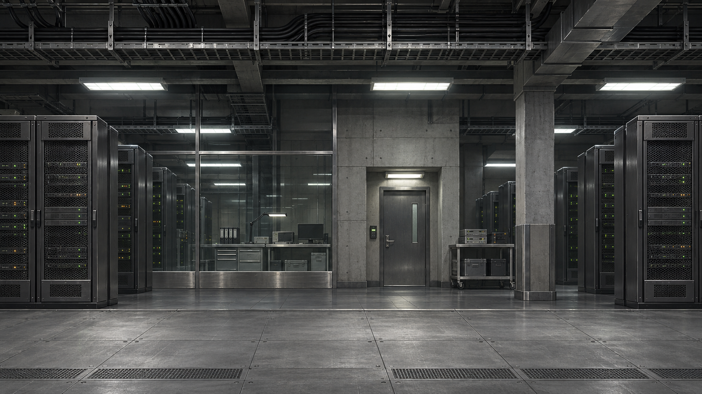

Vue technique candidate de World Marshal, associée au secteur des serveurs de R-04.

- Baies, câblage supérieur, béton et éclairage utilitaire.
- Les passerelles et le volume complet de la salle R-04 ne sont pas reconstruits ; localisation et agencement doivent être revus sur captures finales.

[Fiche bible](../../cqc-bible/CONTINUATION_P63.md#mgr-wm-server-room) · [PNG individuel](../../../public/cqc/assets/p63/mgr-wm-server-room.png)

### Revengeance — R-02 / chambre biologique

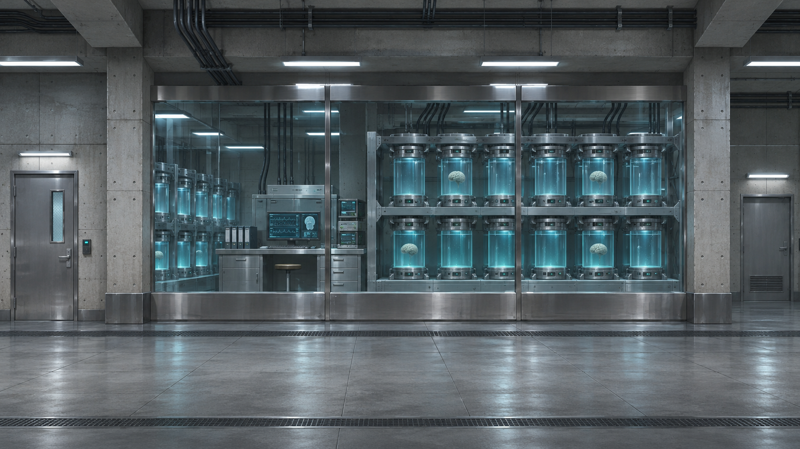

Chambre de conservation biologique, distincte de l’atelier et des égouts P61.

- Enceinte vitrée et dispositifs de conservation ; aucun personnage intégré.
- Agencement des contenants et détail des unités biologiques à comparer aux captures finales.

[Fiche bible](../../cqc-bible/CONTINUATION_P63.md#mgr-guadalajara-brain-chamber) · [PNG individuel](../../../public/cqc/assets/p63/mgr-guadalajara-brain-chamber.png)

### Revengeance — R-02 / salle du GRAD

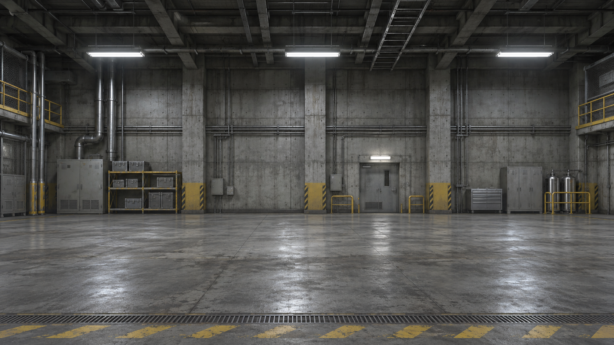

Salle arrière de l’affrontement GRAD, distincte du couloir d’approche.

- Infrastructure industrielle du laboratoire ; machine GRAD séparée du fond.
- Aucune collision, destruction ou phase de boss n’est admise par cette source fixe.
- Les grands canisters destructibles de l’affrontement restent à produire séparément ; la salle vide n’est pas une restitution complète de l’arène.

[Fiche bible](../../cqc-bible/CONTINUATION_P63.md#mgr-guadalajara-grad-arena) · [PNG individuel](../../../public/cqc/assets/p63/mgr-guadalajara-grad-arena.png)

### Revengeance — R-07 / base pakistanaise extérieure

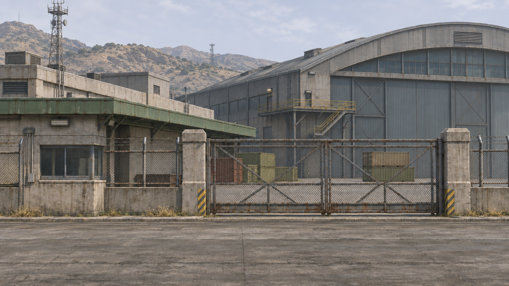

Entrée et approche extérieure avant le hangar et l’affrontement EXCELSUS.

- Portail, bâtiments et infrastructures militaires de l’approche.
- Distinct du hangar P61 et de pakistan_wreck ; cette vue ne ferme pas le périmètre EXCELSUS.
- Correction de l’essai initial : les réservoirs ajoutés par erreur ont été retirés ; blindés et tourelle restent des assets séparés.

[Fiche bible](../../cqc-bible/CONTINUATION_P63.md#mgr-pakistan-exterior) · [PNG individuel](../../../public/cqc/assets/p63/mgr-pakistan-exterior.png)

### Survive — Wrecked Base

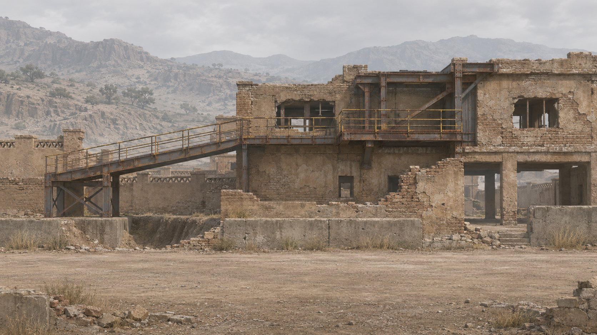

Da Shago Kallai transformé dans Dite ; première singularité.

- Maçonnerie afghane et passerelle métallique rapportée ; remplace l’essai dominé par une épave de Mother Base.
- Correspondance du lieu documentée ; l’implantation précise de la passerelle reste à valider visuellement.

[Fiche bible](../../cqc-bible/CONTINUATION_P63.md#survive-wrecked-base) · [PNG individuel](../../../public/cqc/assets/p63/survive-wrecked-base.png)

### Survive — Fallen Village

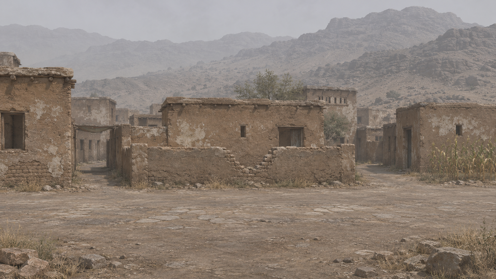

Village afghan associé à Da Wialo Kallai par recoupement des guides de la seconde singularité.

- Maisons basses, ruelles et terrain plat ; correspondance issue du rapprochement des missions.
- Position des maisons et détails des accès restent une adaptation à revoir.

[Fiche bible](../../cqc-bible/CONTINUATION_P63.md#survive-fallen-village) · [PNG individuel](../../../public/cqc/assets/p63/survive-fallen-village.png)

### Survive — Deserted Mine

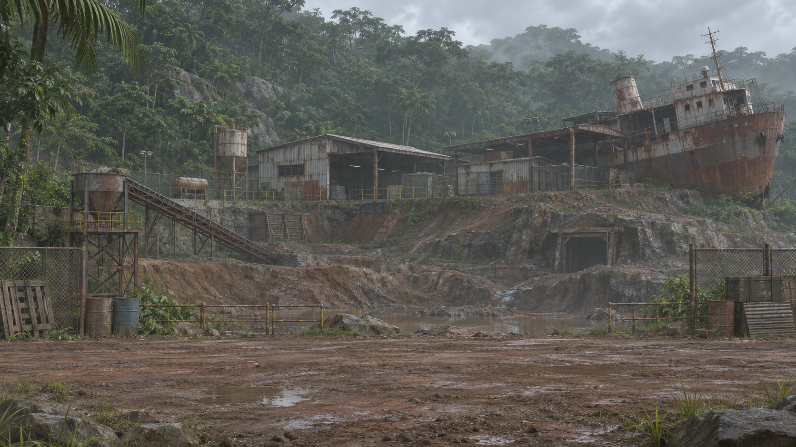

Mine de la carte Afrique/FOB, troisième singularité.

- Jungle, dénivelé, zones humides et navire ; remplace la carrière désertique écartée.
- Kungenga n’est pas une correspondance certifiée ; implantation des ateliers et du navire à vérifier sur captures.

[Fiche bible](../../cqc-bible/CONTINUATION_P63.md#survive-deserted-mine) · [PNG individuel](../../../public/cqc/assets/p63/survive-deserted-mine.png)

### Survive — Abandoned Airport

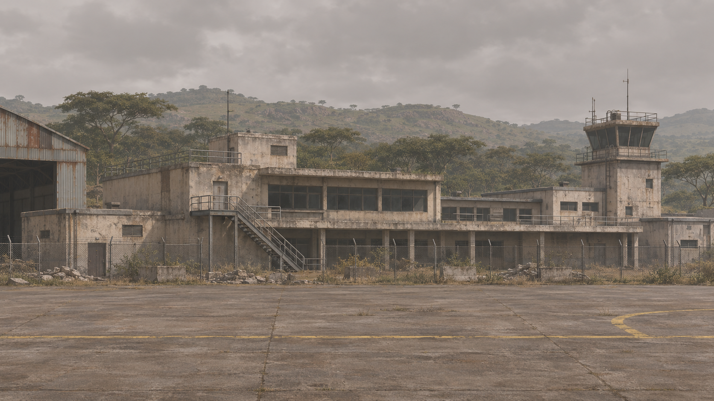

Aéroport africain associé à Nova Braga, candidat du secteur coopératif.

- Bâtiments à toits accessibles, escaliers et aire bétonnée.
- Correspondance du lieu étayée ; silhouette du terminal et parcours sur les toits à valider dans Survive.

[Fiche bible](../../cqc-bible/CONTINUATION_P63.md#survive-abandoned-airport) · [PNG individuel](../../../public/cqc/assets/p63/survive-abandoned-airport.png)

