# P64 — onze sources individuelles et galerie

**26 novembre 2026 — 11 PNG sélectionnés, 205 sources cumulées, 28 entrées dans l’Atlas après ajout du lot.** Cette passe conserve les 194 sources historiques et les 17 objets P63 de l’Atlas. Elle ajoute trois personnages AC!D, deux costumes de démonstration Survive, une machine Survive, trois accessoires MGR et deux corps de projectiles MGR.

Les fichiers sont des sources fixes sur fond transparent. **Aucun PNG n’est natif UHD ; aucune certification 1:1, nouvelle admission au combat ou clôture de périmètre n’est déclarée.** Le statut de fidélité reste `pending_external_review`. Les poses et détails reconstruits sont décrits dans les fiches.

[Onze fiches et associations dans la bible](../../cqc-bible/CONTINUATION_P64.md) · [Registre P64](../../cqc-bible/asset-associations-p64.json) · [Manifeste de livraison](delivery-manifest.json) · [Preuves d’intégration](INTEGRATION_QA.md)

## Compteurs et unités

| Unité | P64 | Cumul ou portée |
|---|---:|---|
| Sources sélectionnées | 11 | 194 + 11 = **205** |
| Personnages AC!D | 3 | Faux Flemming, garde Genetics, mercenaire de Leone |
| Costumes Survive | 2 | Apparences de démonstration TGS2017, associées à `archive__captain` |
| Machine Survive | 1 | Wormhole Digger matériel |
| Accessoires MGR (`prop`) | 3 | Repair Nanopaste, Electrolyte Pack, 3D Photo Frame |
| Corps de projectiles MGR | 2 | RP Grenade, Jamming Grenade |
| Entrées de l’Atlas | +11 | 17 P63 + 11 P64 = **28** |
| Essais PNG écartés uniques | 2 | 12 antérieurs + 2 = **14** |
| PNG générés | 13 | 11 retenus + 2 écartés |
| Refus sans fichier | 3 | Un appel par cible, aucune nouvelle tentative |
| Appels de génération/édition | 16 | 13 sorties PNG + 3 refus |
| Nouveaux décors AC!D 2 | 0 | Références exactes insuffisantes |

La copie redondante de Leone v1 a été supprimée après comparaison octet pour octet avec le fichier sélectionné. Elle ne constitue ni un essai supplémentaire ni un rejet. Les 277 périmètres historiques, les groupes de variantes et les compteurs de PNG restent des unités distinctes.

## Galerie — un fichier par asset

Chaque image ci-dessous est un PNG individuel ; aucune planche de plusieurs poses n’est livrée dans cette passe. Les dimensions sont celles des octets générés, sans agrandissement. Les SHA-256, SHA Git, poids et extrema alpha sont consignés dans les records de livraison.

### Faux Flemming — leurre de la zone résidentielle

**1024 × 1536 — RGBA — `character`.** Le long manteau sombre et le sac opaque reprennent l’art final et la capture PSP. La garde défensive est une adaptation ; le leurre reste distinct du vrai Flemming/Gary Murray.

[Fichier PNG](../../../public/cqc/assets/p64/acid-flemming-decoy.png) · [Fiche de bible](../../cqc-bible/CONTINUATION_P64.md#acid-flemming-decoy)

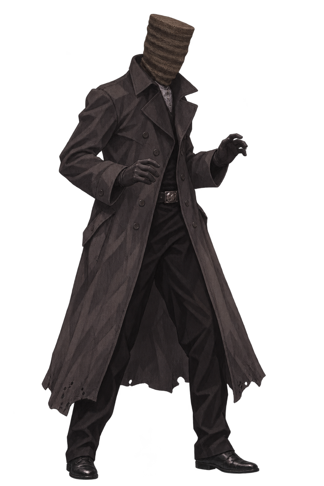

### Genetics Army — garde standard

**1191 × 1321 — RGBA — `character`.** Version v2 retenue. La pointe blanche du casque a été retirée ; de fines franges rouges/jaunes subsistent. Le garde standard est distinct du boss Genetics inutilisé.

[Fichier PNG](../../../public/cqc/assets/p64/acid-genetics-guard.png) · [Fiche de bible](../../cqc-bible/CONTINUATION_P64.md#acid-genetics-guard)

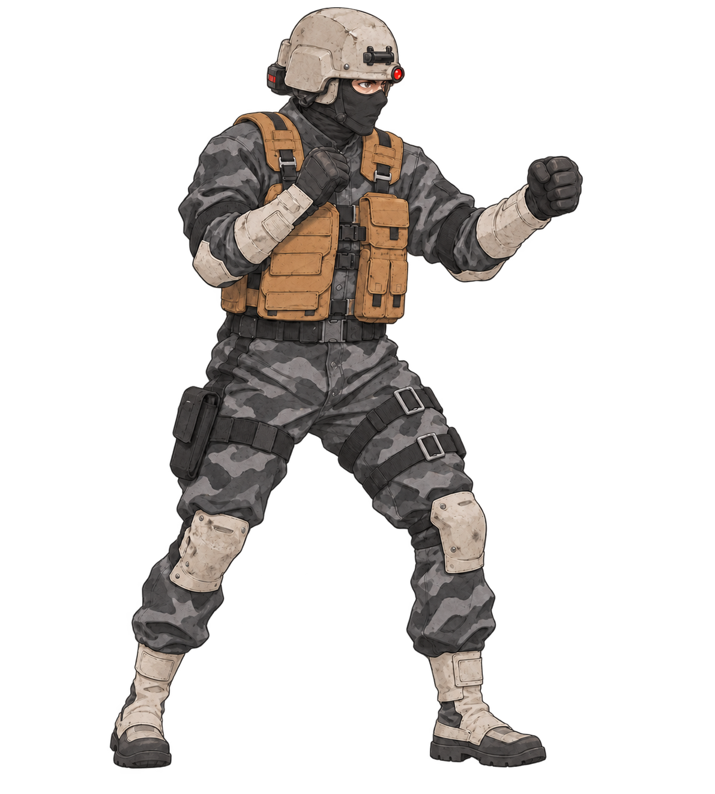

### Unité de Leone — mercenaire

**1199 × 1312 — RGBA — `character`.** Version v1 retenue. Tenue désert, gilet woodland, bonnet/cagoule noirs et gants verts ; franges colorées persistantes à certains contours. La v2 n’améliorait pas le détourage.

[Fichier PNG](../../../public/cqc/assets/p64/acid-leone-guard.png) · [Fiche de bible](../../cqc-bible/CONTINUATION_P64.md#acid-leone-guard)

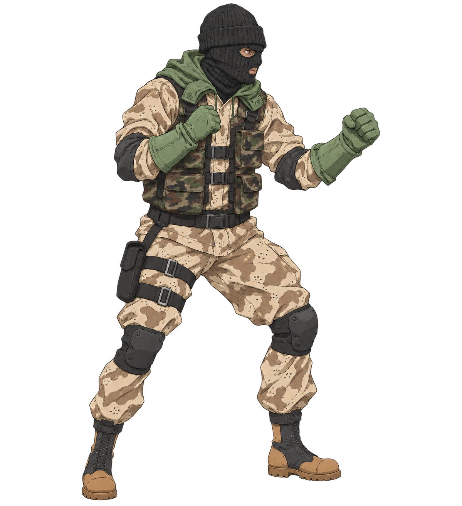

### Wormhole Digger — machine matérielle

**1024 × 1536 — RGBA — `machine`.** Couronne, chambre maillée, tambours et pieds isolés des effets rouges. L’arrière et le nombre exact d’appuis masqués ne sont pas validés ; la silhouette est une adaptation des captures.

[Fichier PNG](../../../public/cqc/assets/p64/survive-wormhole-digger.png) · [Fiche de bible](../../cqc-bible/CONTINUATION_P64.md#survive-wormhole-digger)

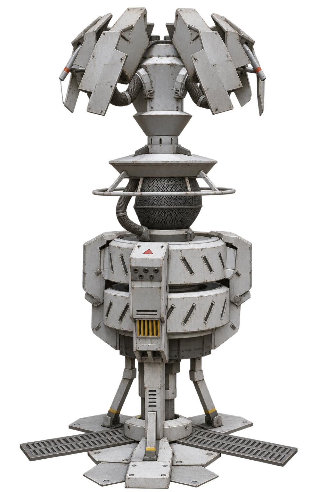

### Captain — apparence féminine de démonstration TGS2017

**1024 × 1536 — RGBA — `costume`.** Cheveux blonds très courts, haut tactique noir et pantalon woodland vert. Pose publiée conservée ; visage non canonique fixe, dos et modèle précis de l’arme non établis.

[Fichier PNG](../../../public/cqc/assets/p64/survive-captain-tgs2017-female.png) · [Fiche de bible](../../cqc-bible/CONTINUATION_P64.md#survive-captain-tgs2017-female)

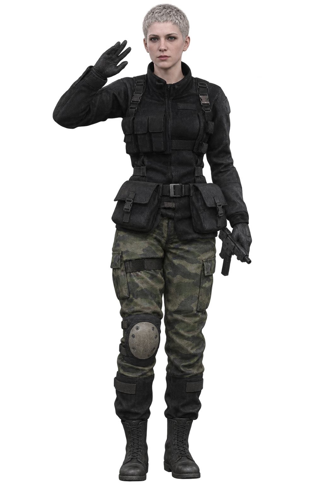

### Captain — apparence masculine de démonstration TGS2017

**1024 × 1536 — RGBA — `costume`.** Gilet olive, manches courtes gris kaki, pantalon camouflé gris et arme portée bas. Pose publiée conservée ; visage non canonique fixe, dos et modèle précis de l’arme non établis.

[Fichier PNG](../../../public/cqc/assets/p64/survive-captain-tgs2017-male.png) · [Fiche de bible](../../cqc-bible/CONTINUATION_P64.md#survive-captain-tgs2017-male)

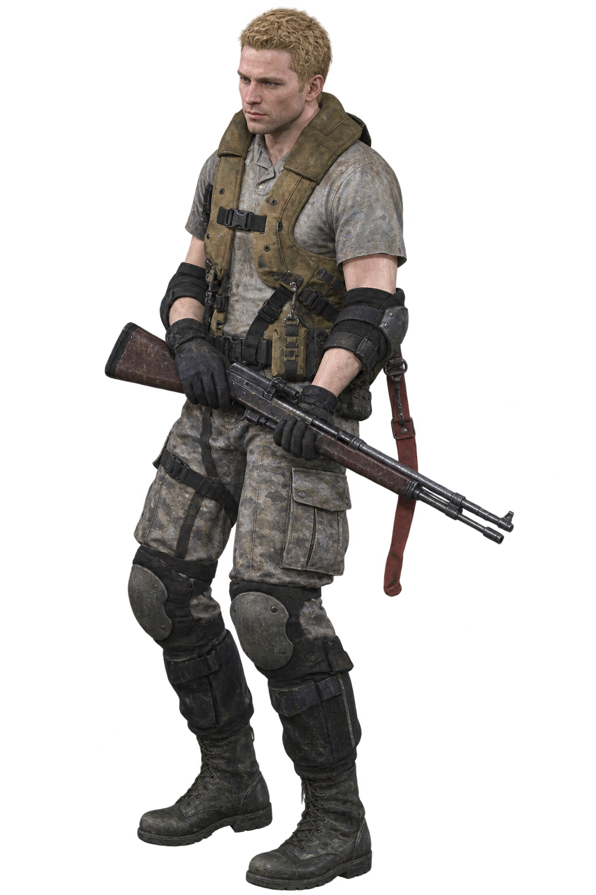

### Repair Nanopaste

**1254 × 1254 — RGBA — `prop`.** Corps nervuré et disque jaune à croix rouge issus de l’icône du guide officiel. Les textures et profondeurs sont interprétées ; aucun soin ni comportement de jeu n’est ajouté.

[Fichier PNG](../../../public/cqc/assets/p64/mgr-repair-nanopaste.png) · [Fiche de bible](../../cqc-bible/CONTINUATION_P64.md#mgr-repair-nanopaste)

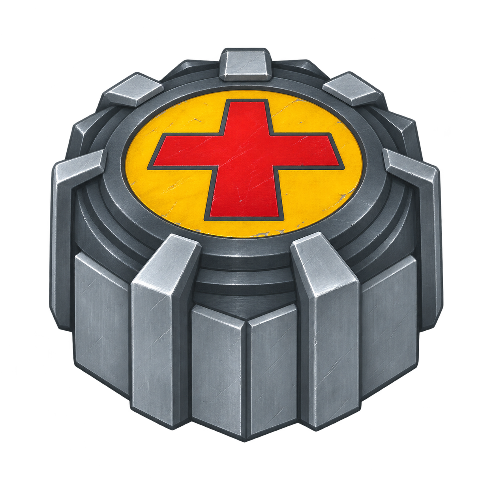

### Electrolyte Pack

**1254 × 1254 — RGBA — `prop`.** Corps nervuré gris, disque cyan et pictogramme de batterie distincts de la Nanopaste. Les volumes sont reconstruits depuis l’icône ; aucun effet de recharge n’est produit.

[Fichier PNG](../../../public/cqc/assets/p64/mgr-electrolyte-pack.png) · [Fiche de bible](../../cqc-bible/CONTINUATION_P64.md#mgr-electrolyte-pack)

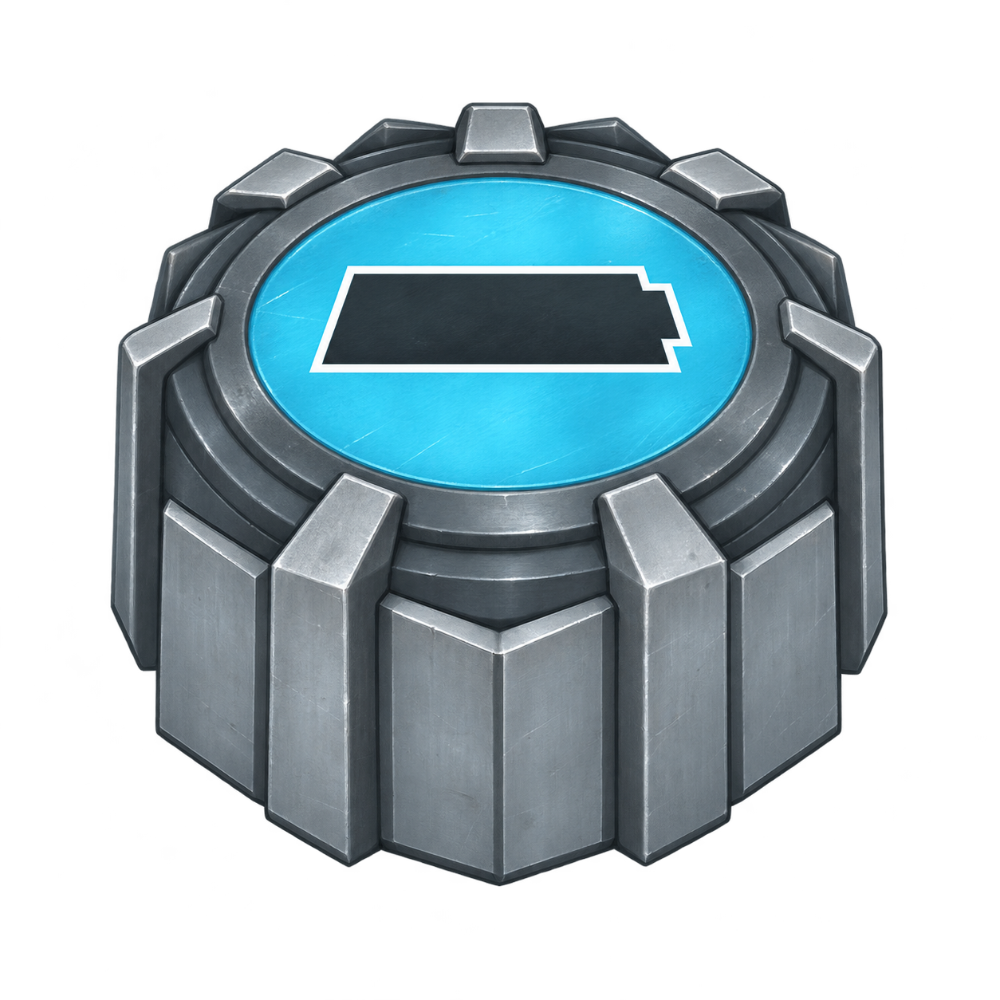

### 3D Photo Frame

**1254 × 1254 — RGBA — `prop`.** Objet à encoches, écran orange et bouton inférieur. Épaisseur et rainures adaptées ; hologramme et comportement de diversion restent absents.

[Fichier PNG](../../../public/cqc/assets/p64/mgr-3d-photo-frame.png) · [Fiche de bible](../../cqc-bible/CONTINUATION_P64.md#mgr-3d-photo-frame)

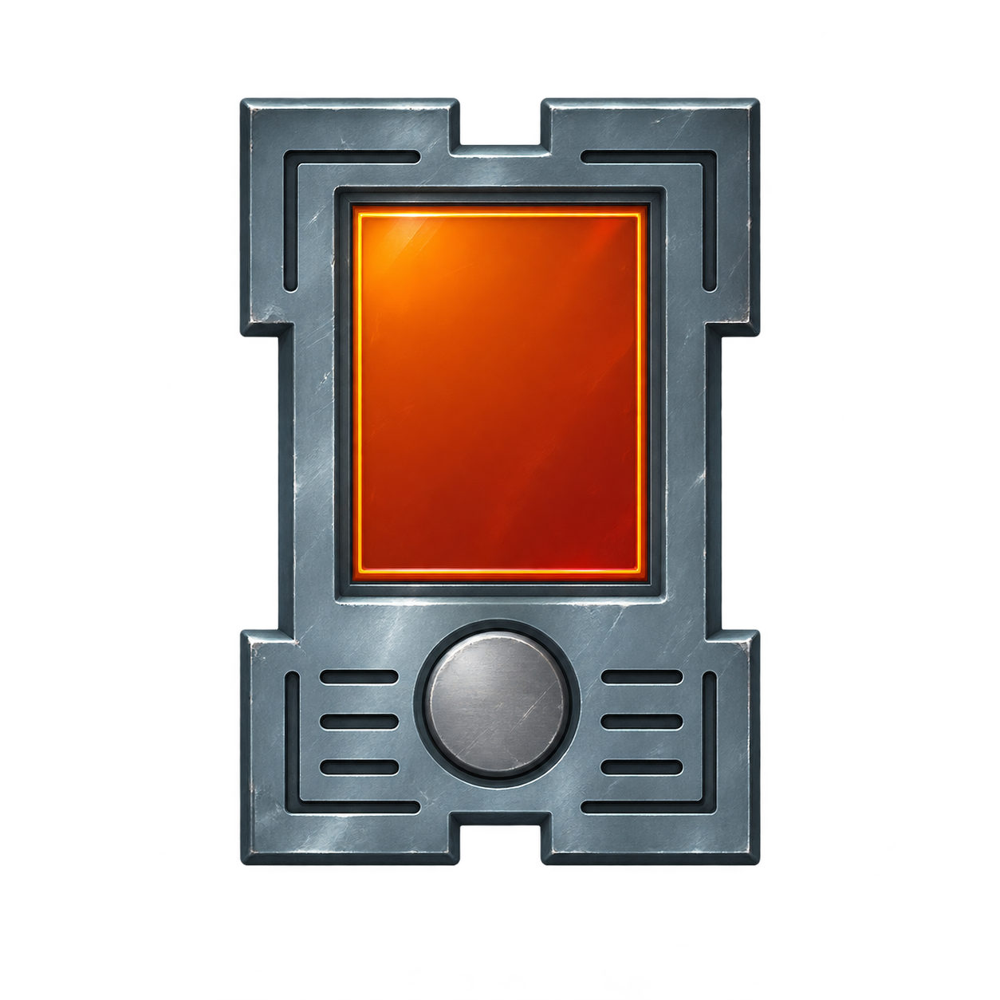

### RP Grenade — corps isolé

**1254 × 1254 — RGBA — `projectile`.** Cylindre élancé, deux bandes basses et ensemble supérieur repris du guide. La revue note un corps un peu plus allongé que l’icône ; matériau et fixation reconstruits, sans fumée, trajectoire ou logique de projectile.

[Fichier PNG](../../../public/cqc/assets/p64/mgr-rp-grenade.png) · [Fiche de bible](../../cqc-bible/CONTINUATION_P64.md#mgr-rp-grenade)

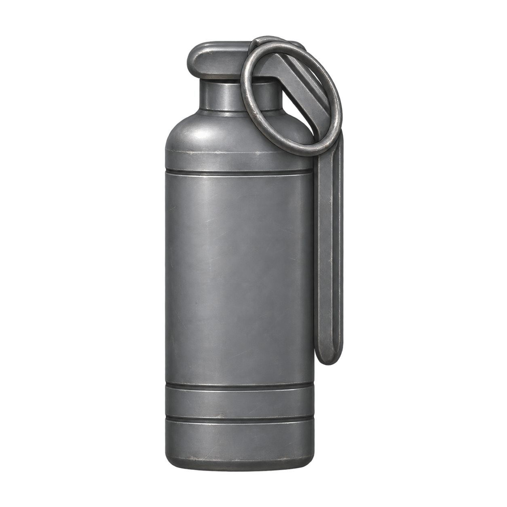

### Jamming Grenade — corps isolé

**1254 × 1254 — RGBA — `projectile`.** Corps élancé à angles arrondis et grands hexagones visibles. Le motif est plus appuyé que celui de l’icône ; texture et profondeur reconstruites, sans champ de brouillage ni comportement de projectile.

[Fichier PNG](../../../public/cqc/assets/p64/mgr-jamming-grenade.png) · [Fiche de bible](../../cqc-bible/CONTINUATION_P64.md#mgr-jamming-grenade)

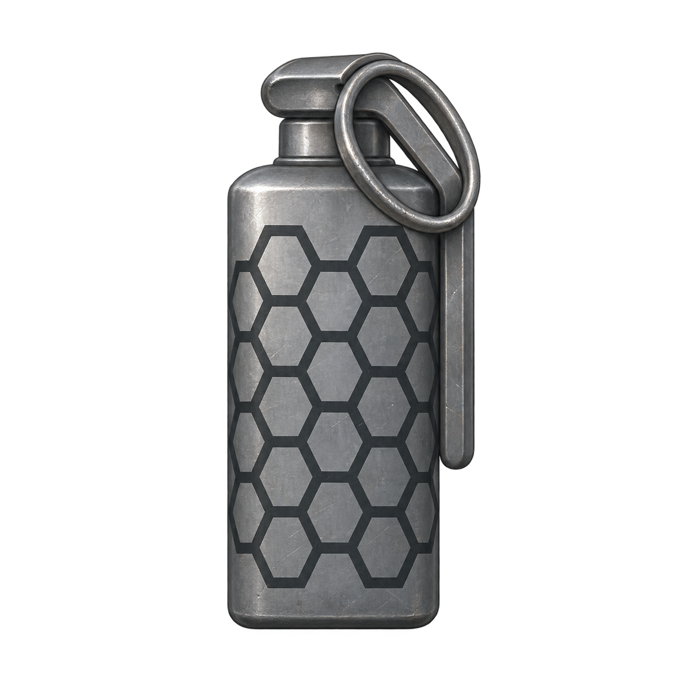

## Références et limites de fidélité

Les trois personnages AC!D reposent sur l’art de design reproduit par Creative Uncut ; la capture PSP du leurre confirme le sac et la tenue sombre. La distinction Genetics/Leone est documentée dans la [fiche des gardes](research/acid-guards.json). Les deux poses CQC sont adaptées depuis une planche neutre, et leurs franges colorées résiduelles sont connues.

Le Digger combine une [capture officielle PlayStation](https://blog.ja.playstation.com/uploads/sites/7/2018/02/20180221-mgsurvive-20.jpg) et une [vue rapprochée de gameplay](https://kyupiru.com/20180725214554_1.jpg), conservées dans [sa fiche](research/digger/references.json). La géométrie masquée n’est pas certifiée. Les Captain dérivent de la [capture TGS2017](https://www.4gamer.net/games/353/G035307/20170923011/SS/005.jpg), avec [provenance et comparaison au costume existant](research/captain/references.json). Aucun rôle Shooter/Fighter n’est attribué à ces silhouettes non libellées.

Les cinq objets MGR proviennent des icônes du [guide officiel Piggyback](https://www.piggyback.com/en/wp-content/uploads/sites/7/2020/04/MGR_U_SamplePages.pdf). Leurs silhouettes visibles fondent les adaptations ; les textures, épaisseurs et faces masquées ne constituent pas une extraction de modèle natif. Les [cinq records MGR](research/mgr/five-assets-handoff.json) distinguent `prop` et `projectile` et conservent les réserves par objet. La [revue visuelle indépendante](research/mgr/visual-qa.json) confirme cinq objets entiers mais relève de fines traces cyan/bleues ou colorées sur certains contours, des résidus alpha faibles et des matières plus détaillées que les icônes. Les détourages ne sont donc pas déclarés parfaits.

## Deux essais uniques écartés

| Essai | Motif | Version retenue |
|---|---|---|
| [Genetics v1](rejected/acid-genetics-guard-v1.png) | Pointe blanche au-dessus du casque et franges plus marquées. | Genetics v2 |
| [Leone v2](rejected/acid-leone-guard-v2.png) | La correction ne montrait pas d’amélioration des contours. | Leone v1 |

Ces deux fichiers restent hors de l’Atlas et du manifeste runtime. Les [prompts et verdicts des corrections](research/acid-guards-edits.json) conservent l’historique des deux appels par garde.

## Trois refus de génération sans fichier

| Cible | Identifiant | Résultat |
|---|---|---|
| Fragmentation Grenade | `mgr-fragmentation-grenade` | Refus du service imagegen ; aucun fichier, un appel, aucune nouvelle tentative. |
| EM Grenade | `mgr-em-grenade` | Refus du service imagegen ; aucun fichier, un appel, aucune nouvelle tentative. |
| Rocket Launcher | `mgr-rocket-launcher` | Refus du service imagegen ; aucun fichier, un appel, aucune nouvelle tentative. |

Les résultats `moderation_blocked` sont conservés dans les [records MGR](research/mgr/five-assets-handoff.json). Ces refus ne sont comptés ni comme PNG ni comme archives d’images. Aucun renommage, second prompt ou rendu alternatif n’a servi à les contourner.

## QA et état des preuves

| Contrôle | État à la rédaction | Preuve |
|---|---|---|
| Module Atlas hérité | **14 tests passés**. | [Sortie Node](p63-node-tests.txt) |
| Helper et contrat P64 | **9 tests passés**. | [Sortie des tests P64](runtime-helper-tests.txt) |
| PNG et manifeste du socle P63 | **Revérifiés réellement dans P64** : PNG/IDAT, CRC, empreintes, reconstruction du manifeste et conservation du socle. | [Rapport local P63](p63-local-verification.json), [préservation](p63-baseline-preservation.json) |
| Parcours navigateur P63 | **Exécuté** sur le déploiement P63 ; 17 images décodées et parcours Atlas documentés. | [Preuve navigateur P63](p63-browser-verification.json) |
| 194 sources historiques | **Identités et registres conservés** ; les PNG historiques absents du checkout léger ne sont pas téléchargés pour ce contrôle. | [Vérification historique](historical-sources-verification.json) |
| Six personnages/costumes/machine et leurs deux archives | **Huit PNG contrôlés** par le vérificateur structurel ; revue visuelle et alpha consignés. | [Handoff validé](research/six-assets-handoff.json), [QA visuelle](research/selected-characters-machines-qa.json) |
| Cinq objets MGR | **Cinq PNG inspectés indépendamment**, un objet entier par fichier, marges et transparence réelles ; fines traces colorées et détails reconstruits documentés. | [QA visuelle MGR](research/mgr/visual-qa.json), [records](research/mgr/five-assets-handoff.json) |
| Suite Node finale P64 | **23 tests sur 23 passés** : 14 tests Atlas et 9 tests du helper et du contrat P64. | [Sortie Node finale](p64-node-tests.txt) |
| Checker final P64 et manifeste runtime | **Passés** : 13 PNG vérifiés, dont 11 retenus et 2 archives ; 28 entrées Atlas et 205 sources cumulées. Le scanner réel retrouve 3 041 fichiers et 4 977 références. | [Vérification locale finale](p64-local-verification.json) |
| Préservation du graphe runtime | **Vérifiée** : 3 029 lignes historiques inchangées ; seul le catalogue change parmi les 3 030 anciens fichiers. Les 4 966 références historiques, 740 omissions et 499 routes externes sont préservées. | [Détail du contrôle final](p64-local-verification.json) |
| Parcours navigateur P64 | **En attente du déploiement P64.** Le résultat du navigateur P63 reste une preuve distincte. | [Plan et preuves d’intégration](INTEGRATION_QA.md) |

La réinspection P63 ne réécrit pas ses anciens rapports, qui décrivaient les limites d’exécution rencontrées lors de cette passe. Les nouvelles preuves sont datées et conservées ici. Une vérification de fichier ou de graphe runtime ne valide ni la fidélité absolue, ni le gameplay, ni toutes les tailles d’écran.

## Périmètres encore ouverts

La [fiche de huit secteurs AC!D/AC!D 2](research/acid-stage-candidates.json) conserve FAR B3F/B4F/B5F, Control Section, Communications Tower, Research Block, Terminal et Residential Area. Les noms et repères de parcours sont utiles, mais aucune capture suffisamment nette et attribuable n’a permis de générer un nouveau décor dans P64. Harbor Area, Cargo Train et Security Monitor Room restent les sources P63 déjà existantes.

Le [projectile du Mortar de Survive](research/survive-mortar-research.json) reste ouvert : ses mécanismes sont corroborés, sa forme exacte n’est pas établie par une vue inspectée exploitable. Les variantes de Captain ne constituent pas un inventaire modulaire complet ; les gardes AC!D ne ferment pas le groupe Genetics/Leone/SaintLogic. Les objets MGR et le Digger ajoutent des périmètres de sources, sans réduire mécaniquement les 97 lignes historiques ouvertes.

## Données de reprise

- [Six records personnages/costumes/machine et deux archives](research/six-assets-handoff.json).
- [Cinq records MGR et trois refus sans fichier](research/mgr/five-assets-handoff.json).
- [Revue visuelle commune des six silhouettes](research/selected-characters-machines-qa.json).
- [Fiches de bible P64](../../cqc-bible/CONTINUATION_P64.md) et [index des associations](../../cqc-bible/ASSOCIATIONS.md).

Les statuts restent `sourceGenerated:true`, `selected:true`, `atlasIntegrated:true` pour les sources retenues, avec `combatReady:false`, `combatRuntimeIntegrated:false`, `absolute1to1Certified:false` et `fidelityStatus:"pending_external_review"`. L’association à l’Atlas est distincte d’un binding de combat.
