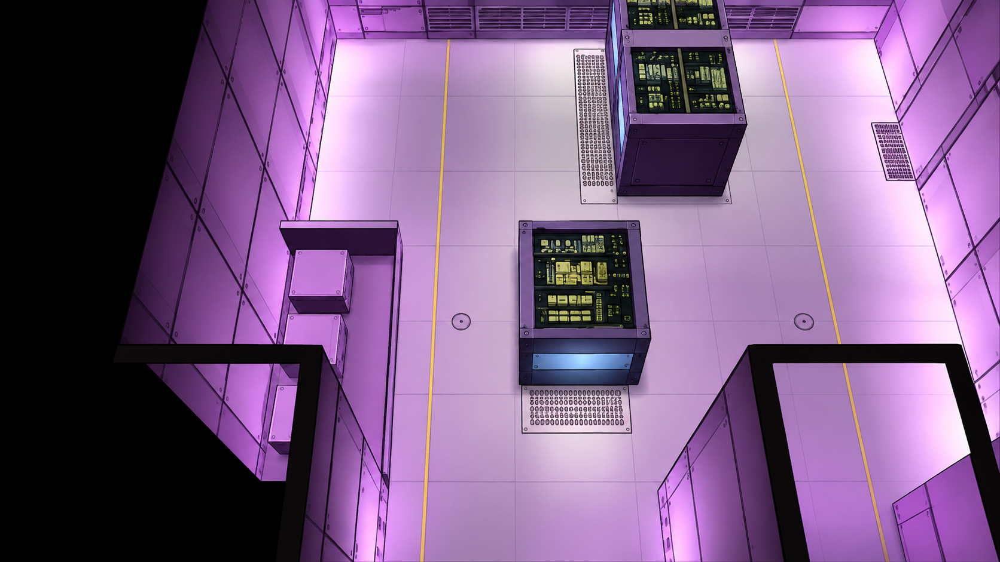
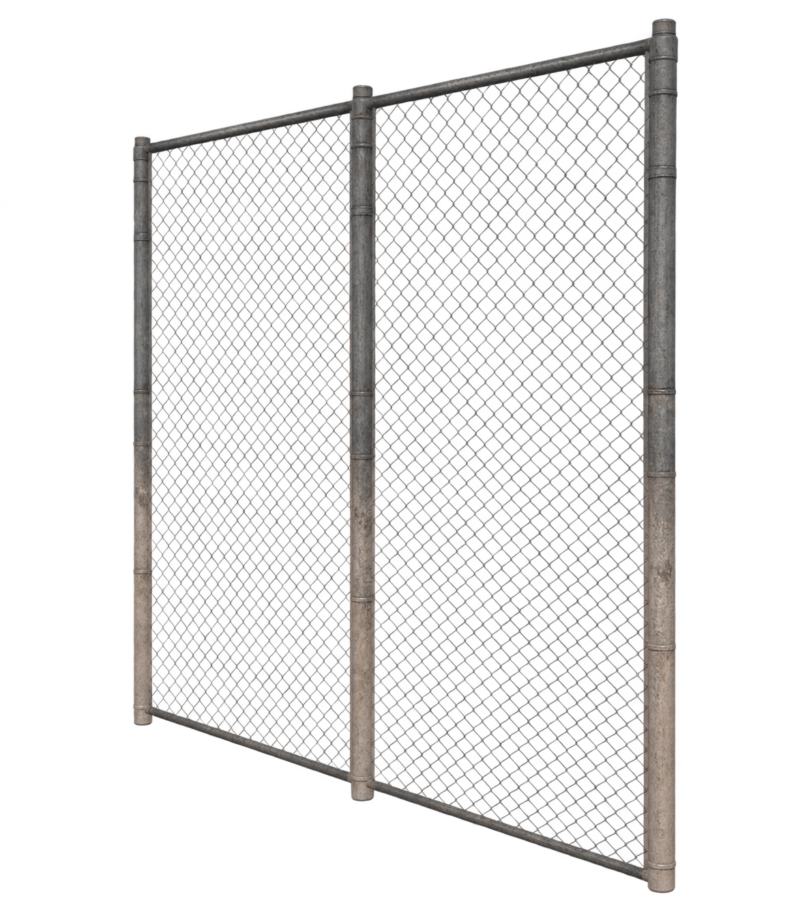
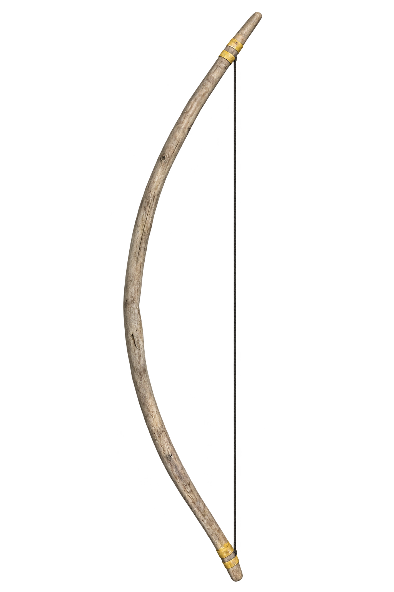
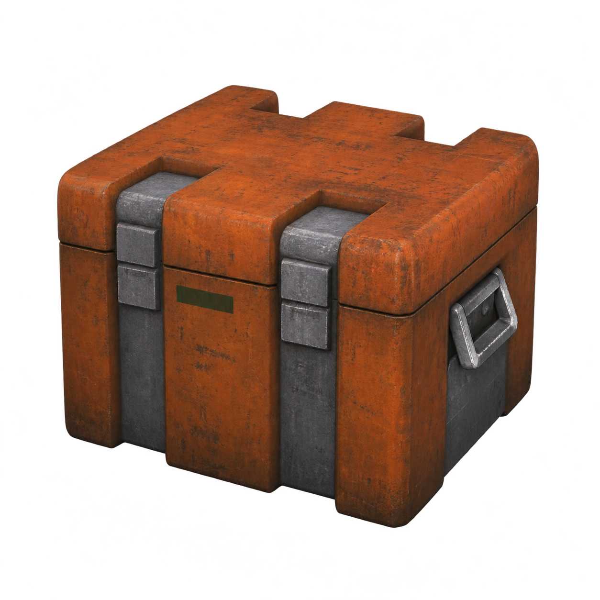
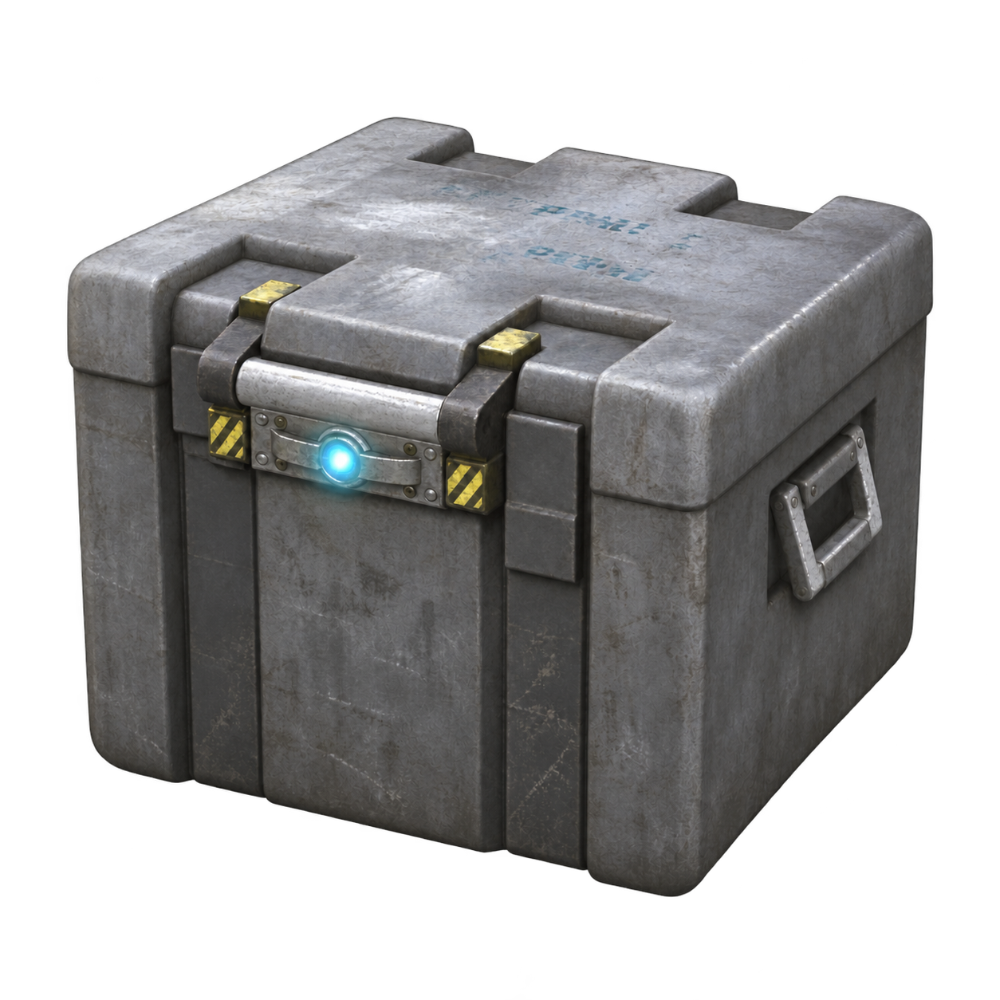
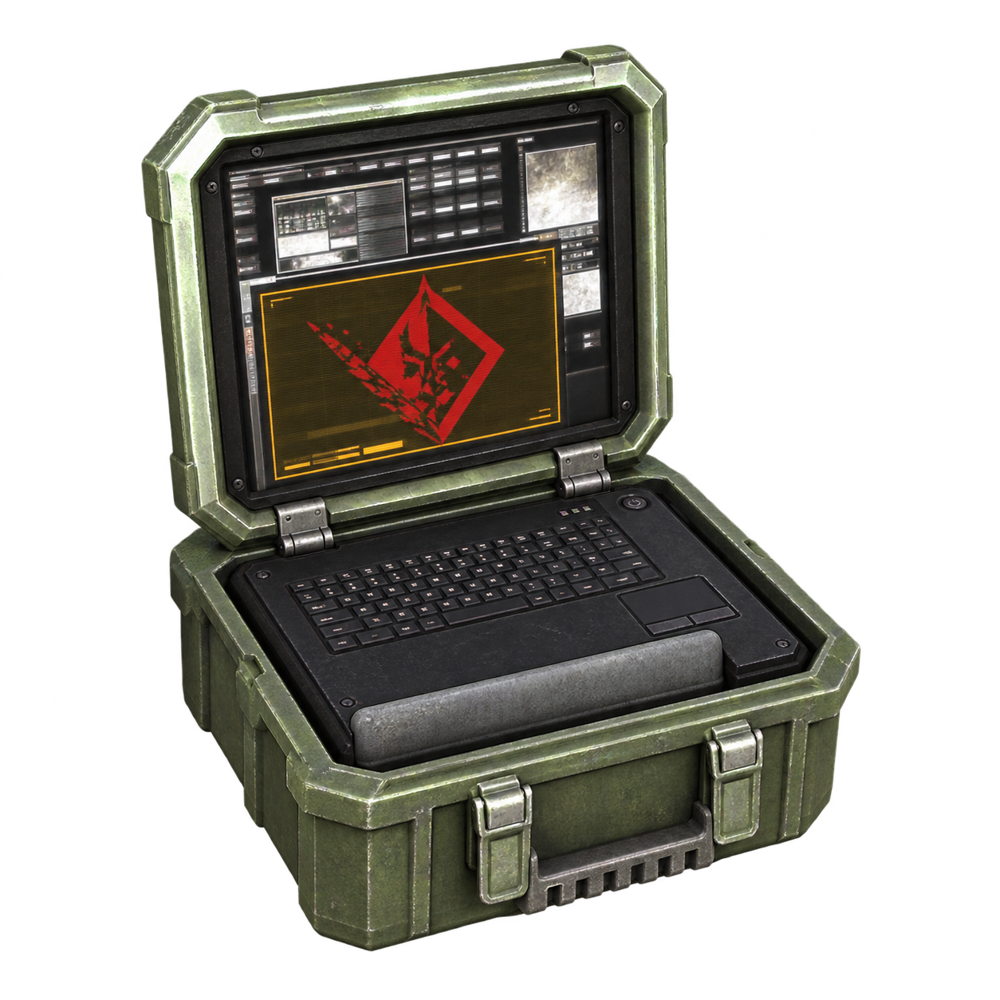

# P65 — AC!D 2, Survive et Revengeance

**26 novembre 2026 — 6 sources individuelles retenues : un fragment de baie technique AC!D 2, deux objets Survive et trois objets Revengeance.** Cette passe porte le suivi de **205 à 211 sources sélectionnées** et le catalogue Atlas de **28 à 34 entrées**. Chaque source possède son propre PNG, ses références, son `workId` et ses réserves de fidélité dans le [manifeste de livraison](delivery-manifest.json) et les [associations P65](../../cqc-bible/asset-associations-p65.json).

La [continuation de la bible P65](../../cqc-bible/CONTINUATION_P65.md) présente les six fiches détaillées. Les sources et associations P64 restent intactes ; les 205 identités antérieures et les 28 anciennes entrées Atlas sont conservées. **Aucun secteur, personnage modulaire ou ensemble d’objets n’est déclaré clos.**

## Comptabilité de la passe

| Mesure | P65 | Cumul après P65 |
|---|---:|---:|
| Sources sélectionnées | 6 | 211 |
| Essais PNG archivés hors Atlas | 1 | 15 |
| Sorties PNG générées | 7 | — |
| Appels imagegen | 7 | — |
| Requêtes refusées | 0 | — |
| Entrées du catalogue Atlas | +6 | 34 |
| Admissions nouvelles au combat | 0 | — |
| Certifications absolues 1:1 | 0 | — |
| Images narratives créées | 0 | — |

Les sept sorties comprennent les six PNG retenus et la première version du coffre verrouillé. Une correction ciblée imagegen produit sa v2 sélectionnée ; la v1 reste archivée. Aucun redimensionnement, agrandissement UHD ou traitement mécanique des pixels n’a été appliqué aux fichiers retenus. Les [prompts exacts et appels](prompts.json) permettent de suivre cette comptabilité.

## Sources, associations et rubriques

Les six `workId` sont des périmètres descriptifs supplémentaires. Ils ne modifient pas les **277 lignes historiques** ni les **97 lignes non associées de la photographie P61** ; ces nombres historiques ne constituent pas un calcul de couverture exhaustive après P65. Les numéros de rubriques sont repris du registre d’associations, sans renuméroter le guide.

| Source / fiche de bible | `workId` | PNG natif retenu | Rubriques du guide |
|---|---|---|---|
| [AC!D 2 — fragment de baie technique](../../cqc-bible/CONTINUATION_P65.md#acid2-research-block-machinery-bay) | `stage:acid2_research_block_machinery_bay` | 1672 × 941, RGB, v1 | 02, 13, 14, 15, 17, 19, 25, 26, 27, 29 |
| [Survive — Normal Fence](../../cqc-bible/CONTINUATION_P65.md#survive-normal-fence) | `prop:survive_normal_fence` | 1189 × 1323, RGBA, v1 | 02, 13, 14, 15, 17, 18, 25, 26, 27, 29 |
| [Survive — Survival Bow](../../cqc-bible/CONTINUATION_P65.md#survive-survival-bow) | `prop:survive_survival_bow` | 1024 × 1536, RGBA, v1 | 02, 05, 15, 16, 17, 18, 25, 26, 27, 29 |
| [Revengeance — coffre normal](../../cqc-bible/CONTINUATION_P65.md#mgr-item-box-normal) | `prop:mgr_item_box_normal` | 1254 × 1254, RGBA, v1 | 02, 13, 15, 17, 19, 25, 26, 27, 29 |
| [Revengeance — coffre verrouillé](../../cqc-bible/CONTINUATION_P65.md#mgr-item-box-locked) | `prop:mgr_item_box_locked` | 1254 × 1254, RGBA, **v2** | 02, 13, 15, 17, 19, 25, 26, 27, 29 |
| [Revengeance — terminal VR](../../cqc-bible/CONTINUATION_P65.md#mgr-vr-data-terminal) | `prop:mgr_vr_data_terminal` | 1254 × 1254, RGBA, v1 | 02, 13, 15, 17, 19, 25, 26, 27, 29 |

## Galerie des PNG individuels

Chaque aperçu ci-dessous ouvre son fichier individuel. La baie technique est opaque ; les cinq objets possèdent un canal alpha réel. Leurs résolutions natives sont toutes inférieures à l’UHD.

| AC!D 2 — Research Block, fragment de baie technique | Survive — Normal Fence |
|---|---|
|  |  |
| [PNG individuel](../../../public/cqc/assets/p65/acid2-research-block-machinery-bay.png) | [PNG individuel](../../../public/cqc/assets/p65/survive-normal-fence.png) |

| Survive — Survival Bow | Revengeance — coffre d’objets normal |
|---|---|
|  |  |
| [PNG individuel](../../../public/cqc/assets/p65/survive-survival-bow.png) | [PNG individuel](../../../public/cqc/assets/p65/mgr-item-box-normal.png) |

| Revengeance — coffre d’objets verrouillé, v2 | Revengeance — terminal de données VR |
|---|---|
|  |  |
| [PNG individuel retenu](../../../public/cqc/assets/p65/mgr-item-box-locked.png) | [PNG individuel](../../../public/cqc/assets/p65/mgr-vr-data-terminal.png) |

## Ce que les références permettent d’établir

**AC!D 2 — baie technique.** La [vignette native de 336 × 188](research/acid2/references/research-block-2-native-thumbnail.png), attribuée au Stage 04 Research Block par le titre de la vidéo, montre deux îlots sombres en enfilade, un sol lilas quadrillé, des lignes jaunes et des parois mauves. Le PNG conserve ce point de vue oblique et le cadrage partiel de l’îlot arrière. Les unités et l’interface ont été retirées ; circuits, grilles, joints et parties masquées sont reconstruits. Le minutage de cette image et la lecture de la séquence complète ne sont pas établis. Le résultat couvre **ce fragment de baie**, sans valider le plan du secteur, ses sorties ou une arène CQC latérale. [Recherche AC!D 2](research/acid2/handoff.json).

**Survive — Normal Fence.** La [capture atwiki](research/survive/references/normal-fence-atwiki-220401_01.jpg) montre le module entier à droite : deux panneaux de grillage, trois montants, rails supérieurs et inférieurs. La [capture Gameranx](research/survive/references/normal-fence-gameranx-20180222143434.jpg) confirme son libellé. La perspective générale est conservée ; fils, joints et texture sont détaillés par reconstruction. Des résidus alpha très faibles sont documentés. Aucune collision, destruction ou logique de défense n’est livrée.

**Survive — Survival Bow.** Le [menu Craft](research/survive/references/survival-bow-craft-20180222142556.jpg) nomme l’objet et montre son bois pâle, ses ligatures jaunes et sa corde. La partie médiane cachée par l’interface est reconstruite en continuité simple. Le PNG contient un seul arc et aucun projectile. L’espace intérieur est transparent ; certaines couleurs brunes visibles dans un aperçu RGB sont cachées sous un alpha nul. [Recherche et mesures Survive](research/survive/handoff.json).

**Revengeance — coffre normal.** La [référence du manuel officiel PC, p. 11](research/mgr/mgr-item-box-normal-reference.png), soutient la caisse orange, ses deux renforts frontaux et sa poignée droite. La source générée est plus lumineuse et plus détaillée que la capture sombre ; usure, joints et petits éléments de serrure sont reconstruits. De fines franges rouge/jaune subsistent sur certains contours.

**Revengeance — coffre verrouillé.** La [référence du manuel officiel PC, p. 11](research/mgr/mgr-item-box-locked-reference.png), soutient la forme métallique, le verrou horizontal, le signal cyan et les accents jaune/noir. La v2 retenue supprime les grosses excroissances blanches de la v1. Elle réinterprète aussi le grain métallique, devenu plus marbré : la correction ne se limite donc pas strictement aux pixels de contour. Les faces cachées, l’ouverture et la destruction restent hors périmètre.

**Revengeance — terminal de données VR.** La [référence du manuel officiel PC, p. 14](research/mgr/mgr-vr-data-terminal-reference.png), de 315 × 178 pixels, montre un ordinateur ouvert dans une valise olive. Le PNG conserve écran, clavier, poignée et fermoirs ; l’interface, le motif rouge, les charnières et la quincaillerie sont reconstruits. Les petits caractères ou pictogrammes ne sont pas certifiés exacts. De très fines franges vert/jaune restent documentées. Les trois objets MGR sont couverts par la [revue visuelle indépendante](research/mgr/independent-visual-qa.json).

## Archive du coffre verrouillé

L’[essai v1 écarté](rejected/mgr-item-box-locked-v1.png) est conservé intégralement pour comparaison : 1254 × 1254, RGBA, 1 666 588 octets, SHA-256 `3bf1b6f3d29f5c10889f872a41a4d50c77c0932867d647691798c68a1e01a785`. Ses excroissances blanches et franges du contour supérieur motivent son remplacement par la v2.

Cette archive porte `selected:false` et `atlasIntegrated:false`. Elle est exclue du catalogue et du runtime et compte comme **un seul essai archivé P65**, portant le cumul à 15. La comparaison v1/v2 et l’ancien verdict restent dans la [revue indépendante](research/mgr/independent-visual-qa.json).

## Intégration et limites communes

Le [catalogue de l’Atlas](../../../public/cqc/data/cqc-p63-source-atlas.json) déclare 34 sources pour la route inchangée `/cqc/?module=atlas63`. Les six ajouts sont associés à `runtimeBinding.status:"atlas_only"` et `admittedByThisPass:false`. Leur présence au catalogue correspond à la consultation des sources statiques.

Les six fichiers gardent `runtimeIntegrated:false`, `combatReady:false`, `combatRuntimeIntegrated:false`, `absolute1to1Certified:false`, `referenceGeometryValidated:false` et `nativeUhd:false`. Le statut de fidélité reste `pending_external_review` et `scopeClosed:false`. **Aucune admission au combat, animation, collision, certification 1:1 ou production UHD native n’est revendiquée.** Les dimensions et empreintes réelles figurent dans le manifeste.

Les périmètres de Research Block et des autres secteurs AC!D restent ouverts. Forsaken Ruins, le transporteur Survive, les défenses insuffisamment vues et le projectile Mortar n’ont pas reçu de nouvelle source P65. Les identités Harley Warren et Joel Marton ne sont pas transformées en corps inventés. Les refus des passes antérieures ne sont pas relancés sous un alias.

## Vérifications disponibles

État établi à partir des preuves locales présentes le **26 novembre 2026**, dont le contrôle complet horodaté **09:32:13.826 (Paris)**. Ces résultats n’établissent pas une exécution du jeu ou du navigateur.

| Contrôle | Résultat effectivement consigné | Preuve |
|---|---|---|
| Tests Node Atlas, P64 et P65 | **30 tests réussis, 0 échec** | [p65-node-tests.txt](p65-node-tests.txt) |
| Contrôle complet P65 | **`status:passed`** ; 7 PNG contrôlés, 6 retenus, 1 archive, total 211 et Atlas 34 | [p65-local-verification.json](p65-local-verification.json) |
| Conservation historique | 205 associations et identités Git inchangées ; 28 PNG locaux rehashés ; anciennes 28 fiches Atlas et coque/contrôleur/style conservés | [Contrôle complet](p65-local-verification.json) |
| Graphe runtime | **3047 fichiers, 4983 références** ; 3040 anciennes lignes inchangées, seul l’ancien catalogue modifié ; 740 omissions et 499 routes externes préservées | [Contrôle complet](p65-local-verification.json) |
| Comparaison visuelle AC!D 2 et Survive | Trois sources retenues avec limites de référence explicites | [root-visual-qa.json](research/root-visual-qa.json) |
| Comparaison visuelle MGR | Coffre normal et terminal retenus avec réserves ; coffre verrouillé v2 retenu, v1 archivée | [independent-visual-qa.json](research/mgr/independent-visual-qa.json) |
| Déploiement et parcours navigateur P65 | **Non vérifiés à ce point. Aucun aperçu P65 validé n’est revendiqué.** La limitation Vercel P64 reste une preuve historique, sans résultat déduit pour P65. | [Blocage Vercel P64](../pass64/p64-browser-verification.json) |

Les sources historiques absentes du checkout partiel sont vérifiées par la stabilité des registres et de l’index Git, sans téléchargement intégral. Le décodage PNG contrôle structure, CRC, décompression, dimensions, empreintes et alpha. L’atteignabilité des fichiers dans le graphe runtime reste une vérification statique. Le [contrat d’intégration et dossier QA](INTEGRATION_QA.md) décrit ces limites et les contrôles à conserver.

## Documents de référence

- [Manifeste de livraison](delivery-manifest.json) : fichiers, dimensions, empreintes, références, limites et versions.
- [Associations à la bible](../../cqc-bible/asset-associations-p65.json) : mêmes identités, `workId` et rubriques du guide.
- [Six fiches détaillées et galerie de bible](../../cqc-bible/CONTINUATION_P65.md).
- [Index des prompts exacts](prompts.json).
- [Passe P64 conservée](../pass64/README.md).
