# P66 — galerie des nouvelles sources CQC

**14 PNG sélectionnés : 8 fragments de décor et 6 objets.** Cumul : **225 sources**, **48 entrées Atlas**, **18 essais archivés**. Les 3 archives de cette passe restent hors du catalogue. 17 appels imagegen ont produit 17 sorties PNG ; aucun refus nouveau.

[Bible P66](../../cqc-bible/CONTINUATION_P66.md) · [Livraison](delivery-manifest.json) · [Associations](../../cqc-bible/asset-associations-p66.json) · [Prompts](prompt-index.json) · [Manquants](MANQUANTS.md) · [QA](INTEGRATION_QA.md)

Chaque illustration est un fichier individuel, consultable dans `/cqc/?module=atlas63`. Les images opaques sont des fragments de décor ; les objets sont isolés avec alpha natif. Aucun PNG natif UHD, aucune admission combat, aucun périmètre clos et aucune certification absolue 1:1.

## Sources sélectionnées

### AC!D — FAR B3F, baie des conteneurs

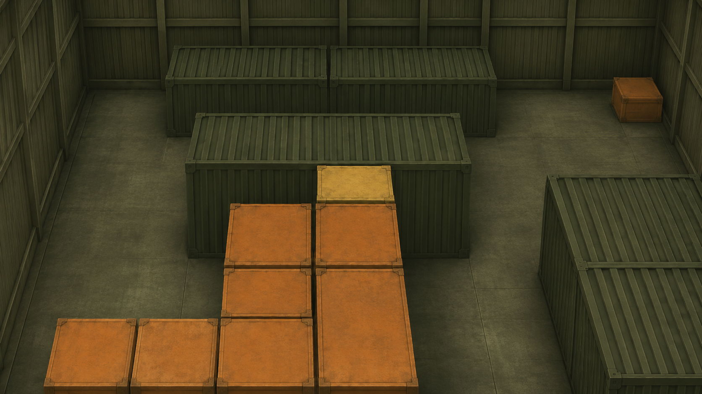

Une baie de conteneurs et de caisses de FAR B3F, en caméra oblique. Fragment de référence, sans plan complet de l’étage.

**1672×941 · RGB · v1** — [Fiche et réserves](https://github.com/darknigthmare/shadow-codec-ops/blob/codex/cqc-p61-missing-static-sources-20261125/docs/cqc-bible/CONTINUATION_P66.md#acid-far-b3f-container-bay).

### AC!D — FAR B4F, passerelles grillagées

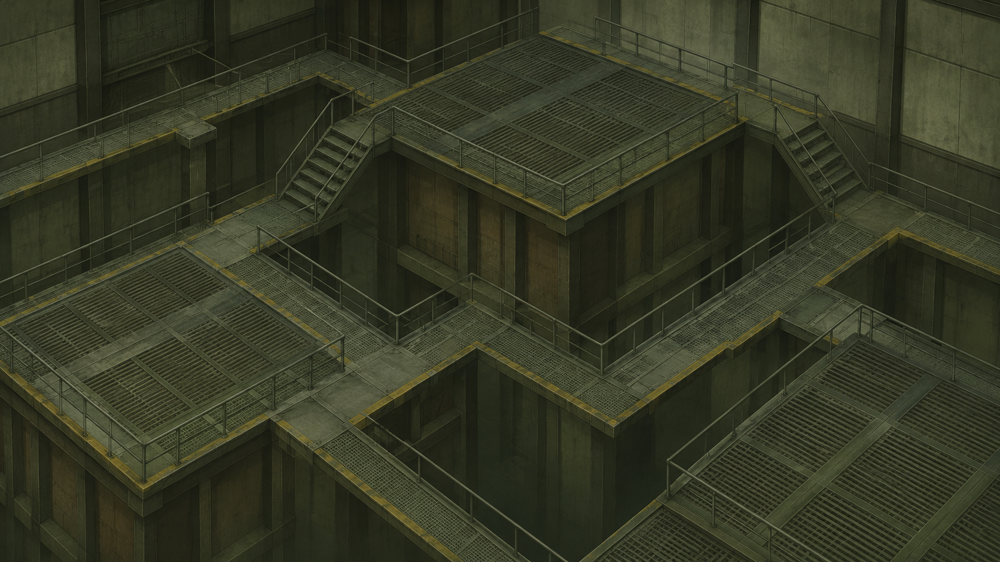

Passerelles et caillebotis d’un secteur de FAR B4F ; les turbines, le graphe de circulation et la topologie exacte restent non validés.

**1672×941 · RGB · v1** — [Fiche et réserves](https://github.com/darknigthmare/shadow-codec-ops/blob/codex/cqc-p61-missing-static-sources-20261125/docs/cqc-bible/CONTINUATION_P66.md#acid-far-b4f-turbine-walkways).

### AC!D — FAR B5F, chambre de La Clown

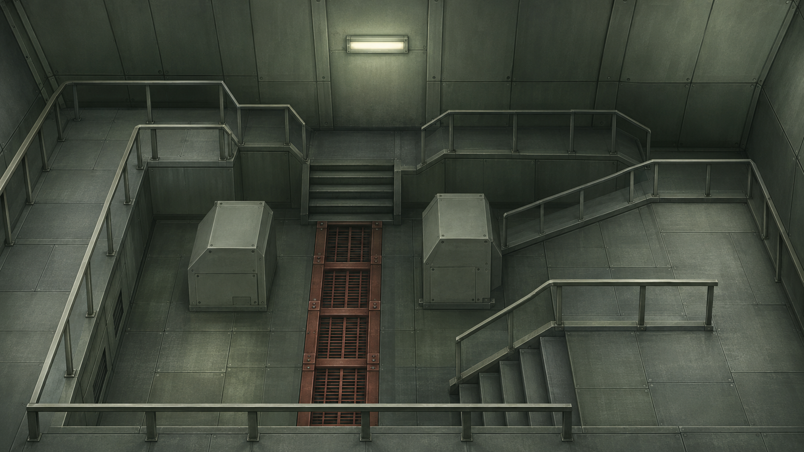

Un secteur de la chambre de La Clown à FAR B5F, avec canal grillagé central et passerelles. Aucun boss intégré.

**1672×941 · RGB · v1** — [Fiche et réserves](https://github.com/darknigthmare/shadow-codec-ops/blob/codex/cqc-p61-missing-static-sources-20261125/docs/cqc-bible/CONTINUATION_P66.md#acid-far-b5f-clown-chamber).

### AC!D 2 — Control Section, hall à escalier

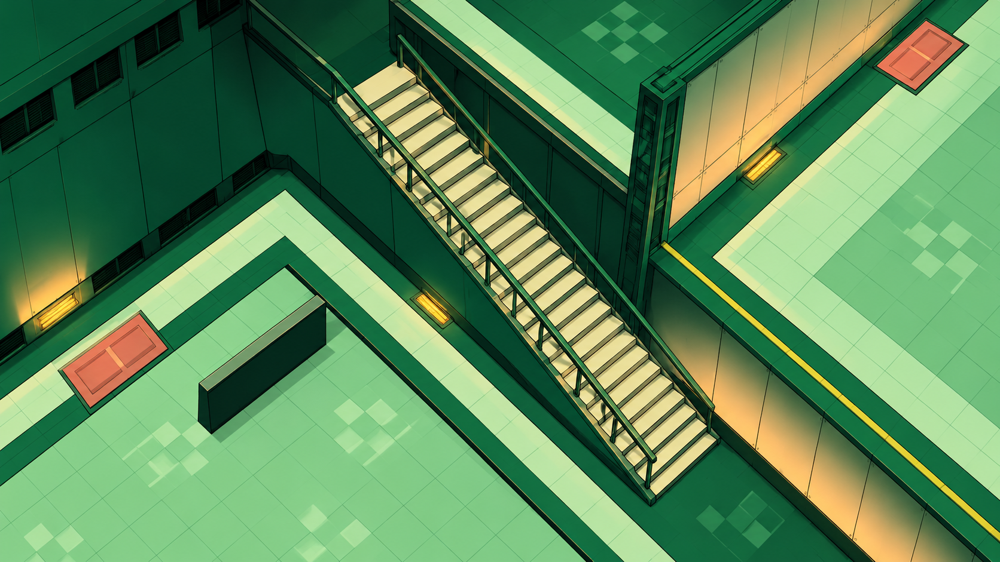

Hall intérieur de Control Section : une longue volée d’escalier et deux paliers. Aucun secteur complet.

**1672×941 · RGB · v1** — [Fiche et réserves](https://github.com/darknigthmare/shadow-codec-ops/blob/codex/cqc-p61-missing-static-sources-20261125/docs/cqc-bible/CONTINUATION_P66.md#acid2-control-section-stair-hall).

### AC!D 2 — Communications Tower, passerelle technique

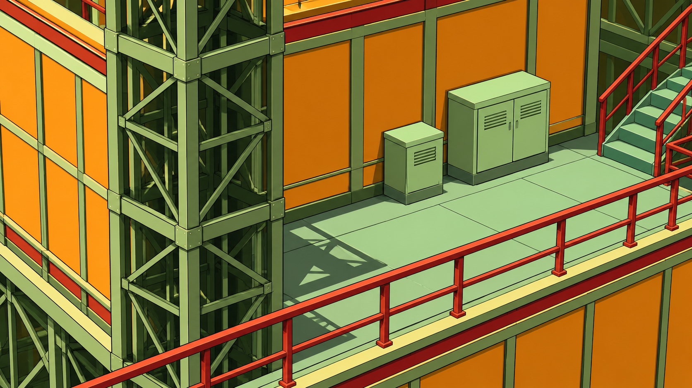

Passerelle technique de Communications Tower : panneaux orange, supports à treillis, rambardes rouges et coffrets.

**1672×941 · RGB · v1** — [Fiche et réserves](https://github.com/darknigthmare/shadow-codec-ops/blob/codex/cqc-p61-missing-static-sources-20261125/docs/cqc-bible/CONTINUATION_P66.md#acid2-communications-tower-service-deck).

### AC!D 2 — Terminal, quai de chargement

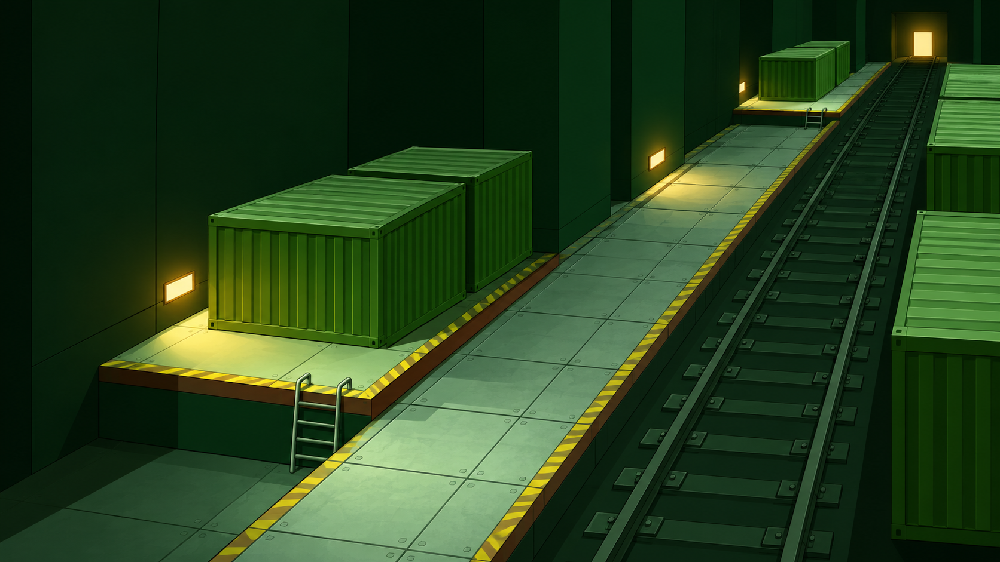

Quai souterrain de Terminal : rails parallèles, passerelle métallique, conteneurs verts et plateforme de chargement.

**1672×941 · RGB · v1** — [Fiche et réserves](https://github.com/darknigthmare/shadow-codec-ops/blob/codex/cqc-p61-missing-static-sources-20261125/docs/cqc-bible/CONTINUATION_P66.md#acid2-terminal-loading-platform).

### AC!D 2 — Residential Area, vestibule intérieur

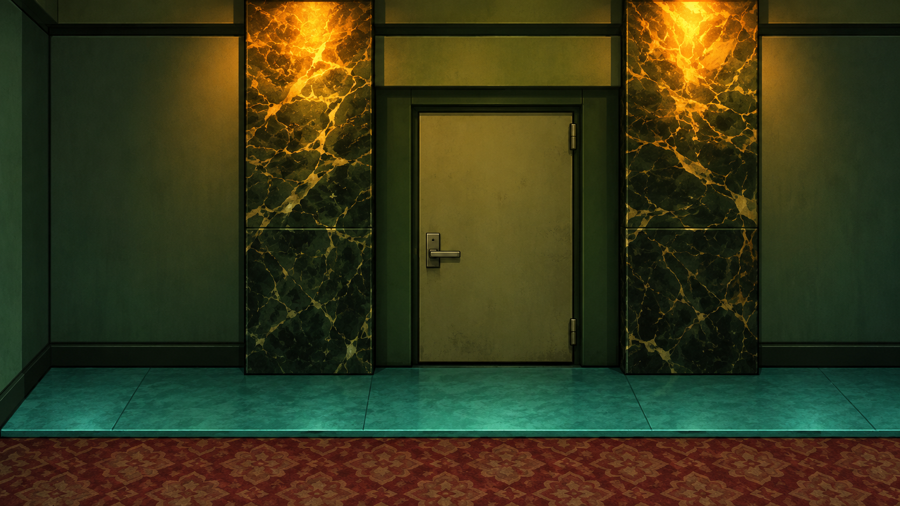

Vestibule intérieur de Residential Area : porte beige-olive, piédroits vert-noir veinés d’or et morceau du palier.

**1672×941 · RGB · v1** — [Fiche et réserves](https://github.com/darknigthmare/shadow-codec-ops/blob/codex/cqc-p61-missing-static-sources-20261125/docs/cqc-bible/CONTINUATION_P66.md#acid2-residential-area-lobby).

### Survive — Forsaken Ruins, terrasse et passage

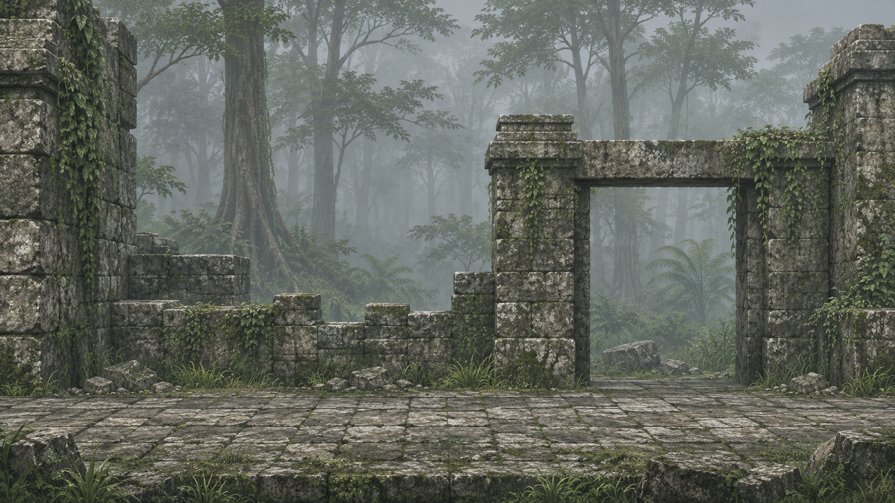

Adaptation latérale 2D d’une terrasse dallée et d’un passage rectangulaire vus dans le gameplay natif ; un secteur seulement, pas la carte entière.

**1672×941 · RGB · v1** — [Fiche et réserves](https://github.com/darknigthmare/shadow-codec-ops/blob/codex/cqc-p61-missing-static-sources-20261125/docs/cqc-bible/CONTINUATION_P66.md#survive-forsaken-ruins-terrace).

### Survive — Machine Gun Turret

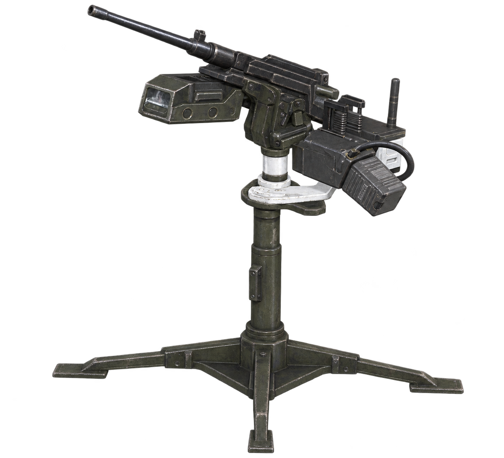

Une tourelle autonome native, vue trois quarts, source fixe isolée ; pas le mortier et pas la version manuelle.

**1314×1197 · RGBA · v1** — [Fiche et réserves](https://github.com/darknigthmare/shadow-codec-ops/blob/codex/cqc-p61-missing-static-sources-20261125/docs/cqc-bible/CONTINUATION_P66.md#survive-machine-gun-turret).

### Survive — Oil Trap

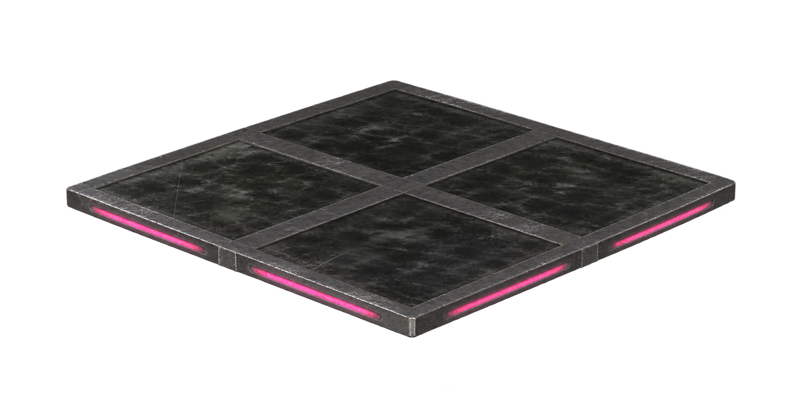

Un piège à huile natif isolé au repos, source fixe.

**1774×887 · RGBA · v1** — [Fiche et réserves](https://github.com/darknigthmare/shadow-codec-ops/blob/codex/cqc-p61-missing-static-sources-20261125/docs/cqc-bible/CONTINUATION_P66.md#survive-oil-trap).

### Survive — Flame Trap, inactif

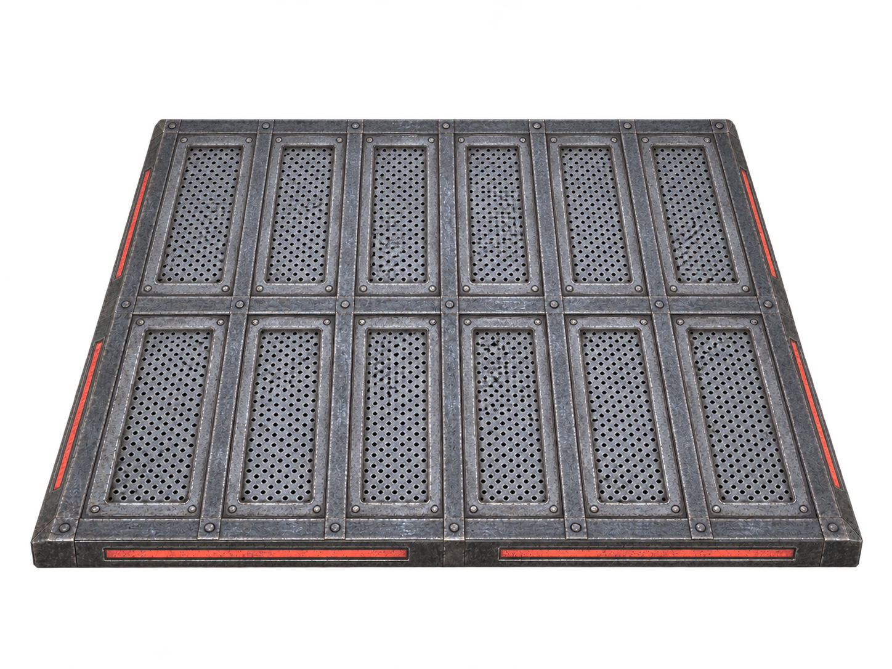

Un piège à flamme natif inactif, plaque métallique seule ; aucun effet de flamme généré.

**1448×1086 · RGBA · v2** — [Fiche et réserves](https://github.com/darknigthmare/shadow-codec-ops/blob/codex/cqc-p61-missing-static-sources-20261125/docs/cqc-bible/CONTINUATION_P66.md#survive-flame-trap).

### Revengeance — Cardboard Box, déguisement normal

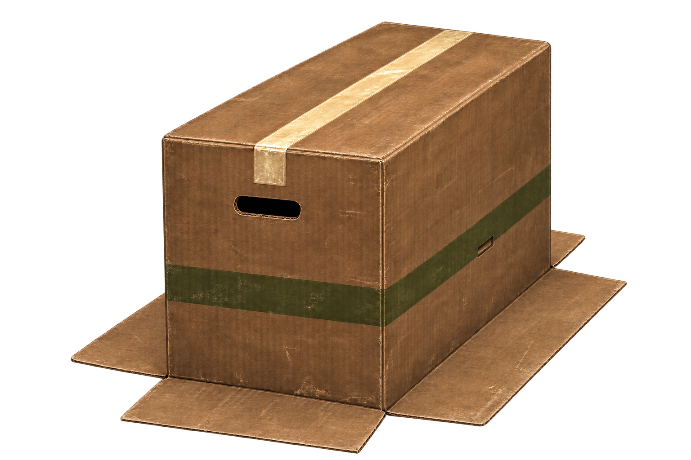

Une vue trois-quarts du déguisement Cardboard Box normal, ruban, bande verte et rabats. Ni l'autre face à étiquette, ni Raiden dedans, ni animation de déplacement ou mécanique de furtivité.

**1536×1024 · RGBA · v2** — [Fiche et réserves](https://github.com/darknigthmare/shadow-codec-ops/blob/codex/cqc-p61-missing-static-sources-20261125/docs/cqc-bible/CONTINUATION_P66.md#mgr-cardboard-box).

### Revengeance — Drum Can, fût de camouflage

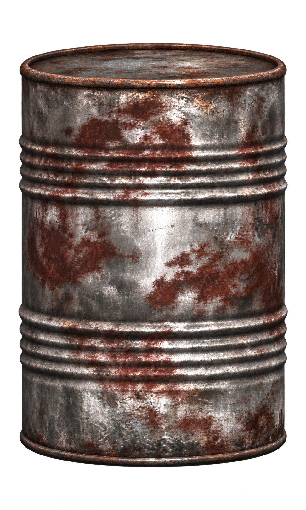

Un fût de camouflage dressé, isolé de Raiden, d'après une capture PS3 de preview. Ni roulade, ni état renversé ou détruit, ni validation du modèle retail final.

**972×1618 · RGBA · v2** — [Fiche et réserves](https://github.com/darknigthmare/shadow-codec-ops/blob/codex/cqc-p61-missing-static-sources-20261125/docs/cqc-bible/CONTINUATION_P66.md#mgr-drum-can).

### Revengeance — Cardboard Box, variante Mariachi

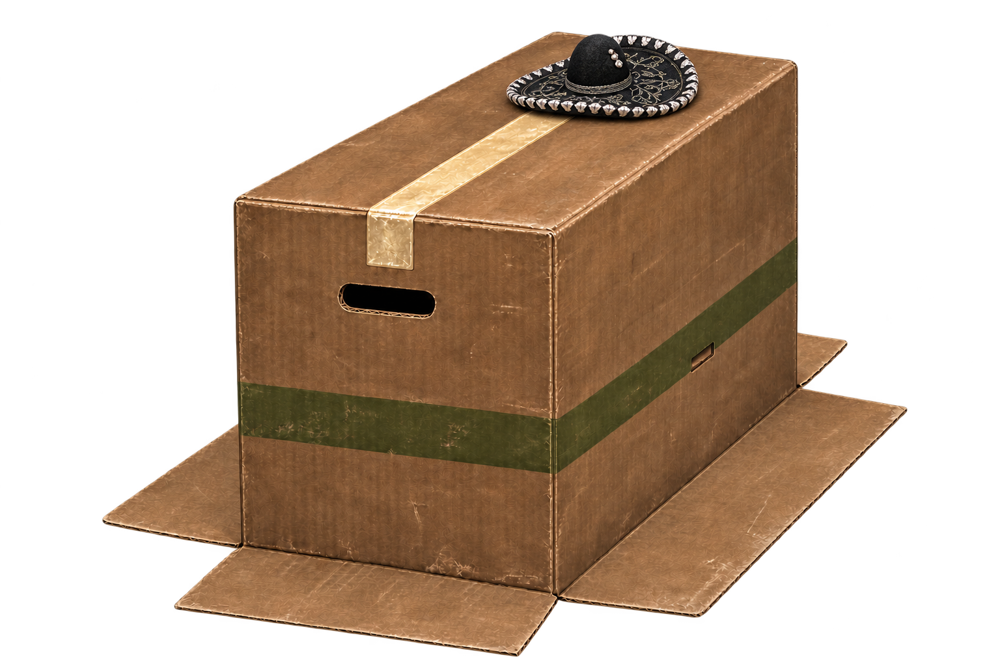

Variante cosmétique du déguisement Cardboard Box avec sombrero Mariachi. Un seul ensemble équipé, distinct du personnage Raiden et du costume plein corps.

**1536×1024 · RGBA · v1** — [Fiche et réserves](https://github.com/darknigthmare/shadow-codec-ops/blob/codex/cqc-p61-missing-static-sources-20261125/docs/cqc-bible/CONTINUATION_P66.md#mgr-cardboard-box-mariachi).

## Essais archivés

| Essai | Motif | Remplacement |
|---|---|---|
| [Cardboard Box v1](rejected/mgr-cardboard-box-v1.png) | Correction de l’alpha périphérique | Cardboard Box v2 |
| [Drum Can v1](rejected/mgr-drum-can-v1.png) | Silhouette trop haute et étroite | Drum Can v2 |
| [Flame Trap v1](rejected/survive-flame-trap-v1.png) | Matrice de 8 panneaux au lieu de 12 | Flame Trap v2 |

La comparaison indépendante des références est consignée dans `research/acid/independent-far-qa.json`, `research/acid/independent-acid2-qa.json`, `research/survive/independent-visual-qa.json` et `research/mgr/independent-visual-qa.json`. Les références locales sont des preuves de recherche, séparées des PNG générés et du runtime.
