# P67 — galerie des sprites et portraits par édition

**29 PNG sélectionnés sur 17 éditions : 22 personnages en corps entier, 6 portraits et 1 Gekko.** Cumul : **254 sources**, **77 dossiers Atlas**, **19 essais archivés**. 31 requêtes, 30 sorties, 1 refus sans fichier. Les images ci-dessous sont des sources statiques candidates ; **aucune certification 1:1 ni admission au combat**.

[Bible et fiches détaillées](../../cqc-bible/CONTINUATION_P67.md) · [Associations](../../cqc-bible/asset-associations-p67.json) · [Livraison](delivery-manifest.json) · [Prompts exacts](prompt-index.json) · [Audit](AUDIT_OPUS.md) · [Manquants](MANQUANTS.md) · [Contrôles](INTEGRATION_QA.md)

L’Atlas est accessible dans l’application par `/cqc/?module=atlas63`. Les 32 éditions y possèdent une clé de filtrage distincte. Les sources MGS1 issues du manuel, MGS2 HD, les poses T PSP et les portraits conservent leur attribution et leur portée dans les fiches.

## Répartition

| Opus / édition | Ajouts | Images sélectionnées |
|---|---:|---|
| Metal Gear — version MSX2 | 1 | garde gris d’Outer Heaven |
| Metal Gear — version NES | 1 | garde d’Outer Heaven |
| Metal Gear 2: Solid Snake — version MSX2 | 1 | Four Horsemen / Ultrabox, archétype visuel partagé |
| Metal Gear Solid — design PlayStation, illustration du manuel d’origine | 2 | Genome léger, illustration officielle du manuel ; Genome lourd, illustration officielle du manuel |
| Metal Gear Solid 2 / capture HD Edition | 1 | otage anonyme grisonnant de Shell 1, assis |
| Metal Gear Solid: The Twin Snakes | 1 | Kenneth Baker assis après sa libération |
| Metal Gear Solid: Portable Ops Plus | 5 | USSR Female Soldier (A) ; Ocelot Unit Female Soldier (A) ; Male Scientist (A) ; USSR Male Soldier (A) ; Female Officer (A) |
| Metal Gear Solid: Peace Walker | 1 | guérillero Sandinista, modèle PSP |
| Metal Gear Solid Delta: Snake Eater | 1 | GRU à cagoule, portrait du haut du torse |
| Metal Gear Solid 4: Guns of the Patriots | 2 | rebelle du Moyen-Orient, manches courtes ; rebelle du Moyen-Orient, tunique claire |
| Metal Gear Online 3 | 6 | portrait du preset Scout au masque optique ; portrait du preset Enforcer au casque à visière ; portrait du preset Infiltrator à cagoule ; preset Scout à casquette, tenue kaki ; preset Infiltrator au masque respirateur ; preset Enforcer à motif crâne |
| Metal Gear Solid Mobile | 1 | garde olive, variante N-Gage |
| Metal Gear Online 1 | 1 | Rowdy Reiko, tenue et pose de Subsistence |
| Metal Gear Solid V: The Phantom Pain | 2 | Dr Evangelos Constantinou, tenue de l’hôpital ; infirmière du prologue, portrait en tenue blanche |
| Metal Gear Online 2 | 1 | preset à béret blanc, uniforme noir et bandoulière |
| Metal Gear Solid V: Ground Zeroes | 1 | garde de Camp Omega en poncho, salut |
| Metal Gear Solid Touch | 1 | Gekko, pose aérienne de la mission 07 |

## Sources individuelles

### MG MSX2 — garde gris d’Outer Heaven

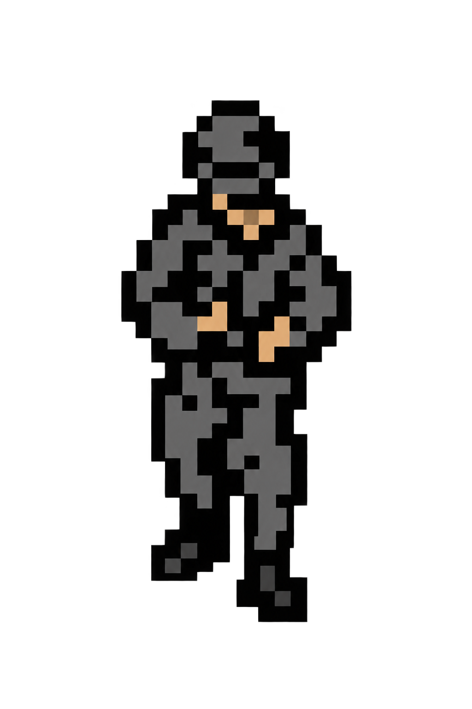

**corps entier · 1024×1536 · RGBA · v1**

Une pose du garde gris natif MSX2, reconstruite en pixel art agrandi ; le groupe gardes/chiens et ses autres palettes reste ouvert.

[Fiche, références et réserves](https://github.com/darknigthmare/shadow-codec-ops/blob/codex/cqc-p61-missing-static-sources-20261125/docs/cqc-bible/CONTINUATION_P67.md#mg1-msx-outer-heaven-gray-guard).

### MG NES — garde d’Outer Heaven

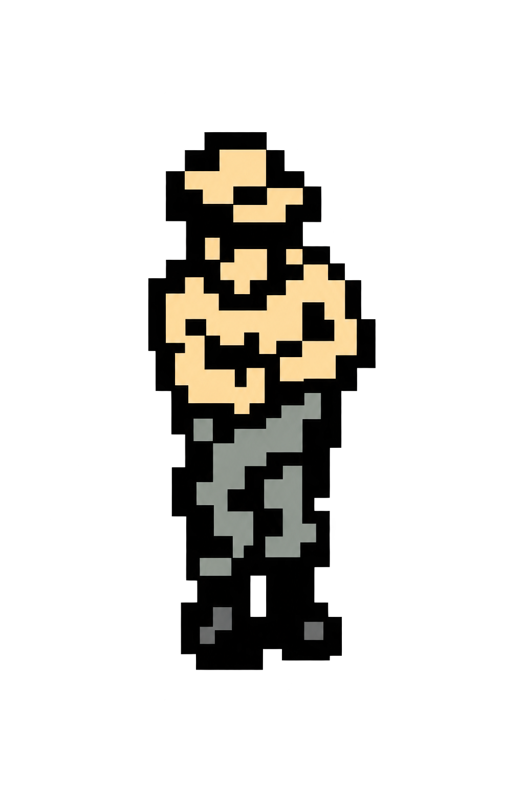

**corps entier · 1024×1536 · RGBA · v1**

Une pose du garde NES à palette beige/noir, distincte du garde MSX2 ; le groupe global reste ouvert.

[Fiche, références et réserves](https://github.com/darknigthmare/shadow-codec-ops/blob/codex/cqc-p61-missing-static-sources-20261125/docs/cqc-bible/CONTINUATION_P67.md#mg1-nes-outer-heaven-guard).

### MG2 — Four Horsemen / Ultrabox, archétype visuel partagé

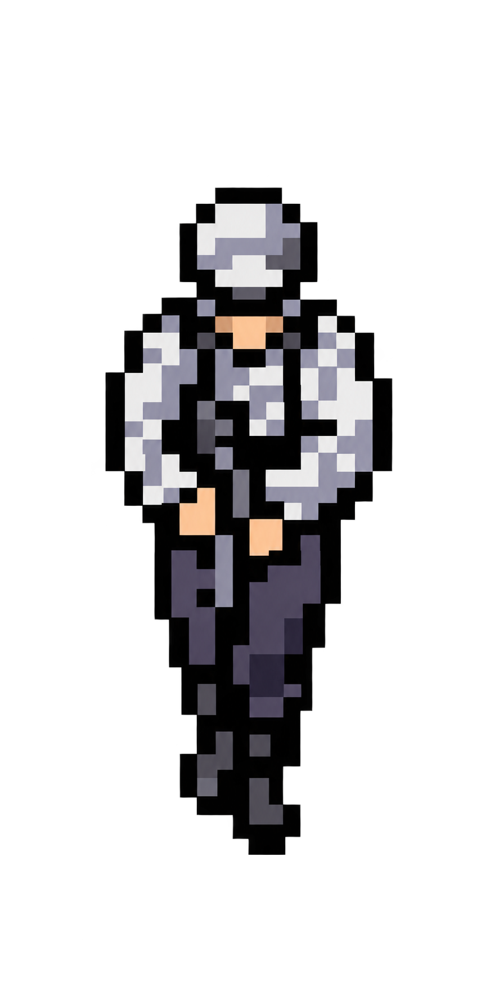

**corps entier · 887×1774 · RGBA · v1**

Une pose normale de l’archétype partagé Four Horsemen/Ultrabox ; ne compte pas comme quatre identités visuellement distinctes.

[Fiche, références et réserves](https://github.com/darknigthmare/shadow-codec-ops/blob/codex/cqc-p61-missing-static-sources-20261125/docs/cqc-bible/CONTINUATION_P67.md#mg2-four-horsemen-shared-guard).

### MGS1 — Genome léger, illustration officielle du manuel

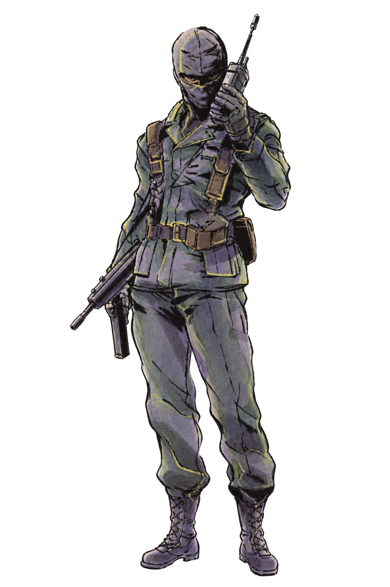

**corps entier · 1024×1536 · RGBA · v1**

Corps complet du Genome Light Infantry d’après l’illustration officielle, dans sa pose radio ; correspondance au modèle PS1 et animations non validées.

[Fiche, références et réserves](https://github.com/darknigthmare/shadow-codec-ops/blob/codex/cqc-p61-missing-static-sources-20261125/docs/cqc-bible/CONTINUATION_P67.md#mgs1-genome-light-infantry).

### MGS1 — Genome lourd, illustration officielle du manuel

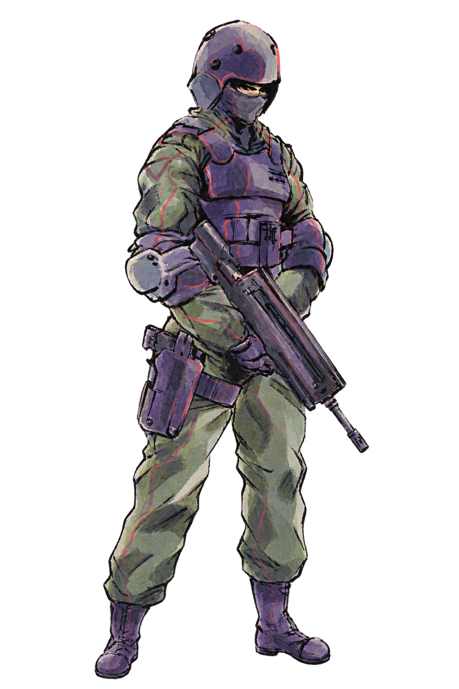

**corps entier · 1024×1536 · RGBA · v1**

Corps complet du Heavily Armed Troop d’après l’illustration officielle, pose armée trois quarts ; modèle PS1, équipements secondaires et animations non validés.

[Fiche, références et réserves](https://github.com/darknigthmare/shadow-codec-ops/blob/codex/cqc-p61-missing-static-sources-20261125/docs/cqc-bible/CONTINUATION_P67.md#mgs1-genome-heavily-armed-troop).

### MGS2 — otage anonyme grisonnant de Shell 1, assis

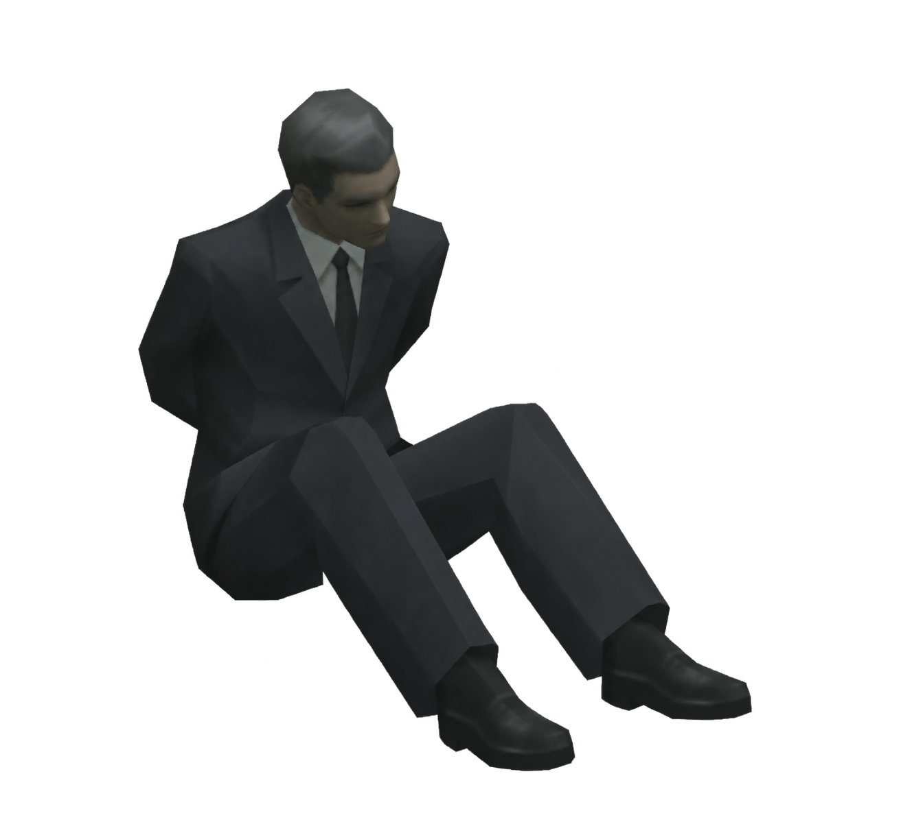

**corps entier · 1312×1199 · RGBA · v1**

Une variante civile anonyme assise, observée à 132–134 s ; le groupe des otages reste ouvert.

[Fiche, références et réserves](https://github.com/darknigthmare/shadow-codec-ops/blob/codex/cqc-p61-missing-static-sources-20261125/docs/cqc-bible/CONTINUATION_P67.md#mgs2-shell1-gray-haired-hostage).

### The Twin Snakes — Kenneth Baker assis après sa libération

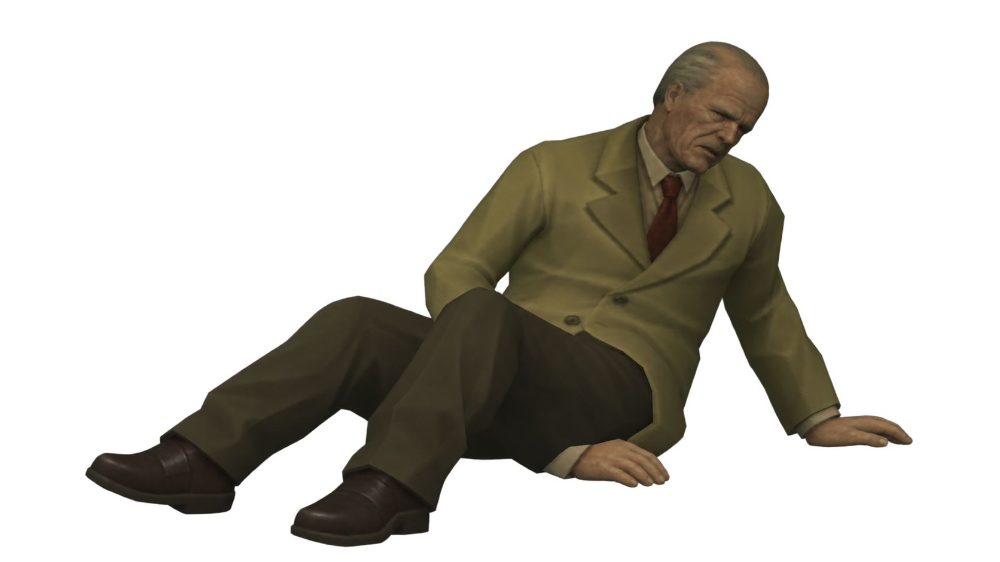

**corps entier · 1672×941 · RGBA · v1**

Kenneth Baker, pose civile assise après libération, d’après la cinématique native ; une pose observée, pas un corps de combattant.

[Fiche, références et réserves](https://github.com/darknigthmare/shadow-codec-ops/blob/codex/cqc-p61-missing-static-sources-20261125/docs/cqc-bible/CONTINUATION_P67.md#tts-kenneth-baker-seated).

### Portable Ops Plus — USSR Female Soldier (A)

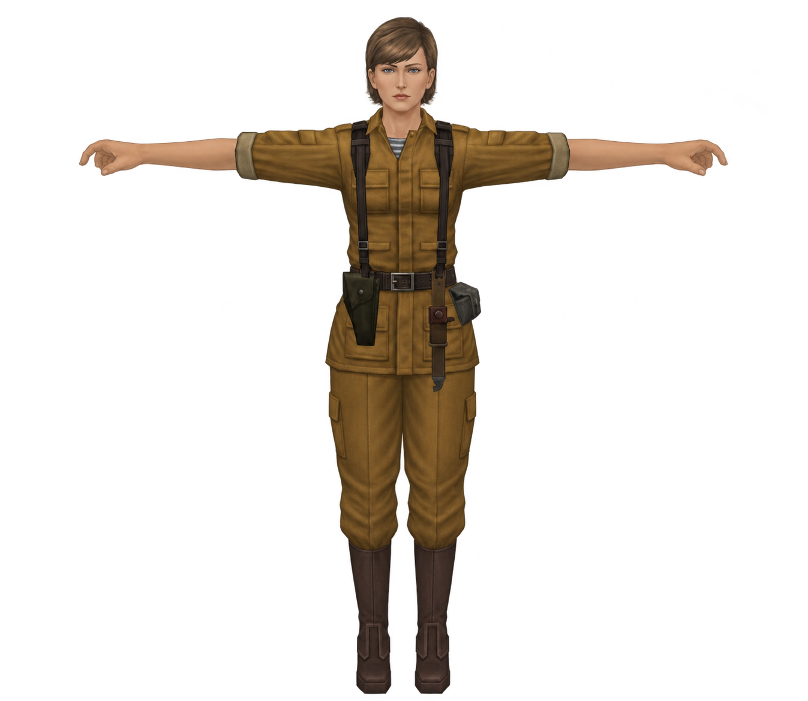

**corps entier · 1347×1167 · RGBA · v1**

Une recrue féminine soviétique A en pose frontale T, tenue ocre et bretelles noires. Aucun autre visage, équipement, palette, dos ou animation du groupe.

[Fiche, références et réserves](https://github.com/darknigthmare/shadow-codec-ops/blob/codex/cqc-p61-missing-static-sources-20261125/docs/cqc-bible/CONTINUATION_P67.md#mpop-ussr-female-a).

### Portable Ops Plus — Ocelot Unit Female Soldier (A)

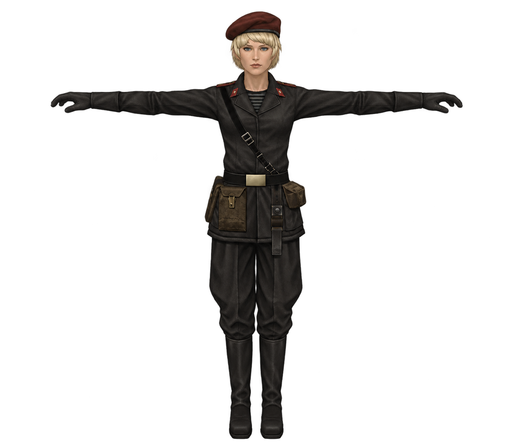

**corps entier · 1347×1167 · RGBA · v1**

Une recrue féminine A de l’unité Ocelot, béret rouge-brun et uniforme noir, vue frontale T. Ne couvre ni les variantes B/C ni la recrue masculine.

[Fiche, références et réserves](https://github.com/darknigthmare/shadow-codec-ops/blob/codex/cqc-p61-missing-static-sources-20261125/docs/cqc-bible/CONTINUATION_P67.md#mpop-ocelot-female-a).

### Portable Ops Plus — Male Scientist (A)

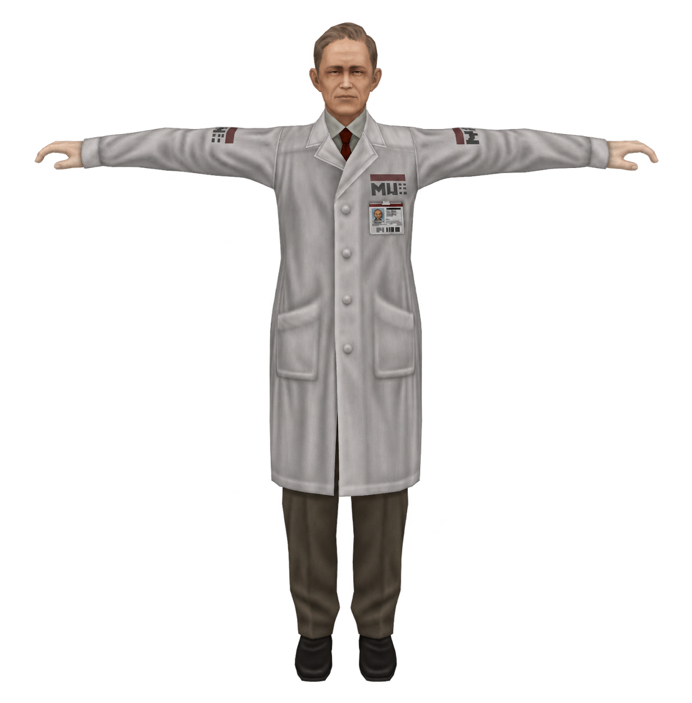

**corps entier · 1244×1264 · RGBA · v1**

Un scientifique masculin A recrutable en blouse blanche et pose T. Ni déguisement de Snake dans MGS3, ni ensemble des médecins/scientifiques/officiers MPO.

[Fiche, références et réserves](https://github.com/darknigthmare/shadow-codec-ops/blob/codex/cqc-p61-missing-static-sources-20261125/docs/cqc-bible/CONTINUATION_P67.md#mpop-male-scientist-a).

### Peace Walker — guérillero Sandinista, modèle PSP

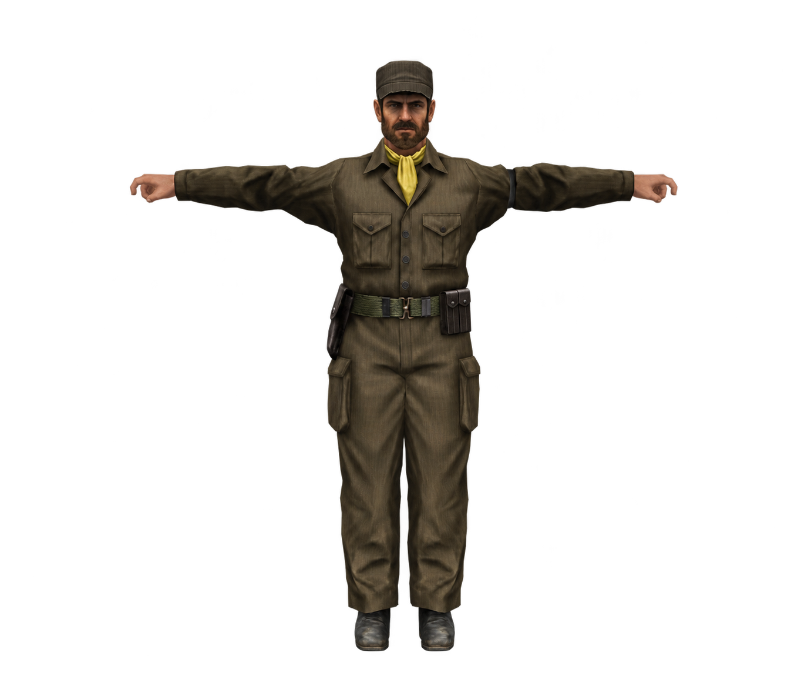

**corps entier · 1347×1167 · RGBA · v1**

Un modèle Sandinista PSP, casquette olive et foulard jaune, vue frontale T. Aucun ensemble complet des FSLN ni posture blessée/transportée.

[Fiche, références et réserves](https://github.com/darknigthmare/shadow-codec-ops/blob/codex/cqc-p61-missing-static-sources-20261125/docs/cqc-bible/CONTINUATION_P67.md#pw-sandinista).

### Portable Ops Plus — USSR Male Soldier (A)

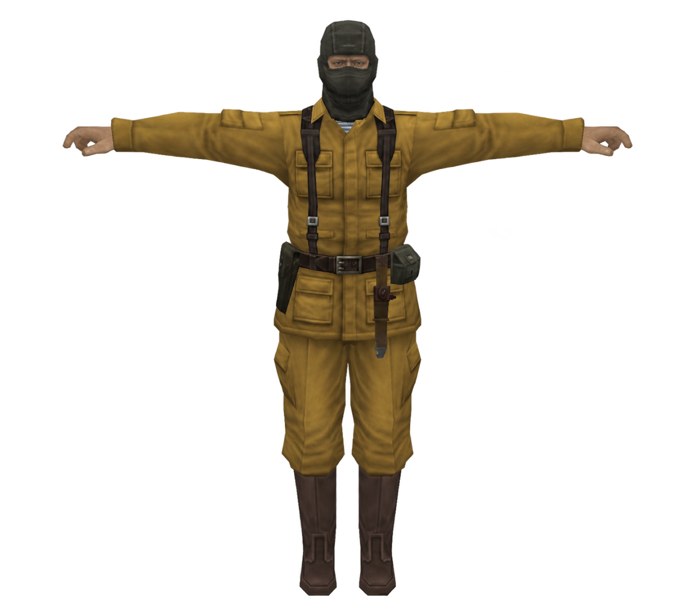

**corps entier · 1347×1167 · RGBA · v1**

Une recrue masculine soviétique A, cagoule sombre, tunique ocre à manches longues, vue frontale T. Ne couvre pas les autres types ni leurs palettes.

[Fiche, références et réserves](https://github.com/darknigthmare/shadow-codec-ops/blob/codex/cqc-p61-missing-static-sources-20261125/docs/cqc-bible/CONTINUATION_P67.md#mpop-ussr-male-a).

### Portable Ops Plus — Female Officer (A)

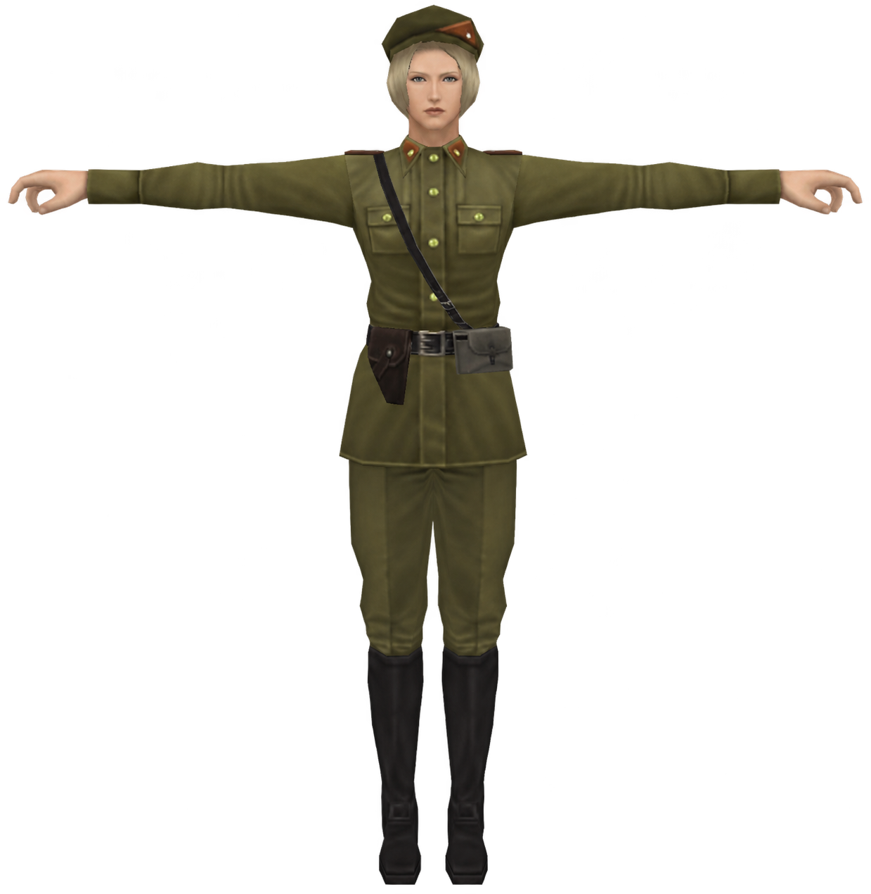

**corps entier · 1239×1270 · RGBA · v1**

Une officière recrutable A, coiffe olive, tunique à boutons et sangle diagonale, vue frontale T. Rattachement au groupe P61 « médecins, scientifiques et officiers recrutables » ; pas de région promotionnelle inventée.

[Fiche, références et réserves](https://github.com/darknigthmare/shadow-codec-ops/blob/codex/cqc-p61-missing-static-sources-20261125/docs/cqc-bible/CONTINUATION_P67.md#mpop-female-officer-a).

### Delta — GRU à cagoule, portrait du haut du torse

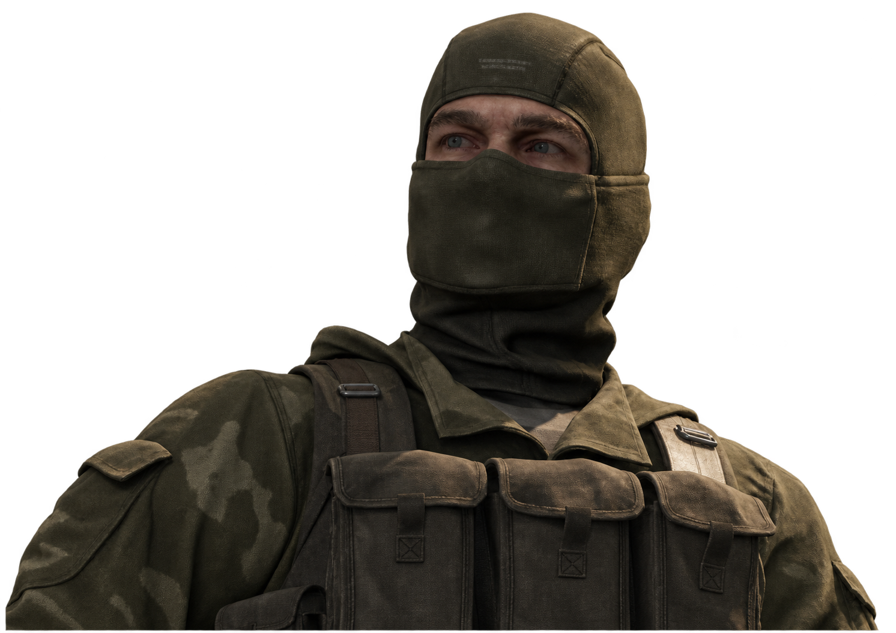

**portrait · 1492×1054 · RGBA · v1**

Portrait tête, épaules et haut du torse uniquement, d’après une capture native PC. Le bord inférieur au niveau des poches est volontaire ; aucun bras complet, taille, dos, jambe ou pied n’est produit.

[Fiche, références et réserves](https://github.com/darknigthmare/shadow-codec-ops/blob/codex/cqc-p61-missing-static-sources-20261125/docs/cqc-bible/CONTINUATION_P67.md#delta-gru-balaclava-portrait).

### MGS4 — rebelle du Moyen-Orient, manches courtes

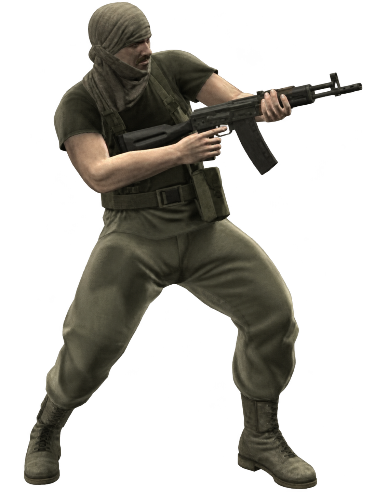

**corps entier · 1094×1438 · RGBA · v1**

Un rebelle au premier plan de la capture PS3 archivée, manches courtes olive et tissu autour de la tête/du cou, corps entier dans la pose observée. Ni groupe régional complet, ni variante sud-américaine.

[Fiche, références et réserves](https://github.com/darknigthmare/shadow-codec-ops/blob/codex/cqc-p61-missing-static-sources-20261125/docs/cqc-bible/CONTINUATION_P67.md#mgs4-middle-east-rebel-short-sleeve).

### MGS4 — rebelle du Moyen-Orient, tunique claire

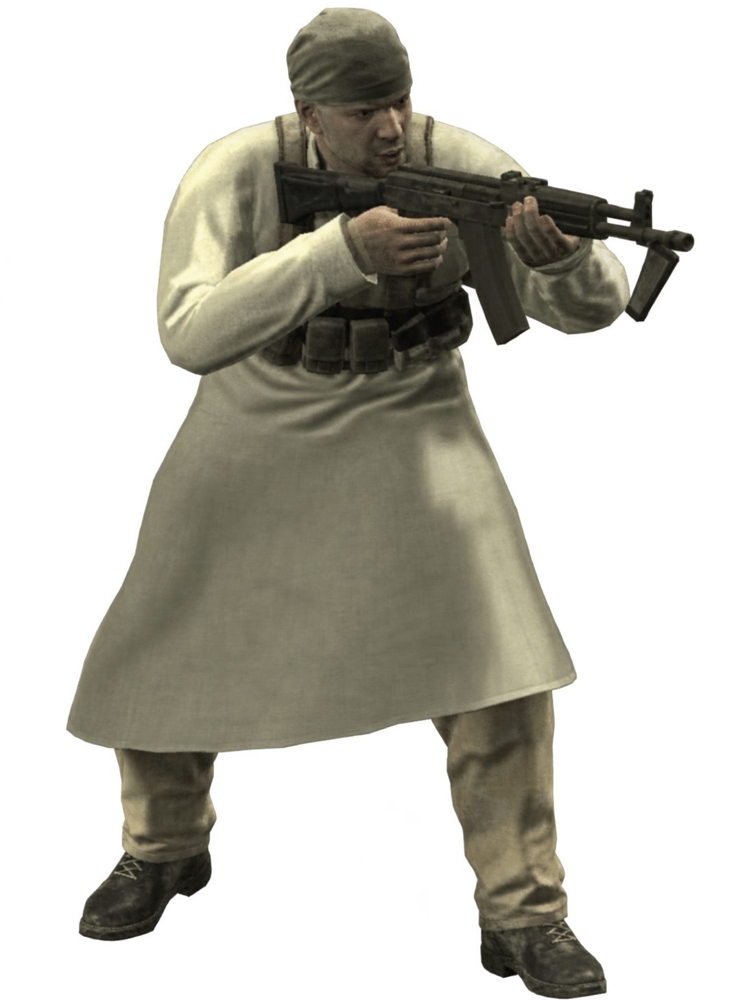

**corps entier · 1079×1458 · RGBA · v1**

Un second rebelle distinct de la même capture PS3, tunique claire longue et manches longues, corps entier dans la pose observée. Variante indépendante du rebelle à manches courtes.

[Fiche, références et réserves](https://github.com/darknigthmare/shadow-codec-ops/blob/codex/cqc-p61-missing-static-sources-20261125/docs/cqc-bible/CONTINUATION_P67.md#mgs4-middle-east-rebel-light-tunic).

### MGO3 — portrait du preset Scout au masque optique

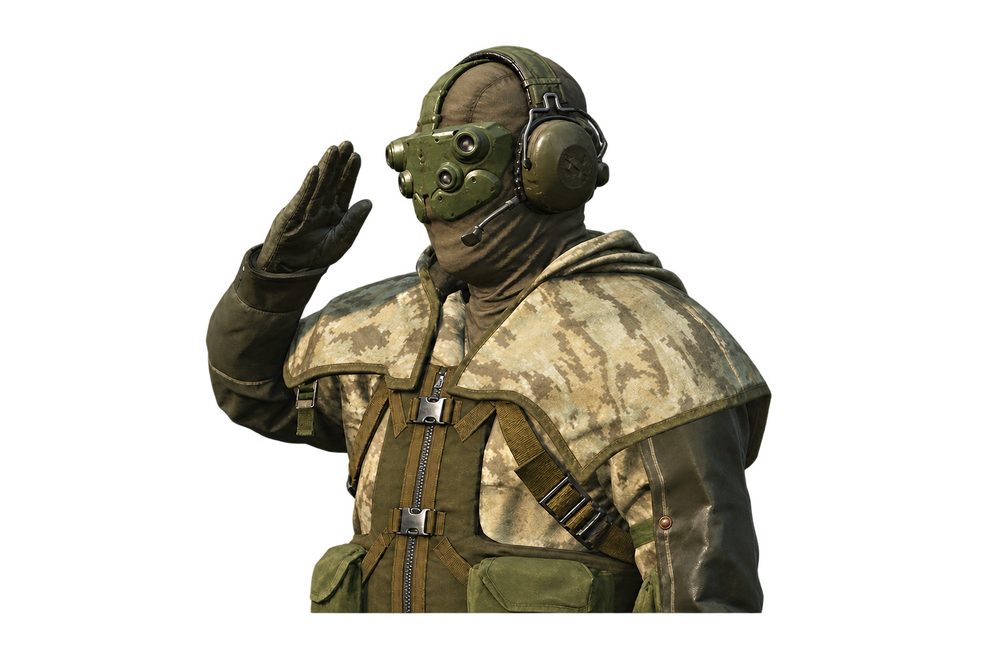

**portrait · 1536×1024 · RGBA · v2**

Portrait du preset Scout au masque optique et à la pèlerine camouflage, dans sa gestuelle visible. Pas de corps complet ni de tenue universelle de classe.

[Fiche, références et réserves](https://github.com/darknigthmare/shadow-codec-ops/blob/codex/cqc-p61-missing-static-sources-20261125/docs/cqc-bible/CONTINUATION_P67.md#mgo3-scout-nvg-mantle-portrait).

### MGO3 — portrait du preset Enforcer au casque à visière

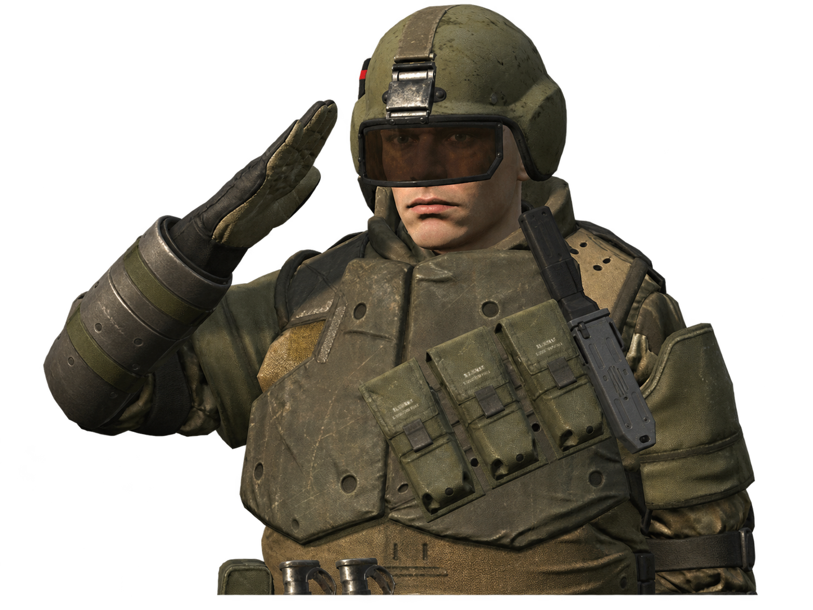

**portrait · 1448×1086 · RGBA · v1**

Portrait du preset Enforcer au casque à visière, dans la pose officielle observée.

[Fiche, références et réserves](https://github.com/darknigthmare/shadow-codec-ops/blob/codex/cqc-p61-missing-static-sources-20261125/docs/cqc-bible/CONTINUATION_P67.md#mgo3-enforcer-visor-portrait).

### MGO3 — portrait du preset Infiltrator à cagoule

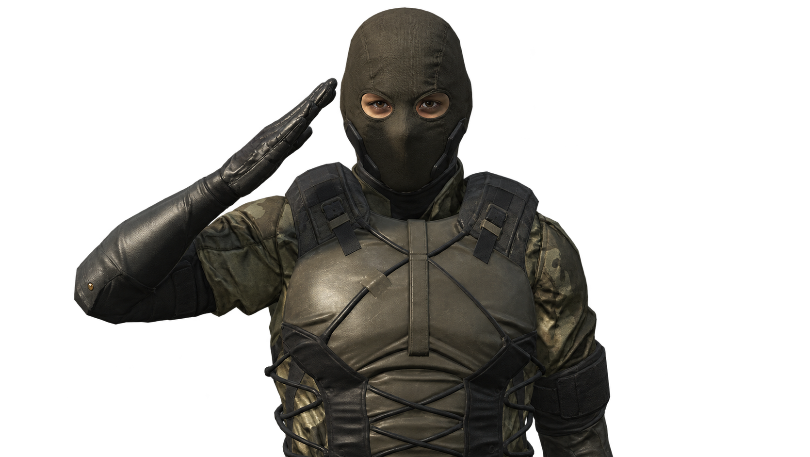

**portrait · 1670×942 · RGBA · v1**

Portrait du preset Infiltrator à cagoule, limité au cadre officiel.

[Fiche, références et réserves](https://github.com/darknigthmare/shadow-codec-ops/blob/codex/cqc-p61-missing-static-sources-20261125/docs/cqc-bible/CONTINUATION_P67.md#mgo3-infiltrator-balaclava-portrait).

### Metal Gear Solid Mobile — garde olive, variante N-Gage

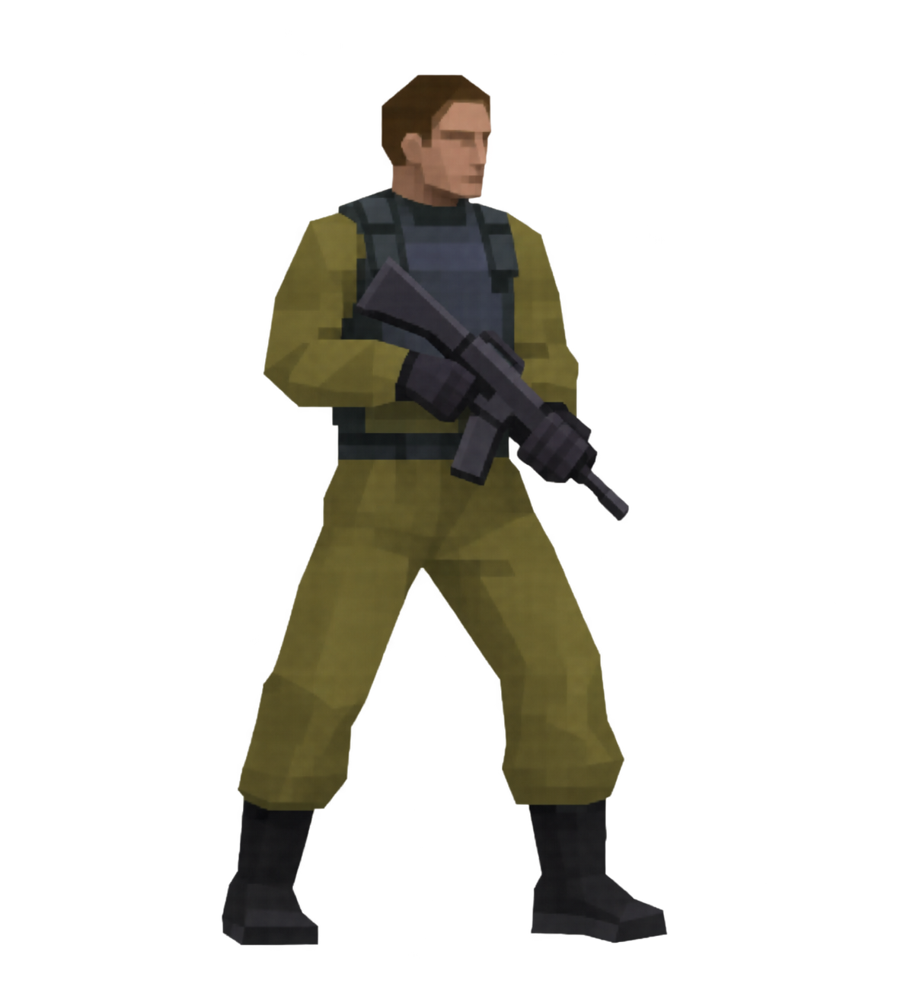

**corps entier · 1199×1312 · RGBA · v1**

Un garde olive au gilet sombre, sujet gauche de la capture N-Gage, isolé dans sa pose et son esthétique polygonale.

[Fiche, références et réserves](https://github.com/darknigthmare/shadow-codec-ops/blob/codex/cqc-p61-missing-static-sources-20261125/docs/cqc-bible/CONTINUATION_P67.md#mobile-ngage-olive-guard).

### MGO1 — Rowdy Reiko, tenue et pose de Subsistence

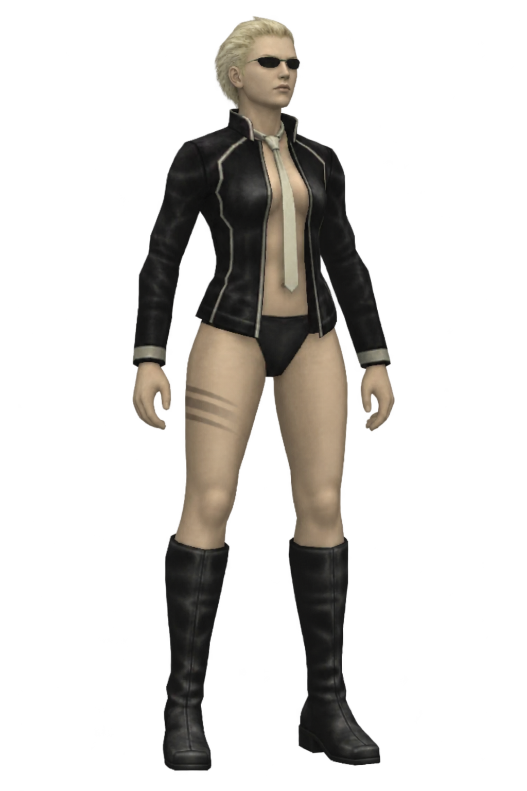

**corps entier · 1024×1536 · RGBA · v1**

Rowdy Reiko en tenue noire, cheveux blonds courts et lunettes, une pose de repos observée dans MGO1.

[Fiche, références et réserves](https://github.com/darknigthmare/shadow-codec-ops/blob/codex/cqc-p61-missing-static-sources-20261125/docs/cqc-bible/CONTINUATION_P67.md#mgo1-rowdy-reiko-idle).

### TPP — Dr Evangelos Constantinou, tenue de l’hôpital

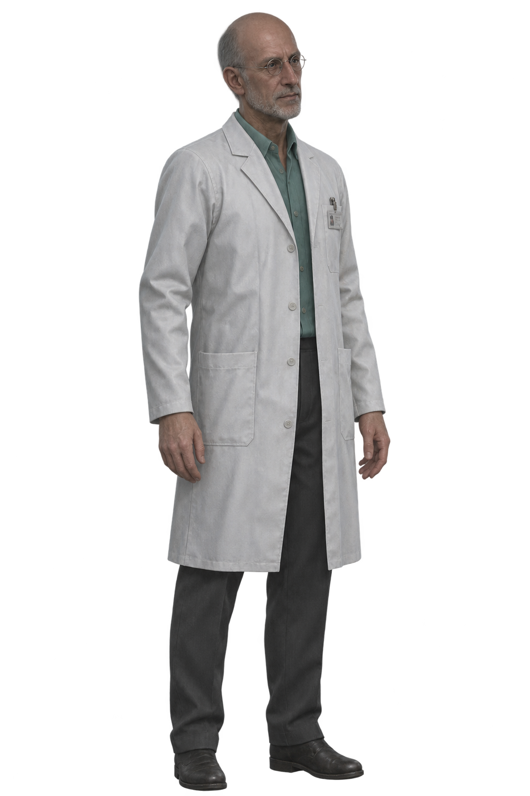

**corps entier · 1024×1536 · RGBA · v1**

Dr Evangelos Constantinou en blouse blanche, une pose debout neutre reconstituée à partir de plusieurs vues de l’hôpital.

[Fiche, références et réserves](https://github.com/darknigthmare/shadow-codec-ops/blob/codex/cqc-p61-missing-static-sources-20261125/docs/cqc-bible/CONTINUATION_P67.md#tpp-evangelos-constantinou-hospital).

### MGO2 — preset à béret blanc, uniforme noir et bandoulière

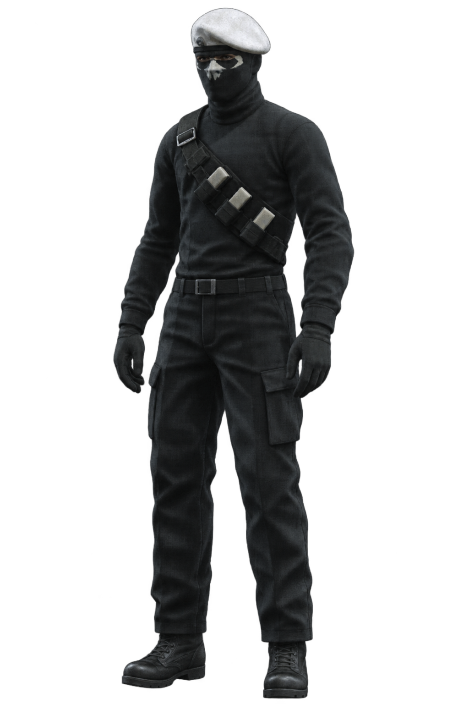

**corps entier · 1024×1536 · RGBA · v1**

Un avatar MGO2 au béret blanc, cagoule et uniforme noirs, avec bandoulière claire.

[Fiche, références et réserves](https://github.com/darknigthmare/shadow-codec-ops/blob/codex/cqc-p61-missing-static-sources-20261125/docs/cqc-bible/CONTINUATION_P67.md#mgo2-white-beret-black-uniform-preset).

### MGO3 — preset Scout à casquette, tenue kaki

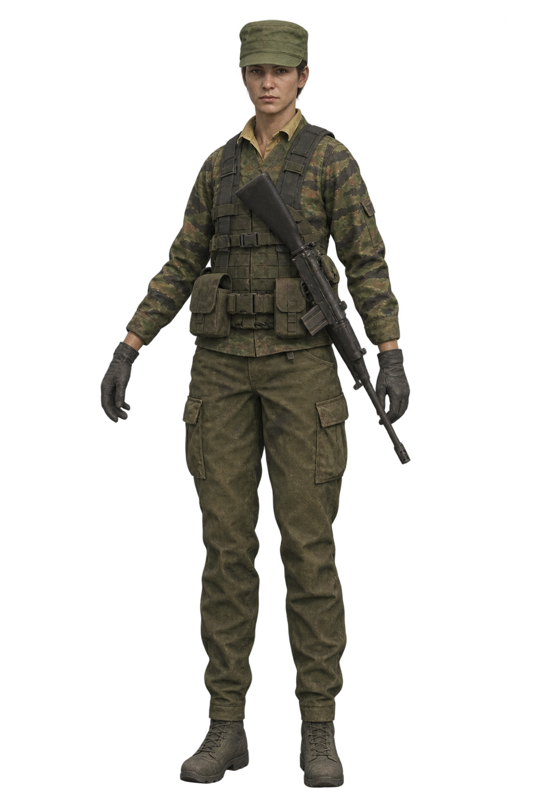

**corps entier · 1024×1536 · RGBA · v1**

Un preset Scout complet à casquette olive, veste camouflage et arme en bandoulière.

[Fiche, références et réserves](https://github.com/darknigthmare/shadow-codec-ops/blob/codex/cqc-p61-missing-static-sources-20261125/docs/cqc-bible/CONTINUATION_P67.md#mgo3-scout-patrol-cap-preset).

### MGO3 — preset Infiltrator au masque respirateur

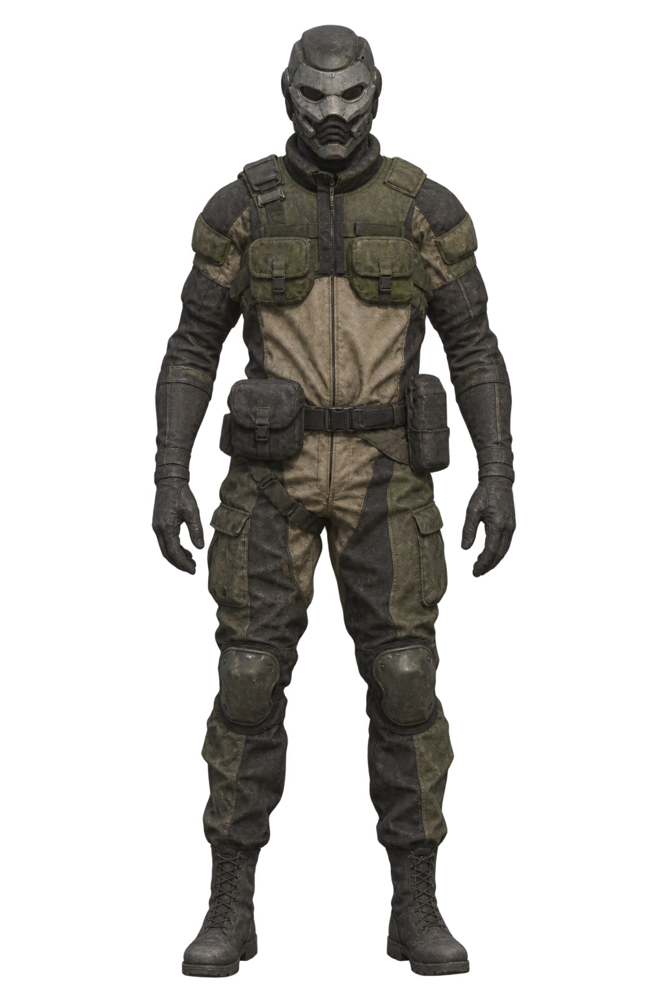

**corps entier · 1024×1536 · RGBA · v1**

Un preset Infiltrator complet avec masque gris, torse clair, poches olive et protections de genoux.

[Fiche, références et réserves](https://github.com/darknigthmare/shadow-codec-ops/blob/codex/cqc-p61-missing-static-sources-20261125/docs/cqc-bible/CONTINUATION_P67.md#mgo3-infiltrator-respirator-preset).

### Ground Zeroes — garde de Camp Omega en poncho, salut

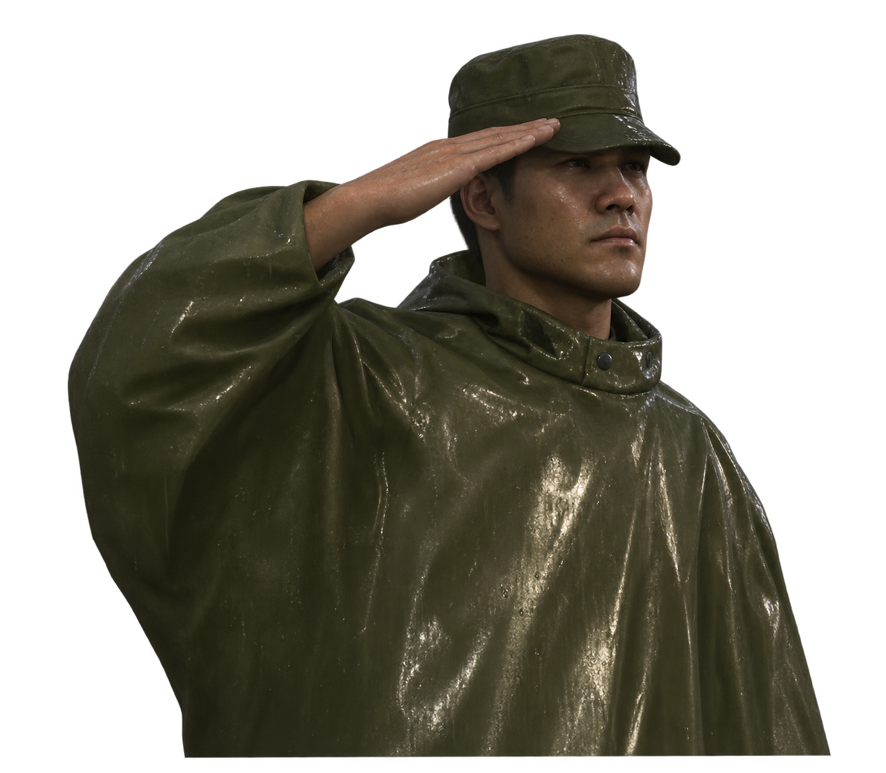

**portrait · 1342×1172 · RGBA · v1**

Portrait du garde de Camp Omega en poncho olive qui salue dans l’introduction.

[Fiche, références et réserves](https://github.com/darknigthmare/shadow-codec-ops/blob/codex/cqc-p61-missing-static-sources-20261125/docs/cqc-bible/CONTINUATION_P67.md#gz-camp-omega-poncho-salute-portrait).

### TPP — infirmière du prologue, portrait en tenue blanche

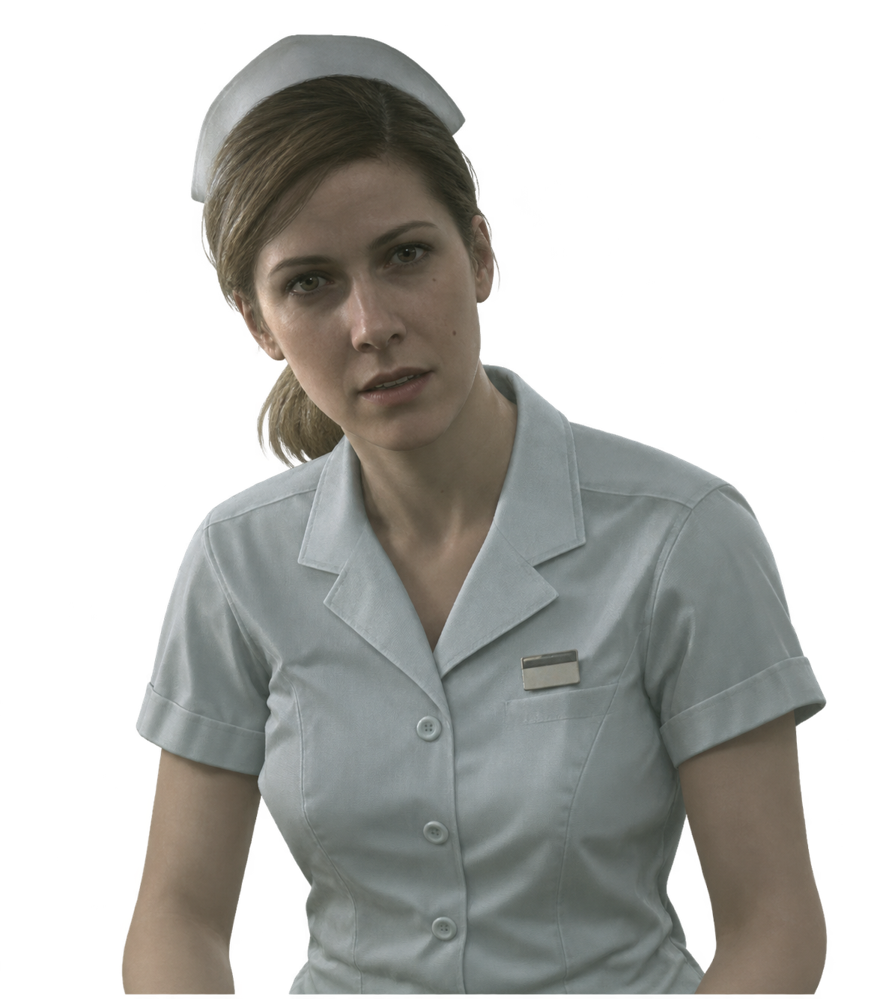

**portrait · 1179×1334 · RGBA · v1**

Portrait de l’infirmière observée dans le prologue, coiffe blanche, cheveux attachés et uniforme clair.

[Fiche, références et réserves](https://github.com/darknigthmare/shadow-codec-ops/blob/codex/cqc-p61-missing-static-sources-20261125/docs/cqc-bible/CONTINUATION_P67.md#tpp-hospital-nurse-white-uniform-portrait).

### MGO3 — preset Enforcer à motif crâne

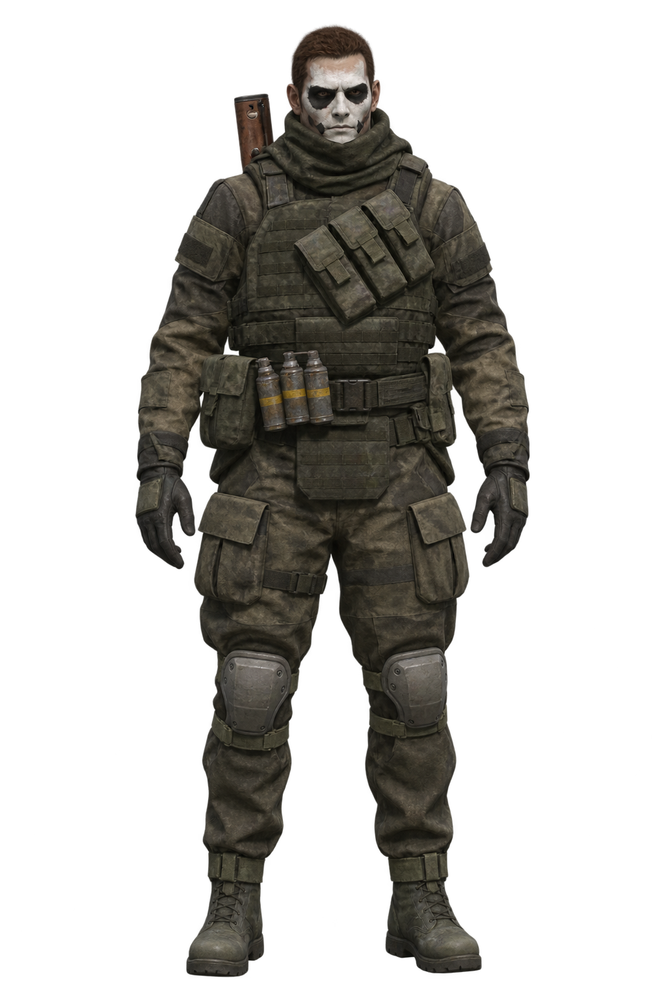

**corps entier · 1024×1536 · RGBA · v1**

Un preset Enforcer complet au visage marqué de blanc et noir, armure olive et rangée diagonale de poches.

[Fiche, références et réserves](https://github.com/darknigthmare/shadow-codec-ops/blob/codex/cqc-p61-missing-static-sources-20261125/docs/cqc-bible/CONTINUATION_P67.md#mgo3-enforcer-skull-face-preset).

### MGS Touch — Gekko, pose aérienne de la mission 07

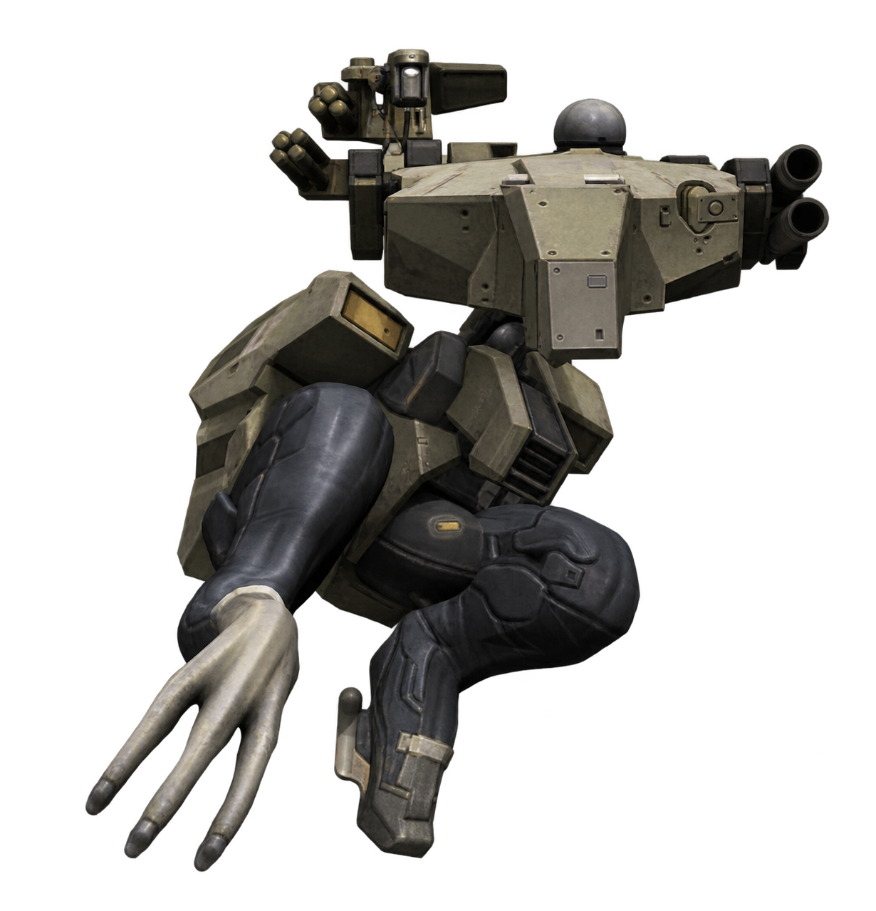

**corps entier · 1230×1278 · RGBA · v1**

Une machine ennemie Touch dans une vue de gameplay observée. Ajout partiel au groupe transversal des versions dérivées ; aucun personnage narratif nouveau et aucune fermeture de ce groupe.

[Fiche, références et réserves](https://github.com/darknigthmare/shadow-codec-ops/blob/codex/cqc-p61-missing-static-sources-20261125/docs/cqc-bible/CONTINUATION_P67.md#touch-gekko-mission07).

## Archive et refus

Le portrait Scout v1 est [archivé](rejected/mgo3-scout-nvg-mantle-portrait-v1.png) car son casque touchait le bord supérieur. La v2 sélectionnée conserve une marge de 70 px au seuil alpha >128. L’archive est exclue de l’Atlas et du graphe runtime.

La sortie du **PW Sentinel Vest** a été refusée par l’outil lors de son unique tentative. Aucun PNG ni nouvelle tentative sous un autre nom n’est enregistré. Les refus historiques restent conservés.

## Ce qui reste ouvert

Les détails fins, les parties occultées et les différences entre éditions demandent encore des références de meilleure qualité. Six fiches sont explicitement des portraits. La couverture d’une famille ou d’un jeu n’est jamais déclarée complète à partir d’un seul candidat. Le [suivi par édition](MANQUANTS.md) et le [delta des périmètres](scope-delta.json) distinguent ces travaux.
