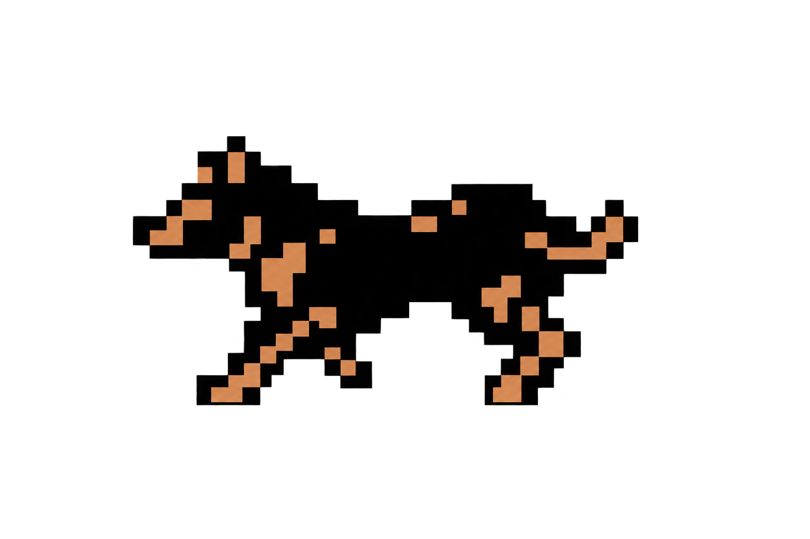
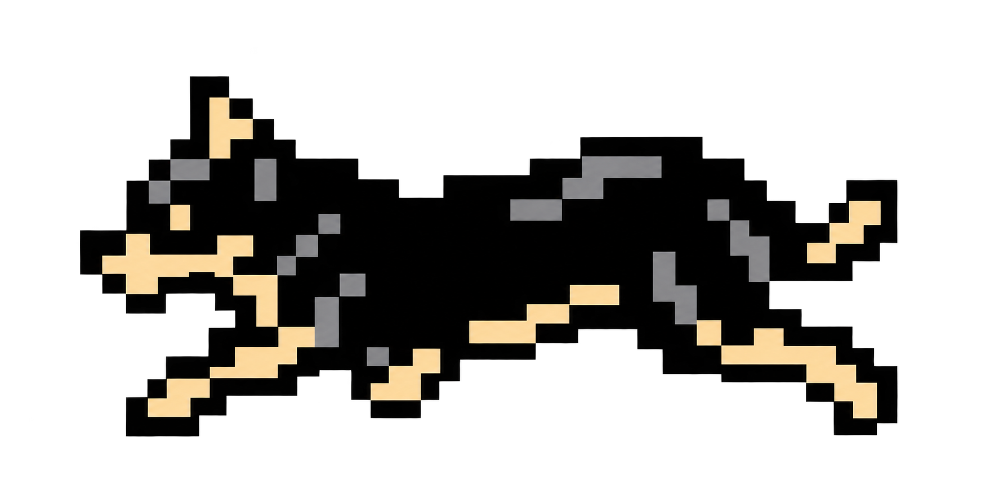
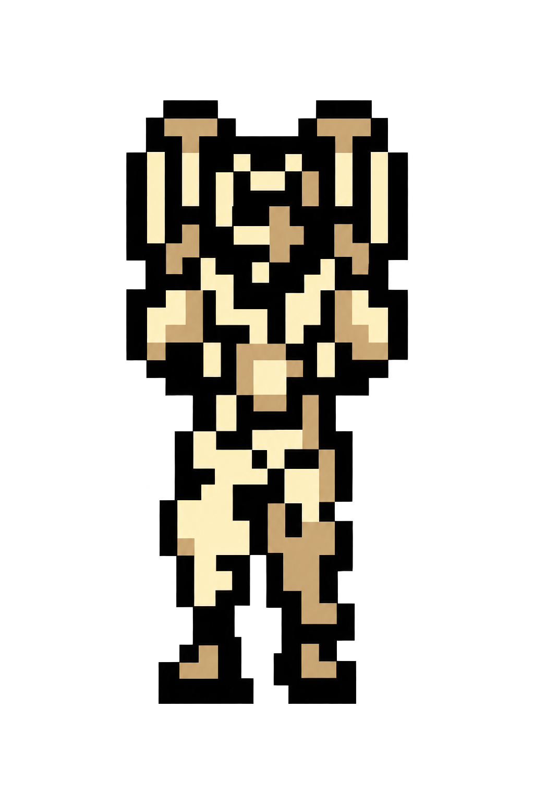
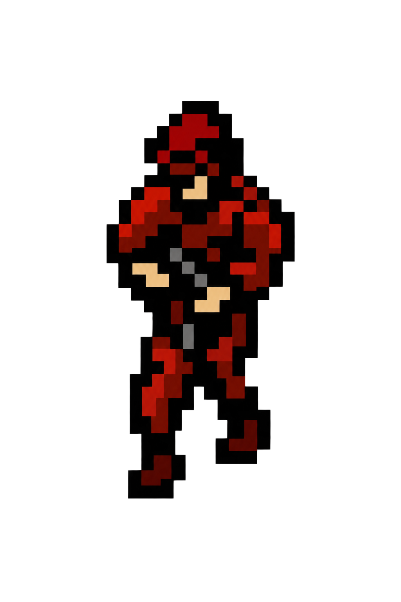
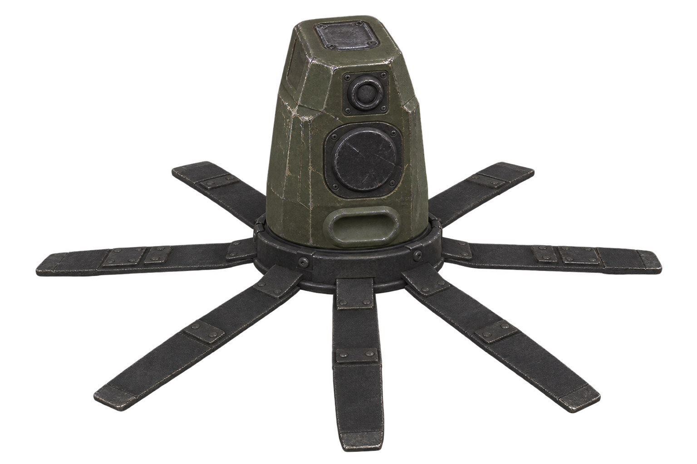

# P68 — livraison des cinq sources fixes

**5 nouvelles sources sélectionnées, 1 essai archivé et 6 appels imagegen.** Le cumul atteint **259 sources sélectionnées**, **82 dossiers Atlas** et **20 archives**.

[Fiches et états à produire](../../cqc-bible/CONTINUATION_P68.md) · [Manifeste](delivery-manifest.json) · [Prompts](prompt-index.json) · [Manquants](MANQUANTS.md) · [QA](INTEGRATION_QA.md)

Les fichiers sont des PNG individuels bruts, transparents et accompagnés de leurs références. Les éléments MSX2/NES conservent une esthétique pixel art native ; leur grille générée reste une reconstruction. Le gadget Survive conserve une réserve sur le support masqué et sur les détails interpolés.

## Metal Gear MSX2 — chien de garde, profil natif

**1536 × 1024 · RGBA · 707,615 octets · une image fixe**

[Références, limites et animation prévue](../../cqc-bible/CONTINUATION_P68.md#classic-mg1-msx-guard-dog-side).

## Metal Gear NES — chien de garde, profil natif

**1774 × 887 · RGBA · 363,154 octets · une image fixe**

[Références, limites et animation prévue](../../cqc-bible/CONTINUATION_P68.md#classic-mg1-nes-guard-dog-side).

## Metal Gear NES — garde au jetpack, pose native

**1024 × 1536 · RGBA · 794,200 octets · une image fixe**

[Références, limites et animation prévue](../../cqc-bible/CONTINUATION_P68.md#classic-mg1-nes-jetpack-guard).

## Metal Gear MSX2 — garde rouge d’Outer Heaven

**1024 × 1536 · RGBA · 659,309 octets · une image fixe**

[Références, limites et animation prévue](../../cqc-bible/CONTINUATION_P68.md#classic-mg1-msx-red-guard).

## Survive — Balloon Trap, déployé inactif

**1536 × 1024 · RGBA · 1,703,307 octets · une image fixe**

[Références, limites et animation prévue](../../cqc-bible/CONTINUATION_P68.md#survive-balloon-trap).

## Archive et reprise des fichiers locaux

Le [Balloon Trap V2](research/survive/archive/survive-balloon-trap-v2-alpha-attempt.png) est archivé et exclu de l’Atlas comme du runtime. Aucun refus de génération n’a eu lieu en P68.

La [récupération locale de 53 fichiers](../local-recovery-20261126/README.md) est publiée séparément et vérifiée dans [recovery-publication-verification.json](recovery-publication-verification.json). Les archives, documents, sources antérieures et leurs statuts restent conservés.
