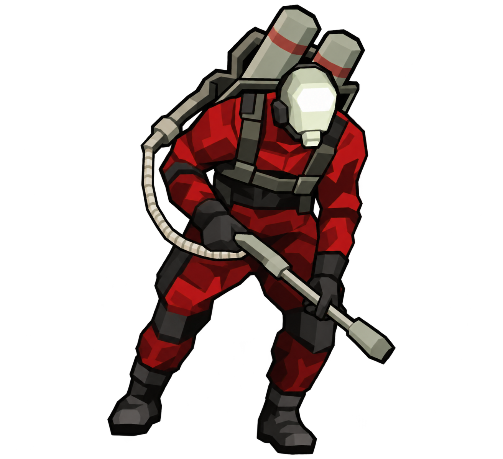
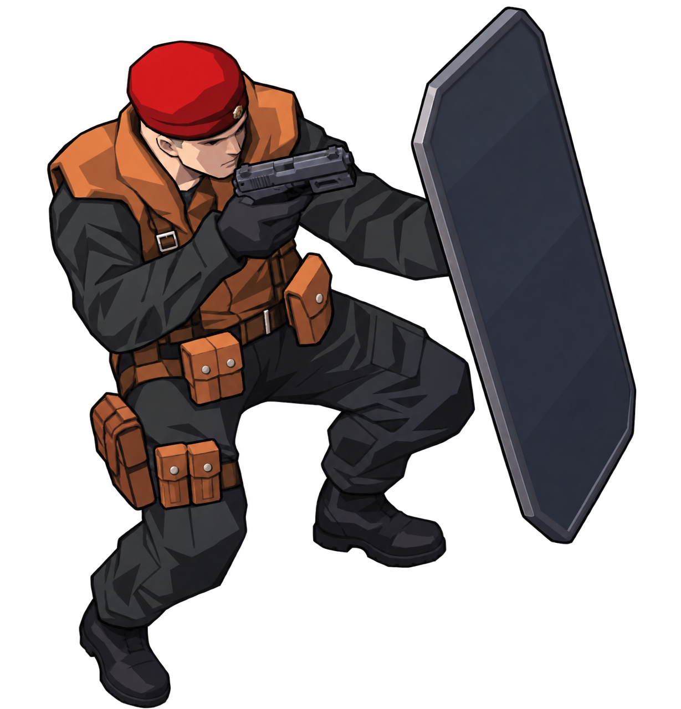
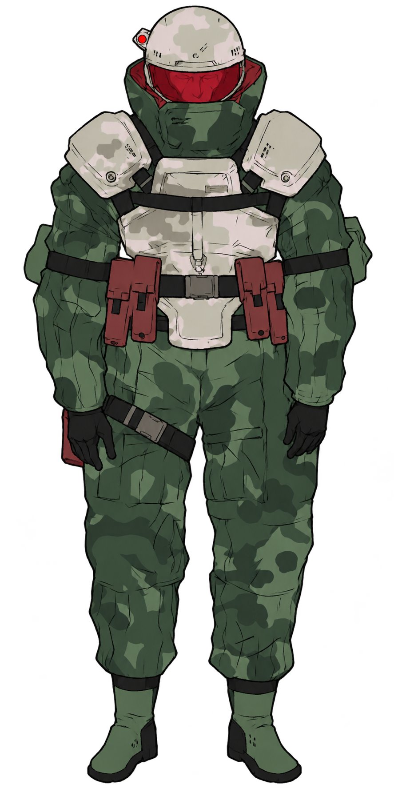
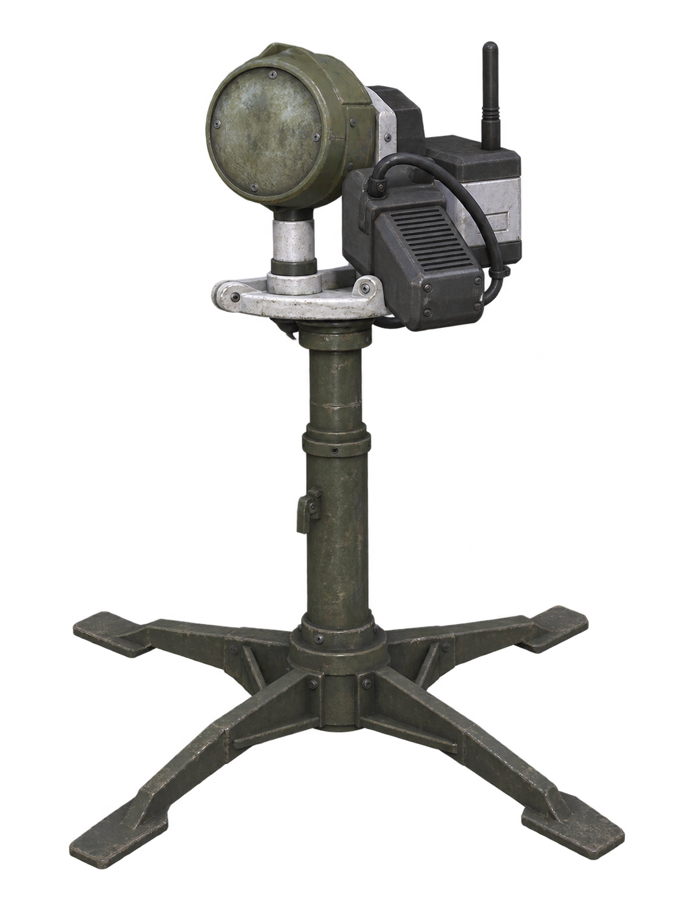
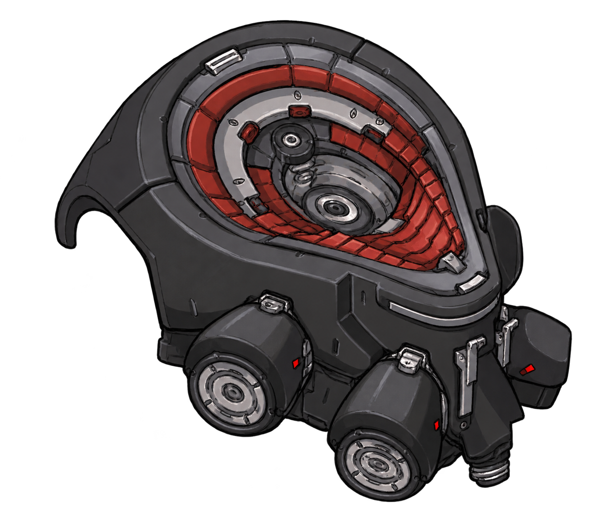
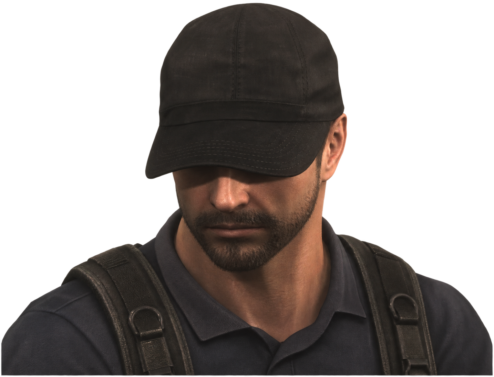

# P69 — nouvelles sources et fichiers locaux

**8 nouvelles sources sélectionnées, 0 essais archivés et 1 refus conservés.** Cumul : **267 sources sélectionnées**, **90 dossiers Atlas**, **20 essais archivés**.

[Fiches et états à produire](../../cqc-bible/CONTINUATION_P69.md) · [Manifeste](delivery-manifest.json) · [Prompts exacts](prompt-index.json) · [Manquants](MANQUANTS.md) · [QA](INTEGRATION_QA.md)

PNG individuels bruts, accompagnés des références réellement utilisées. Les références conceptuelles restent identifiées ; un portrait reste un portrait.

## AC!D 2 — soldat lance-flammes, vue de face oblique

**1312 × 1199 · RGBA · 700,911 octets · `full_body`**

[Référence, limites et états prévus](../../cqc-bible/CONTINUATION_P69.md#acid2-flamethrower-soldier).

## AC!D 2 — garde au bouclier et béret rouge

**1229 × 1280 · RGBA · 1,179,145 octets · `full_body`**

[Référence, limites et états prévus](../../cqc-bible/CONTINUATION_P69.md#acid2-shield-guard).

## AC!D 2 — soldat Hi-Tech, uniforme complet

**887 × 1774 · RGBA · 1,323,895 octets · `full_body`**

[Référence, limites et états prévus](../../cqc-bible/CONTINUATION_P69.md#acid2-high-tech-soldier).

## Survive — Air Shock Cannon, déployé inactif

**1086 × 1448 · RGBA · 824,547 octets · `full_object`**

[Référence, limites et états prévus](../../cqc-bible/CONTINUATION_P69.md#survive-air-shock-cannon).

## Survive — Sledgehammer [Gold], Survival Pack

![Survive — Sledgehammer [Gold], Survival Pack](../../../public/cqc/assets/p69/survive-sledgehammer-gold.png)

**1555 × 1012 · RGBA · 590,712 octets · `full_object`**

[Référence, limites et états prévus](../../cqc-bible/CONTINUATION_P69.md#survive-sledgehammer-gold).

## Survive — Survival Spear [Gold], Survival Pack

![Survive — Survival Spear [Gold], Survival Pack](../../../public/cqc/assets/p69/survive-survival-spear-gold.png)

**2172 × 724 · RGBA · 316,046 octets · `full_object`**

[Référence, limites et états prévus](../../cqc-bible/CONTINUATION_P69.md#survive-survival-spear-gold).

## Revengeance — collier mécanique de Mistral, étude de concept

**1371 × 1147 · RGBA · 1,514,646 octets · `full_object`**

[Référence, limites et états prévus](../../cqc-bible/CONTINUATION_P69.md#mgr-mistral-collar-concept).

## Revengeance — agent Maverick R-00 à casquette, portrait

**1434 × 1097 · RGBA · 1,430,921 octets · `portrait`**

[Référence, limites et états prévus](../../cqc-bible/CONTINUATION_P69.md#mgr-r00-maverick-cap-portrait).

## Tentatives et fichiers locaux

9 appels imagegen sont documentés : 8 sorties PNG et 1 refus. Tous les essais non sélectionnés figurent dans les archives de recherche.

Les [six journaux locaux antérieurs](local-addendum/README.md) complètent les sauvegardes déjà publiées. [Preuve de la base P68](p68-baseline-proof.json) · [Inventaire initial du dossier](initial-local-audit.json).
