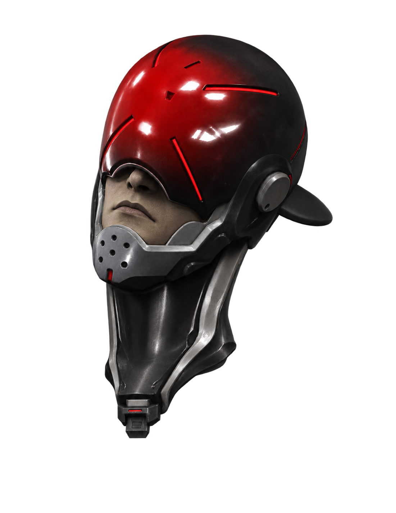
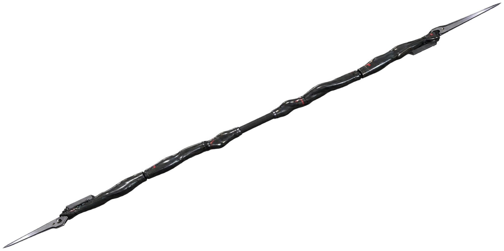

# P71 — cinq sources fixes et fichiers conservés

**5 nouvelles sources sélectionnées, 0 essai archivé et 0 refus.** Cumul : **272 sources sélectionnées**, **95 dossiers Atlas**, **20 essais archivés**.

[Fiches et états à produire](../../cqc-bible/CONTINUATION_P71.md) · [Manifeste](delivery-manifest.json) · [Prompts exacts](prompt-index.json) · [Références](references.json) · [Revue des sources](reviewed-batch.json) · [Extensions du guide](../../cqc-bible/EXTENSIONS_GUIDE_P71.md)

Cinq PNG individuels RGBA, conservés sans retouche, conversion ou upscaling. Trois fichiers de référence officiels ont réellement servi aux générations. Ce sont des candidats de l’Atlas, avec réserves de fidélité ; aucune animation ou nouvelle admission au combat n’est livrée par ces images.

**P70 reste réservé.** Le [constat de recherche](RECOVERY_STATUS.json) ne retrouve aucun original du lot ancien annoncé ; aucun de ces fichiers absents n’est compté ici. Les 75 anciennes lignes sans candidat restent ouvertes.

## Survive — BOXMAN [THE ORANGE], accessoire de tête

![Survive — BOXMAN [THE ORANGE], accessoire de tête](../../../public/cqc/assets/p71/survive-boxman-the-orange.png)

**1402 × 1122 · RGBA · 1 586 144 octets · `full_object`**

[Référence, limites et états prévus](../../cqc-bible/CONTINUATION_P71.md#survive-boxman-the-orange).

## Survive — Bat [Gold], Survival Pack

![Survive — Bat [Gold], Survival Pack](../../../public/cqc/assets/p71/survive-bat-gold.png)

**1774 × 887 · RGBA · 322 248 octets · `full_object`**

[Référence, limites et états prévus](../../cqc-bible/CONTINUATION_P71.md#survive-bat-gold).

## Survive — Machete [Gold], Survival Pack

![Survive — Machete [Gold], Survival Pack](../../../public/cqc/assets/p71/survive-survival-machete-gold.png)

**1774 × 887 · RGBA · 763 016 octets · `full_object`**

[Référence, limites et états prévus](../../cqc-bible/CONTINUATION_P71.md#survive-survival-machete-gold).

## Revengeance — module de tête mécanique de Monsoon

**1101 × 1428 · RGBA · 817 592 octets · `head_module`**

[Référence, limites et états prévus](../../cqc-bible/CONTINUATION_P71.md#mgr-monsoon-head-module).

## Revengeance — L’Étranger, arme de Mistral

**1774 × 887 · RGBA · 279 837 octets · `full_object`**

[Référence, limites et états prévus](../../cqc-bible/CONTINUATION_P71.md#mgr-mistral-etranger-polearm).

## Traçabilité

Les [enregistrements sources](source-records.json), le [registre des prompts](prompt-index.json), les [références](references.json) et la [revue](reviewed-batch.json) conservent identités, paramètres, SHA-256 et SHA Git. Les cinq sorties occupent **3 768 837 octets**. Les trois références restent brutes ; les autres documents de recherche non utilisés ne sont pas présentés comme entrées.

La reconstruction reproductible de ces registres et de l’annexe utilise `python scripts/build-cqc-p71.py` depuis la racine du dépôt. Ce script préserve les registres historiques et les 90 premières fiches, et ne modifie aucun code de jeu, manifeste runtime ou rapport QA.
