# P72 — sources fixes et provenance

**11 nouvelles sources sélectionnées, 2 sortie(s) archivée(s), 2 refus sans PNG.** Cumul : **283 sources sélectionnées**, **106 dossiers Atlas**, **22 essais archivés**.

[Fiches détaillées](../../cqc-bible/CONTINUATION_P72.md) · [Manifeste](delivery-manifest.json) · [Prompts exacts](prompt-index.json) · [Références](references.json) · [Revue](reviewed-batch.json) · [Couverture](coverage-delta.json)

Les 95 fiches Atlas précédentes et les 9 registres antérieurs sont conservés. Le nombre de lignes historiques sans candidat passe de **75 à 73** : 2 ligne(s) reçoivent un premier candidat partiel. Les groupes restent ouverts et les statuts P61 restent inchangés.

Les sorties originales sont conservées sans retouche, conversion ni mise à l’échelle. Les références raster réellement utilisées sont archivées brutes ; les pages web entières et recherches inutilisées ne sont pas copiées. La provenance d’un miroir communautaire reste distincte d’un hébergement éditeur.

## AC!D — robot de patrouille de Lobito

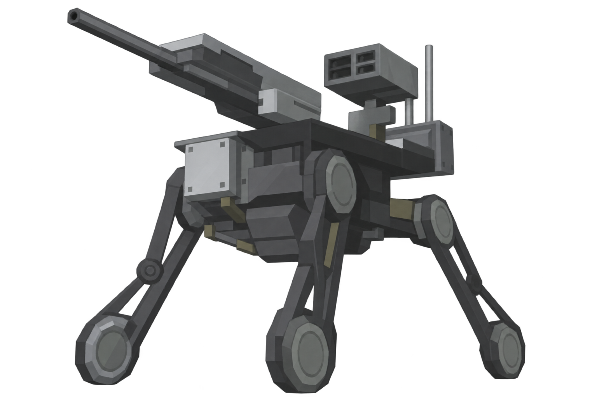

**1536 × 1024 · RGBA · `full_body`**

[Référence, réserves et états prévus](../../cqc-bible/CONTINUATION_P72.md#acid-patrol-bot).

## AC!D — caméra de surveillance de Lobito

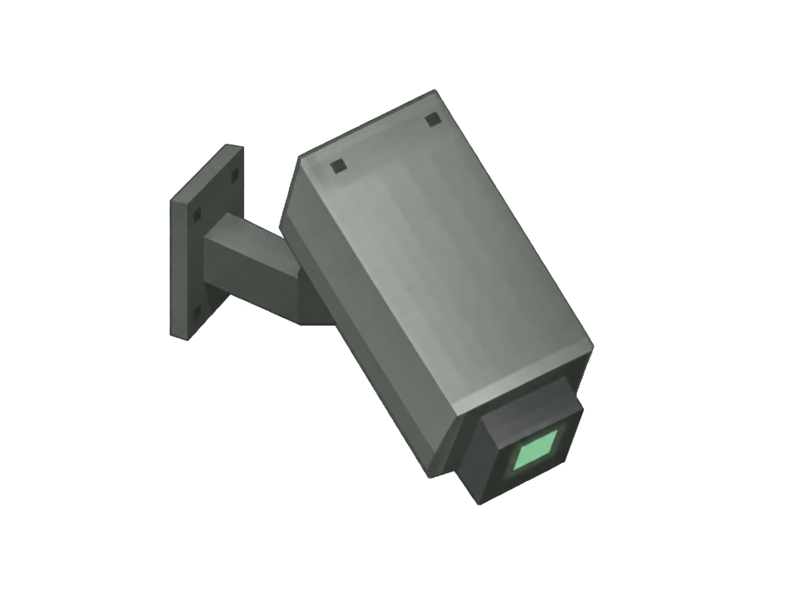

**1448 × 1086 · RGBA · `full_object`**

[Référence, réserves et états prévus](../../cqc-bible/CONTINUATION_P72.md#acid-surveillance-camera).

## Survive — Large Spiked Barricade, déployée intacte

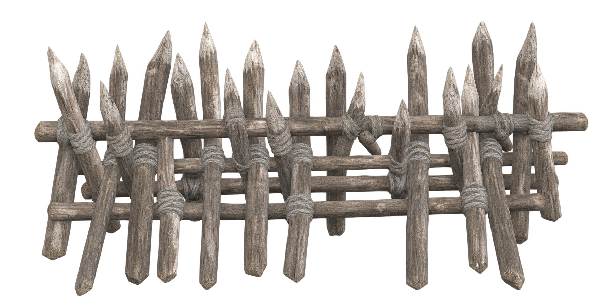

**1774 × 887 · RGBA · `full_object`**

[Référence, réserves et états prévus](../../cqc-bible/CONTINUATION_P72.md#survive-large-spiked-barricade).

## Survive — établi médical, bêta janvier2018

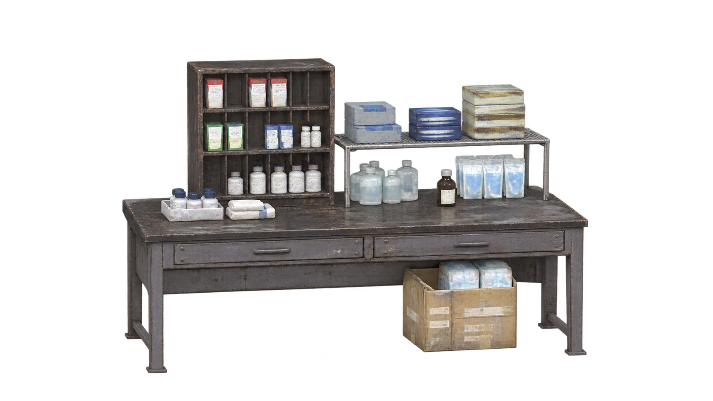

**1672 × 941 · RGBA · `full_object`**

[Référence, réserves et états prévus](../../cqc-bible/CONTINUATION_P72.md#survive-beta-medical-workbench).

## Survive — établi d’armes, bêta janvier2018

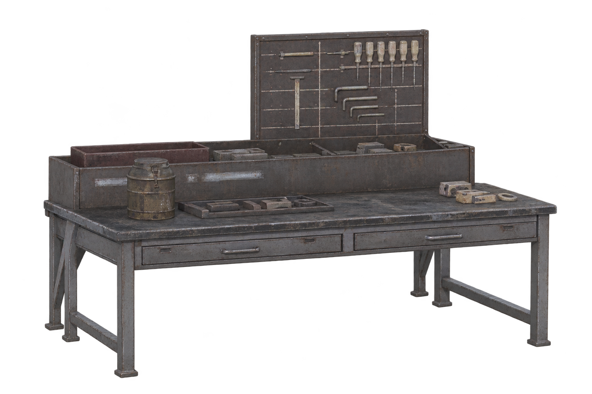

**1536 × 1024 · RGBA · `full_object`**

[Référence, réserves et états prévus](../../cqc-bible/CONTINUATION_P72.md#survive-beta-weapons-workbench).

## Revengeance — VR Missions DLC, parcours de plateformes jaunes

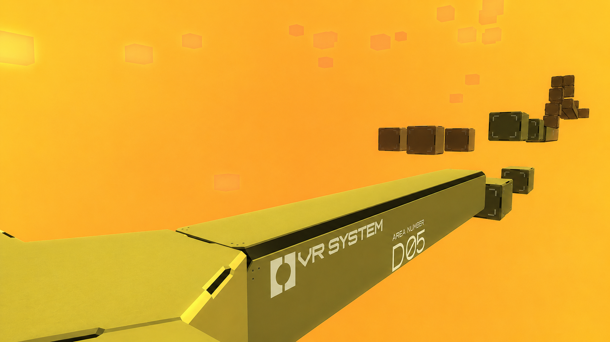

**1674 × 940 · RGB · `environment_fragment`**

[Référence, réserves et états prévus](../../cqc-bible/CONTINUATION_P72.md#mgr-vr-dlc-yellow-platform-course).

## Revengeance — VR Missions DLC, salle jaune aux caméras

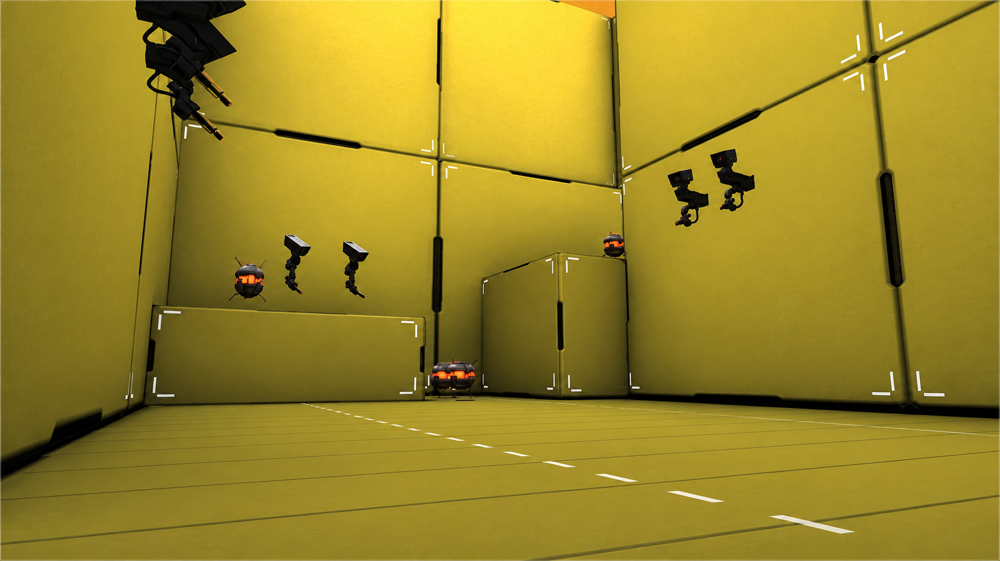

**1674 × 940 · RGB · `environment_fragment`**

[Référence, réserves et états prévus](../../cqc-bible/CONTINUATION_P72.md#mgr-vr-dlc-camera-room).

## Revengeance — Pincer Blades, icône d’inventaire du guide

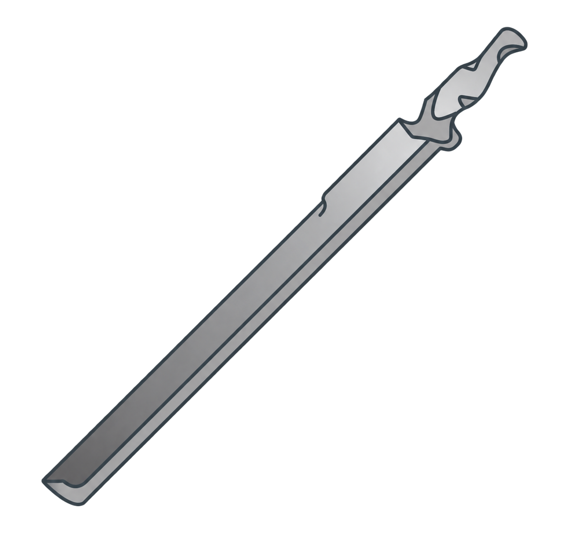

**1293 × 1217 · RGBA · `inventory_icon`**

[Référence, réserves et états prévus](../../cqc-bible/CONTINUATION_P72.md#mgr-pincer-blades-inventory).

## Portable Ops Plus — KGB Soldier

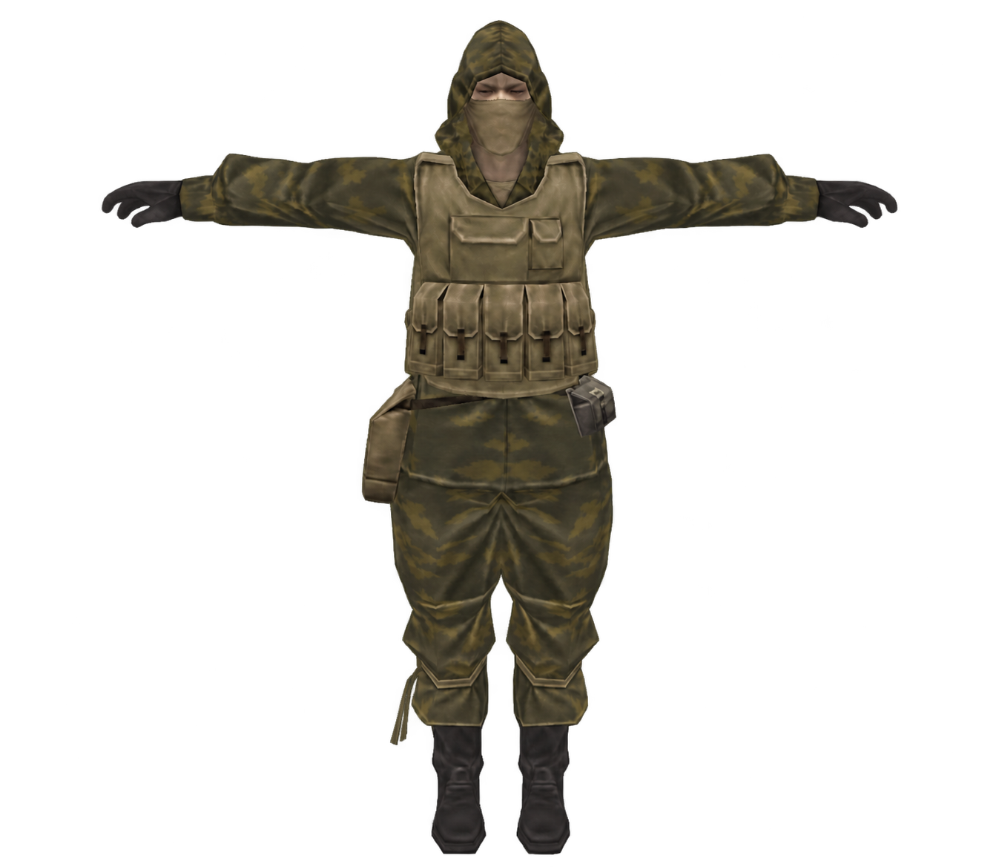

**1347 × 1168 · RGBA · `full_body`**

[Référence, réserves et états prévus](../../cqc-bible/CONTINUATION_P72.md#mpop-kgb-soldier).

## Portable Ops Plus — GRU Soldier

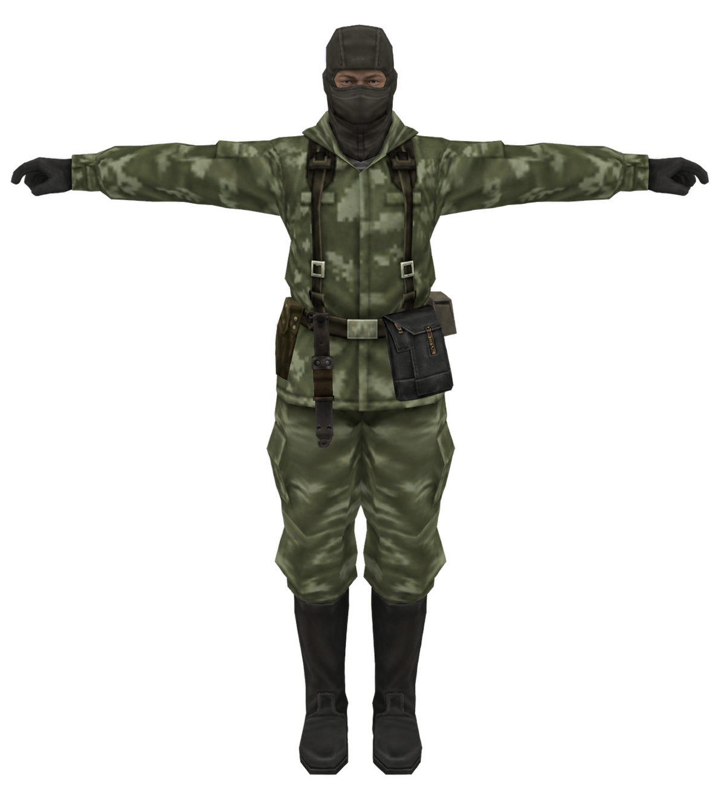

**1193 × 1319 · RGBA · `full_body`**

[Référence, réserves et états prévus](../../cqc-bible/CONTINUATION_P72.md#mpop-gru-soldier).

## Portable Ops Plus — SEAL

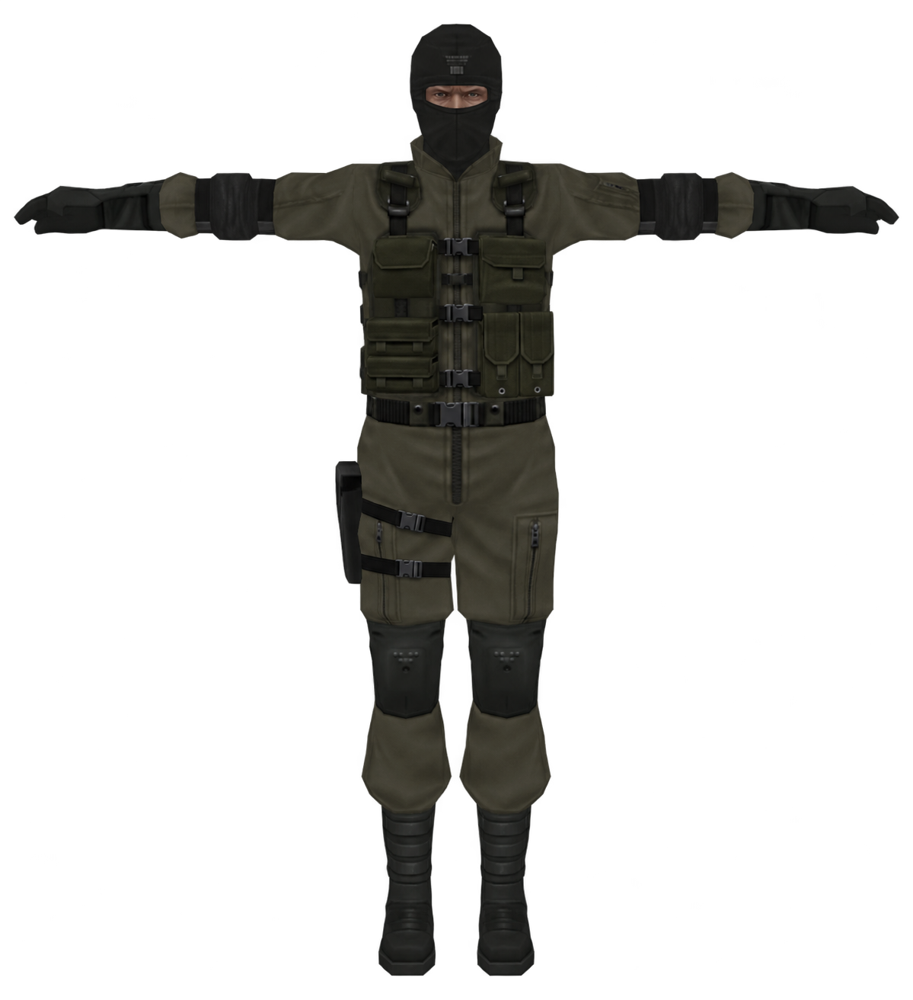

**1199 × 1312 · RGBA · `full_body`**

[Référence, réserves et états prévus](../../cqc-bible/CONTINUATION_P72.md#mpop-seal-soldier).

## Traçabilité et reconstruction

15 références raster utilisées, 15 appels, 13 PNG produits, 2 refus sans PNG. Les [sources normalisées](source-records.json) conservent les paramètres exacts et les chemins d’entrée originaux ; les fichiers livrés possèdent leurs empreintes SHA-256 et Git.

Reconstruction hors ligne : `python scripts/build-cqc-p72.py --apply`. Le script préserve les 95 fiches et les 9 registres antérieurs, et ne modifie aucun code, manifeste runtime, rapport QA ou enregistrement de publication.
