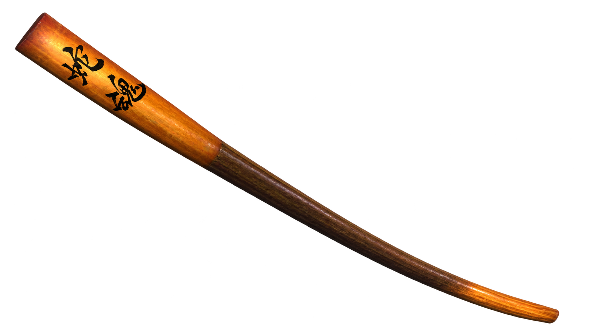
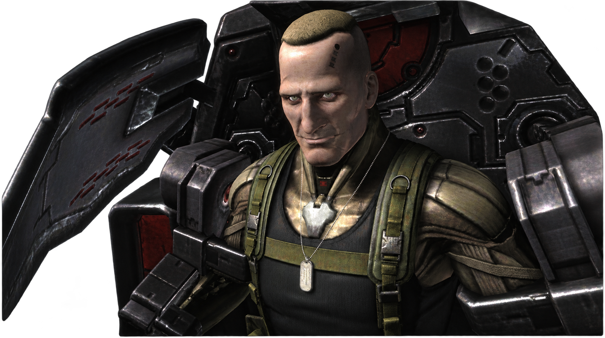
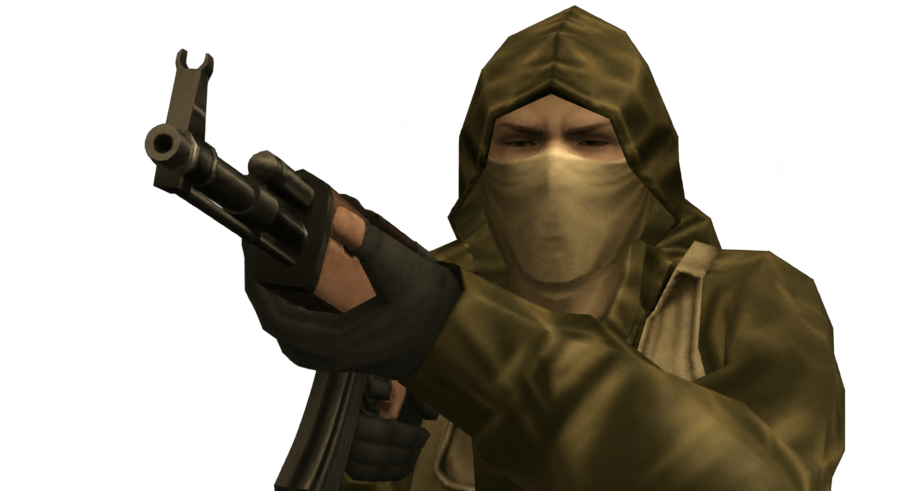

# P74 — sources canoniques complémentaires

Ce lot contient **3 nouveaux candidats de sources fixes**, chacun dans un PNG indépendant, avec références, prompt exact et revue. Il apporte une première couverture partielle au groupe KGB de Snake Eater, un accessoire japonais de Revengeance et une nouvelle vue de dossier de Khamsin.

**Ces images ne sont pas certifiées 1:1 et ne constituent pas des animations ou des combattants admis au runtime.** Les deux portraits conservent les limites du cadrage natif. Aucune jambe, vue arrière ou machine complète n’est déclarée à partir de ces portraits.

| Candidat | Couverture livrée | Association | Effet sur l’inventaire |
|---|---|---|---|
| [Hebidamashii](#mgr-hebidamashii) | Arme isolée ; petite section de prise reconstruite | `prop:mgr_hebidamashii` | Nouveau périmètre hors inventaire historique |
| [Khamsin dans son cockpit](#mgr-khamsin-cockpit-portrait) | Portrait tête/torse et cadre de cockpit | `core__khamsin` ; `portrait:core__khamsin:cockpit_closeup` | Nouvelle vue du boss existant |
| [Garde KGB en visée](#mgs3-kgb-aiming-portrait) | Portrait tête/torse/fusil du modèle original | `character:R-MGS3-kgb` | Première source partielle du groupe |

[Manifeste détaillé](manifest.json) · [Enregistrements pour l’Atlas](source-records.json) · [Revue](reviewed-batch.json) · [Dimensions, alpha et empreintes](image-validation.json).

## Périmètre de l’audit

Le point de comparaison est le commit `06d5de112e40faa2d551b77e1961f11a6af14bb4`, l’inventaire P61 et les sources sélectionnées P63–P69, P71 et P72. P73 reste réservé et **n’a pas été récupéré ni inspecté**.

P72 indiquait 73 lignes historiques sans candidat. Le KGB de MGS3 appartient à cette liste. Le KGB de Portable Ops Plus produit en P72 appartient au groupe des invités PSP et ne ferme pas la ligne de MGS3. Les deux autres sources de ce lot ne réduisent aucun compteur historique. Le rattachement de la source KGB peut donc ajouter **une** ligne partiellement couverte, sans modifier son statut historique ni fermer le groupe.

La recherche a aussi identifié des rendus existants de machines Survive/Revengeance et des modèles issus de mods ; ils n’ont pas été ajoutés comme nouveaux corps canoniques. Aucun nouveau corps entier n’a été retenu lorsque la preuve visuelle n’était pas suffisante. Les refus historiques concernant Mistral à deux bras, les cyborgs blindés de Revengeance, Tengu et le Sai n’ont pas été relancés.

## Revengeance — Hebidamashii

| Élément | Détail |
|---|---|
| Fichier | [mgr-hebidamashii.png](../../../../public/cqc/assets/canon-pass74/mgr-hebidamashii.png) |
| Format | PNG RGBA, 1674 × 940 pixels |
| Identité | `asset:p74:mgr-hebidamashii` |
| Référence | Capture KONAMI du DLC japonais VR Missions |
| Prompt exact | [mgr-hebidamashii.txt](prompts/mgr-hebidamashii.txt) |

La [page officielle japonaise du DLC](https://www.konami.com/mg/archive/mgr/jp/dlc/) nomme l’arme **木刀蛇魂** et décrit les répliques de Solid Snake qu’elle émet. La [capture officielle](https://www.konami.com/mg/archive/mgr/jp/dlc/_img/dlc1_pic3b.jpg), conservée [dans ce lot](references/dlc1_pic3b.jpg), montre le bois orange, les deux caractères noirs et la diagonale générale. Le PNG retire le personnage, le décor et l’aura bleue afin de garder une source indépendante de l’arme.

L’image reste candidate : une courte partie est masquée par la main dans la référence et a été prolongée de manière simple. La courbure, la prise et la calligraphie ne sont pas des mesures du modèle natif. Une référence rapprochée sans main est nécessaire pour les certifier. L’arme n’est pas comptée comme un nouveau personnage, un costume ou une animation.

**Usage CQC proposé :** fiche de l’accessoire dans l’Atlas, avec édition japonaise explicite. L’échelle portée, la prise, les mouvements et les déclenchements vocaux demandent des références et une intégration distinctes.

## Revengeance — Khamsin dans son cockpit

| Élément | Détail |
|---|---|
| Fichier | [mgr-khamsin-cockpit-portrait.png](../../../../public/cqc/assets/canon-pass74/mgr-khamsin-cockpit-portrait.png) |
| Format | PNG RGBA, 1678 × 937 pixels |
| Identité | `asset:p74:mgr-khamsin-cockpit-portrait` |
| Personnage existant | `core__khamsin` |
| Prompt exact | [mgr-khamsin-cockpit-portrait.txt](prompts/mgr-khamsin-cockpit-portrait.txt) |

La [page officielle du DLC Blade Wolf](https://www.konami.com/mg/archive/mgr/jp/dlc/) présente Khamsin et publie ce [gros plan officiel](https://www.konami.com/mg/archive/mgr/jp/dlc/_img/dlc3_pic5b.jpg), conservé [localement](references/dlc3_pic5b.jpg). Le candidat reprend le visage, le torse, les sangles et les plaques de cockpit visibles.

Khamsin et sa machine disposent déjà de sources dans le dépôt. Ce portrait ajoute une vue rapprochée au même UID ; **il n’ajoute pas un boss au roster**. Les grands bords latéraux et le bas du torse restent tronqués, comme dans la source. La ressemblance et les détails métalliques demandent une revue supplémentaire à partir d’une source plus grande.

**Usage CQC proposé :** portrait de dossier du Khamsin existant. Les limites du cadrage ne doivent pas être interprétées comme des limites anatomiques, une silhouette complète de machine ou des volumes de collision.

## Snake Eater — garde KGB en visée

| Élément | Détail |
|---|---|
| Fichier | [mgs3-kgb-aiming-portrait.png](../../../../public/cqc/assets/canon-pass74/mgs3-kgb-aiming-portrait.png) |
| Format | PNG RGBA, 1699 × 926 pixels |
| Identité | `asset:p74:mgs3-kgb-aiming-portrait` |
| Groupe historique | `character:R-MGS3-kgb` |
| Prompt exact | [mgs3-kgb-aiming-portrait.txt](prompts/mgs3-kgb-aiming-portrait.txt) |

Les trois captures natives reproduites sur [la page de Snake Eater d’IMFDB](https://www.imfdb.org/wiki/Metal_Gear_Solid_3%3A_Snake_Eater) montrent le même type de tenue : capuche olive, masque clair, harnais, gants et arme. Les fichiers de référence sont conservés sans retouche : [vue 1](references/MGS3AK47KGB.jpg), [vue 2](references/MGS3AK47KGB2.jpg), [vue 3](references/MGS3AK47KGB3.jpg). La troisième vue sert d’ancrage de pose ; les deux autres confirment seulement le vêtement et l’équipement visibles.

Il s’agit d’images du jeu original hébergées par un tiers, pas d’exports de modèle distribués par KONAMI. **La plateforme de capture PS2 ou port HD n’est pas départagée.** Le prompt vise le design PS2 et demeure archivé tel qu’il a été envoyé ; cette intention n’est pas une preuve technique d’édition. Le modèle Delta et le modèle PSP de Portable Ops Plus restent distincts.

Le candidat apporte une première source au groupe historique, mais seulement pour la tête, le torse et le fusil dans cette pose. Les jambes, pieds, dos, autres tenues et variantes ne sont pas établis. Les détails peu lisibles du visage et des textures ont été interprétés par la génération.

**Usage CQC proposé :** dossier visuel du groupe, sans admission de combattant. Prochaine preuve utile : une vue native en pied de cette même tenue, puis l’inventaire des variantes et les séquences de mouvement.

## Quarantaine d’identité — rendu MGS4

Un quatrième PNG a été produit puis **retiré de la sélection**. Une image de galerie non légendée avait été interprétée comme un PMC MGS4. La tenue et l’insigne, comparés au rendu voisin de Meryl, indiquent plutôt Johnny/Akiba de Rat Patrol. L’identité n’étant pas définitivement qualifiée et Johnny disposant déjà de sources, ce PNG n’est associé ni au groupe PMC ni au roster de Johnny.

L’[essai brut](quarantine/mgs4-misidentified-johnny-promotional.png) et le [prompt original erroné](prompts/mgs4-misidentified-johnny-promotional.txt) sont conservés. La [référence utilisée](references/2321L.jpg) provient de [GameFragger](https://gamefragger.com/playstation/ps3/action-adventure/metal-gear-solid-4-guns-of-the-patriots/pictures/metal-gear-solid-4-guns-of-the-patriots-characters-15-i2321), hébergeur tiers. Le [rendu voisin](references/2322L.jpg) sert uniquement au contrôle d’identité. Cette quarantaine contribue **zéro** source sélectionnée et **zéro** couverture.

## Vérification et reprise

Les trois PNG retenus et l’essai en quarantaine ont été inspectés visuellement. Les dimensions, canaux alpha et empreintes SHA-256 ont été calculés sur les fichiers. Les images ont un canal alpha réel ; de faibles pixels de bord existent et les portraits conservent leur coupe documentaire. Cela ne certifie pas la géométrie ou la fidélité native.

L’arrêt de l’exécuteur a supprimé le checkout temporaire. Les PNG ont été restaurés sans transformation depuis les données exactes retournées par image_gen ; les prompts ont été restaurés mot pour mot et les références récupérées aux URL enregistrées. Les trois fichiers sélectionnés ont aussi été sauvegardés comme blobs GitHub, sans modification de branche par l’agent de ce lot.

Les trois sources sont intégrées dans le catalogue documentaire de l’Atlas. Les 106 dossiers antérieurs conservent exactement leurs données et leur ordre ; le catalogue en comporte maintenant 109. Les compteurs de couverture passent de 283 à 286 sources sélectionnées et de 73 à 72 lignes historiques sans candidat. Les 277 lignes historiques et leurs 97 statuts non résolus restent inchangés ; aucune ligne n’est fermée.

[Delta de couverture](coverage-delta.json) · [Vérification ciblée](atlas-verification.json) · [Script reproductible](verify-atlas.py) · [Empreinte de l’Atlas antérieur](atlas-integration-baseline.json).

La commande `python docs/cqc-reprise/pass74/canonical/verify-atlas.py` vérifie les identités, les liens locaux et ancres, les empreintes des images et références, les prompts exacts, les compteurs, la conservation des 106 anciennes entrées et l’acceptation des nouvelles entrées par le normaliseur réel de l’Atlas. Elle vérifie aussi le filtre du groupe KGB. Cette vérification ne prétend pas à une revue navigateur ou à une validation visuelle du modèle natif.

L’index central de la bible et le runtime de combat ne sont pas modifiés dans ce sous-lot. L’intégration dans l’Atlas reste distincte d’une admission au combat et d’une certification 1:1.
